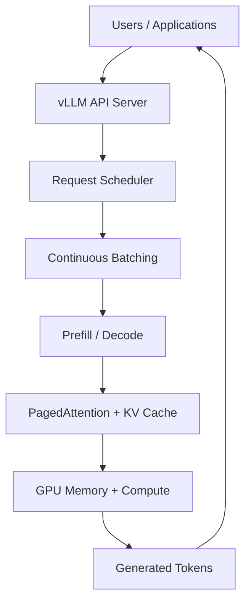
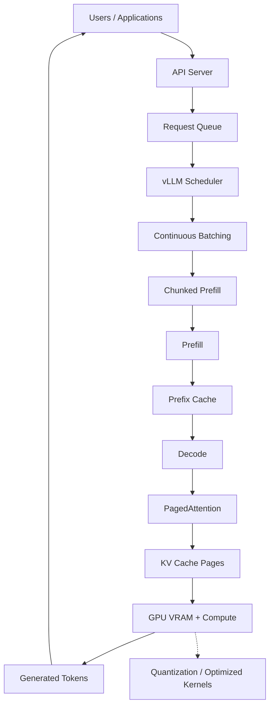
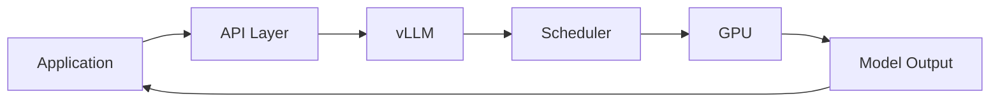
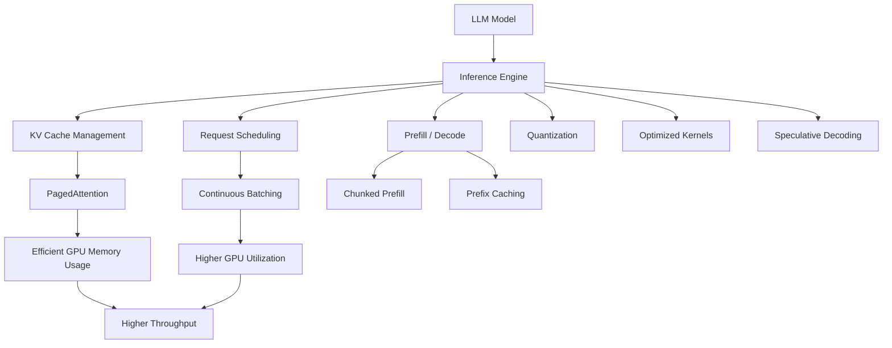

# Chapter 04 - vLLM Architecture Overview

## Overview

vLLM is a high-throughput LLM inference engine originally developed at UC Berkeley's Sky Computing Lab. It is designed to maximize GPU utilization by efficiently managing KV cache memory, request scheduling, batching, and token generation. This chapter provides an overview of the complete vLLM architecture and its major components.

---

## 1. What Is vLLM?

**vLLM** is an open-source LLM serving engine designed for efficiently serving open-weight models. Instead of directly running a model for every request independently, vLLM manages the entire inference process:



### Major Optimization Areas

vLLM incorporates multiple optimization techniques:

- **PagedAttention** — Virtual-memory paging for KV cache
- **Continuous Batching** — Dynamic request scheduling at token level
- **Chunked Prefill** — Large prompt processing in manageable chunks
- **Prefix Caching** — Reusing KV cache for shared prompt prefixes
- **Quantization** — Reduced precision for model weights
- **Optimized GPU Kernels** — FlashAttention, FlashInfer, Triton, CUTLASS
- **Speculative Decoding** — Draft-then-verify token generation
- **Disaggregated Prefill/Decode** — Separate nodes for each phase

---

## 2. Complete vLLM Architecture



---

## 3. Request Flow Through vLLM

A typical request flows through vLLM as follows:

```text
1. User sends request
       ↓
2. vLLM receives request
       ↓
3. Scheduler places request into execution
       ↓
4. Shared prefix may be retrieved from cache
       ↓
5. Prompt enters Prefill
       ↓
6. KV cache is created
       ↓
7. Decode starts
       ↓
8. PagedAttention manages KV blocks
       ↓
9. Continuous batching combines active requests
       ↓
10. More KV blocks are allocated as needed
        ↓
11. Tokens are generated
        ↓
12. Finished request releases its KV blocks
        ↓
13. GPU memory becomes available for other requests
```

---

## 4. Core Components

### 4.1 API Server

vLLM exposes an **OpenAI-compatible REST API** plus support for Anthropic Messages API and gRPC. This makes it easy for existing applications to communicate with a self-hosted model.



### 4.2 Request Scheduler

The scheduler manages incoming requests, decides which requests to execute next, and coordinates with the batching system.

### 4.3 Continuous Batching Engine

Dynamically adds and removes requests while generation is running, keeping GPU resources busy.

### 4.4 Prefill Engine

Processes input prompts with chunked prefill and prefix caching support.

### 4.5 Decode Engine

Generates tokens autoregressively using PagedAttention for KV cache management.

### 4.6 PagedAttention Manager

Manages KV cache using page-based memory allocation instead of requiring large contiguous memory regions.

---

## 5. Supported Model Architectures

vLLM seamlessly supports 200+ model architectures on Hugging Face:

### Decoder-only LLMs

```
Llama
Qwen
Gemma
```

### Mixture-of-Experts (MoE)

```
DeepSeek-V3
Mixtral
Qwen-MoE
GPT-OSS
```

### Multi-Modal Models

```
LLaVA
Qwen-VL
Pixtral
```

### Embedding and Retrieval Models

```
E5-Mistral
GTE
ColBERT
```

### Reward and Classification Models

```
Qwen-Math
```

---

## 6. API Compatibility

vLLM exposes serving through common application interfaces:

```text
OpenAI-compatible REST API
Anthropic Messages API
gRPC
```

---

## 7. Hardware Support

vLLM runs on diverse hardware:

| Category | Examples |
|----------|----------|
| **NVIDIA GPUs** | A100, H100, RTX 3090/4090, etc. |
| **AMD GPUs** | MI300X, MI250 |
| **Intel GPUs** | Arc, Gaudi |
| **CPUs** | x86, ARM, PowerPC |
| **Accelerators** | Google TPUs, Intel Gaudi, IBM Spyre, Huawei Ascend, Rebellions NPU, Apple Silicon, MetaX GPU |

---

## 8. Distributed Inference Support

vLLM supports multiple parallelism strategies:

| Parallelism Type | Description |
|------------------|-------------|
| **Tensor Parallelism** | Split tensors across GPUs |
| **Pipeline Parallelism** | Split layers across GPUs |
| **Data Parallelism** | Replicate model across GPUs |
| **Expert Parallelism** | Distribute MoE experts |
| **Context Parallelism** | Split long contexts across GPUs |

---

## 9. Key vLLM Features Summary

| Feature | Description |
|---------|-------------|
| **PagedAttention** | Virtual memory paging for KV cache |
| **Continuous Batching** | Dynamic request scheduling at token iteration level |
| **Chunked Prefill** | Break large prompts into chunks |
| **Prefix Caching** | Reuse KV cache for shared prompts |
| **Quantization** | FP8, INT8, INT4, AWQ, GPTQ, GGUF, NVFP4, TorchAO |
| **Optimized Kernels** | FlashAttention, FlashInfer, Triton, CUTLASS |
| **Speculative Decoding** | EAGLE, n-gram, DFlash, suffix |
| **CUDA/HIP Graphs** | Fast graph-level execution |
| **Multi-LoRA** | Efficient LoRA serving |
| **Structured Output** | xgrammar, guidance |

---

## 10. The Main Problems vLLM Solves

| Problem | vLLM Technique |
|---------|----------------|
| KV-cache fragmentation | **PagedAttention** |
| GPU idle time between batches | **Continuous Batching** |
| Large prompt blocking generation | **Chunked Prefill** |
| Repeated system prompts | **Prefix Caching** |
| Large model memory requirements | **Quantization** |
| Expensive GPU operations | **Optimized Kernels** |
| Slow autoregressive generation | **Speculative Decoding** |
| Many concurrent users | **Dynamic Scheduling + Efficient KV Management** |

---

## 11. Big Picture: From GPU to vLLM



---

## 12. Key Takeaways

### vLLM

A high-throughput inference engine for serving LLMs efficiently.

### Architecture Philosophy

Use GPU memory efficiently → keep the GPU busy → serve more requests → increase throughput and reduce latency.

### Core Innovations

- **PagedAttention** — eliminates KV cache fragmentation
- **Continuous Batching** — keeps GPU saturated
- **Chunked Prefill** — prevents large prompts from blocking
- **Prefix Caching** — avoids redundant prefill work

---

## 13. Study Questions

1. What are the main components of the vLLM architecture?
2. How does vLLM's request flow differ from a naive inference implementation?
3. What model architectures does vLLM support?
4. What APIs does vLLM expose for application integration?
5. What hardware platforms does vLLM run on?
6. What are the main problems vLLM solves and how?

---

## Pseudo Code: vLLM High-Level Structure

```typescript
// PSEUDO CODE — illustrates vLLM architecture, not runnable

class VLLMEngine {
  private apiServer: APIServer;
  private scheduler: Scheduler;
  private batcher: ContinuousBatcher;
  private prefillEngine: PrefillEngine;
  private decodeEngine: DecodeEngine;
  private pagedAttention: PagedAttentionManager;
  private kvCacheStore: KVCacheStore;
  private model: Model;
  private quantizer: Quantizer;

  constructor(config: VLLMConfig) {
    this.apiServer = new APIServer(config.api);
    this.scheduler = new Scheduler(config.scheduler);
    this.batcher = new ContinuousBatcher();
    this.prefillEngine = new PrefillEngine();
    this.decodeEngine = new DecodeEngine();
    this.pagedAttention = new PagedAttentionManager();
    this.kvCacheStore = new KVCacheStore();
    this.model = this.loadModel(config.model);
    this.quantizer = new Quantizer(config.quantization);
  }

  async serve(request: GenerateRequest): Promise<GenerateResponse> {
    // 1. Receive request via API
    const requestId = this.apiServer.receive(request);

    // 2. Queue request
    this.scheduler.enqueue(requestId);

    // 3. Scheduler manages execution
    while (this.scheduler.hasPending()) {
      // 4. Continuous batching - build batch
      const batch = this.batcher.buildBatch(this.scheduler.getReadyRequests());

      // 5. For each request in batch
      for (const req of batch.requests) {
        // Check prefix cache
        if (this.prefixCache.has(req.prefix)) {
          req.kvCache = this.prefixCache.get(req.prefix);
        } else {
          // 6. Prefill with chunked processing
          const prefillResult = this.prefillEngine.process(req.prompt, req.maxTokens);
          req.kvCache = prefillResult.kvCache;
        }

        // 7. Decode with PagedAttention
        while (!req.isComplete()) {
          const token = this.decodeEngine.generateNext(
            req.kvCache, this.model, this.pagedAttention
          );
          req.addToken(token);
          this.pagedAttention.allocateBlock(req.kvCache);
        }

        // 8. Release KV blocks on completion
        this.pagedAttention.release(req.kvCache);
      }

      // 9. Stream results
      this.streamResults(batch);
    }

    return this.apiServer.sendResponse(requestId);
  }
}
```