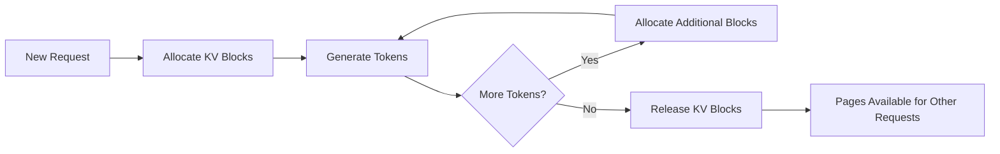
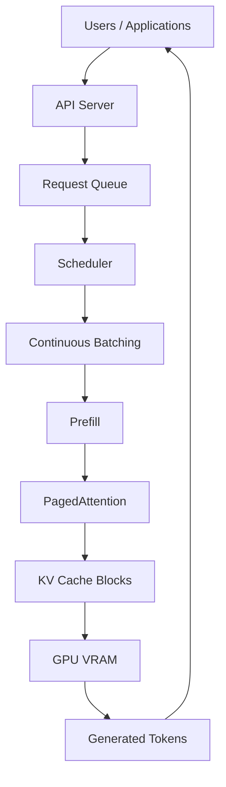

# Chapter 05 - PagedAttention: Virtual Memory for KV Cache

## Overview

PagedAttention is vLLM's key innovation that applies virtual memory paging to KV-cache management. Instead of requiring one large contiguous memory region for each request, it divides the KV cache into smaller blocks/pages, significantly improving memory utilization and enabling larger batch sizes.

---

## 1. Why Traditional KV Cache Allocation Fails

### Problem: Memory Fragmentation

A naive inference server may reserve a large contiguous memory region for each request based on the maximum expected sequence length.

```text
Request A
┌────────────────────────────────────────────┐
│ Used │ Used │ Used │       Unused          │
└────────────────────────────────────────────┘

Request B
┌────────────────────────────────────────────┐
│ Used │ Used │             Unused            │
└────────────────────────────────────────────┘
```

**Issues:**

1. **Actual sequence might be much shorter** than reserved capacity
2. **Memory fragmentation** occurs between requests
3. **Inefficient GPU-memory utilization**
4. **Wasted memory** due to fragmentation
5. **Smaller batch sizes** than hardware allows

---

## 2. PagedAttention: Virtual Memory for KV Cache

vLLM's **PagedAttention** applies the idea of virtual memory paging to KV-cache management.

### Logical KV Cache

```text
Logical KV Cache

┌─────────┬─────────┬─────────┐
│ Block 0 │ Block 1 │ Block 2 │
└────┬────┴────┬────┴────┬────┘
     │         │         │
     ▼         ▼         ▼

Physical GPU Memory

┌────────┐ ┌────────┐ ┌────────┐
│ Page 12│ │ Page 03│ │ Page 88│
└────────┘ └────────┘ └────────┘
```

**Key Insight:** The logical sequence doesn't need to occupy one contiguous region of physical GPU memory.

A mapping mechanism connects:

```text
Logical KV Blocks
       ↓
Physical GPU Pages
```

---

## 3. Dynamic KV-Cache Allocation

### Block-Level Allocation

Pages can be allocated as the sequence grows:



### Memory Mapping

For each request, maintain:

```typescript
// PSEUDO CODE — illustrates PagedAttention memory mapping
interface PagedAttentionManager {
  allocateKVPages(logicalBlocks: number): PhysicalPage[];
  deallocateKVPages(physicalPages: PhysicalPage[]);
  mapLogicalToPhysical(logicalBlock: number): PhysicalPage;
}

class KVCache {
  constructor(private pagedAttention: PagedAttentionManager) {}

  generateToken(inputToken: Token): Token {
    // Get physical pages for KV cache blocks
    const kvPages = [];
    for (let block = 0; block < this.currentBlockCount; block++) {
      kvPages.push(this.pagedAttention.mapLogicalToPhysical(block));
    }

    // Compute using mapped pages
    const output = this.transformer.computeWithPages(
      kvPages, inputToken, this.model
    );

    // Check if more blocks needed for longer sequence
    if (this.shouldExpandCache()) {
      this.pagedAttention.allocateKVPages(1);
    }

    return output;
  }

  release() {
    // Release all allocated pages back to pool
    const pages = this.getAllPhysicalPages();
    this.pagedAttention.deallocateKVPages(pages);
  }
}
```

---

## 4. Why PagedAttention Helps

### Before PagedAttention

```text
Request → Large Fixed Allocation
```

**Problems:**

- Cannot efficiently use small sequences
- Memory fragmentation reduces usable capacity
- Limited batch size for single GPU
- Poor memory utilization (~60-70% in typical cases)

### With PagedAttention

```text
Request
   │
   ├── Block 0 → Physical Page
   ├── Block 1 → Physical Page
   ├── Block 2 → Physical Page
   └── Block 3 → Physical Page
```

**Benefits:**

- **Reduced wasted memory** (below ~4% in cited setups)
- **More concurrent sequences** can fit in available memory
- **Efficient sharing** of memory between requests
- **Larger batch sizes** possible
- **Better fragmentation tolerance**

---

## 5. KV Cache Structure and Usage

### Key-Value Cache Components

During autoregressive generation, each token produces:

```text
Token Generation
     │
     ▼
┌──────────────┐
│   Query     │
│ (Q)          │
│              │
│   Key       │
│ (K)          │
│              │
│   Value     │
│ (V)          │
└──────────────┘
           │
           ▼
        Attention + Output
```

**During KV cache usage:**

```text
Prompt
  │
  ▼
Token 1 ──┐
Token 2 ──┤
Token 3 ──┤──> KV Cache
Token 4 ──┘
              │
              ▼
           Generate
              │
              ▼
            Token 5
              │
              ▼
       Update KV Cache
              │
              ▼
            Token 6
```

### KV Cache Growth

As requests become longer and more concurrent users increase, KV cache can consume significant GPU memory. This is why efficient KV-cache management is crucial.

```text
Sequence Length = 10 tokens

KV Cache Size = 10 * (Size of Q + K + V per token)
```

---

## 6. PagedAttention Implementation Details

### Page Size Configuration

Typical page sizes for KV cache:

```
Sequence Length 128 → Page Size 32 tokens
Sequence Length 256 → Page Size 64 tokens
Sequence Length 512 → Page Size 128 tokens
```

### Memory Allocation Strategy

| Strategy | Description |
|----------|-------------|
| **First-Fit** | Allocate first available page | 
| **Best-Fit** | Find smallest suitable allocation |
| **Buddy System** | Power-of-two allocation for efficiency |

### Block Size Considerations

```text
Small Block Size
  ───► Many pages, fine-grained allocation
      +
  High allocation overhead
      +
  Better fragmentation handling
      +
  More metadata management

Large Block Size
  ───► Fewer pages, coarse-grained allocation
      +
  Lower overhead
      +
  More internal fragmentation
      +
  Simpler metadata
```

---

## 7. Impact on Performance

### Memory Utilization Comparison

| Approach | Memory Utilization | Batch Size | Notes |
|----------|-------------------|------------|-------|
| Fixed Allocation | ~60-70% | Limited | Simple, inefficient |
| PagedAttention | >96% | Much higher | Complex, efficient |

### Throughput Gains

PagedAttention enables:

1. **Higher concurrency** - more requests per GPU
2. **Larger batches** - better GPU utilization
3. **Better resource sharing** - memory available for other workloads
4. **More robust performance** - less sensitive to sequence length variations

### Use Case Examples

| Scenario | Fixed Allocation | PagedAttention |
|----------|------------------|----------------|
| Short sequences + many users | Poor | Excellent |
| Long sequences + few users | OK | Very good |
| Mixed sequence lengths | Terrible | Excellent |

---

## 8. Integration with vLLM Architecture



### How PagedAttention Fits

1. **Prefill Phase** – Creates initial KV cache blocks
2. **Decode Phase** – Uses existing KV cache blocks, allocates new ones as needed
3. **Request Completion** – Releases allocated blocks back to pool
4. **Continuous Batching** – Blocks become available for new requests immediately

---

## 9. Key Takeaways

### PagedAttention

A virtual memory paging system for KV cache that eliminates memory fragmentation and dramatically improves GPU memory utilization.

### Core Innovation

- **Logical KV cache blocks** → **Physical GPU pages** mapping
- **Dynamic allocation** based on actual sequence length
- **Fine-grained control** over memory usage

### Benefits

- **Memory efficiency** – Reduces waste from ~40% to <4%
- **Higher throughput** – More requests per GPU
- **Better utilization** – Keeps GPU busy with diverse workloads
- **Scalability** – Enables larger batch sizes

### Implementation Notes

- Page size must balance metadata overhead vs internal fragmentation
- Allocation strategy affects performance and complexity
- Integration with other vLLM optimizations (chunked prefill, prefix caching)

---

## 10. Study Questions

1. What is the problem with traditional KV cache allocation?
2. How does PagedAttention solve this problem?
3. How does PagedAttention work conceptually?
4. What is the mapping mechanism between logical blocks and physical pages?
5. How does KV cache grow during token generation?
6. What page size configuration works best?
7. How does PagedAttention improve GPU memory utilization?
8. How does PagedAttention integrate with vLLM architecture?

---

## Pseudo Code: PagedAttention Memory Management

```typescript
// PSEUDO CODE — illustrates PagedAttention memory management, not runnable

class PagedAttentionManager {
  private freePages: PhysicalPage[];
  private blockSize: number;
  private pageSize: number;

  constructor(config: PagedAttentionConfig) {
    this.blockSize = config.blockSize;     // tokens per block
    this.pageSize = config.pageSize;       // tokens per page
    this.freePages = this.initializeFreePages(config.totalPages);
  }

  allocateKVBlocks(logicalBlocksNeeded: number): PhysicalPage[] {
    const pages = [];
    const blocksNeeded = Math.ceil(logicalBlocksNeeded / this.blockSize);

    for (let i = 0; i < blocksNeeded && this.freePages.length > 0; i++) {
      // Allocate page from free pool
      const page = this.freePages.pop();
      pages.push(page);
      
      // Create mapping from logical block to physical page
      const logicalBlock = i * this.blockSize;
      this.mapping.set(logicalBlock, page);
    }

    return pages;
  }

  deallocateKVBlocks(pages: PhysicalPage[]) {
    // Return pages to free pool
    this.freePages.push(...pages);

    // Clean up mappings
    for (const [logicalBlock, page] of this.mapping.entries()) {
      if (pages.includes(page)) {
        this.mapping.delete(logicalBlock);
      }
    }
  }

  getPhysicalPage(logicalBlock: number): PhysicalPage | null {
    return this.mapping.get(logicalBlock) || null;
  }

  getAvailableMemory(logicalBlocks: number): number {
    // Calculate actual GPU memory needed for given logical blocks
    const pagesNeeded = Math.ceil(logicalBlocks / this.blockSize);
    return pagesNeeded * this.pageSize;
  }
}
```