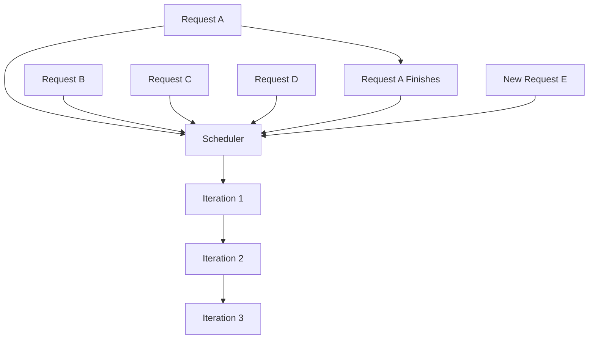
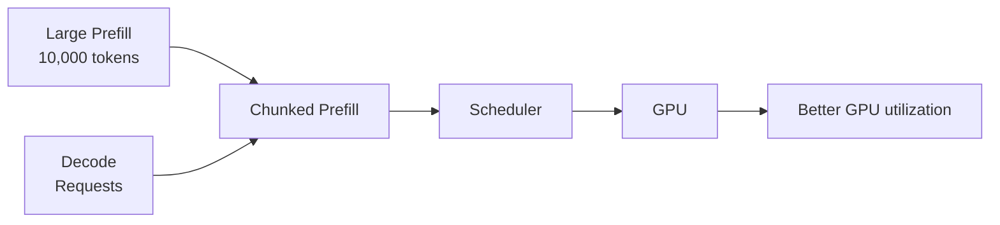
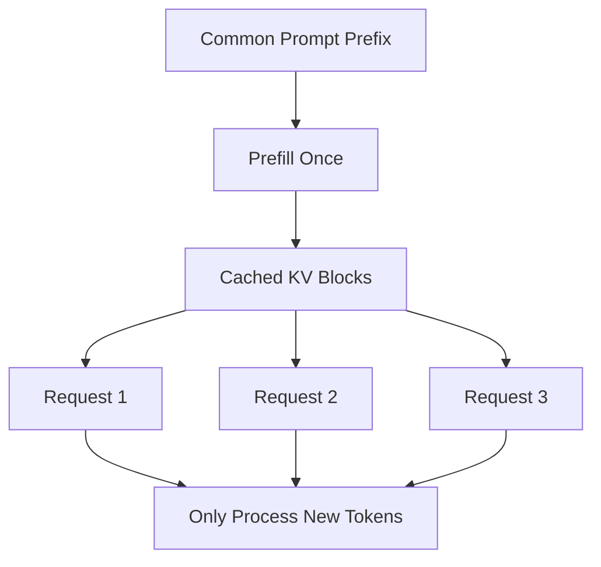
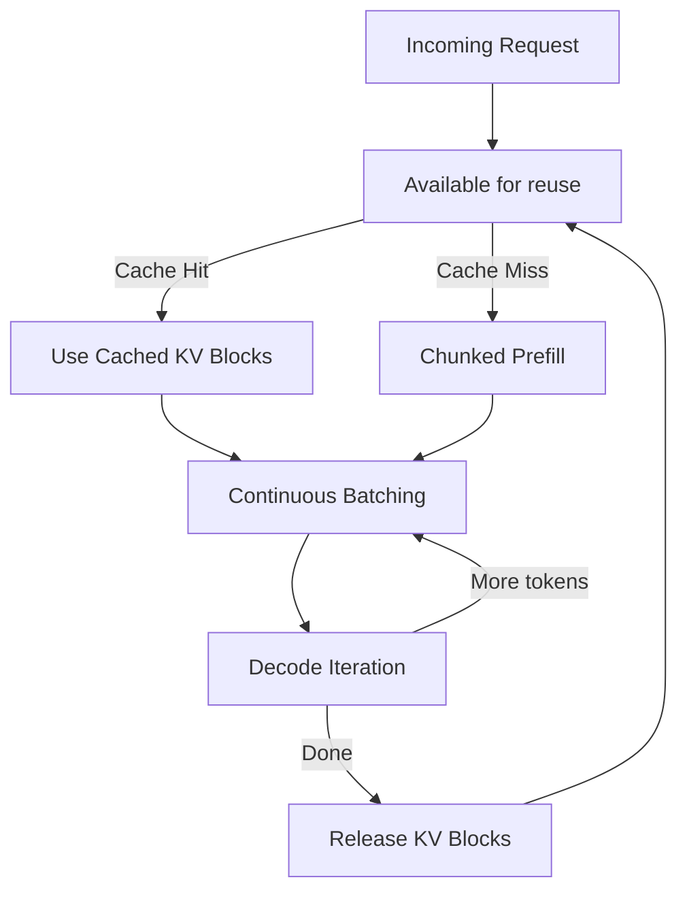

# Chapter 06 - Continuous Batching, Chunked Prefill, and Prefix Caching

## Overview

This chapter covers three critical optimization techniques in vLLM that work together to maximize GPU utilization and throughput: **Continuous Batching** (dynamic scheduling at the token-iteration level), **Chunked Prefill** (breaking large prompts into manageable chunks), and **Prefix Caching** (reusing KV cache for identical prompt prefixes).

---

## 1. Continuous Batching

### Problem: Traditional Batching Is Inefficient

Traditional batching works like this:

```text
Batch 1
  ├── Request A
  ├── Request B
  └── Request C

Wait until all finish
         ↓
Batch 2
```

**The problem:** Requests can have very different generation lengths.

If Request A finishes early:

```text
A → Finished
B → Still generating
C → Still generating
```

GPU capacity associated with A may not be used efficiently.

---

### Continuous Batching Solution

vLLM dynamically schedules requests at the **token-iteration level**:



When one request finishes, another request can enter the running batch immediately. This keeps GPU resources busy.

---

### How It Works

```text
Continuous Batching Algorithm

1. Initialize empty batch
2. While requests pending or running:
     a. Add ready requests to current batch
     b. Execute one decode iteration for all in batch
     c. Remove finished requests
     d. Add newly arrived requests
     e. Repeat
```

### Benefits

| Benefit | Description |
|---------|-------------|
| **GPU utilization** | Keeps compute units busy |
| **Throughput** | More tokens per second per GPU |
| **Latency** | Reduces queue wait time |
| **Fairness** | Short requests don't wait behind long ones |
| **Resource efficiency** | Memory freed immediately on completion |

---

### Implementation Details

```typescript
// PSEUDO CODE — illustrates continuous batching logic

class ContinuousBatcher {
  private runningBatch: Request[] = [];
  private pendingQueue: Request[] = [];

  step() {
    // 1. Add new requests from queue
    this.fillBatch();

    // 2. Run one decode iteration for all running requests
    const results = this.executeDecodeIteration(this.runningBatch);

    // 3. Handle completed requests
    this.runningBatch = this.runningBatch.filter((req, idx) => {
      if (results[idx].isComplete) {
        // Release KV cache, notify client
        this.kvCache.release(req.kvCache);
        req.complete(results[idx].output);
        return false; // Remove from batch
      }
      return true; // Keep in batch
    });

    // 4. Loop continues
  }

  fillBatch() {
    while (this.runningBatch.length < this.maxBatchSize && 
           this.pendingQueue.length > 0) {
      this.runningBatch.push(this.pendingQueue.shift()!);
    }
  }
}
```

---

## 2. Chunked Prefill

### Problem: Large Prompts Block Everything

Prefill can involve a very large prompt:

```text
Large Prompt
─────────────────────────────────────────────
1 2 3 4 5 6 7 8 9 10 ... 10000 tokens
─────────────────────────────────────────────
```

If the entire prompt is processed at once:
- Consumes substantial compute and scheduling resources
- Blocks other decode requests
- Creates head-of-line blocking

---

### Chunked Prefill Solution

With **chunked prefill**, the prompt is divided into smaller pieces:

```text
Large Prompt

┌──────────┐
│ Chunk 1  │
└──────────┘
     ↓
┌──────────┐
│ Chunk 2  │
└──────────┘
     ↓
┌──────────┐
│ Chunk 3  │
└──────────┘
     ↓
    ...
```

This allows the scheduler to interleave prompt processing with token generation from other requests.

---

### How It Works



**Conceptually:**

```text
Large Prefill
      +
Decode Requests
      ↓
Scheduler
      ↓
Better GPU utilization
```

### Benefits

| Benefit | Description |
|---------|-------------|
| **Fair scheduling** | Decode requests get GPU time during prefill |
| **Reduced latency** | Other requests don't wait for full prefill |
| **Better utilization** | GPU always has work to do |
| **Scalability** | Handles arbitrarily long prompts |

---

### Implementation Details

```typescript
// PSEUDO CODE — illustrates chunked prefill logic

class ChunkedPrefillEngine {
  private chunkSize: number;

  processPrompt(prompt: string, requestId: string): PrefillResult {
    const tokens = this.tokenizer.tokenize(prompt);
    const chunks = this.chunkTokens(tokens, this.chunkSize);
    const kvCache = new KVCache();

    for (const chunk of chunks) {
      // Process each chunk
      const chunkResult = this.prefillChunk(chunk, kvCache);
      
      // Yield to scheduler between chunks
      // Other requests can run decode iterations
      this.yieldToScheduler();
    }

    return { kvCache, firstToken: kvCache.getFirstToken() };
  }

  private chunkTokens(tokens: Token[], size: number): Token[][] {
    const chunks: Token[][] = [];
    for (let i = 0; i < tokens.length; i += size) {
      chunks.push(tokens.slice(i, i + size));
    }
    return chunks;
  }
}
```

---

## 3. Prefix Caching

### Problem: Repeated System Prompts

Many LLM applications repeatedly use the same beginning of a prompt:

```text
System Prompt
     +
Agent Instructions
     +
Tools
     +
User Query
```

Without caching:

```text
Request 1 → Prefill System Prompt
Request 2 → Prefill System Prompt
Request 3 → Prefill System Prompt
Request 4 → Prefill System Prompt
```

**Wasted work:** The same system prompt is processed over and over.

---

### Prefix Caching Solution

With prefix caching:



The already-computed KV blocks can be reused when the prompt prefix matches.

---

### How It Works

1. **Detect shared prefix** - Compare incoming prompt with cached prefixes
2. **Retrieve cached KV blocks** - Get pre-computed attention states
3. **Process only new tokens** - Skip redundant computation
4. **Extend KV cache** - Add new tokens to cached prefix

```text
System Prompt (cached)
     ↓
   KV Blocks (cached)
     ↓
User Query (unique)
     ↓
   Only process User Query tokens
     ↓
   Extend KV cache with new tokens
```

### Benefits

| Benefit | Description |
|---------|-------------|
| **Reduced prefill latency** | Skip redundant computation |
| **Lower compute cost** | Fewer FLOPs for shared prefixes |
| **Higher throughput** | More requests per second |
| **Better latency** | Faster time-to-first-token |

---

### Implementation Details

```typescript
// PSEUDO CODE — illustrates prefix caching logic

class PrefixCache {
  private cache: Map<string, CachedPrefix> = new Map();
  private maxEntries: number;

  constructor(maxEntries: number) {
    this.maxEntries = maxEntries;
  }

  tryGetPrefix(prompt: string): KVCache | null {
    const prefix = this.findLongestMatchingPrefix(prompt);
    if (prefix) {
      return prefix.kvCache.clone(); // Return copy for isolation
    }
    return null;
  }

  storePrefix(prompt: string, kvCache: KVCache) {
    const prefix = this.extractPrefix(prompt);
    this.cache.set(prefix, { prompt: prefix, kvCache });

    // Eviction if needed
    if (this.cache.size > this.maxEntries) {
      this.evictOldest();
    }
  }

  private findLongestMatchingPrefix(prompt: string): CachedPrefix | null {
    let bestMatch: CachedPrefix | null = null;
    
    for (const [key, value] of this.cache.entries()) {
      if (prompt.startsWith(key) && 
          (!bestMatch || key.length > bestMatch.prompt.length)) {
        bestMatch = value;
      }
    }
    
    return bestMatch;
  }
}
```

---

## 4. How They Work Together



### Combined Request Flow

```text
1. Request arrives
       ↓
2. Check prefix cache
       ├─ Hit: Use cached KV blocks, only process unique suffix
       └─ Miss: Chunked prefill the full prompt
       ↓
3. Add to continuous batch
       ↓
4. Decode iterations (interleaved with other requests)
       ↓
5. New requests join batch as slots free up
       ↓
6. On completion: release KV blocks, update prefix cache
```

---

## 5. Key Takeaways

### Continuous Batching

- Dynamic scheduling at token-iteration level
- Requests enter/exit batch as they complete/arrive
- Keeps GPU saturated, improves throughput

### Chunked Prefill

- Breaks large prompts into chunks
- Interleaves with decode work
- Prevents head-of-line blocking

### Prefix Caching

- Reuses KV cache for shared prompt prefixes
- Skips redundant prefill computation
- Dramatically reduces latency for common prefixes

### Synergy

Together they form a complete serving optimization:

- **Continuous Batching** keeps GPU busy
- **Chunked Prefill** prevents large prompts from blocking
- **Prefix Caching** eliminates redundant work
- **PagedAttention** enables all of the above with efficient memory

---

## 6. Study Questions

1. How does continuous batching differ from traditional batching?
2. What problem does chunked prefill solve?
3. How does prefix caching reduce redundant computation?
4. How do these three techniques work together in vLLM?
5. What would happen if you only had one of these optimizations?

---

## Pseudo Code: Integrated Scheduler

```typescript
// PSEUDO CODE — illustrates integrated vLLM scheduler

class VLLMScheduler {
  private continuousBatcher: ContinuousBatcher;
  private chunkedPrefill: ChunkedPrefillEngine;
  private prefixCache: PrefixCache;
  private pagedAttention: PagedAttentionManager;

  schedule(request: Request) {
    // 1. Try prefix cache
    const cachedKV = this.prefixCache.tryGetPrefix(request.prompt);
    
    if (cachedKV) {
      // Prefix hit - only process unique suffix
      const suffix = this.extractSuffix(request.prompt, cachedKV);
      const result = this.chunkedPrefill.processSuffix(suffix, cachedKV);
      request.kvCache = result.kvCache;
    } else {
      // Full chunked prefill
      const result = this.chunkedPrefill.processPrompt(request.prompt, request.id);
      request.kvCache = result.kvCache;
      
      // Cache prefix for future requests
      this.prefixCache.storePrefix(request.prompt, result.kvCache);
    }

    // 2. Add to continuous batch
    this.continuousBatcher.add(request);
  }

  runLoop() {
    while (this.hasWork()) {
      // Run one decode iteration for all in batch
      this.continuousBatcher.step();
      
      // Yield for other work
      this.yield();
    }
  }
}
```