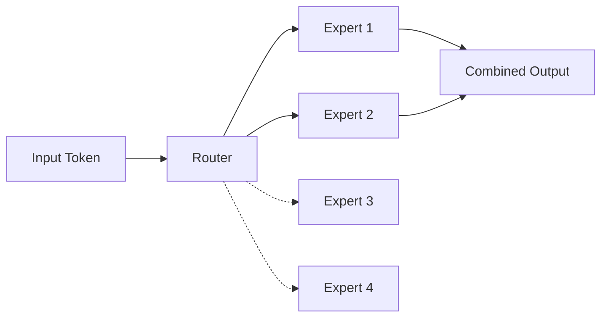
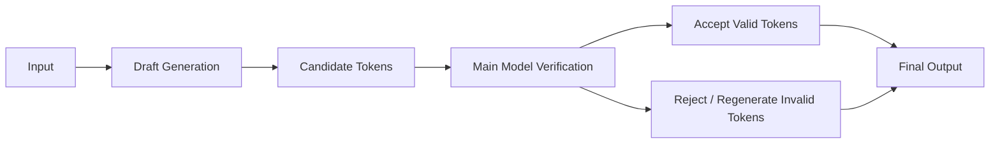

# Chapter 07 - Quantization, Optimized Kernels, Mixture-of-Experts, and Speculative Decoding

## Overview

This chapter covers four advanced optimization techniques that vLLM supports to reduce memory requirements, improve GPU execution efficiency, and accelerate autoregressive generation: **Quantization**, **Optimized GPU Kernels**, **Mixture-of-Experts (MoE) Support**, and **Speculative Decoding**. These techniques directly address the memory-bandwidth bottleneck and compute challenges in LLM inference.

---

## 1. Quantization

### Problem: Large Model Memory Requirements

Model weights normally use numerical formats such as FP16 (16-bit floating point) or BF16 (bfloat16). For large models, this can require substantial GPU memory:

- Llama 3 8B: ~16 GB (FP16)
- Llama 3 70B: ~112 GB (FP16)
- A single A100 (80 GB) cannot even fit Llama 3 70B

### Quantization Solution

Quantization represents weights using lower-precision formats, reducing memory requirements:

```text
Higher Precision       │
       │                 ▼
       │          More Memory
       │                 │
       ▼                 ▼
Lower Precision        │
       │                 Less Memory
```

### Supported Quantization Formats

| Format | Precision | Memory Reduction | Quality Impact |
|--------|-----------|------------------|----------------|
| **FP8** | 8-bit float | 50% vs FP16 | Minimal |
| **INT8** | 8-bit int | 50% vs FP16 | Minimal |
| **INT4** | 4-bit int | 75% vs FP16 | Moderate |
| **AWQ** | Weight-only quantization | 50-75% | Minimal |
| **GPTQ** | Weight-only quantization | 50-75% | Minimal |
| **GGUF** | 4-bit/5-bit file format | 70-80% | Configurable |
| **NVFP4** | NVIDIA FP4 format | 75% vs FP16 | Minimal |
| **TorchAO** | PyTorch optimization | Variable | Minimal |

### Conceptual Understanding

```text
Higher Precision
       │
       ▼
More Memory
       │
       ▼
Lower Precision
       │
       ▼
Less Memory
```

**Trade-off:** Lower precision reduces memory but may slightly reduce model quality. Modern quantization techniques (AWQ, GPTQ, FP8) minimize this impact.

### Benefits

| Benefit | Description |
|---------|-------------|
| **Memory savings** | 50-80% reduction in model memory |
| **Faster loading** | Less data to transfer from disk/VRAM |
| **Better throughput** | More models fit on same GPU |
| **Preserved quality** | Modern techniques minimize accuracy loss |

### Quantization in vLLM

```typescript
// PSEUDO CODE — quantizes model weights

class Quantizer {
  quantizeWeights(weights: Tensor, format: QuantFormat): Tensor {
    switch (format) {
      case QuantFormat.INT8:
        return this.quantizeToInt8(weights);
      case QuantFormat.INT4:
        return this.quantizeToInt4(weights);
      case QuantFormat.FP8:
        return this.quantizeToFP8(weights);
      case QuantFormat.AWQ:
        return this.applyAWQ(weights);
      case QuantFormat.GPTQ:
        return this.applyGPTQ(weights);
      default:
        return weights; // Keep original
    }
  }

  // PSEUDO CODE: INT8 quantization
  private quantizeToInt8(weights: Tensor): Tensor {
    // Scale and clip to 8-bit range
    const scale = this.computeScale(weights);
    const clamped = weights.clamp(-127, 127);
    const int8 = Math.round(clamped / scale);
    return int8; // Store with scale factor
  }
}
```

---

## 2. Optimized GPU Kernels

### Problem: Transformer Operations Are Expensive

Transformer inference involves many operations that can benefit from GPU optimization:

- **Attention mechanisms** (softmax, QK^T, weighted sum)
- **GEMM** (General Matrix Multiply - matrix multiplication)
- **Feed-forward networks** (two-layer MLP)
- **Element-wise operations** (activation, normalization)

### Optimized Kernels in vLLM

| Kernel | Purpose | Performance Gain |
|--------|---------|------------------|
| **FlashAttention** | Tiled attention with I/O reduction | 2-3x faster |
| **FlashInfer** | FlashAttention-inspired, multi-GPU | 3-5x faster |
| **Triton** | DSL for custom GPU kernels | Highly optimized |
| **CUTLASS** | NVIDIA GPU linear algebra | 2-4x faster |
| **FlashMLA** | MLA (Multi-Head Latent Attention) | Significant for MoE |
| **TRTLLM-GEN** | TensorRT for LLM generation | Up to 10x |

### Why Optimized Kernels Matter

The GPU's raw compute units are insufficient — we need kernels that:

- **Reduce memory I/O** (FlashAttention tiled approach)
- **Exploit GPU architecture** (Tensor cores, warps)
- **Minimize synchronization** (avoid unnecessary barriers)
- **Use appropriate data types** (FP16/BF16/FP8 for tensor cores)

### Example: FlashAttention Pattern

```text
Traditional Attention
       ↓
Load Q, K, V from HBM → SRAM → Compute → Write to HBM
       ↓
Multiple passes → High I/O → Slow

FlashAttention
       ↓
Load Q, K, V once → Tiled computation → Accumulate → Write once
       ↓
Single pass → Low I/O → Fast
```

---

## 3. Mixture-of-Experts (MoE) Support

### Problem: Activate All Experts Wastes Compute

MoE models (like DeepSeek-V3, Mixtral) have multiple "experts" (sub-networks), but only a few should be active per token:

- 16-64 experts per layer
- Each expert is a feed-forward network
- Routing: decide which expert(s) handle each token

### Naive Approach: Activate All Experts

If every token activates all experts:

```text
Tokens → All Experts → Full Compute → Wasted resources
```

### MoE Routing Solution

Instead of activating every expert, vLLM routes each token to selected experts:



### How Routing Works

1. **Router network** decides which expert(s) for each token
2. **Top-k routing** - Select top-k experts (typically k=1 or k=2)
3. **Sparse computation** - Only compute selected experts

```typescript
// PSEUDO CODE — MoE routing

class MoEBlock {
  constructor(experts: Tensor[], router: NeuralNetwork) {
    this.experts = experts;
    this.router = router;
  }

  forward(token: Token): Tensor {
    // 1. Router decides which experts
    const routingScores = this.router(token);
    const topK = this.getTopKExperts(routingScores, k=2);
    
    // 2. Initialize output
    const output = zerosLike(token);
    
    // 3. Compute only selected experts
    for (const [expertIdx, tokenIdx] of topK) {
      const expertOutput = this.experts[expertIdx](token);
      output.add(expertOutput, routingScores[tokenIdx]);
    }
    
    return output;
  }
}
```

### Supported MoE Models

| Model | Experts | Architecture |
|-------|---------|--------------|
| **DeepSeek-V3** | 128 experts | 2 activated per token |
| **Mixtral** | 8 experts | 2 activated per token |
| **Qwen-MoE** | Variable | Top-2 routing |
| **GPT-OSS** | Custom | Sparse expert |

### Benefits

| Benefit | Description |
|---------|-------------|
| **Fewer FLOPs** | Only compute selected experts |
| **Memory efficient** | Sparse expert activation |
| **Scalable** | Add more experts without linear compute cost |
| **Higher capacity** | Larger effective model size |

### MoE in vLLM

vLLM supports MoE with:

- Efficient routing kernels
- Expert parallelism (distribute experts across GPUs)
- Dynamic expert loading
- Optimized kernels (FlashMLA, CUTLASS)

---

## 4. Speculative Decoding

### Problem: Slow Autoregressive Generation

Autoregressive generation produces one token at a time, which is inherently sequential and slow:

```text
T5 → T6 → T7 → T8 → T9 → ...
     ↓    ↓    ↓    ↓    ↓
Slow   Slow Slow Slow Slow
```

### Speculative Decoding Solution

Use a **faster model** to propose multiple tokens, then have the **main model verify** them:



### How It Works

1. **Draft model** (smaller, faster) proposes N tokens
2. **Main model** (larger, accurate) verifies each candidate
3. **Accept** tokens that pass verification
4. **Reject/regen** tokens that don't
5. **Output** only accepted tokens

```text
Original (slow):
  T5 → T6 → T7 → T8 → T9 → T10 → T11

Speculative (fast):
  Draft:  T5 → T6 → T7 ✓ (all accepted)
  Main:   Verify T5, T6, T7 → Output all 3
  Result: Generate 3 tokens in time of 1
```

### Benefits

| Benefit | Description |
|---------|-------------|
| **Throughput gain** | 2x-3x more tokens/sec |
| **Latency reduction** | Faster responses per request |
| **Quality preserved** | Main model retains full capability |
| **Flexible** | Can use any draft model |

### Common Draft Model Approaches

| Approach | Description |
|----------|-------------|
| **EAGLE** | Learns to generate good candidates |
| **n-gram** | Statistical next-token prediction |
| **DFlash** | FlashAttention-based draft |
| **Suffix caching** | Reuse previous predictions |
| **Distilled model** | Small version of main model |

### vLLM Speculative Decoding

vLLM integrates speculative decoding with:

```typescript
// PSEUDO CODE — vLLM speculative decoding

class SpeculativeDecoder {
  constructor(draftModel: Model, mainModel: Model, draftSize: number) {
    this.draftModel = draftModel;
    this.mainModel = mainModel;
    this.draftSize = draftSize;
  }

  async decodeStep(currentToken: Token): Promise<TokenBatch> {
    // 1. Draft model proposes candidates
    const candidates = await this.draftModel.generate(
      currentToken,
      this.draftSize
    );

    // 2. Main model verifies candidates
    const verified = await this.mainModel.verify(
      candidates,
      currentToken
    );

    // 3. Return accepted tokens
    return verified.acceptedTokens;
  }
}
```

### Acceptance Rate

The speedup depends on the **acceptance rate** (percentage of drafted tokens accepted):

| Acceptance Rate | Speedup (vs standard) |
|----------------|----------------------|
| 25% | 1.33x |
| 50% | 2.0x |
| 75% | 3.0x |
| 100% | 4.0x (theoretical) |

Typical acceptance rates: 40-70% with good draft models.

---

## 5. Key Takeaways

### Quantization

- Reduces model memory 50-80% using lower precision
- Modern formats (FP8, AWQ, GPTQ) minimize quality loss
- Enables fitting larger models on same GPU

### Optimized GPU Kernels

- FlashAttention: 2-3x faster attention
- FlashInfer: Multi-GPU attention
- Triton/CUTLASS: Optimized GEMM
- Critical for maximizing GPU utilization

### Mixture-of-Experts

- Route tokens to selected experts only
- 2x-4x FLOPs reduction vs. full activation
- Enables larger effective model sizes

### Speculative Decoding

- Draft model proposes, main model verifies
- 2x-3x throughput improvement typical
- Preserves main model quality

### Combined Impact

Together these techniques address all aspects of the inference bottleneck:

```text
Memory → Quantization (50-80% less)
Compute → Optimized Kernels (2-5x faster) 
Sparse → MoE (only compute selected experts)
Speed → Speculative Decoding (2-3x more tokens)
```

---

## 6. Study Questions

1. What are the main quantization formats supported by vLLM?
2. How does quantization reduce memory requirements?
3. What is the difference between FP8, INT8, and INT4 quantization?
4. How do optimized GPU kernels improve inference speed?
5. What is the role of the router in MoE models?
6. How does speculative decoding achieve speedup?
7. What is a typical acceptance rate for speculative decoding?
8. Which combination of techniques gives the best overall improvement?

---

## 7. Pseudo Code: Quantization and MoE Implementation

```typescript
// PSEUDO CODE — demonstrates quantization and MoE, not runnable

class OptimizedInferenceEngine {
  private quantizer: Quantizer;
  private kernelRegistry: KernelRegistry;
  private moeRouter: MoERouter;

  async generate(token: Token, model: QuantizedModel): Promise<Token> {
    // 1. Quantize/load weights if needed
    const weights = this.quantizer.dequantifyOnFly(model);

    // 2. Choose optimized kernel
    const attention = this.kernelRegistry.get('attention');
    const mlp = this.kernelRegistry.get('mlp');

    // 3. If MoE, route to selected experts
    const isMoE = model.hasMoE();
    let mlpOutput;
    
    if (isMoE) {
      mlpOutput = this.moeRouter.routeAndCompute(token, model.moeExperts);
    } else {
      mlpOutput = mlp.forward(token, model.mlpWeights);
    }

    // 4. Compute attention with optimized kernel
    const attnOutput = attention.forward(
      token, model.qkvWeights, model.attnMask
    );

    // 5. Combine and produce next token
    const combined = this.add(attnOutput, mlpOutput);
    const nextToken = this.sample(combined);

    return nextToken;
  }
}
```