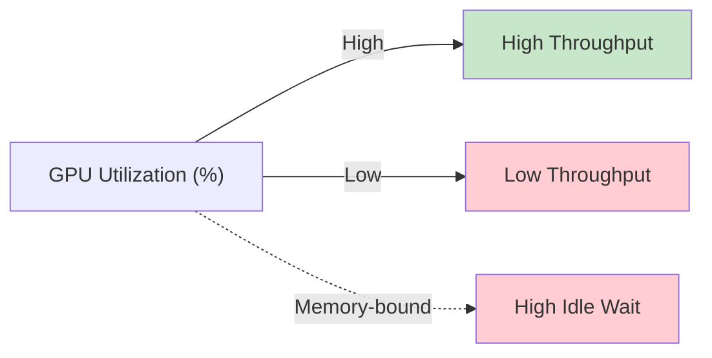
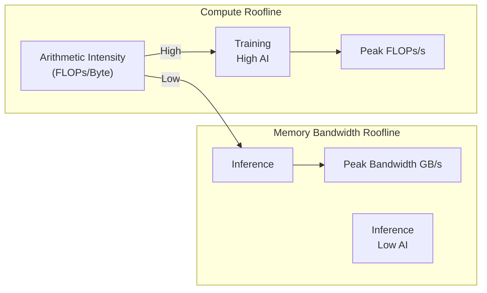

# Chapter 08 - Serving Economics, Self-Hosting vs Managed APIs, and the Roofline Model

## Overview

This final chapter covers the economic and practical considerations of LLM serving: cost models ($/1M tokens), GPU utilization metrics, the decision framework for self-hosting vs. managed APIs, and how the roofline model helps understand when you're compute-bound vs. bandwidth-bound in production. These insights help architects make informed decisions about LLM deployment strategies.

---

## 1. Serving Economics: Cost Metrics

### Cost Per Million Tokens

The primary economic metric for LLM serving is **cost per 1M tokens**, which varies dramatically based on deployment strategy:

| Deployment Type | Cost per 1M Input Tokens | Cost per 1M Output Tokens | Typical GPU | Notes |
|-----------------|-------------------------|--------------------------|-----------|-------|
| **OpenAI GPT-4o** | $2.50–$10.00 | $10.00–$30.00 | Managed | Includes infrastructure, no hardware cost |
| **OpenAI GPT-3.5 Turbo** | $0.50–$1.50 | $1.50–$2.00 | Managed | Cheapest, lower capability |
| **vLLM Self-Hosted** (A100) | $0.10–$0.50 | $0.20–$1.00 | On-premise | Hardware amortized over time |
| **vLLM Self-Hosted** (H100) | $0.30–$1.50 | $0.50–$2.50 | On-premise | Better performance, higher hardware cost |
| **Ollama/Llama.cpp** | $0.01–$0.05 | $0.02–$0.15 | Consumer GPU | Lowest cost, slower throughput |

### Cost Components

For self-hosted serving, total cost includes:

```text
Total Cost = Hardware Cost + Electricity + Cooling + 
             Maintenance + Software Licenses + 
             amortization over useful life
```

### Amortization Example

```
GPU: NVIDIA H100 ($40,000)
Expected lifespan: 4 years
Daily serving cost (amortized): $40,000 / (365 * 4) ≈ $27.40/day

Per-token cost depends on throughput:
  At 1,000 tokens/sec: $27.40 / 86,400,000 ≈ $0.00032 per 1K tokens
  At 5,000 tokens/sec: $27.40 / 432,000,000 ≈ $0.00006 per 1K tokens
```

### Throughput-Driven Cost Reduction

Higher throughput directly reduces cost per token:

```text
Fixed GPU cost per hour → More tokens/sec → Lower $/token

Example: A100 at 2,000 tokens/sec vs 4,000 tokens/sec
  - 2K tokens/sec: $X per 1M tokens
  - 4K tokens/sec: $X/2 per 1M tokens (50% cost reduction)
```

---

## 2. GPU Utilization Metrics

### Key Performance Indicators

| Metric | Target | Good | Poor | Measurement |
|--------|--------|------|------|-------------|
| **GPU Utilization** | 70-80% | 80%+ | <50% | nvidia-smi `utilization.gpu` |
| **Memory Utilization** | 70-85% | 85%+ | <60% | nvidia-smi `memory.utilization` |
| **Throughput** | Model-specific | Above baseline | Below | tokens/sec per GPU |
| **Time-to-First-Token (TFT)** | <500ms | <200ms | >1s | End-to-end latency |
| **Inter-token Latency** | <20ms | <10ms | >50ms | Per-token after first |

### Utilization vs. Throughput



### Balancing Act

- **Too low utilization** → Wasted GPU capacity, higher $/token
- **Too high utilization** → No headroom for burst traffic, increased latency
- **Target 70-80%** → Good balance of throughput and latency

---

## 3. Roofline Model for Inference

### Understanding the Roofline

The **roofline model** visualizes where a workload sits relative to hardware limits:



### Arithmetic Intensity (AI)

```text
AI = FLOPs / Bytes Accessed
```

- **High AI** → Many FLOPs per byte → Compute-bound (training)
- **Low AI** → Few FLOPs per byte → Memory-bandwidth bound (inference)

### Inference Position on Roofline

```text
Peak Memory Bandwidth (GB/s)
       │
       │  Inference workload sits HERE
       │  (low AI, near memory roof)
       │
       │
       │  Training workload sits HERE
       │  (high AI, near compute roof)
       │
       └──────────────────────→ Arithmetic Intensity (FLOPs/Byte)
```

### Why Inference Is Memory-Bound

As we learned in Chapter 2, inference has low arithmetic intensity because:

- **Few FLOPs per token** (only one forward pass)
- **Many bytes accessed per token** (weights + KV cache)
- **Repeated memory access** for every generated token

This is why optimizing memory access (PagedAttention, quantization) matters more than raw compute speed.

---

## 4. Self-Hosting vs. Managed APIs Decision Framework

### When to Choose Self-Hosted (vLLM)

| Factor | Self-Hosted Preference |
|--------|----------------------|
| **Cost per token** | $0.10/1M tokens or less desired |
| **Data privacy** | Sensitive data, cannot send to third party |
| **Custom models** | Own open-weight models required |
| **Customization** | Need to modify serving, kernels, quantization |
| **Long-term ownership** | Own infrastructure, no vendor lock-in |
| **Traffic patterns** | Predictable, consistent load |
| **Compliance** | Regulatory requirements for data residency |

### When to Choose Managed API (OpenAI, Anthropic, etc.)

| Factor | Managed API Preference |
|--------|----------------------|
| **Development speed** | Get running in minutes, not days |
| **Reliability/SLAs** | Enterprise-grade uptime guarantees |
| **Scaling** | Auto-scale to any traffic level |
| **Feature velocity** | Access to latest model updates instantly |
| **Capital expenditure** | Avoid large GPU hardware purchases |
| **Model capabilities** | Need cutting-edge proprietary models |
| **Small scale** | Low traffic, wouldn't justify GPU purchase |
| **Team size** | Small team, limited DevOps resources |

### Decision Matrix

```text
                    Self-Hosted      Managed API
Cost per token       ✅               ❌
Data privacy         ✅               ❌
Model customization  ✅               ❌
Time to production   ❌               ✅
Scalability          ✅ (with work)    ✅ (auto)
Latest model access  ❌               ✅
Vendor lock-in       ✅ (own infra)    ❌ (provider)
```

### Hybrid Approach

Many organizations use **both**:

- **Prototype / Early stage**: Managed API
- **Production / Scale**: Self-hosted vLLM
- **Specialized use cases**: Mix based on requirements

Example strategy:

```text
Small requests / experimentation → OpenAI API
High-volume / sensitive data → Self-hosted vLLM
Model fine-tuning / custom → Self-hosted with own data
```

---

## 5. Data Locality: Moving Weights Costs More Than Computing

### Key Insight from Chapter 1

Moving model weights from VRAM to compute units consumes memory bandwidth. This has economic implications:

```text
GPU Compute Operation       ↓
                              Memory Bandwidth Cost
                              (energy, time, latency)

For every token generated:
  - Load weights from HBM/VRAM
  - Load KV cache from HBM/VRAM
  - Perform matrix multiply
  - Write result back
  
  Memory traffic often dominates
  the total cost of generation.
```

### Economic Impact

| Action | Memory Impact | Economic Impact |
|--------|--------------|-----------------|
| **Quantization** (FP16 → INT4) | 75% less memory | 75% lower bandwidth cost |
| **PagedAttention** | 90% less waste | Better GPU utilization |
| **KV Cache offloading** | Move to system RAM | Slower, but cheaper |
| **Weight caching** | Reuse across requests | Reduced reload cost |

---

## 6. Local Model Runtimes vs. Serving Engines

### Local Runtimes (Ollama, llama.cpp)

```text
Best for:
- Prototyping, local development
- Small models (<13B parameters)
- Low throughput requirements
- Consumer GPUs/CPUs
- Offline usage

Limitations:
- Limited concurrent users
- No advanced batching/paging
- No API compatibility (or limited)
- Manual GPU management
```

### Real Serving Engines (vLLM, TGI, Ray)

```text
Best for:
- Production serving, multi-user
- Large models (70B+ parameters)
- High throughput requirements
- Data-center GPUs (A100, H100)
- API compatibility (OpenAI format)

Features:
- PagedAttention, continuous batching
- Prefix caching, chunked prefill
- Quantization support
- Metrics, monitoring, autoscaling
```

---

## 7. Speculative Decoding Economics

### Cost-Benefit Analysis

```text
Speculative Decoding Cost:
  - Additional model (draft) memory: +10-20%
  - Extra compute per iteration: +15-30%

Speculative Decoding Benefit:
  - 2x-3x throughput improvement
  - Effectively reduces $/token by 50-67%

ROI Example:
  Without speculative decoding: $0.50 per 1M tokens
  With 50% throughput improvement: $0.25 per 1M tokens
  Additional model cost: +$0.05 per 1M tokens
  Net cost: $0.30 per 1M tokens (40% savings)
```

### When Speculative Decoding Makes Sense

| Condition | Recommendation |
|-----------|---------------|
| **Throughput critical** | ✅ Use it |
| **Latency sensitive** | ✅ Use it (faster responses) |
| **Draft model available** | ✅ Use it |
| **Small models (<7B)** | ❌ May not help much |
| **Already bandwidth-bound** | ⚠️ Help depends on bottleneck |
| **Cost per token matters** | ✅ Usually worth it |

---

## 8. Key Takeaways

### Economics

| Consideration | Insight |
|---------------|---------|
| **Cost per 1M tokens** | Self-hosted can be 10-100x cheaper at scale |
| **GPU utilization target** | 70-80% for good balance |
| **Roofline model** | Inference is typically memory-bandwidth bound |
| **Amortization** | Hardware cost spreads over 3-5 years |

### Self-Hosting vs. Managed

| Factor | Self-Hosted vLLM | Managed API |
|--------|------------------|-------------|
| **Initial setup** | Days to weeks | Minutes |
| **Ongoing management** | Required | None |
| **Cost at scale** | Lower ($0.10-1.50/1M tokens) | Higher ($2.50-30/1M tokens) |
| **Data privacy** | Full control | Depends on provider |
| **Model flexibility** | Full control | Limited to provider |
| **Scalability** | Requires engineering | Auto-scaled |
| **Latest models** | Depends on update cadence | Instant access |

### Decision Framework

```text
Choose self-hosted if:
  • Need cost efficiency at >1M tokens/month
  • Data privacy/compliance requirements
  • Own open-weight models
  • Team has DevOps capacity

Choose managed API if:
  • Prototype / early stage
  • Low traffic (<100K tokens/month)
  • Need latest proprietary models
  • Limited engineering resources

Consider hybrid:
  • Prototype on managed API
  • Production self-host when scale justifies
  • Use speculative decoding for both
```

---

## 9. Study Questions

1. What is the typical cost per 1M tokens for self-hosted vLLM on A100?
2. How does the roofline model help understand inference bottlenecks?
3. What are the main factors in the self-hosting vs. managed API decision?
4. How does GPU utilization relate to cost per token?
5. When does speculative decoding provide the best ROI?
6. How does quantization affect the economic model?
7. What TFT and inter-token latency targets are reasonable?
8. When would you choose a hybrid approach?

---

## 10. Pseudo Code: Cost Analysis and Decision Logic

```typescript
// PSEUDO CODE — cost analysis and deployment decision

interface CostMetrics {
  tokensPerSecond: number;
  gpuUtilization: number;
  costPerHour: number;  // including electricity, etc.
  modelCostPerToken: number;  // $/token
}

function calculateCostPerMillionTokens(metrics: CostMetrics): number {
  const secondsPerMillion = 1_000_000 / metrics.tokensPerSecond;
  const hardwareCost = metrics.costPerHour * secondsPerMillion / 3_600_000;
  const totalCost = hardwareCost + metrics.modelCostPerToken * 1_000_000;
  return totalCost;
}

function shouldSelfHost({
  monthlyTokenVolume: number,
  dataSensitivity: 'low' | 'medium' | 'high',
  teamDevOpsCapacity: 'low' | 'medium' | 'high',
  budgetConstraint: number
}: {
  monthlyTokenVolume: number;
  dataSensitivity: 'low' | 'medium' | 'high';
  teamDevOpsCapacity: 'low' | 'medium' | 'high';
  budgetConstraint: number;
}): 'self-hosted' | 'managed' | 'hybrid' {
  
  // Rule: High token volume + low sensitivity + good team = self-hosted
  if (monthlyTokenVolume > 1_000_000 && 
      dataSensitivity !== 'high' && 
      teamDevOpsCapacity === 'high') {
    return 'self-hosted';
  }
  
  // Rule: Low token volume or high sensitivity = managed
  if (monthlyTokenVolume < 100_000 || dataSensitivity === 'high') {
    return 'managed';
  }
  
  // Default: hybrid
  return 'hybrid';
}
```