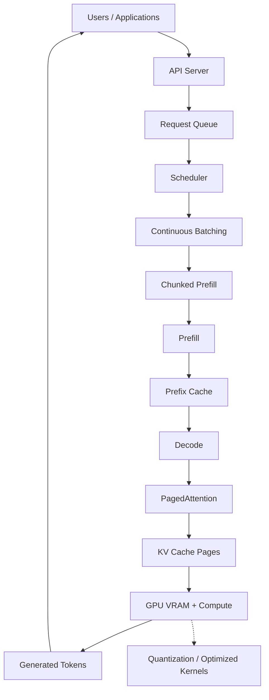
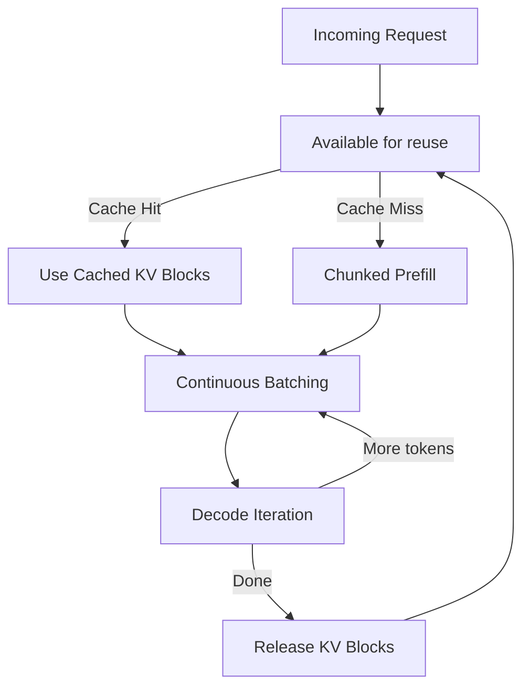
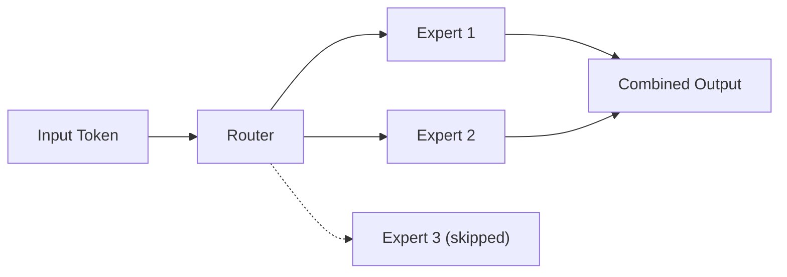
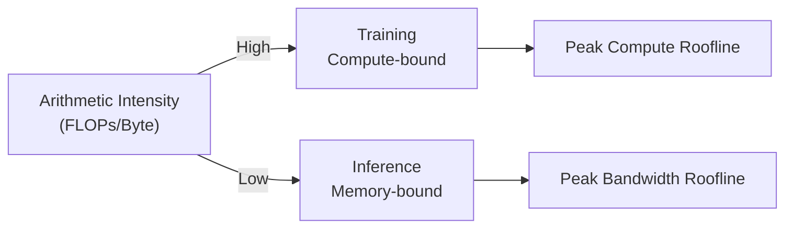

# Lecture 25 — vLLM and PagedAttention: Complete Notes

> **Phase:** 8 · Production Infrastructure · **Level:** 🔴 Expert
> **Source:** `GAC D07`
> **Goal:** Understand the hardware and serving engine under the API — and why inference is memory-bandwidth-bound, not compute-bound.

---

## Table of Contents

| Chapter | Topic | Link |
|---------|-------|------|
| 01 | LLM Hardware Mechanics: GPU VRAM, HBM, Memory Hierarchy | [01_LLM_Hardware_Mechanics.md](01_LLM_Hardware_Mechanics.md) |
| 02 | Compute-Bound Training vs Memory-Bandwidth-Bound Inference | [02_Compute_Bound_vs_Memory_Bound.md](02_Compute_Bound_vs_Memory_Bound.md) |
| 03 | Inference Engine Architecture: Prefill vs Decode Phases | [03_Inference_Engine_Architecture.md](03_Inference_Engine_Architecture.md) |
| 04 | vLLM Architecture Overview | [04_vLLM_Architecture_Overview.md](04_vLLM_Architecture_Overview.md) |
| 05 | PagedAttention: Virtual Memory for KV Cache | [05_PagedAttention.md](05_PagedAttention.md) |
| 06 | Continuous Batching, Chunked Prefill, Prefix Caching | [06_Continuous_Batching_Chunked_Prefill_Prefix_Caching.md](06_Continuous_Batching_Chunked_Prefill_Prefix_Caching.md) |
| 07 | Quantization, Optimized Kernels, MoE, Speculative Decoding | [07_Quantization_Kernels_MoE_Speculative.md](07_Quantization_Kernels_MoE_Speculative.md) |
| 08 | Serving Economics, Self-Hosting vs Managed APIs, Roofline Model | [08_Serving_Economics_and_Roofline.md](08_Serving_Economics_and_Roofline.md) |

---

## Executive Summary

Lecture 25 explores high-performance inference for LLMs, focusing on hardware mechanics, the vLLM serving engine, and its core innovations including PagedAttention. The key insight is that **inference is memory-bandwidth-bound, not compute-bound** — meaning that raw GPU compute power alone doesn't solve throughput issues. Efficient data movement, KV cache management, and dynamic scheduling are what matter.

For full details on each topic, see the linked chapter notes.

---

## 1. LLM Hardware Mechanics

**Core concepts:** GPU VRAM, HBM (High Bandwidth Memory), memory hierarchy

- VRAM stores model weights, KV cache, and activations
- HBM provides high-bandwidth access between GPU compute and memory
- Memory hierarchy: Registers → SRAM → L2 Cache → HBM/VRAM → System RAM → Disk
- For every token generated, GPU must load weights and KV cache from memory
- **Data locality** is critical: moving weights costs more than computing on them
- Inference is limited by **memory bandwidth**, not compute capacity
- **See Chapter 1** for memory hierarchy diagrams and data locality analysis

For detailed diagrams and analysis, see **[Chapter 01](01_LLM_Hardware_Mechanics.md)**

---

## 2. Training vs Inference: Compute-Bound vs Memory-Bandwidth Bound

**Core concept:** Training and inference have fundamentally different bottlenecks

### Training Is Compute-Bound

```text
Large batches
     ↓
Forward + Backward Pass
     ↓
Weight Updates
     ↓
Compute-bound (high arithmetic intensity)
```

- Weights updated via backpropagation
- Large, fixed batches
- GPU compute units saturated
- Primary bottleneck: FLOPs (compute)
- Arithmetic intensity (FLOPs/Byte) is high

### Inference Is Memory-Bandwidth Bound

```text
User requests
     ↓
Load model data + KV cache
     ↓
Generate token
     ↓
Memory-bandwidth bound (low arithmetic intensity)
```

- Weights fixed (read-only)
- Dynamic, continuous requests
- Repeated memory access per token (weights + KV cache)
- Primary bottleneck: data movement speed
- **Doubling GPU compute does NOT halve decode latency**
- Arithmetic intensity (FLOPs/Byte) is low

For detailed comparison, see **[Chapter 02](02_Compute_Bound_vs_Memory_Bound.md)**

---

## 3. Inference Engine Architecture: Prefill vs Decode

**Core concept:** Two-phase generation with fundamentally different resource needs

```text
User Prompt
     │
     ▼
┌──────────┐        →  First output token
│  PREFILL │  (parallel, compute-heavy)
└──────────┘
     │
     ▼
┌──────────┐        →  Tokens streamed back
│  DECODE  │  (sequential, memory-bandwidth sensitive)
└──────────┘
```

### Inference Engine Components

- **Request Queue** — Queues incoming requests
- **Dynamic Batching** — Combines active requests into batches
- **KV Cache Manager** — Manages KV cache allocation/access
- **GPU Scheduling** — Optimizes GPU execution
- Similar to Nginx for web servers — sits between clients and GPU

For detailed phase characteristics and architecture, see **[Chapter 03](03_Inference_Engine_Architecture.md)**

---

## 4. vLLM Architecture

**Core concept:** High-throughput LLM inference engine designed to maximize GPU utilization



### Supported Features

- **Model architectures:** Decoder-only LLMs (Llama, Qwen), MoE (DeepSeek-V3, Mixtral), Multi-modal (LLaVA, Qwen-VL), Embedding models
- **APIs:** OpenAI-compatible REST API, Anthropic Messages API, gRPC
- **Parallelism:** Tensor, pipeline, data, expert, context parallelism
- **Hardware:** NVIDIA, AMD, Intel, CPUs, TPUs, and more

For complete architecture details and component breakdown, see **[Chapter 04](04_vLLM_Architecture_Overview.md)**

---

## 5. PagedAttention

**Core concept:** Virtual memory paging for KV cache — eliminates fragmentation

### Traditional Problem

```text
Request A
┌────────────────────────────────────────────┐
│ Used │ Used │ Used │       Unused          │
└────────────────────────────────────────────┘
```

- Naive allocation reserves large contiguous memory per request
- Actual sequence is often shorter → **wasted memory**
- Memory fragmentation reduces usable capacity
- Memory utilization typically ~60-70%

### PagedAttention Solution

```text
Logical KV Cache    Physical GPU Memory
┌─────────┬─────────┐   ┌────────┐ ┌────────┐ ┌────────┐
│ Block 0 │ Block 1 │ → │ Page 12│ │ Page 03│ │ Page 88│
└─────────┴─────────┘   └────────┘ └────────┘ └────────┘
```

- KV cache divided into **logical blocks** mapped to **physical pages**
- Non-contiguous memory allocation enables fine-grained control
- Memory waste reduced to **below ~4%** in typical setups
- **Dynamic allocation** — pages allocated as sequence grows

For detailed implementation, see **[Chapter 05](05_PagedAttention.md)**

---

## 6. Continuous Batching, Chunked Prefill, Prefix Caching

These three optimizations work together to maximize throughput:



### Continuous Batching

- Dynamic scheduling at **token-iteration level**
- Requests join/leave batch as they arrive/complete
- Keeps GPU saturated → higher throughput
- Unlike traditional batching (wait for all to finish), runs continuously

### Chunked Prefill

- Breaks large prompts into smaller chunks
- Enables interleaving prefill with decode
- Prevents large prompts from blocking other requests
- Better GPU utilization with mixed workload sizes

### Prefix Caching

- Reuses KV cache for shared prompt prefixes (e.g., system prompt)
- Skips redundant prefill computation
- Only processes unique suffix tokens
- Dramatically reduces latency for common prefixes

For detailed explanations and pseudo-code, see **[Chapter 06](06_Continuous_Batching_Chunked_Prefill_Prefix_Caching.md)**

---

## 7. Quantization, Optimized Kernels, MoE, Speculative Decoding

### Quantization

Reduces model memory 50-80% using lower-precision formats:

| Format | Memory Reduction | Quality Impact |
|--------|------------------|----------------|
| FP8 | 50% vs FP16 | Minimal |
| INT8 | 50% vs FP16 | Minimal |
| INT4 | 75% vs FP16 | Moderate |
| AWQ/GPTQ | 50-75% | Minimal (weight-only) |
| GGUF | 70-80% | Configurable |

### Optimized GPU Kernels

| Kernel | Purpose | Speedup |
|--------|---------|---------|
| FlashAttention | Tiled attention with I/O reduction | 2-3x |
| FlashInfer | Multi-GPU attention | 3-5x |
| Triton | Custom GPU kernel DSL | High |
| CUTLASS | NVIDIA GPU linear algebra | 2-4x |

### Mixture-of-Experts (MoE)

- Router directs each token to selected experts (sparse)
- Only compute active experts → 2x-4x FLOPs reduction
- Models: DeepSeek-V3, Mixtral, Qwen-MoE



### Speculative Decoding

- Draft model proposes N tokens → main model verifies
- 2x-3x throughput improvement when acceptance rate is 50-70%
- Quality preserved (main model does verification)

For detailed explanations, see **[Chapter 07](07_Quantization_Kernels_MoE_Speculative.md)**

---

## 8. Serving Economics and the Roofline Model

### Cost Per Million Tokens

| Deployment | Input (1M tokens) | Notes |
|-----------|-------------------|-------|
| OpenAI GPT-4o (managed) | $2.50–$10.00 | Includes infrastructure |
| OpenAI GPT-3.5 (managed) | $0.50–$1.50 | Cheapest managed option |
| vLLM A100 (self-hosted) | $0.10–$0.50 | Hardware amortized |
| vLLM H100 (self-hosted) | $0.30–$1.50 | Better performance, higher HW cost |
| Ollama/llama.cpp | $0.01–$0.05 | Consumer GPUs, low throughput |

### Self-Hosting vs. Managed Decision Framework

**Choose self-hosted (vLLM) when:**
- High token volume (>1M tokens/month)
- Data privacy/compliance requirements
- Own open-weight models needed
- DevOps capacity available
- Cost per token optimization is critical

**Choose managed API when:**
- Prototyping / early stage
- Low traffic (<100K tokens/month)
- Need latest proprietary models
- Limited engineering resources
- Want enterprise SLAs

### Roofline Model



- **Higher arithmetic intensity** → compute-bound (near compute roofline)
- **Lower arithmetic intensity** → memory-bound (near memory bandwidth roofline)
- Inference is typically memory-bandwidth bound
- This is why memory optimizations matter more than raw compute for inference

For detailed economic analysis and decision framework, see **[Chapter 08](08_Serving_Economics_and_Roofline.md)**

---

## How Lecture 25 Connects to Other Lectures

| Connected Lecture | Connection |
|-------------------|-----------|
| **Lecture 02** | LLM foundations — KV cache and context windows |
| **Lecture 03** | Attention and decoding — quadratic attention cost, KV cache |
| **Lecture 16/17** | RAG — serving economics for retrieval |
| **Lecture 19** | Agent memory — KV cache and context management |

---

## The Completion Gate

You can explain:

> **Why doubling GPU compute does not halve decode latency.**

Because inference is memory-bandwidth-bound during decode — each token generation depends on repeated high-bandwidth access to model weights and KV cache. Adding more compute units doesn't help when the GPU is already waiting on memory.

```text
Doubling FLOPs in a memory-bound regime
         ↓
No improvement in token generation speed
         ↓
Latency unchanged (still waiting on memory)
```

The solution is not more compute — it's **more efficient memory access** (PagedAttention, quantization) and **better scheduling** (continuous batching, prefix caching).

---

## Summary: Key Principles

1. **Inference is memory-bandwidth bound** — data movement, not computation, is the bottleneck
2. **KV cache is king** — it grows with sequence length and is the primary memory consumer
3. **Efficiency > raw power** — optimized scheduling and memory management beat faster GPUs
4. **vLLM addresses all bottlenecks** — PagedAttention for memory, continuous batching for scheduling, quantization for size, speculative decoding for speed
5. **Economics matter** — self-hosted at scale is dramatically cheaper than managed APIs

For detailed study, read the individual chapter notes linked above.

---
