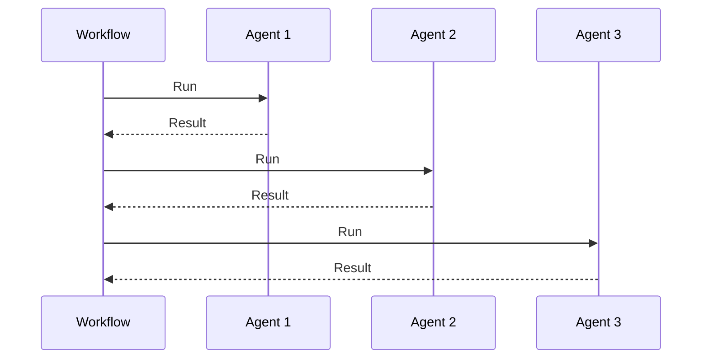
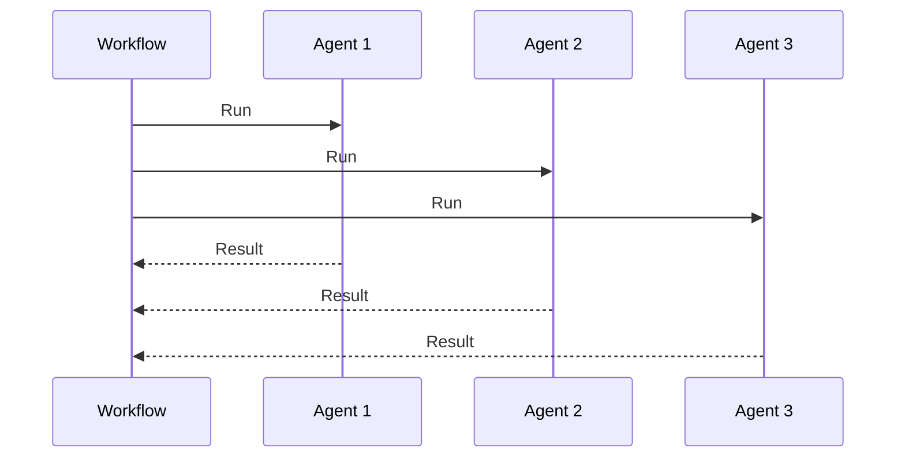
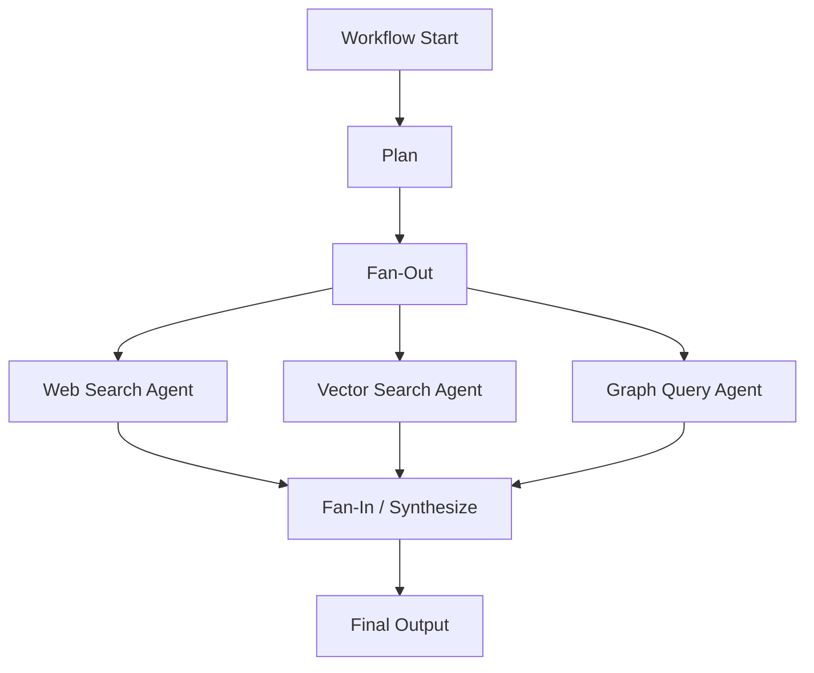
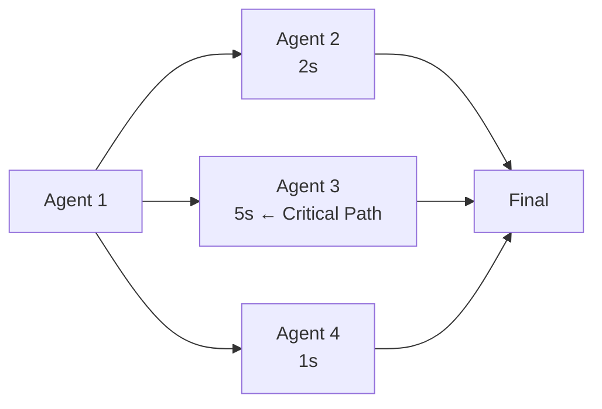

# 🚀 05 — Parallel Multi-Agent Workflows: Fan-Out / Fan-In

## Goal: Understand how to run independent AI agents in parallel, aggregate their results safely, and identify the critical path in complex multi-step AI workflows. Learn durable fan-out / fan-in patterns using Inngest steps.

### 1. 🎯 What Is Fan-Out / Fan-In?

Fan-out / fan-in is a workflow pattern where:

1. **Fan-out:** One step dispatches or starts multiple independent units of work in parallel
2. **Fan-in:** A final step aggregates or merges the results once all branches complete

Conceptually:

```text
                  Workflow Start
                         │
                         ▼
                    Fan-Out
                         │
             ┌───────────┼───────────┐
             ▼           ▼           ▼
         Branch A    Branch B    Branch C
             │           │           │
             └───────────┴───────────┘
                         │
                         ▼
                    Fan-In
                         │
                         ▼
                      Combined Result
```

Each branch runs independently.

### 2. ⚡ Why Fan-Out / Fan-In Matters for AI

AI workloads often call multiple independent capabilities:

```text
Research Request
      │
      ▼
 Planner
      │
 ┌────┴────┬────┐
 ▼         ▼    ▼
Web    Vector   Graph
Search  Search   DB
      │         │
      └────┬────┘
           ▼
       Synthesizer
```

If you run these **sequentially**, total latency adds up:

```text
Sequential:
   Search   →   Vector   →   Graph   →   Synthesize
  3s          2s           4s          1s
  ─────────────────────────────────────────
              Total ≈ 10 seconds
```

If you run them **in parallel**:

```text
Parallel:
   Search   Vector   Graph   Synthesize
   ─────   ─────   ─────   ─────
   3s        2s        4s        1s
   └──────────┬──────────┘
              │
              ▼
         Total ≈ 4 seconds + synthesis
           (critical path)
```

This is why fan-out / fan-in matters:

> **Parallel branches can reduce wall-clock time to the longest branch.**

### 3. 🧱 Durable Fan-Out / Fan-In with `Promise.all()`

For independent step results, you can use JavaScript `Promise.all()` inside `step.run()`:

```javascript
const results = await step.run(
  "parallel-research",
  async () => {
    const [web, vector, graph] = await Promise.all([
      runWebSearch(query),
      runVectorSearch(query),
      runGraphQuery(query),
    ]);

    return {
      web,
      vector,
      graph,
    };
  }
);
```

The durable boundary captures the **combined** result.

But this pattern has an important limitation:

> If one branch fails, `Promise.all()` rejects and the whole step may retry all branches from scratch.

### 4. 🛡️ Safer Durable Fan-Out: Individual Steps

A more durable alternative is to create separate steps per branch:

```javascript
const webResult = await step.run("web-search", async () => {
  return await runWebSearch(query);
});

const vectorResult = await step.run("vector-search", async () => {
  return await runVectorSearch(query);
});

const graphResult = await step.run("graph-query", async () => {
  return await runGraphQuery(query);
});
```

However, these execute **sequentially** in code unless each is truly independent.

To keep them parallel AND durable, use `Promise.all()` at the step level:

```javascript
const [webResult, vectorResult, graphResult] = await Promise.all([
  step.run("web-search", async () => {
    return await runWebSearch(query);
  }),
  step.run("vector-search", async () => {
    return await runVectorSearch(query);
  }),
  step.run("graph-query", async () => {
    return await runGraphQuery(query);
  }),
]);
```

Conceptually:

```text
Workflow
   │
   ├── step.run("web-search")   ───────────┐
   ├── step.run("vector-search") ──────────┤
   ├── step.run("graph-query") ───────────┤
   │                                        │
   └─────────────── Promise.all ───────────┘
                     │
                     ▼
                Combined Result
```

### 5. 🧠 Critical Path Analysis

The critical path is the longest sequence of dependent steps through the workflow.

```text
            Agent 1
              │
              ▼
        Fan-Out Parallel
       ┌────────┴────────┐
       ▼         ▼       ▼
    Agent 2   Agent 3   Agent 4
     (3s)      (1s)      (5s)      ← longest = critical path
       │         │         │
       └─────────┴─────────┘
                    │
                    ▼
                 Agent 5
                    │
                    ▼
               Final Result
```

Total time ≈ Agent 1 + 5s (critical path) + Agent 5

This matters because optimizing branches outside the critical path may not improve total latency.

### 6. 🛡️ Handling Partial Failures in Fan-Out

What if one branch fails?

```text
Branch A ✅
Branch B ❌
Branch C ✅
```

With naive `Promise.all()`:

```text
One rejection → entire step fails
```

Options:

#### Option A — Fail fast

```javascript
try {
  const results = await Promise.all([
    step.run("a", ...),
    step.run("b", ...),
    step.run("c", ...),
  ]);
} catch (error) {
  // handle failure
}
```

#### Option B — Tolerate partial failure

```javascript
const settled = await Promise.allSettled([
  step.run("a", ...),
  step.run("b", ...),
  step.run("c", ...),
]);

const successful = settled.filter(
  (r) => r.status === "fulfilled"
);

const failed = settled.filter(
  (r) => r.status === "rejected"
);
```

Use `Promise.allSettled()` when you want results even if some branches fail.

### 7. 🔀 Fan-In / Aggregation

After fan-out completes, a fan-in step combines the results:

```javascript
const [web, vector, graph] = await Promise.all([
  step.run("web-search", ...),
  step.run("vector-search", ...),
  step.run("graph-query", ...),
]);

const synthesis = await step.run("synthesize", async () => {
  return await runSynthesizer({
    web,
    vector,
    graph,
  });
});
```

Conceptually:

```text
Web   Vector   Graph
  │       │       │
  └───────┴───────┘
          │
          ▼
     Synthesize
```

### 8. 🧩 Multi-Agent Pipelines

AI agents often form pipelines:

```text
Planner
   │
   ├── Research Agent
   ├── Citation Agent
   └── Formatting Agent
      │
      ▼
   Reviewer Agent
      │
      ▼
   Publisher Agent
```

Parallel branches can feed into a reviewer:

```text
      Research   Citation   Formatting
         │         │           │
         └─────────┴───────────┘
                   │
                   ▼
              Reviewer
                   │
                   ▼
             Final Output
```

### 9. 📊 Diagrams

#### Sequential vs. Parallel

**Sequential:**



**Parallel:**



#### Fan-Out / Fan-In Flowchart



#### Critical Path



### 10. 🧰 Complete AI Research Example

```javascript
export const researchWorkflow = inngest.createFunction(
  {
    id: "research-workflow",
  },
  {
    event: "research/requested",
  },
  async ({ event, step }) => {

    // Fan-out: independent research branches in parallel
    const [webResults, vectorResults, graphResults] = await Promise.all([
      step.run("web-search", async () => {
        return await runWebSearch(event.data.query);
      }),
      step.run("vector-search", async () => {
        return await runVectorSearch(event.data.query);
      }),
      step.run("graph-query", async () => {
        return await runGraphQuery(event.data.query);
      }),
    ]);

    // Fan-in: combine results
    const synthesis = await step.run("synthesize-report", async () => {
      return await synthesize({
        web: webResults,
        vector: vectorResults,
        graph: graphResults,
      });
    });

    // Follow-on step
    const validated = await step.run("validate-report", async () => {
      return await validateReport(synthesis);
    });

    // Notify downstream systems
    await step.sendEvent("research-completed", {
      name: "research/completed",
      data: {
        jobId: event.data.jobId,
        report: validated,
      },
    });
  }
);
```

### 11. ⚖️ Promise.all vs Promise.allSettled

| | `Promise.all()` | `Promise.allSettled()` |
|---|-----------------|------------------------|
| Rejects if any rejects | ✅ Yes | ❌ No |
| Returns when all complete | ✅ Yes | ✅ Yes |
| Returns results | ✅ Fulfilled values | ✅ Status + value/reason |
| Use when | All branches must succeed | Partial results are acceptable |
| Good for | Dependent fan-in | Tolerant aggregation |

### 12. ⚠️ Common Mistakes

#### ❌ Mistake 1 — Running parallel branches sequentially

Don't write:

```javascript
// Not parallel
const web = await step.run("web-search", ...);
const vector = await step.run("vector-search", ...);
const graph = await step.run("graph-query", ...);
```

Use `Promise.all()` when they're independent.

#### ❌ Mistake 2 — Assuming `Promise.all()` failure leaves completed branches untouched

If one branch rejects, `Promise.all()` rejects immediately. Other in-flight branches may still complete, but their results are discarded.

#### ❌ Mistake 3 — Not identifying the critical path

Optimizing a fast branch won't reduce total latency if it's not on the critical path.

#### ❌ Mistake 4 — Mixing dependent branches into parallel `Promise.all()`

```javascript
// ❌ branch B depends on result of branch A
const [a, b] = await Promise.all([
  step.run("a", async () => { return ... }),
  step.run("b", async () => { return ... }), // needs 'a'
]);
```

Dependent branches need sequential ordering.

### 13. 🧠 Interview Questions

#### Q1. What is fan-out / fan-in?

> Fan-out is dispatching multiple independent units of work in parallel. Fan-in is aggregating their results once complete.

#### Q2. How does `Promise.all()` differ from sequential `await` steps?

> `Promise.all()` starts independent operations concurrently, while sequential `await` steps run one after another.

#### Q3. What is the critical path?

> The critical path is the longest chain of dependent work through a workflow; it determines the minimum wall-clock time.

#### Q4. What happens if one branch fails in `Promise.all()`?

> `Promise.all()` rejects immediately when any branch rejects, discarding other results. Use `Promise.allSettled()` when partial results are acceptable.

#### Q5. Why use separate `step.run()` calls inside `Promise.all()`?

> To keep each branch's result durable across retries while still running them concurrently.

### 14. 🧾 Cheat Sheet

```javascript
// Parallel fan-out
const [a, b, c] = await Promise.all([
  step.run("a", async () => { return ... }),
  step.run("b", async () => { return ... }),
  step.run("c", async () => { return ... }),
]);

// Fan-in
const result = await step.run("combine", async () => {
  return combine(a, b, c);
});

// Tolerate partial failure
const settled = await Promise.allSettled([...]);
const successes = settled.filter(s => s.status === "fulfilled");
```

### Common mistakes:

1. Running independent branches sequentially instead of with `Promise.all()`
2. Assuming `Promise.all()` failure preserves other branch results
3. Not identifying the critical path before optimizing
4. Putting dependent work into a parallel `Promise.all()` block
5. Using `Promise.all()` when partial failure tolerance is needed

### Key takeaways:

- Fan-out / fan-in runs independent AI agents in parallel and aggregates results
- Parallel execution reduces wall-clock time to the critical path length
- `Promise.all()` runs independent steps concurrently but fails fast on rejection
- `Promise.allSettled()` tolerates partial branch failures
- Wrapping independent `step.run()` calls in `Promise.all()` keeps each branch durable
- Dependent branches must remain sequential
- Identify the critical path to know where optimization actually helps

---
*Source: gen-ai-cohort/week07/learning/day13/notes/05-advanced-multi-agent-workflows-concurrency-and-error-resilience.md, plus roadmap.md Lecture 26 topics*