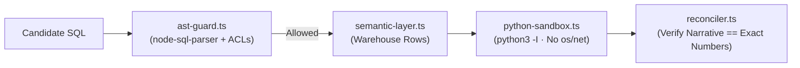

# Chapter 00: Overview, Architecture & File Structure

> **Chapter goal:** understand *what* this codebase is, how candidate SQL is validated via AST, how Python runs in isolation, and how numbers are reconciled.

---

## 0.1 What this codebase is

This is the **minimum working TypeScript + Python sandbox engine** proving Lecture 26:
- Uses `node-sql-parser` for real grammar-based SQL AST validation.
- Spawns `python3 -I` with stripped `env: {}` and static import bans for exact statistical math.

| File | Responsibility | Notes Chapter |
| :--- | :--- | :---: |
| `package.json` & `tsconfig.json` | ESM + strict TypeScript + `node-sql-parser` + `tsx` | — |
| `src/semantic-layer.ts` | Role-scoped table/column ACL policies & warehouse dataset | 02, 05 |
| `src/ast-guard.ts` | SQL AST parser blocking DDL/DML, stacked queries, `SELECT *` on PII, & oversized `LIMIT` | 04, 05 |
| `src/python-sandbox.ts` | Isolated `python3 -I` runner with banned `os`/`subprocess`/`socket` guard | 06 |
| `src/reconciler.ts` | Deterministic numerical reconciliation gate | 08 |
| `src/index.ts` | Runnable end-to-end demo | 01–08 |
| `src/release-gate.test.ts` | 4 automated release-gate suites (including 10-question EX benchmark) | All |

---

## 0.2 Architecture



---

## 0.3 Commands

```bash
cd "Lecture 26 - Semantic Text-to-SQL and Analytical Python/code/Basic Code"
npm install
npm run typecheck
npm start
npm test
```

