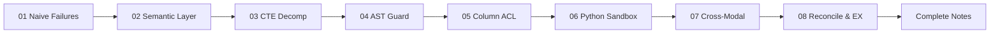

# Lecture 26 — Chapter Index

**Semantic-Layer Text-to-SQL & Analytical Python**
Phase 6 · Enterprise Data, Semantics & SQL · 🔴 Expert · **8 chapters**

> Source of truth for topics, goal, build task and gate: **[../roadmap-v1.md](../roadmap-v1.md)** → *"Lecture 26"*.
> Source mapping: `FDE S13 & S14`.

---

## 📚 Chapters

| # | Chapter | One-line summary | File |
| :---: | :--- | :--- | :--- |
| 01 | **Why Naive Text-to-SQL Fails in Production** | Schema bloat, metric ambiguity, destructive DDL/DML, runaway scan costs, numerical hallucinations | [01_Why_Naive_Text_to_SQL_Fails_in_Production.md](./notes/01_Why_Naive_Text_to_SQL_Fails_in_Production.md) |
| 02 | **Metadata-Guided Schema Discovery & Semantic Layers** | Progressive schema pruning, certified tables, canonical metrics, join paths, enum sampling | [02_Metadata_Guided_Schema_Discovery_and_Semantic_Layers.md](./notes/02_Metadata_Guided_Schema_Discovery_and_Semantic_Layers.md) |
| 03 | **Query Decomposition & SQL Generation** | Multi-part decomposition into `WITH` CTEs, `NULLIF` division guards, bounded syntax repair | [03_Query_Decomposition_and_SQL_Generation.md](./notes/03_Query_Decomposition_and_SQL_Generation.md) |
| 04 | **SQL AST Validation & Read-Only Guardrails** | Grammar-based AST parsing (`node-sql-parser`), single-statement `SELECT` only, read-only DB role | [04_SQL_AST_Validation_and_Read_Only_Guardrails.md](./notes/04_SQL_AST_Validation_and_Read_Only_Guardrails.md) |
| 05 | **Schema & Column-Level Authorization + Query Budgets** | Role-based table/column allow-lists, blocking `SELECT *` on PII, `LIMIT` & scan-byte caps | [05_Schema_and_Column_Authorization_and_Query_Budgets.md](./notes/05_Schema_and_Column_Authorization_and_Query_Budgets.md) |
| 06 | **Sandboxed Python Analytical Intelligence** | SQL for reduction vs. Python for stats, `python3 -I`, stripped `env`, blocked `os`/`socket`, timeouts | [06_Sandboxed_Python_Analytical_Intelligence.md](./notes/06_Sandboxed_Python_Analytical_Intelligence.md) |
| 07 | **Cross-Modal Reasoning (SQL + Vector + Graph)** | Combining SQL aggregates + Vector tickets + Graph dependencies via `canonicalId`s | [07_Cross_Modal_Reasoning_SQL_Vector_Graph.md](./notes/07_Cross_Modal_Reasoning_SQL_Vector_Graph.md) |
| 08 | **Numerical Reconciliation & Execution-Accuracy Evals** | Reconciling narrative numbers against SQL/Python ledger, Execution Accuracy (EX) 10-question gate | [08_Numerical_Reconciliation_and_Execution_Accuracy_Evals.md](./notes/08_Numerical_Reconciliation_and_Execution_Accuracy_Evals.md) |

---

## 📄 Complete notes

A single consolidated document with the executive summary, architecture diagram, cheat sheet, and self-check questions:

👉 **[Lecture_26_Complete_Notes.md](./notes/Lecture_26_Complete_Notes.md)**

---

## 🔗 Related

- **[./code/Basic Code](./code/Basic%20Code)** — runnable TypeScript AST-validated Text-to-SQL (`node-sql-parser`) + Sandboxed Python (`python3 -I`) + Numerical Reconciler, release-gate tests, and chapter-wise `implementations guide/`
- **[./Assignment/task.md](./Assignment/task.md)** — hands-on assignment & release gate checklist
- **[./README.md](./README.md)** — lecture objectives, phase, level, source mapping and checklist
- **[../roadmap-v1.md](../roadmap-v1.md)** — complete topic list, goal, build task and completion gate

---

## 🧭 Reading order

