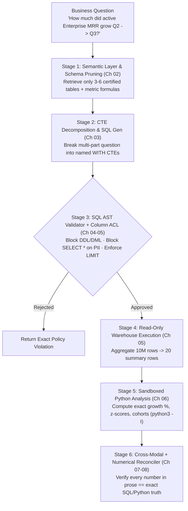

# Chapter 01 — Why Naive Text-to-SQL Fails in Production

> **Lecture 26 · Chapter 01 of 08** · Level: 🔴 Expert · Phase 6 — Enterprise Data, Semantics & SQL
> **Source:** `FDE S13` · **Roadmap Reference:** [`roadmap-v1.md`](../../roadmap-v1.md#lecture-26--semantic-layer-text-to-sql--analytical-intelligence)
> **Roadmap topics:** Naive Text-to-SQL failure modes · schema bloat · ambiguous business metrics · destructive DDL/DML · runaway scan costs · numerical hallucination.

---

## 01.0 What this chapter is for

Every team building an internal AI data analyst starts with the same tempting idea:

> *"Let's paste our `CREATE TABLE` schemas into the system prompt, ask the LLM to write SQL, and run it against the warehouse!"*

In a 3-table toy demo, that works on the first try. **In a real enterprise warehouse, it fails catastrophically** — producing wrong board-meeting numbers, leaking restricted PII, scanning terabytes of cold logs, or executing destructive queries.

By the end of this chapter you should be able to:

1. Explain the **five distinct ways** naive Text-to-SQL breaks in production using concrete examples.
2. Explain why **regex blacklists** (`if (!sql.includes("DROP"))`) are a false sense of security.
3. Sketch the **6-stage Guarded Analytical Architecture** that makes Text-to-SQL safe and accurate.

---

## 01.1 The running case study: SaaS RevOps Analytics

Throughout Lecture 26, we will follow one realistic enterprise scenario:

A SaaS company has a warehouse (`mart_subscriptions`, `raw_stripe_events`, `stg_customers`, `dim_accounts`, plus 350 other tables). A VP of Sales asks the AI analyst:

> **"How much did our active Enterprise MRR grow from Q2 to Q3, and why did EMEA drop?"**

Watch what happens when a **naive** Text-to-SQL bot tries to answer this:

| Failure Mode | What the Naive Bot Did | Why It Happened | Real-World Consequence |
| :--- | :--- | :--- | :--- |
| **1. Schema Bloat** | Joined `raw_stripe_events` instead of `mart_subscriptions` | 350 tables (~28,000 tokens of DDL) diluted the LLM's attention ("lost in the middle") | Counted test accounts and refunded invoices in revenue |
| **2. Metric Ambiguity** | Computed `SUM(amount)` without filtering `status = 'active'` | Raw `CREATE TABLE` DDL does not say what *"Active MRR"* means | Reported `$142,000` instead of `$72,000` (2× inflation!) |
| **3. Unsafe / Unauthorized SQL** | Emitted `SELECT * FROM mart_subscriptions` (returning `billing_email`) or fell for prompt injection (`; DROP TABLE ...`) | No grammar-level SQL parser or column-level ACL | Leaked customer PII or risked destructive writes |
| **4. Runaway Scan Cost** | Ran `SELECT * FROM raw_stripe_events` without `LIMIT` or date partition filter | LLM didn't know the table has 4 billion rows | Single user question triggered a \$45 BigQuery scan |
| **5. Arithmetic Hallucination** | SQL returned `Q2 = 69,000`, `Q3 = 72,000`, and the LLM wrote *"grew by 4.8%"* in prose | LLMs predict next tokens, they don't run floating-point division (`3000 / 69000 = 4.35%`) | Executive loses trust immediately when numbers don't add up |

---

## 01.2 Why regex blacklists cannot protect your database

Many engineers try to "secure" Text-to-SQL with a quick regex check:

```typescript
// ❌ ANTI-PATTERN: Trivially bypassable regex guard
if (/\b(DROP|DELETE|UPDATE|INSERT)\b/i.test(sql)) {
  throw new Error("Unsafe SQL!");
}
```

Here are **three ways** an attacker (or a confused LLM) bypasses that regex in seconds:

1. **Inline SQL comments:** `DR/**/OP TABLE mart_subscriptions;` — valid in many dialects, misses `\bDROP\b`.
2. **Data-modifying CTEs (PostgreSQL):** `WITH deleted AS (DELETE FROM mart_subscriptions RETURNING *) SELECT * FROM deleted;` — starts with `WITH`, or if someone only checks `sql.trim().startsWith("SELECT")`, they miss `WITH` or stacked queries.
3. **Stacked queries / PII exfiltration:** `SELECT billing_email, tax_id FROM mart_subscriptions;` — contains **zero** `DROP`/`DELETE` keywords, yet still exfiltrates restricted PII!

> [!IMPORTANT]
> **Security rule:** Never validate a formal language (SQL) with regex. Parse it into an **Abstract Syntax Tree (AST)** and **fail closed** on anything other than a single, bounded `SELECT` over allow-listed columns (Chapter 04).

---

## 01.3 The 6-Stage Guarded Analytical Architecture

Every chapter in this lecture builds one layer of this defense-in-depth pipeline:



---

## 01.4 Key takeaways

1. **Naive Text-to-SQL fails on 5 axes:** schema bloat, metric ambiguity, unsafe SQL/PII leaks, runaway scan costs, and arithmetic hallucinations.
2. **Regex SQL filters are broken by design** — always parse SQL into an AST and pair it with a read-only database role.
3. **Separate data reduction (SQL) from math (Sandboxed Python) from narration (LLM + Reconciler)** so every number is provably grounded.

---

**Next:** [Chapter 02 — Metadata-Guided Schema Discovery & Semantic Layers](./02_Metadata_Guided_Schema_Discovery_and_Semantic_Layers.md)
