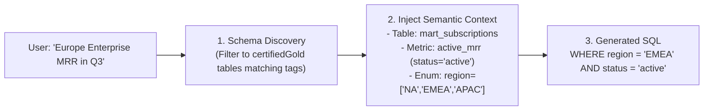

# Chapter 02 — Metadata-Guided Schema Discovery & Semantic Layers

> **Lecture 26 · Chapter 02 of 08** · Level: 🔴 Expert · Phase 6 — Enterprise Data, Semantics & SQL
> **Source:** `FDE S13` · **Roadmap Reference:** [`roadmap-v1.md`](../../roadmap-v1.md#lecture-26--semantic-layer-text-to-sql--analytical-intelligence)
> **External Reference:** [dbt Semantic Layer](https://docs.getdbt.com/docs/use-dbt-semantic-layer/dbt-semantic-layer)
> **Roadmap topics:** Progressive schema pruning · semantic layers (entities, dimensions, metrics, certified joins) · enum/value sampling · preventing join-path hallucinations.

---

## 02.0 What this chapter is for

Even the smartest frontier LLM cannot write accurate SQL if you either:
- **Drown it** in 350 raw tables (`schema bloat`), or
- **Starve it** of business definitions (`"What does Active Enterprise MRR actually mean?"`).

This chapter solves both problems using **Metadata-Guided Schema Discovery** (prune to the right 3–6 tables) and a **Semantic Layer** (tell the LLM the exact formulas, join keys, and enum strings).

By the end of this chapter you should be able to:

1. Build a **2-step schema discovery flow** that shrinks a 350-table warehouse to 3–6 relevant certified tables.
2. Define the **four primitives of a Semantic Layer** (Certified Tables, Canonical Metrics, Allowed Join Paths, Enum Samples).
3. Explain how **enum value sampling** eliminates silent `WHERE` clause bugs.

---

## 02.1 Why raw `CREATE TABLE` DDL is never enough

Look at a standard SQL table definition:

```sql
CREATE TABLE mart_subscriptions (
  customer_id VARCHAR,
  region VARCHAR,
  plan_tier VARCHAR,
  status VARCHAR,
  mrr_usd INT,
  quarter VARCHAR
);
```

Ask yourself: if you only give an LLM that `CREATE TABLE` block, **four critical facts are completely invisible**:
1. What are the valid strings in `status`? Is it `'active'`, `'ACTIVE'`, `'Active'`, or `'subscribed'`?
2. Does *"Active MRR"* include `past_due` customers or only `status = 'active'`?
3. Is `mrr_usd` already in dollars or in cents?
4. Should this table be used instead of `raw_stripe_events`?

Without those answers, the LLM **guesses** — and every guess is a silent bug.

---

## 02.2 The four primitives of a Semantic Layer

A **Semantic Layer** (like dbt Semantic Layer, Cube, or an internal YAML/JSON registry) turns tribal knowledge into structured context injected into the SQL generator:

| Primitive | Concrete Example | Failure It Prevents |
| :--- | :--- | :--- |
| **1. Certified Table** | `mart_subscriptions` (`certifiedGold: true`, `grain: 1 row per customer per quarter`) | Prevents querying uncleaned `raw_*` or `stg_*` tables |
| **2. Canonical Metric** | `active_mrr`: `SUM(mrr_usd)` with required filter `status = 'active'` | Eliminates LLM-invented `SUM()` formulas |
| **3. Allowed Join Path** | `mart_subscriptions.customer_id = dim_customers.customer_id` (`many_to_one`) | Prevents fan-out double-counting or Cartesian joins |
| **4. Enum / Value Samples** | `status: ['active', 'past_due', 'canceled']`, `region: ['NA', 'EMEA', 'APAC']` | Prevents `WHERE region = 'Europe'` returning 0 rows when DB stores `'EMEA'` |



Notice how `"Europe"` automatically maps to `'EMEA'` because the LLM saw `region: ['NA', 'EMEA', 'APAC']` in the Semantic Layer!

---

## 02.3 Progressive Schema Pruning (Keeping prompts lean & cacheable)

Never stuff all 350 tables into the prompt:
1. **Offline Index:** Embed or tag each table's business description, column names, and metric synonyms.
2. **Query-Time Retrieval:** Retrieve only the **top 3–6 certified tables** and **2–5 matching metrics** for the user's question.
3. **Cache-Friendly Ordering:** Keep the core Semantic Layer instructions in the static prefix (Lecture 08) and append only the retrieved table snippets at the tail.

---

## 02.4 Key takeaways

1. **Raw DDL is ambiguous:** always enrich it with certified table flags, metric formulas, join cardinalities, and enum value samples.
2. **Prune to 3–6 tables** before generating SQL to eliminate attention dilution and cut input token costs.
3. **Enum sampling** (`'EMEA'` vs. `'Europe'`) prevents the #1 silent `0 rows returned` bug in Text-to-SQL.

---

**Next:** [Chapter 03 — Query Decomposition & SQL Generation](./03_Query_Decomposition_and_SQL_Generation.md)
