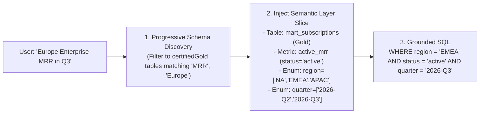
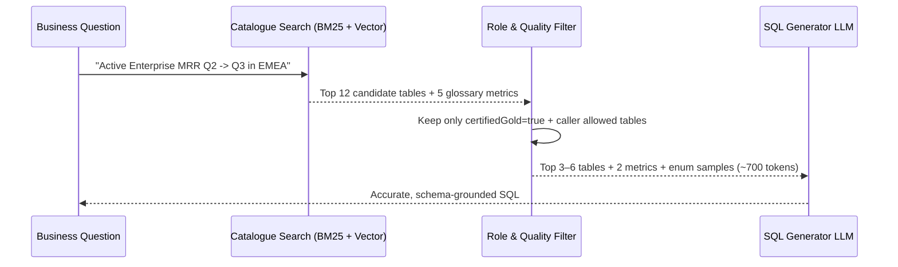

# Chapter 02 — Metadata-Guided Schema Discovery & Semantic Layers

> **Lecture 26 · Chapter 02 of 08** · Level: 🔴 Expert · Phase 6 — Enterprise Data, Semantics & SQL
> **Source:** `FDE S13` · **Roadmap Reference:** [`roadmap-v1.md`](../../roadmap-v1.md#lecture-26--semantic-layer-text-to-sql--analytical-intelligence)
> **External Reference:** [dbt Semantic Layer](https://docs.getdbt.com/docs/use-dbt-semantic-layer/dbt-semantic-layer)
> **Roadmap topics:** Progressive schema pruning · semantic layers (entities, dimensions, metrics, certified joins) · enum/value sampling · preventing join-path hallucinations.

---

## 02.0 What this chapter is for

Even the smartest frontier LLM cannot write accurate SQL if you either:
- **Drown it** in 350 raw `CREATE TABLE` definitions (`schema bloat` $\rightarrow$ wrong table selection), or
- **Starve it** of business definitions (`"What does Active Enterprise MRR actually mean?"` $\rightarrow$ invented formulas and `0 rows returned`).

This chapter solves both problems using **Metadata-Guided Schema Discovery** (prune 350 tables down to the right 3–6 certified tables) and a **Semantic Layer** (inject exact metric formulas, allowed join cardinalities, and real enum value samples).

By the end of this chapter you should be able to:

1. Explain why raw `CREATE TABLE` DDL is missing four critical pieces of information an LLM needs.
2. Build a **2-step progressive schema discovery flow** that shrinks a 350-table warehouse to 3–6 relevant certified tables without breaking prompt caching.
3. Define the **four primitives of a Semantic Layer** (Certified Tables, Canonical Metrics, Allowed Join Paths, and Enum/Value Samples).
4. Eliminate **join-path fan-out bugs** and **silent `0 rows returned` string-mismatch bugs** using semantic metadata.

---

## 02.1 Why raw `CREATE TABLE` DDL is never enough

Look at a standard SQL table definition:

```sql
CREATE TABLE mart_subscriptions (
  customer_id VARCHAR,
  region      VARCHAR,
  plan_tier   VARCHAR,
  status      VARCHAR,
  mrr_usd     INT,
  quarter     VARCHAR
);
```

If you only give an LLM that `CREATE TABLE` block, **four critical facts are completely invisible**:
1. **Enum casing & codes:** Is `region` stored as `'Europe'`, `'EU'`, `'EMEA'`, or `'emea'`? Is `status` `'active'` or `'ACTIVE'`?
2. **Metric business rules:** Does *"Active MRR"* include `past_due` or `trialing` accounts, or strictly `status = 'active'`?
3. **Grain & join safety:** Is `mart_subscriptions` 1 row per customer, or 1 row per subscription-quarter? Joining `1:N` without knowing the grain causes **fan-out double counting**.
4. **Certification tier:** Should the agent query `mart_subscriptions` instead of `raw_stripe_events`?

Without those answers, the LLM **guesses**—and every guess is a silent data bug.

---

## 02.2 The four primitives of a Semantic Layer

A **Semantic Layer** (such as dbt Semantic Layer, Cube, or an internal YAML/JSON registry) turns tribal analytics knowledge into structured context injected into the SQL generator:

| Semantic Primitive | Concrete Example | Failure It Prevents |
| :--- | :--- | :--- |
| **1. Certified Table & Grain** | `mart_subscriptions` (`certifiedGold: true`, `grain: "1 row per subscription per quarter"`) | Prevents querying uncleaned `raw_*` / `stg_*` tables |
| **2. Canonical Metric** | `active_mrr`: `SUM(mrr_usd)` with `requiredFilters: ["status = 'active'"]` | Eliminates LLM-invented `SUM()` formulas |
| **3. Allowed Join Path** | `mart_subscriptions.customer_id = dim_customers.customer_id` (`many_to_one`) | Prevents Cartesian explosions & fan-out double-counting |
| **4. Enum / Value Samples** | `status: ['active', 'past_due', 'canceled']`, `region: ['NA', 'EMEA', 'APAC']`, `quarter: ['2026-Q2', '2026-Q3']` | Prevents `WHERE region = 'Europe'` returning `0` rows when DB stores `'EMEA'` |



Notice how `"Europe"` automatically translates to `region = 'EMEA'` and `"Q3"` translates to `'2026-Q3'`—not because the LLM got lucky, but because the Semantic Layer handed it the exact enum samples!

---

## 02.3 Progressive Schema Pruning (Keeping prompts lean & cacheable)

Never stuff 350 tables into the system prompt. Use a **2-step progressive discovery pipeline**:



1. **Offline Indexing:** Index every certified table's business description, column descriptions, and metric synonyms. Also run a nightly profiler (`SELECT DISTINCT region FROM mart_subscriptions LIMIT 20`) to refresh **enum value samples** for low-cardinality columns.
2. **Query-Time Pruning:** Retrieve only the **top 3–6 certified tables** and **2–5 matching metrics** for the user's question.
3. **Cache-Friendly Prompt Ordering:** Keep your SQL dialect rules and AST constraints in the **static system-prompt prefix** (so prompt caching hits 100%), and append the pruned 3–6 table Semantic Layer slice in the **user/developer message** at the tail.

> [!IMPORTANT]
> **Never sample high-cardinality PII columns.** Run `DISTINCT` value sampling *only* on low-cardinality categorical dimensions (`region`, `plan_tier`, `status`, `currency`). Never sample `email`, `customer_name`, or `phone` into the prompt!

---

## 02.4 Worked example: Preventing join fan-out

Suppose `mart_subscriptions` has 1 row per subscription (`$10,000` MRR for `c1`), and `dim_support_tickets` has **4** support tickets for `c1`.
- **Without Allowed Join Paths:** The LLM joins `mart_subscriptions` directly to `dim_support_tickets` and runs `SUM(mrr_usd)` $\rightarrow$ `c1`'s MRR is multiplied by 4 (`$40,000` instead of `$10,000`)!
- **With Allowed Join Paths:** The Semantic Layer declares `mart_subscriptions <-> dim_support_tickets` as `one_to_many (aggregate tickets first before joining)`. The generator aggregates tickets in a CTE (`COUNT(*) AS ticket_count`) *before* joining to `mart_subscriptions`—preserving the exact `$10,000` MRR.

---

## 02.5 Common mistakes

| # | Common Mistake | Why It Hurts | What To Do Instead |
| :---: | :--- | :--- | :--- |
| 1 | **Sending raw `CREATE TABLE` DDL without enum samples** | `WHERE region = 'Europe'` or `status = 'Active'` silently returns `0` rows | Profile low-cardinality columns and inject real `['NA', 'EMEA', 'APAC']` samples |
| 2 | **Dumping all 350 tables into the system prompt** | Causes "lost in the middle" table selection errors and huge token bills | Prune to top 3–6 `certifiedGold` tables via metadata search |
| 3 | **Omitting join cardinality (`1:N` vs. `N:1`)** | Joining fact tables directly causes silent fan-out revenue multiplication | Declare allowed join paths and cardinalities in the Semantic Layer |
| 4 | **Sampling PII columns into enum examples** | Leaks customer names/emails into every SQL generation prompt | Whitelist only low-cardinality categorical columns for value sampling |
| 5 | **Putting dynamic schemas at the top of the system prompt** | Invalidates LLM prompt caching on every single query | Put static rules in the prefix and dynamic pruned schemas at the tail |

---

## 02.6 Key takeaways

1. **Raw DDL is ambiguous:** enrich it with **Certified Table flags**, **Canonical Metrics**, **Allowed Join Paths**, and **Enum Samples**.
2. **Prune to 3–6 certified tables** at query time to eliminate attention dilution and cut input token costs.
3. **Enum value sampling** (`'EMEA'` vs. `'Europe'`, `'2026-Q3'` vs. `'Q3'`) eliminates the #1 silent `0 rows returned` bug in Text-to-SQL.
4. **Declare join cardinalities** so the SQL generator aggregates `1:N` tables in CTEs before joining.

---

**Next:** [Chapter 03 — Query Decomposition & SQL Generation](./03_Query_Decomposition_and_SQL_Generation.md)
