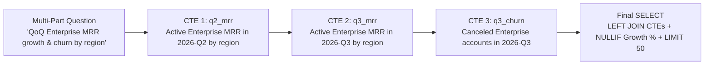
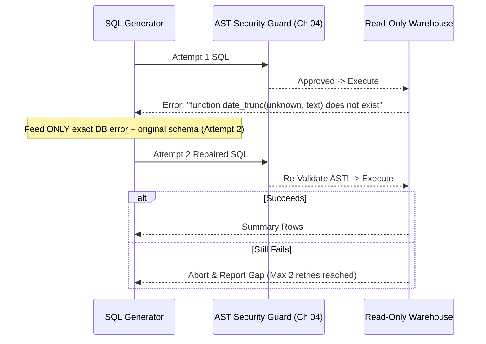

# Chapter 03 — Query Decomposition & SQL Generation

> **Lecture 26 · Chapter 03 of 08** · Level: 🔴 Expert · Phase 6 — Enterprise Data, Semantics & SQL
> **Source:** `FDE S13` · **Roadmap Reference:** [`roadmap-v1.md`](../../roadmap-v1.md#lecture-26--semantic-layer-text-to-sql--analytical-intelligence)
> **Roadmap topics:** Multi-part business questions · CTE-first SQL generation · defensive SQL (`NULLIF`, explicit aliases) · bounded syntax-repair loops.

---

## 03.0 What this chapter is for

Simple questions (*"How many active customers are in North America?"*) map cleanly to a single `SELECT`. Real executive questions almost never do:

> **"Which regions had > 15% QoQ active Enterprise MRR growth from Q2 to Q3, and what was their churn count?"**

When an LLM tries to cram three aggregations, two time windows, and a growth-rate division into deeply nested subqueries in one pass, it routinely mixes up `GROUP BY` levels, drops zero-revenue regions with `INNER JOIN`, or crashes the database with division by zero. **Query Decomposition** teaches the agent to break complex questions into **named, single-purpose Common Table Expressions (`WITH ...`)** before assembling the final `SELECT`.

By the end of this chapter you should be able to:

1. Decompose multi-part analytical questions into a linear pipeline of **named CTEs (`WITH ...`)**.
2. Enforce **four defensive SQL habits** (`NULLIF`, `LEFT JOIN` + `COALESCE`, qualified aliases, explicit `LIMIT`) that prevent runtime crashes and silent row drops.
3. Implement a **bounded SQL syntax-repair loop** (max 2 retries) that feeds exact DB errors back without bypassing the AST security guard.
4. Explain why **CTE-first SQL** dramatically improves human auditability and Execution Accuracy.

---

## 03.1 Step-by-step: From business question to CTEs

Instead of nested `SELECT ... FROM (SELECT ... FROM (...))`, instruct the SQL generator to follow a **one-logical-step-per-CTE** pattern:



Look how clean, readable, and auditable the resulting SQL is:

```sql
WITH q2_mrr AS (
  SELECT region, SUM(mrr_usd) AS mrr_q2
  FROM mart_subscriptions
  WHERE quarter = '2026-Q2'
    AND status = 'active'
    AND plan_tier = 'enterprise'
  GROUP BY region
),
q3_mrr AS (
  SELECT region, SUM(mrr_usd) AS mrr_q3
  FROM mart_subscriptions
  WHERE quarter = '2026-Q3'
    AND status = 'active'
    AND plan_tier = 'enterprise'
  GROUP BY region
),
q3_churn AS (
  SELECT region, COUNT(DISTINCT customer_id) AS churned_accounts
  FROM mart_subscriptions
  WHERE quarter = '2026-Q3'
    AND status = 'canceled'
    AND plan_tier = 'enterprise'
  GROUP BY region
)
SELECT
  q2.region,
  q2.mrr_q2,
  COALESCE(q3.mrr_q3, 0) AS mrr_q3,
  ROUND(((COALESCE(q3.mrr_q3, 0) - q2.mrr_q2) * 100.0) / NULLIF(q2.mrr_q2, 0), 2) AS growth_pct,
  COALESCE(ch.churned_accounts, 0) AS churned_accounts
FROM q2_mrr q2
LEFT JOIN q3_mrr q3 ON q2.region = q3.region
LEFT JOIN q3_churn ch ON q2.region = ch.region
ORDER BY growth_pct DESC
LIMIT 50;
```

---

## 03.2 Four defensive SQL habits baked into every prompt

Every enterprise Text-to-SQL system prompt should enforce these four rules:

| Defensive Rule | Naive LLM SQL | Defensive SQL | Failure It Prevents |
| :--- | :--- | :--- | :--- |
| **1. Zero-Division Guard** | `(mrr_q3 - mrr_q2) / mrr_q2` | `... / NULLIF(q2.mrr_q2, 0)` | Crashes the entire query if a region had `0` Q2 revenue |
| **2. `LEFT JOIN` + `COALESCE`** | `INNER JOIN q3_mrr` | `LEFT JOIN q3_mrr ... COALESCE(q3.mrr_q3, 0)` | `INNER JOIN` silently deletes regions whose Q3 MRR dropped to `$0` |
| **3. Qualified Aliases** | `SELECT region` | `SELECT q2.region` | Prevents `ambiguous column reference: region` errors across CTEs |
| **4. Bounded Output (`LIMIT`)** | Unbounded `SELECT` | `LIMIT 50` (always `<= maxRows`) | Prevents accidental 100,000-row dumps into LLM context |

> [!TIP]
> **Integer division trap in Postgres / DuckDB.** Writing `3000 / 69000` in Postgres or DuckDB performs **integer division** and returns `0`! Always multiply by `100.0` or cast `::NUMERIC` (`(q3 - q2) * 100.0 / NULLIF(q2, 0)`)—or even better, return raw `q2` and `q3` from SQL and compute ratios in Sandboxed Python (Chapter 06).

---

## 03.3 Bounded syntax-repair loop

Even well-prompted models occasionally emit a dialect quirk (e.g., `DATE_TRUNC('quarter', ...)` vs. `DATE_TRUNC(..., QUARTER)` in BigQuery vs. Postgres). Wrap execution in a **strictly bounded 2-attempt repair loop**:



> [!WARNING]
> **Never skip the AST Security Guard on repaired SQL.** A prompt-injected database error or confused repair attempt could emit an unauthorized table or `DELETE`. Every retry must pass through the AST + ACL gate again before touching the database.

---

## 03.4 Common mistakes

| # | Common Mistake | Why It Hurts | What To Do Instead |
| :---: | :--- | :--- | :--- |
| 1 | **Using deeply nested subqueries instead of CTEs** | Hard for LLMs to track aliases and nearly impossible for engineers to audit | Instruct the model to decompose every step into named `WITH` CTEs |
| 2 | **Dividing without `NULLIF(..., 0)`** | One zero-revenue segment crashes the entire analytical query | Wrap every denominator in `NULLIF(denom, 0)` |
| 3 | **Using `INNER JOIN` between time periods (`Q2` $\leftrightarrow$ `Q3`)** | Silently drops churned regions that had `$0` in Q3 | Use `LEFT JOIN` (or `FULL OUTER JOIN`) + `COALESCE(..., 0)` |
| 4 | **Unbounded retry loops on SQL errors** | Burns tokens and latency on an unfixable schema gap | Cap syntax repair at **2 attempts** max, then fail cleanly |
| 5 | **Forgetting integer division in SQL** | `3000 / 69000` evaluates to `0` in Postgres/DuckDB | Multiply by `100.0` or offload ratio math to Sandboxed Python |

---

## 03.5 Key takeaways

1. **CTE-first decomposition** turns complex multi-part questions into linear, readable, auditable building blocks.
2. **Always guard divisions with `NULLIF(..., 0)`**, preserve zero-rows with `LEFT JOIN` + `COALESCE`, and qualify all column aliases.
3. **Cap syntax self-repair at 2 attempts** and **re-run the AST Security Guard** on every repaired query.

---

**Next:** [Chapter 04 — SQL AST Validation & Read-Only Guardrails](./04_SQL_AST_Validation_and_Read_Only_Guardrails.md)
