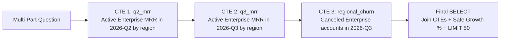

# Chapter 03 — Query Decomposition & SQL Generation

> **Lecture 26 · Chapter 03 of 08** · Level: 🔴 Expert · Phase 6 — Enterprise Data, Semantics & SQL
> **Source:** `FDE S13` · **Roadmap Reference:** [`roadmap-v1.md`](../../roadmap-v1.md#lecture-26--semantic-layer-text-to-sql--analytical-intelligence)
> **Roadmap topics:** Multi-part business questions · CTE-first SQL generation · defensive SQL (`NULLIF`, explicit aliases) · bounded syntax-repair loops.

---

## 03.0 What this chapter is for

Simple questions (*"How many active customers are in NA?"*) map to one `SELECT`. Real executive questions don't:

> **"Which regions had > 15% QoQ active Enterprise MRR growth from Q2 to Q3, and what was their churn count?"**

When an LLM tries to cram three aggregations and a ratio into nested subqueries in one shot, it frequently mixes up `GROUP BY` levels or divides by zero. **Query Decomposition** teaches the agent to think in **named building blocks (CTEs)** before writing a single line of SQL.

By the end of this chapter you should be able to:

1. Decompose a multi-part business question into a sequence of **Common Table Expressions (`WITH ...`)**.
2. Apply **defensive SQL habits** (`NULLIF`, qualified aliases, explicit `GROUP BY`) that prevent runtime crashes.
3. Design a **bounded SQL self-repair loop** (max 2 retries) when the database returns a syntax error.

---

## 03.1 Step-by-Step: From Question to CTEs

Instead of one giant nested query, instruct the generator to decompose into **one logical step per CTE**:



Look how readable and auditable the generated SQL becomes:

```sql
WITH q2_mrr AS (
  SELECT region, SUM(mrr_usd) AS mrr_q2
  FROM mart_subscriptions
  WHERE quarter = '2026-Q2' AND status = 'active' AND plan_tier = 'enterprise'
  GROUP BY region
),
q3_mrr AS (
  SELECT region, SUM(mrr_usd) AS mrr_q3
  FROM mart_subscriptions
  WHERE quarter = '2026-Q3' AND status = 'active' AND plan_tier = 'enterprise'
  GROUP BY region
)
SELECT
  q2.region,
  q2.mrr_q2,
  COALESCE(q3.mrr_q3, 0) AS mrr_q3,
  ROUND(((COALESCE(q3.mrr_q3, 0) - q2.mrr_q2) * 100.0) / NULLIF(q2.mrr_q2, 0), 2) AS growth_pct
FROM q2_mrr q2
LEFT JOIN q3_mrr q3 ON q2.region = q3.region
ORDER BY growth_pct DESC
LIMIT 50;
```

### Three defensive SQL rules baked into every prompt

| Rule | Bad SQL | Safe Defensive SQL | Why |
| :--- | :--- | :--- | :--- |
| **1. Zero-Division Guard** | `(q3 - q2) / q2` | `(q3 - q2) / NULLIF(q2, 0)` | Returns `NULL` instead of crashing the entire query if a new region had `0` Q2 revenue |
| **2. Left Join + `COALESCE`** | `INNER JOIN q3_mrr` | `LEFT JOIN ... COALESCE(q3.mrr_q3, 0)` | An `INNER JOIN` silently drops regions whose Q3 MRR fell to zero! |
| **3. Qualified Aliases** | `SELECT region` | `SELECT q2.region` | Prevents `ambiguous column reference` errors when joining CTEs |

---

## 03.2 Bounded syntax-repair loop

Even good models occasionally emit a dialect typo (e.g., `DATE_TRUNC` argument order in BigQuery vs. Postgres). Wrap execution in a **2-attempt repair loop**:
1. Run AST guard first (never send unsafe SQL to the DB).
2. Execute on read-only DB. If DB returns a syntax/column error, feed **only the exact DB error message** back to the generator for 1 repair attempt.
3. If Attempt 2 still fails, abort and explain the gap — never loop indefinitely.

---

## 03.3 Key takeaways

1. **CTE-first decomposition** turns complex analytical questions into readable, auditable steps.
2. **Always guard divisions with `NULLIF(..., 0)`** and preserve zero-rows with `LEFT JOIN` + `COALESCE`.
3. **Cap syntax self-repair at 2 attempts** and never skip AST validation on repaired SQL.

---

**Next:** [Chapter 04 — SQL AST Validation & Read-Only Guardrails](./04_SQL_AST_Validation_and_Read_Only_Guardrails.md)
