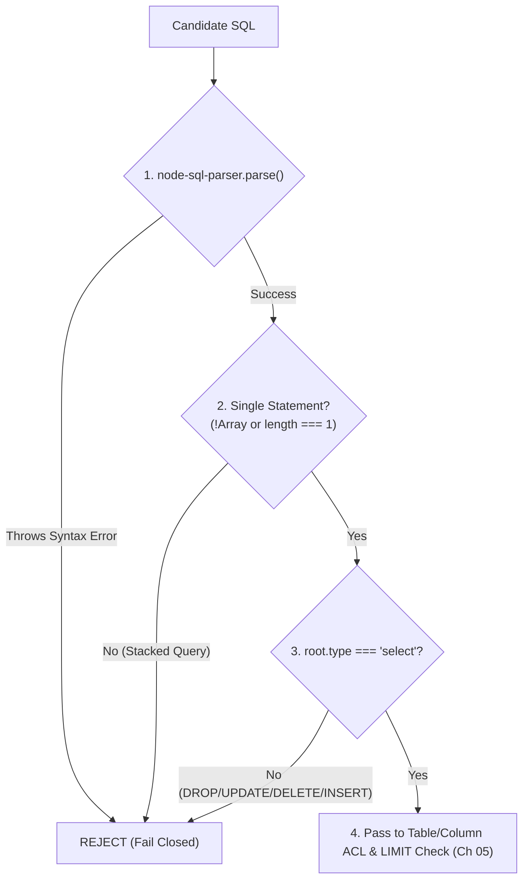

# Chapter 04 — SQL AST Validation & Read-Only Guardrails

> **Lecture 26 · Chapter 04 of 08** · Level: 🔴 Expert · Phase 6 — Enterprise Data, Semantics & SQL
> **Source:** `FDE S13` · **Roadmap Reference:** [`roadmap-v1.md`](../../roadmap-v1.md#lecture-26--semantic-layer-text-to-sql--analytical-intelligence)
> **External Reference:** [node-sql-parser](https://github.com/taozhi8833998/node-sql-parser)
> **Roadmap topics:** Abstract Syntax Tree (AST) parsing · fail-closed validation · single-statement `SELECT` only · blocking DDL/DML (`DROP`, `UPDATE`, `DELETE`, `INSERT`) · defense-in-depth with read-only DB roles.

---

## 04.0 What this chapter is for

In Chapter 01 we proved that regex checks (`!/DROP/i`) can be bypassed. To truly guarantee that an LLM-generated query **cannot mutate, delete, or corrupt** your warehouse, you must parse the SQL string using a real SQL grammar into an **Abstract Syntax Tree (AST)**.

Think of an AST like a compiler's x-ray of a SQL query: comments, whitespace tricks, and capitalization disappear, leaving only the exact structural nodes (`type: "select"`, `from: [...]`, `columns: [...]`, `limit: ...`).

By the end of this chapter you should be able to:

1. Parse SQL into an AST using `node-sql-parser` and inspect its root `type`, `tableList`, and `columnList`.
2. Enforce a **fail-closed** policy: reject syntax errors, multi-statement stacking, and any non-`select` AST node.
3. Combine **Application-Layer AST Validation** with **Database-Layer Read-Only Roles** for defense in depth.

---

## 04.1 How AST validation works step by step

When you pass `SELECT region, mrr_usd FROM mart_subscriptions LIMIT 50` to `node-sql-parser`, it produces a structured tree:

```json
{
  "ast": {
    "type": "select",
    "columns": [{ "expr": { "column": "region" } }, { "expr": { "column": "mrr_usd" } }],
    "from": [{ "table": "mart_subscriptions" }],
    "limit": { "value": [{ "value": 50 }] }
  },
  "tableList": ["select::null::mart_subscriptions"],
  "columnList": ["select::null::region", "select::null::mrr_usd"]
}
```

Now compare what happens when an attacker injects `; DROP TABLE mart_subscriptions;`:
- `ast` becomes an **Array of 2 statements**: `[{ type: "select" }, { type: "drop" }]`!
- Our validator checks `if (Array.isArray(ast) && ast.length !== 1)` $\rightarrow$ **Blocked immediately!**

### Concrete Attack Vector Test Table

| Attack Payload | Naive Regex Guard | AST Validator (`node-sql-parser`) |
| :--- | :--- | :--- |
| `SELECT 1; DROP TABLE users;` | Blocked (if `DROP` checked) | **Blocked:** `Array.isArray(ast)` has length `2` |
| `WITH d AS (DELETE FROM users RETURNING *) SELECT * FROM d` | **BYPASSED** (starts with `WITH`) | **Blocked:** CTE inner AST node has `type === "delete"` |
| `DR/**/OP TABLE users` | **BYPASSED** (comment splits `DROP`) | **Blocked:** Syntax error $\rightarrow$ fail-closed rejection |



---

## 04.2 Defense in depth: AST Guard + Read-Only DB Role

Never rely on a single layer of security:

| Layer | What It Stops | What If It Fails? |
| :--- | :--- | :--- |
| **Layer 1: Application AST Guard** | Blocks `DROP`, `UPDATE`, `SELECT *`, unauthorized columns, and `LIMIT > 200` *before* touching the DB | Layer 2 still blocks writes |
| **Layer 2: Read-Only DB Principal** | Warehouse user `ai_readonly` has `GRANT SELECT` only and `statement_timeout = 5000ms` | Even a 0-day parser bypass cannot `DROP` or `UPDATE` |

---

## 04.3 Key takeaways

1. **Always fail closed:** if `node-sql-parser` cannot parse the SQL, reject it.
2. **Require `ast.length === 1` and `root.type === "select"`** to block 100% of DDL, DML, and stacked queries.
3. **Pair AST validation with a least-privilege read-only DB role** so neither layer is a single point of failure.

---

**Next:** [Chapter 05 — Schema & Column-Level Authorization + Query Budgets](./05_Schema_and_Column_Authorization_and_Query_Budgets.md)
