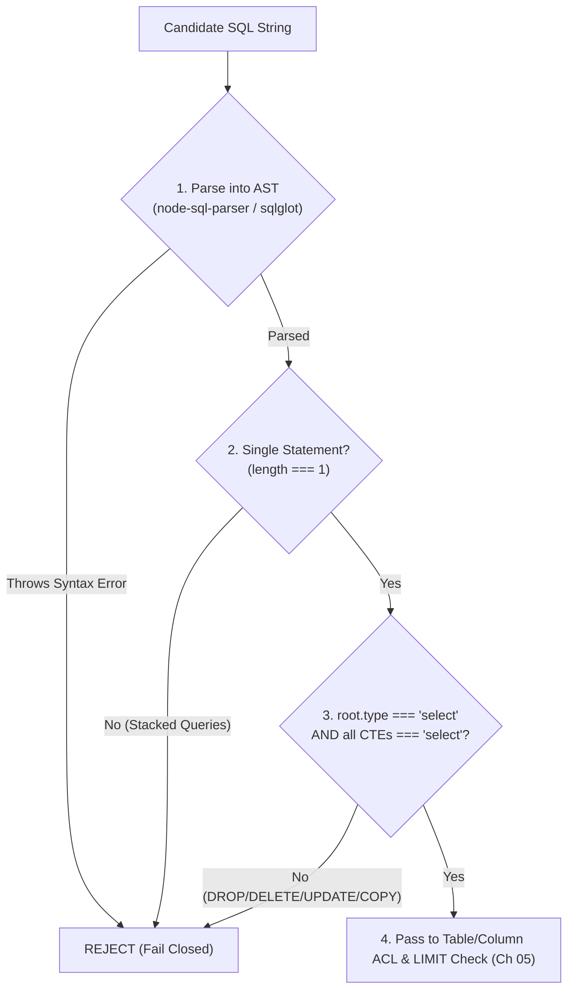
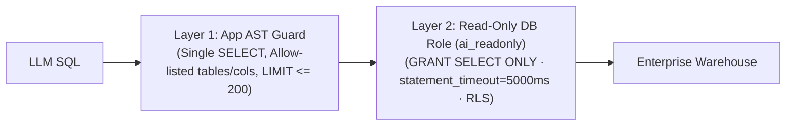

# Chapter 04 — SQL AST Validation & Read-Only Guardrails

> **Lecture 26 · Chapter 04 of 08** · Level: 🔴 Expert · Phase 6 — Enterprise Data, Semantics & SQL
> **Source:** `FDE S13` · **Roadmap Reference:** [`roadmap-v1.md`](../../roadmap-v1.md#lecture-26--semantic-layer-text-to-sql--analytical-intelligence)
> **External Reference:** [node-sql-parser](https://github.com/taozhi8833998/node-sql-parser)
> **Roadmap topics:** Abstract Syntax Tree (AST) parsing · fail-closed validation · single-statement `SELECT` only · blocking DDL/DML (`DROP`, `UPDATE`, `DELETE`, `INSERT`) · defense-in-depth with read-only DB roles.

---

## 04.0 What this chapter is for

In Chapter 01 we saw that regex filters (`!/DROP/i`) are trivially bypassed by inline comments, stacked queries, or data-modifying CTEs. To guarantee that an LLM-generated query **cannot mutate, delete, or corrupt** your enterprise warehouse, you must parse the SQL string using a real SQL grammar into an **Abstract Syntax Tree (AST)**.

Think of an AST as a compiler's X-ray of a SQL query: comments, whitespace tricks, and capitalization vanish, leaving only the exact structural nodes (`type: "select"`, `from: [...]`, `columns: [...]`, `limit: ...`).

By the end of this chapter you should be able to:

1. Parse SQL into an AST using `node-sql-parser` (or `sqlglot` in Python) and inspect its statement count, `type`, `tableList`, and `columnList`.
2. Enforce a **fail-closed** policy: reject syntax errors, multi-statement stacking, and any non-`select` AST node (including nested CTEs).
3. Explain how AST parsing neutralizes `DR/**/OP`, `WITH (DELETE ...)`, and `; DROP TABLE` attacks.
4. Combine **Application-Layer AST Validation** with **Database-Layer Read-Only Roles** for true defense in depth.

---

## 04.1 How AST validation works step by step

When you pass `SELECT region, mrr_usd FROM mart_subscriptions LIMIT 50` to `node-sql-parser`, it returns a structured tree:

```json
{
  "ast": {
    "type": "select",
    "columns": [
      { "expr": { "type": "column_ref", "column": "region" } },
      { "expr": { "type": "column_ref", "column": "mrr_usd" } }
    ],
    "from": [{ "table": "mart_subscriptions" }],
    "limit": { "value": [{ "value": 50 }] }
  },
  "tableList": ["select::null::mart_subscriptions"],
  "columnList": ["select::null::region", "select::null::mrr_usd"]
}
```

Now watch what happens when an attacker injects `; DROP TABLE mart_subscriptions;`:
- `ast` becomes an **Array of 2 statements**: `[{ type: "select", ... }, { type: "drop", ... }]`.
- Our validator checks `if (Array.isArray(ast) && ast.length !== 1)` $\rightarrow$ **Blocked immediately before touching the database!**



### Concrete Attack Vector Comparison

| Attack Payload | Naive Regex Guard | AST Validator (`node-sql-parser`) |
| :--- | :--- | :--- |
| `SELECT 1; DROP TABLE users;` | Blocked (only if `DROP` matched) | **Blocked:** `ast.length === 2` (stacked query rejected) |
| `WITH d AS (DELETE FROM users RETURNING *) SELECT * FROM d` | **BYPASSED** (starts with `WITH`) | **Blocked:** CTE inner AST node has `type === "delete"` |
| `DR/**/OP TABLE users` | **BYPASSED** (comment splits `DROP`) | **Blocked:** Syntax error $\rightarrow$ fail-closed rejection |
| `COPY users TO '/tmp/leak.csv'` | **BYPASSED** (`COPY` forgotten) | **Blocked:** `root.type !== "select"` |

---

## 04.2 Concrete fail-closed AST validator (TypeScript)

```typescript
import { Parser } from "node-sql-parser";

const parser = new Parser();

export function validateReadOnlySelectAst(sql: string, dialect = "Postgresql") {
  let parsed: ReturnType<Parser["parse"]>;
  try {
    parsed = parser.parse(sql, { database: dialect });
  } catch (err) {
    // Fail closed: if the parser cannot understand it, never execute it
    throw new Error(`SQL_AST_PARSE_ERROR: ${(err as Error).message}`);
  }

  const statements = Array.isArray(parsed.ast) ? parsed.ast : [parsed.ast];
  if (statements.length !== 1) {
    throw new Error("SQL_POLICY_VIOLATION: Stacked multi-statement queries are forbidden.");
  }

  const root = statements[0];
  if (!root || root.type !== "select") {
    throw new Error(`SQL_POLICY_VIOLATION: Only SELECT is allowed, got '${root?.type}'.`);
  }

  return parsed;
}
```

> [!IMPORTANT]
> **Also check `tableList` and `columnList` prefixes.** `node-sql-parser` prefixes every entry in `tableList` with the operation type (e.g., `"select::null::mart_subscriptions"` vs. `"delete::null::users"`). Rejecting any entry that does not start with `"select::"` catches data-modifying CTEs even inside complex nested queries!

---

## 04.3 Defense in depth: AST Guard + Read-Only DB Role

Never rely on a single layer of security. Pair your application-level AST Guard with a **Database-Level Read-Only Principal**:



| Defense Layer | What It Stops | What Happens If It Fails? |
| :--- | :--- | :--- |
| **Layer 1: Application AST Guard** | Blocks `DROP`, `UPDATE`, `SELECT *`, unauthorized columns, and `LIMIT > 200` *before* any network call to the DB | Layer 2 still blocks all writes and enforces timeouts |
| **Layer 2: Read-Only DB Principal** | Warehouse role `ai_readonly` has `GRANT SELECT` only, no `CREATE`/`DROP`/`INSERT`, and `statement_timeout = 5000ms` | Even a 0-day AST parser bug cannot mutate or drop a single table |

---

## 04.4 Common mistakes

| # | Common Mistake | Why It Hurts | What To Do Instead |
| :---: | :--- | :--- | :--- |
| 1 | **Failing open when the SQL parser throws an error** | Novel dialect syntax or obfuscated attacks slip straight to the DB | Always **fail closed**: any parse error rejects the query |
| 2 | **Checking only `root.type === "select"` without checking CTEs** | Postgres `WITH d AS (DELETE ...)` has an outer `SELECT` wrapping a `DELETE` | Inspect `tableList` prefixes (`select::`) and recursively check CTE ASTs |
| 3 | **Using the wrong parser dialect** | `Postgresql` vs. `BigQuery` vs. `Snowflake` syntax differences cause false rejections | Pass the exact warehouse dialect (`database: "BigQuery" \| "Postgresql"`) |
| 4 | **Skipping a read-only DB role because "we have an AST guard"** | Single point of failure if a parser bug is discovered | Always pair AST validation with a `GRANT SELECT` DB user |
| 5 | **Not re-running AST validation after syntax self-repair** | Repaired SQL from Attempt 2 bypasses security checks | Run `validateReadOnlySelectAst()` on every single generated/repaired SQL string |

---

## 04.5 Key takeaways

1. **Always fail closed:** if `node-sql-parser` (or `sqlglot`) cannot parse the SQL, reject it immediately.
2. **Require `statements.length === 1` and `root.type === "select"`** (including inside all CTEs) to block 100% of DDL, DML, and stacked queries.
3. **Pair application-layer AST validation with a least-privilege read-only DB role** so neither layer is a single point of failure.

---

**Next:** [Chapter 05 — Schema & Column-Level Authorization + Query Budgets](./05_Schema_and_Column_Authorization_and_Query_Budgets.md)
