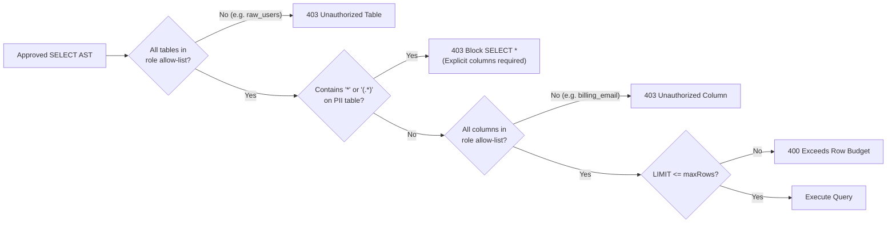

# Chapter 05 — Schema & Column-Level Authorization + Query Budgets

> **Lecture 26 · Chapter 05 of 08** · Level: 🔴 Expert · Phase 6 — Enterprise Data, Semantics & SQL
> **Source:** `FDE S13` · **Roadmap Reference:** [`roadmap-v1.md`](../../roadmap-v1.md#lecture-26--semantic-layer-text-to-sql--analytical-intelligence)
> **Roadmap topics:** Schema-level & column-level authorization · blocking `SELECT *` on mixed-sensitivity tables · row-level security (`tenant_id`) · query cost & row budgets.

---

## 05.0 What this chapter is for

Once your AST guard (Chapter 04) guarantees the query is a read-only `SELECT`, two major risks remain:
1. **Authorization leak:** An `analyst` user asks *"Show me all EMEA customers and their contact emails"* and the LLM emits `SELECT customer_id, billing_email FROM mart_subscriptions` or `SELECT * FROM mart_subscriptions`.
2. **Wallet / Latency DoS:** The LLM emits `SELECT customer_id, mrr_usd FROM events LIMIT 5000000`, scanning terabytes and blowing your warehouse bill.

By the end of this chapter you should be able to:

1. Enforce **role-based table & column allow-lists** directly on the parsed AST (`tableList`, `columnList`).
2. Explain why **`SELECT *` must be blocked** on any table containing restricted PII columns.
3. Enforce **row limits (`LIMIT <= maxRows`)**, **byte-scan caps**, and **tenant row-level security (`tenant_id`)**.

---

## 05.1 Table & Column Allow-Lists in Practice

In our `mart_subscriptions` table, we have 7 columns, but `billing_email` is restricted PII:

| Role | Allowed Tables | Allowed Columns | `SELECT *` Allowed? |
| :--- | :--- | :--- | :---: |
| **`analyst`** | `mart_subscriptions` | `customer_id`, `region`, `plan_tier`, `status`, `mrr_usd`, `quarter` | **No** (would expose `billing_email`) |
| **`admin`** | `mart_subscriptions` | All 7 columns including `billing_email` | **Yes** (or explicit list) |



---

## 05.2 Row-Level Security & Cost Budgets

1. **Tenant Isolation (`tenant_id`):** In multi-tenant warehouses, never trust the LLM to remember `WHERE tenant_id = 't1'`. Either use **Postgres Row-Level Security (RLS)** on the DB session or inject/rewrite the AST `WHERE` clause deterministically in the harness:
   ```sql
   -- Postgres RLS: DB engine enforces tenant_id even if LLM forgets WHERE!
   ALTER TABLE mart_subscriptions ENABLE ROW LEVEL SECURITY;
   CREATE POLICY tenant_isolation ON mart_subscriptions
     USING (tenant_id = current_setting('app.current_tenant_id'));
   ```
2. **Query Cost Budgets:**
   - **Row cap:** Reject `LIMIT > 200` (or inject `LIMIT 200` if omitted).
   - **Scan-byte cap:** Use BigQuery's `maximumBytesBilled` or Snowflake's `EXPLAIN` dry-run to abort queries scanning `> 1 GB` before execution.
   - **Wall-clock cap:** `SET statement_timeout = 5000` (5 seconds).

---

## 05.3 Key takeaways

1. **Authorize both tables AND individual columns** from the parsed AST against the caller's role.
2. **Block `SELECT *`** on any mixed-sensitivity table so restricted PII cannot slip through.
3. **Bound every query with `LIMIT`, scan-byte caps, and timeouts** to protect warehouse cost and latency.

---

**Next:** [Chapter 06 — Sandboxed Python Analytical Intelligence](./06_Sandboxed_Python_Analytical_Intelligence.md)
