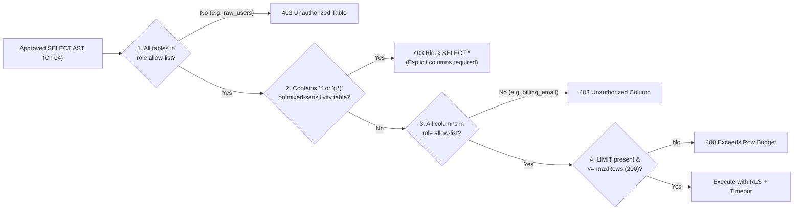
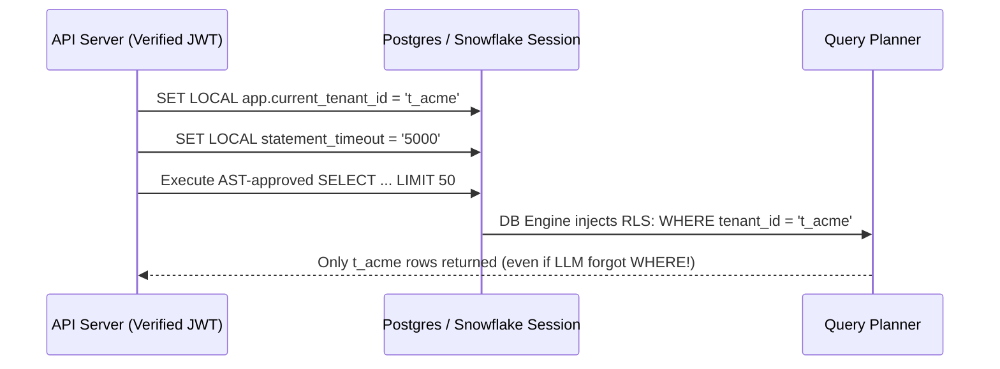

# Chapter 05 — Schema & Column-Level Authorization + Query Budgets

> **Lecture 26 · Chapter 05 of 08** · Level: 🔴 Expert · Phase 6 — Enterprise Data, Semantics & SQL
> **Source:** `FDE S13` · **Roadmap Reference:** [`roadmap-v1.md`](../../roadmap-v1.md#lecture-26--semantic-layer-text-to-sql--analytical-intelligence)
> **Roadmap topics:** Schema-level & column-level authorization · blocking `SELECT *` on mixed-sensitivity tables · row-level security (`tenant_id`) · query cost & row budgets.

---

## 05.0 What this chapter is for

Once your AST guard (Chapter 04) guarantees that a query is a single read-only `SELECT`, two major enterprise risks still remain:
1. **Authorization & PII Leak:** An `analyst` user asks *"Show me all EMEA customers and their contact emails"* and the LLM emits `SELECT customer_id, billing_email FROM mart_subscriptions`—or worse, `SELECT * FROM mart_subscriptions`.
2. **Wallet / Latency DoS:** The LLM emits `SELECT customer_id, mrr_usd FROM events LIMIT 5000000`, scanning terabytes of cold data and blowing up your warehouse bill or crashing the agent's context window.

By the end of this chapter you should be able to:

1. Enforce **role-based table & column allow-lists** directly on the parsed AST (`tableList`, `columnList`).
2. Explain why **`SELECT *` must be blocked** on any mixed-sensitivity table containing restricted PII columns.
3. Enforce **Row-Level Security (`tenant_id`)** at the database session layer so multi-tenant isolation never depends on the LLM remembering a `WHERE` clause.
4. Bound every query with **row budgets (`LIMIT <= maxRows`)**, **scan-byte caps**, and **execution timeouts**.

---

## 05.1 Table & column allow-lists in practice

In our `mart_subscriptions` table, 6 columns are safe analytical dimensions, while `billing_email` and `tax_id` are restricted PII:

| Role | Allowed Tables | Allowed Columns | `SELECT *` Allowed? |
| :--- | :--- | :--- | :---: |
| **`analyst`** | `mart_subscriptions`, `dim_customers` | `customer_id`, `region`, `plan_tier`, `status`, `mrr_usd`, `quarter` | **No** (would expose `billing_email` & `tax_id`) |
| **`finance_admin`** | `mart_subscriptions`, `dim_customers` | All columns including `billing_email`, `tax_id` | **No** (explicit columns still best practice) |



> [!IMPORTANT]
> **Why `SELECT *` is a security vulnerability.** Even if `billing_email` is hidden from the LLM's schema prompt, an LLM trained on SQL often defaults to `SELECT * FROM mart_subscriptions`—which pulls `billing_email` straight out of the database into the tool output! Always reject `*` (`column === "*"`) in the AST validator on any table with restricted columns.

---

## 05.2 Concrete AST column & limit enforcement (TypeScript)

```typescript
export function enforceAclAndBudget(
  parsed: { ast: any; tableList: string[]; columnList: string[] },
  policy: { allowedTables: Set<string>; allowedColumns: Set<string>; maxRows: number }
) {
  for (const entry of parsed.tableList) {
    const [, , tableName] = entry.split("::");
    if (!policy.allowedTables.has(tableName)) {
      throw new Error(`AUTHZ_DENIED_TABLE: '${tableName}' is not allow-listed for this role.`);
    }
  }

  for (const entry of parsed.columnList) {
    const [, , colName] = entry.split("::");
    if (colName === "(.*)" || colName === "*") {
      throw new Error("AUTHZ_DENIED_WILDCARD: SELECT * is forbidden; specify explicit columns.");
    }
    if (!policy.allowedColumns.has(colName)) {
      throw new Error(`AUTHZ_DENIED_COLUMN: '${colName}' is restricted for this role.`);
    }
  }

  const limitVal = parsed.ast?.limit?.value?.[0]?.value;
  if (typeof limitVal !== "number" || limitVal > policy.maxRows) {
    throw new Error(`BUDGET_EXCEEDED: Query must include LIMIT <= ${policy.maxRows}.`);
  }
}
```

---

## 05.3 Row-Level Security (RLS) & query cost budgets

Never rely on the LLM to remember `WHERE tenant_id = 't_acme'`. Enforce tenant isolation and cost caps in the **database session** itself:



```sql
-- Postgres Row-Level Security (RLS): enforced by the DB engine on every query
ALTER TABLE mart_subscriptions ENABLE ROW LEVEL SECURITY;

CREATE POLICY tenant_isolation ON mart_subscriptions
  USING (tenant_id = current_setting('app.current_tenant_id'));
```

### Three mandatory query cost budgets

| Budget Control | Mechanism | Recommended Default | Protects Against |
| :--- | :--- | :---: | :--- |
| **1. Row Budget** | AST `LIMIT` check (or deterministic `LIMIT` injection) | `<= 200` rows | Flooding LLM context with 100,000 raw rows |
| **2. Scan-Byte Cap** | BigQuery `maximumBytesBilled` or Snowflake `EXPLAIN` dry-run | `<= 1 GB` per query | `$45` full-table scans on unpartitioned event logs |
| **3. Wall-Clock Timeout** | `SET statement_timeout = 5000` (Postgres) / `STATEMENT_TIMEOUT_IN_SECONDS` | `5–10 seconds` | Cartesian cross-joins hanging warehouse compute |

> [!WARNING]
> **Watch out for `LIMIT` on unaggregated queries.** `SELECT * FROM events LIMIT 50` without a partition filter can still scan 4 billion rows if it has an `ORDER BY timestamp DESC` on an unindexed column! Always pair `LIMIT` with a **scan-byte cap** (`maximumBytesBilled` / `EXPLAIN` cost check).

---

## 05.4 Common mistakes

| # | Common Mistake | Why It Hurts | What To Do Instead |
| :---: | :--- | :--- | :--- |
| 1 | **Allowing `SELECT *` on tables with PII columns** | Exposes restricted columns even when they were hidden from the schema prompt | Block `*` and `(.*)` in the AST validator; require explicit column lists |
| 2 | **Asking the LLM to add `WHERE tenant_id = ...` in the prompt** | One forgotten `WHERE` clause or prompt injection leaks another tenant's rows | Enforce `tenant_id` via **Postgres RLS** or deterministic AST `WHERE` injection |
| 3 | **Relying on `LIMIT 200` alone to control warehouse cost** | `ORDER BY` or `GROUP BY` over 4B rows still scans the entire table before limiting | Pair `LIMIT` with `maximumBytesBilled` / dry-run `EXPLAIN` and `statement_timeout` |
| 4 | **Authorizing only at the table level** | `analyst` needs `mart_subscriptions.mrr_usd` but must not see `billing_email` | Enforce **both** `allowedTables` and `allowedColumns` on the parsed AST |
| 5 | **Returning 50,000 rows to the LLM** | Blows token budgets and triggers "lost-in-the-middle" numerical errors | Cap SQL output at `<= 200` rows and aggregate in SQL before Python |

---

## 05.5 Key takeaways

1. **Authorize both tables AND individual columns** from the parsed AST against the caller's role.
2. **Block `SELECT *`** on mixed-sensitivity tables so restricted PII cannot leak into tool outputs.
3. **Enforce multi-tenant isolation via DB Row-Level Security (RLS)**—never trust the LLM to remember `WHERE tenant_id`.
4. **Bound every query with `LIMIT`, scan-byte caps, and `statement_timeout`** to protect warehouse cost and latency.

---

**Next:** [Chapter 06 — Sandboxed Python Analytical Intelligence](./06_Sandboxed_Python_Analytical_Intelligence.md)
