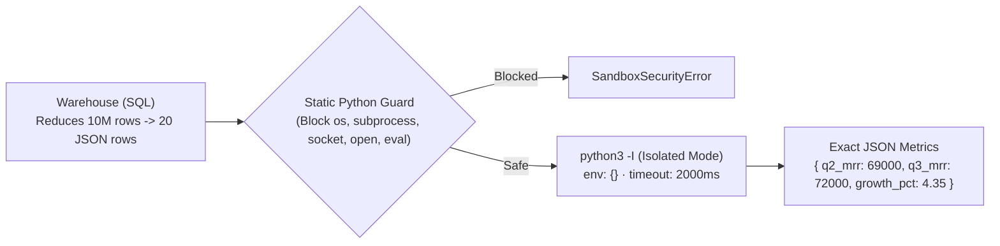

# Chapter 06 — Sandboxed Python Analytical Intelligence

> **Lecture 26 · Chapter 06 of 08** · Level: 🔴 Expert · Phase 6 — Enterprise Data, Semantics & SQL
> **Source:** `FDE S14` · **Roadmap Reference:** [`roadmap-v1.md`](../../roadmap-v1.md#lecture-26--semantic-layer-text-to-sql--analytical-intelligence)
> **Roadmap topics:** SQL for reduction vs. Python for computation · why LLMs fail at mental math · isolated `python3 -I` sandboxes · static import bans · timeouts & memory caps.

---

## 06.0 What this chapter is for

Suppose SQL returns our active Enterprise MRR:
- `2026-Q2`: `69,000`
- `2026-Q3`: `72,000`

If you ask the LLM to write the answer directly, it has to compute `(72000 - 69000) / 69000 * 100` using next-token prediction. On 2 numbers it might get `4.35%` right; on 25 rows of cohort retention or a standard deviation, **LLMs routinely hallucinate arithmetic**.

The fix is simple: **never ask an LLM to do math.** Offload all arithmetic and statistics to **Sandboxed Python**.

By the end of this chapter you should be able to:

1. Split analytical workloads cleanly between **SQL (data reduction)** and **Python (statistical computation)**.
2. Execute dynamically generated Python safely using **four sandbox layers** (static import bans, `python3 -I`, empty `env: {}`, strict timeout).
3. Return structured JSON metrics from Python so the Numerical Reconciler (Chapter 08) can verify the final prose.

---

## 06.1 SQL vs. Python: Who does what?

| Step | Tool | Input $\rightarrow$ Output | Why This Tool Wins |
| :--- | :--- | :--- | :--- |
| **1. Filter, Join & Aggregate** | **SQL (Warehouse)** | `10,000,000` raw rows $\rightarrow$ `20` summary rows | Columnar engines scan billions of rows in milliseconds without moving data over the network. |
| **2. Ratios, Growth, Z-Scores & Forecasting** | **Python (Sandbox)** | `20` JSON rows $\rightarrow$ `{ q2: 69000, q3: 72000, growth_pct: 4.35 }` | Exact IEEE-754 floating-point math (`math`, `statistics`) instead of token-prediction guessing. |



---

## 06.2 Four mandatory Python sandbox controls

Running arbitrary LLM-generated Python with `exec()` on your API server is a **Remote Code Execution (RCE)** vulnerability. Always enforce all four layers:

1. **Static Import & Builtin Guard:** Before spawning Python, reject any script containing `os`, `subprocess`, `socket`, `http`, `urllib`, `ctypes`, `shutil`, `pathlib`, `importlib`, `open(`, `eval(`, `exec(`, or `__import__(`.
2. **Isolated Interpreter (`python3 -I`):** Ignores user site-packages and `PYTHONPATH`, preventing malicious local module shadowing.
3. **Zero Inherited Environment (`env: {}`):** Even if a script somehow inspected `os.environ`, no `OPENAI_API_KEY`, `DATABASE_URL`, or AWS credentials exist in the child process.
4. **Strict Time & Buffer Caps (`timeout: 2000ms`, `maxBuffer: 256KB`):** Stops `while True: pass` infinite loops or stdout memory bombs immediately.

```typescript
// Launching isolated Python cleanly from Node.js
const res = spawnSync("python3", ["-I", "-c", safeScript], {
  env: {},              // Zero secrets inherited!
  timeout: 2000,        // Kill infinite loops at 2s
  maxBuffer: 256 * 1024,
  encoding: "utf8",
});
```

> [!TIP]
> **In multi-tenant SaaS production:** Pair these process-level controls with a **container or microVM boundary** (Docker `--network=none --read-only`, Firecracker, or Cloudflare Sandboxes) as covered in Lecture 08 Chapter 07.

---

## 06.3 Key takeaways

1. **SQL reduces data; Python computes math; LLMs narrate.** Never ask an LLM to calculate percentages or statistics in its head.
2. **Always return structured JSON** from the Python sandbox so downstream gates can verify every number.
3. **Never run LLM-generated Python without static import bans, `-I`, `env: {}`, and a hard timeout.**

---

**Next:** [Chapter 07 — Cross-Modal Reasoning (SQL + Vector + Graph)](./07_Cross_Modal_Reasoning_SQL_Vector_Graph.md)
