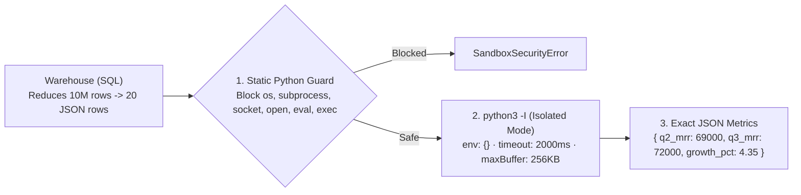

# Chapter 06 — Sandboxed Python Analytical Intelligence

> **Lecture 26 · Chapter 06 of 08** · Level: 🔴 Expert · Phase 6 — Enterprise Data, Semantics & SQL
> **Source:** `FDE S14` · **Roadmap Reference:** [`roadmap-v1.md`](../../roadmap-v1.md#lecture-26--semantic-layer-text-to-sql--analytical-intelligence)
> **Roadmap topics:** SQL for reduction vs. Python for computation · why LLMs fail at mental math · isolated `python3 -I` sandboxes · static import bans · timeouts & memory caps.

---

## 06.0 What this chapter is for

Suppose our guarded SQL query returns active Enterprise MRR:
- `2026-Q2`: `69,000`
- `2026-Q3`: `72,000`

If you ask the LLM to write the executive summary directly from those two numbers, it has to compute `(72000 - 69000) / 69000 * 100` using next-token prediction. On two simple numbers it might get `4.35%` right—or it might hallucinate `4.8%`. On 25 rows of cohort retention, weighted averages, or anomaly z-scores, **LLMs routinely hallucinate arithmetic**.

The engineering rule is absolute: **never ask an LLM to do math.** Offload all arithmetic, ratios, statistics, and cohort calculations to **Sandboxed Python**.

By the end of this chapter you should be able to:

1. Split analytical workloads cleanly between **SQL (data reduction)** and **Python (exact IEEE-754 computation)**.
2. Execute LLM-generated Python safely using **four mandatory sandbox controls** (static import/builtin bans, `python3 -I`, empty `env: {}`, strict timeout & memory/buffer caps).
3. Explain why running `exec()` or bare `python3 -c` on an API server creates an immediate **Remote Code Execution (RCE)** vulnerability.
4. Return **structured JSON metrics** from Python so the Numerical Reconciliation Gate (Chapter 08) can verify the final prose.

---

## 06.1 SQL vs. Python: Who does what?

| Analytical Stage | Engine | Input $\rightarrow$ Output | Why This Engine Wins |
| :--- | :--- | :--- | :--- |
| **1. Filter, Join & Aggregate** | **SQL (Warehouse)** | `10,000,000` raw rows $\rightarrow$ `20` summary rows | Columnar engines scan billions of rows in milliseconds without moving data over the network |
| **2. Ratios, Growth, Z-Scores & Forecasting** | **Python (Sandbox)** | `20` JSON rows $\rightarrow$ `{ q2: 69000, q3: 72000, growth_pct: 4.35 }` | Exact IEEE-754 floating-point math (`math`, `statistics`) instead of token-prediction guessing |
| **3. Narrative Synthesis** | **LLM + Reconciler** | Verified JSON + Vector quotes $\rightarrow$ Executive brief | Fluent prose grounded 100% in deterministic numbers |



---

## 06.2 Four mandatory Python sandbox controls

Running arbitrary LLM-generated Python with `exec()` in your app process—or spawning `python3` with inherited environment variables—is a **Remote Code Execution (RCE)** and **credential-theft** vulnerability. Always enforce all four controls:

1. **Static Import & Builtin Guard:** Before spawning Python, parse or scan the script and reject any use of dangerous modules/builtins: `os`, `sys`, `subprocess`, `socket`, `http`, `urllib`, `ctypes`, `shutil`, `pathlib`, `importlib`, `open(`, `eval(`, `exec(`, `compile(`, `__import__(`, `__builtins__`.
2. **Isolated Interpreter (`python3 -I`):** Runs Python in isolated mode—ignoring `PYTHONPATH`, user `site-packages`, and current-directory module shadowing.
3. **Zero Inherited Environment (`env: {}`):** Passes an empty environment object so `OPENAI_API_KEY`, `DATABASE_URL`, and AWS credentials do not exist in the child process.
4. **Strict Time & Output Caps (`timeout: 2000ms`, `maxBuffer: 256KB`):** Kills infinite loops (`while True: pass`) and stdout memory bombs (`print("A" * 10**9)`) immediately.

```typescript
import { spawnSync } from "node:child_process";

const BANNED_PATTERN =
  /\b(os|sys|subprocess|socket|http|urllib|ctypes|shutil|pathlib|importlib|open|eval|exec|compile|__import__|__builtins__)\b/;

export function runSandboxedPython(script: string, inputRows: unknown[]) {
  if (BANNED_PATTERN.test(script)) {
    throw new Error("SANDBOX_VIOLATION: Banned module or builtin detected.");
  }

  const wrappedScript = `
import json, math, statistics
DATA = json.loads(${JSON.stringify(JSON.stringify(inputRows))})
${script}
`;

  const res = spawnSync("python3", ["-I", "-c", wrappedScript], {
    env: {}, // Zero secrets inherited!
    timeout: 2000, // Kill infinite loops at 2s
    maxBuffer: 256 * 1024, // 256 KB stdout cap
    encoding: "utf8",
  });

  if (res.error || res.status !== 0) {
    throw new Error(`SANDBOX_EXEC_ERROR: ${res.stderr || res.error?.message}`);
  }
  return JSON.parse(res.stdout.trim());
}
```

> [!TIP]
> **Multi-tenant SaaS production hardening.** Process-level isolation (`python3 -I`, `env: {}`) is your baseline for trusted internal tools. For untrusted external users, wrap Python inside a **container or microVM boundary** (`docker run --network=none --read-only --memory=128m`, Firecracker, or Cloudflare Sandboxes) so kernel-level namespaces isolate filesystem, CPU, and network completely.

---

## 06.3 Worked example: Computing exact QoQ growth & anomaly z-score

Given SQL output `[{"quarter": "2026-Q2", "mrr": 69000}, {"quarter": "2026-Q3", "mrr": 72000}]`, the LLM writes a small, pure-math Python script:

```python
q2 = next(r["mrr"] for r in DATA if r["quarter"] == "2026-Q2")
q3 = next(r["mrr"] for r in DATA if r["quarter"] == "2026-Q3")
delta = q3 - q2
growth_pct = round((delta / q2) * 100, 2) if q2 else None

print(json.dumps({
    "q2_mrr": q2,
    "q3_mrr": q3,
    "delta_usd": delta,
    "growth_pct": growth_pct
}))
```

Output:
```json
{"q2_mrr": 69000, "q3_mrr": 72000, "delta_usd": 3000, "growth_pct": 4.35}
```

Every key in that JSON object becomes an entry in the **Ground-Truth Numerical Ledger** checked by Chapter 08's Numerical Reconciliation Gate.

---

## 06.4 Common mistakes

| # | Common Mistake | Why It Hurts | What To Do Instead |
| :---: | :--- | :--- | :--- |
| 1 | **Asking the LLM to compute `%` growth or `stddev` in prose** | Next-token prediction hallucinates floating-point arithmetic | Compute all math in Sandboxed Python and return JSON |
| 2 | **Spawning `python3` without `env: {}`** | Child process inherits `OPENAI_API_KEY` and `DATABASE_URL` | Always pass `env: {}` and `-I` (isolated mode) |
| 3 | **Running Python without a `timeout` or `maxBuffer`** | An accidental `while True` or huge `print()` hangs or OOMs the API server | Set `timeout: 2000` and `maxBuffer: 256 * 1024` (plus container memory limits) |
| 4 | **Loading 10M raw rows into Python `pandas`** | Network transfer + memory explosion; warehouse SQL is 100x faster | Aggregate in SQL first (`<= 200` summary rows), then compute stats in Python |
| 5 | **Returning unstructured text from Python** | Downstream Numerical Reconciler cannot verify prose against a structured ledger | Require Python scripts to `print(json.dumps(...))` |

---

## 06.5 Key takeaways

1. **SQL reduces data; Python computes math; LLMs narrate.** Never ask an LLM to calculate percentages or statistics in its head.
2. **Enforce all four sandbox controls:** static import/builtin bans, `python3 -I`, `env: {}`, and strict `timeout` / `maxBuffer` caps (plus containers/microVMs for untrusted users).
3. **Emit structured JSON from Python** so every computed metric feeds directly into the Numerical Reconciliation Gate (Chapter 08).

---

**Next:** [Chapter 07 — Cross-Modal Reasoning (SQL + Vector + Graph)](./07_Cross_Modal_Reasoning_SQL_Vector_Graph.md)
