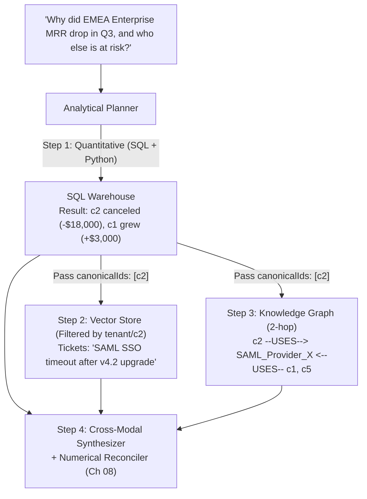

# Chapter 07 — Cross-Modal Reasoning (SQL + Vector + Graph)

> **Lecture 26 · Chapter 07 of 08** · Level: 🔴 Expert · Phase 6 — Enterprise Data, Semantics & SQL
> **Source:** `FDE S14` · **Roadmap Reference:** [`roadmap-v1.md`](../../roadmap-v1.md#lecture-26--semantic-layer-text-to-sql--analytical-intelligence)
> **Roadmap topics:** Multi-step analytical planning · combining structured SQL aggregates with unstructured Vector evidence and Graph relationships · canonical ID joins across modalities.

---

## 07.0 What this chapter is for

Returning to our running case study:

> **"EMEA Enterprise MRR dropped from `$30,000` in Q2 to `$15,000` in Q3. *Why* did it drop, and *who else* is at risk?"**

No single database can answer all three parts of that question:
- **SQL (Warehouse)** knows *how much* (`c2` canceled `-$18,000`, `c1` expanded `+$3,000` $\rightarrow$ net `-$15,000`).
- **Vector RAG (Support Tickets)** knows *why* (`c2` filed 3 tickets citing `"SAML SSO timeout after v4.2 upgrade"`).
- **Knowledge Graph (Dependencies)** knows *who else is at risk* (`c1` and `c5` also use the exact same `SAML_Provider_X` node!).

By the end of this chapter you should be able to:

1. Plan a **3-modality analytical workflow** (SQL $\rightarrow$ Vector + Graph).
2. Join across modalities deterministically using **`canonicalId`s** (Lecture 24) rather than fuzzy company names.
3. Keep quantitative SQL/Python facts separate from qualitative Vector quotes before final synthesis.

---

## 07.1 The Cross-Modal Analytical Flow

### Why you MUST pass `canonicalId`s from SQL into Vector & Graph

If you let the Vector store do a broad semantic search for `"EMEA churn"`, it might pull support tickets from **2024** or from a **different customer** (`Beta Corp US` vs. `Beta Corp EU`). By running SQL **first** to identify the exact `canonicalId` (`c2`) and passing `filter: { customerId: "c2" }` into Vector and Graph, every qualitative quote is **provably tied to the exact revenue delta**.

---

## 07.2 Key takeaways

1. **SQL = *how much*; Vector = *why*; Graph = *who else is connected*.**
2. **Run SQL first to anchor `canonicalId`s**, then filter Vector and Graph queries by those exact IDs.
3. **Never blend unverified Vector numbers into SQL totals** — pass all numbers through the Numerical Reconciliation Gate (Chapter 08).

---

**Next:** [Chapter 08 — Numerical Reconciliation & Execution-Accuracy Evals](./08_Numerical_Reconciliation_and_Execution_Accuracy_Evals.md)
