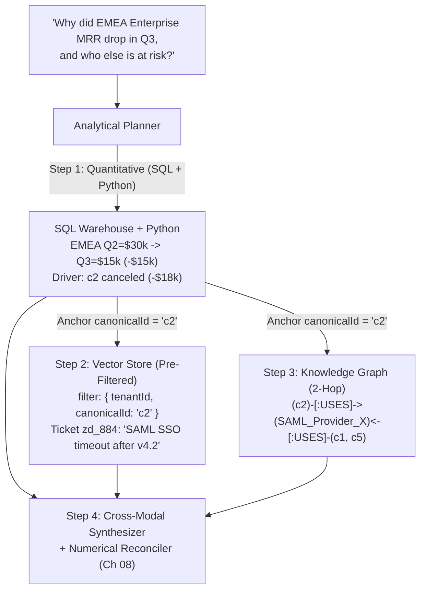
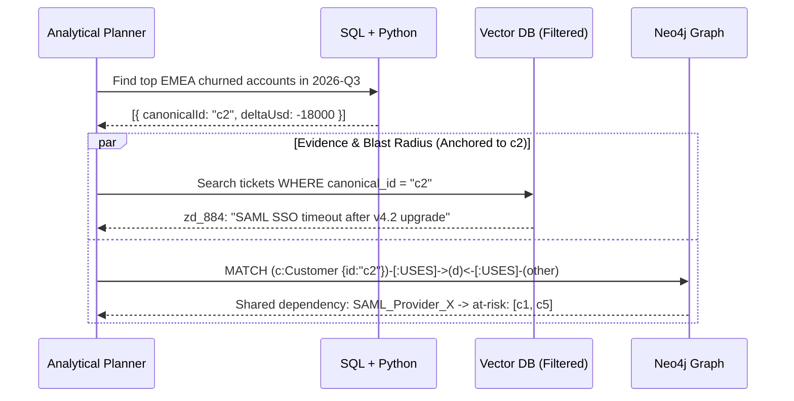

# Chapter 07 — Cross-Modal Reasoning (SQL + Vector + Graph)

> **Lecture 26 · Chapter 07 of 08** · Level: 🔴 Expert · Phase 6 — Enterprise Data, Semantics & SQL
> **Source:** `FDE S14` · **Roadmap Reference:** [`roadmap-v1.md`](../../roadmap-v1.md#lecture-26--semantic-layer-text-to-sql--analytical-intelligence)
> **Roadmap topics:** Multi-step analytical planning · combining structured SQL aggregates with unstructured Vector evidence and Graph relationships · canonical ID joins across modalities.

---

## 07.0 What this chapter is for

Returning to the second half of our running VP of Sales question:

> **"EMEA Enterprise MRR dropped from `$30,000` in Q2 to `$15,000` in Q3. *Why* did it drop, and *who else* is at risk?"**

No single database in an enterprise can answer all three parts of that question:
- **SQL (Warehouse)** knows *how much* (`c2` canceled `-$18,000`, `c1` expanded `+$3,000` $\rightarrow$ net `-$15,000`).
- **Vector RAG (Support Tickets & Call Transcripts)** knows *why* (`c2` filed 3 urgent tickets citing `"SAML SSO timeout after v4.2 upgrade"`).
- **Knowledge Graph (Dependency & Org Relationships)** knows *who else is at risk* (`c1` and `c5` also share the exact same `SAML_Provider_X` integration node!).

By the end of this chapter you should be able to:

1. Design a **3-modality analytical planner** (SQL $\rightarrow$ Vector + Graph) that routes each sub-question to the right engine.
2. Anchor cross-modal retrieval deterministically using **`canonicalId`s** from SQL (never broad, unfiltered semantic search).
3. Separate **quantitative SQL/Python truth** from **qualitative Vector/Graph evidence** before final synthesis.
4. Explain how **cross-modal provenance** prevents mixing anecdotal ticket numbers into financial totals.

---

## 07.1 The 3-modality analytical flow

| Modality | Question It Answers | Strength | Blind Spot |
| :--- | :--- | :--- | :--- |
| **1. SQL + Python** | *What* happened & *how much*? | Exact sums, counts, deltas, growth `%` | Doesn't know *why* a customer canceled |
| **2. Vector RAG** | *Why* did it happen? | Unstructured prose: tickets, Gong calls, emails | Terrible at global `SUM`/`COUNT` and cross-customer joins |
| **3. Knowledge Graph** | *Who else* is connected / at risk? | Multi-hop dependency & blast-radius traversal | Doesn't store full unstructured prose or billing ledgers |



---

## 07.2 Why you MUST anchor Vector & Graph with SQL `canonicalId`s

If you let a Vector store run an unanchored semantic search for `"EMEA churn reason"`, two things go wrong:
1. **Temporal & entity drift:** It pulls a support ticket from **2024** or from a **different customer** (`Beta Corp US` instead of `c2`).
2. **False causality:** The LLM weaves an unrelated ticket's complaint into Q3's `$18,000` churn explanation.

By running **SQL first** to identify the exact `canonicalId` (`c2`) responsible for the `-$18,000` drop, and then passing `filter: { tenantId: caller.tenantId, canonicalId: "c2" }` into Vector and Graph, every qualitative quote is **provably tied to the exact revenue delta**.



---

## 07.3 Concrete 3-modality synthesis payload

Keep the structured payload cleanly partitioned before handing it to the final synthesizer LLM:

```json
{
  "sqlPythonTruth": {
    "region": "EMEA",
    "q2MrrUsd": 30000,
    "q3MrrUsd": 15000,
    "netDeltaUsd": -15000,
    "deltaPct": -50.0,
    "primaryChurn": { "canonicalId": "c2", "deltaUsd": -18000 }
  },
  "vectorEvidence": [
    {
      "canonicalId": "c2",
      "ticketId": "zd_884",
      "createdAt": "2026-08-14T11:20:00Z",
      "quote": "SAML SSO timeout after v4.2 upgrade blocked 200 engineers."
    }
  ],
  "graphBlastRadius": [
    {
      "sharedDependency": "SAML_Provider_X",
      "atRiskCustomerIds": ["c1", "c5"],
      "hopCount": 2
    }
  ]
}
```

> [!IMPORTANT]
> **Never blend numbers mentioned inside support tickets into SQL totals.** If ticket `zd_884` says *"We lost $50k of productivity"*, the synthesizer must never confuse that prose number with the `$18,000` MRR churn from `sqlPythonTruth`. Keep `sqlPythonTruth` as the sole numerical ledger for Chapter 08's Reconciliation Gate.

---

## 07.4 Common mistakes

| # | Common Mistake | Why It Hurts | What To Do Instead |
| :---: | :--- | :--- | :--- |
| 1 | **Running broad Vector search without `canonicalId` filtering** | Attaches old or wrong-customer complaints to a specific revenue drop | Run SQL first to get `canonicalId`s, then pre-filter Vector & Graph by those IDs |
| 2 | **Asking Vector RAG to count or sum revenue** | Top-K retrieval misses rows and hallucinates totals | Always use SQL + Python for quantitative totals; Vector only for *why* |
| 3 | **Using fuzzy company names across modalities** | `"Acme Corp"` in SQL fails to match `"Acme Inc."` in Neo4j/Qdrant | Stamp `canonicalId` (Lecture 24 Ch 04) on all SQL rows, Vector chunks, and Graph nodes |
| 4 | **Skipping tenant filters on Graph 2-hop queries** | Shared dependency nodes can bridge across tenants | Enforce `tenant_id` on every node and edge in every Cypher traversal |
| 5 | **Mixing prose numbers from tickets into financial KPIs** | Confuses anecdotal customer claims with governed warehouse metrics | Pass only `sqlPythonTruth` into the Numerical Reconciliation Ledger |

---

## 07.5 Key takeaways

1. **SQL = *how much*; Python = *exact math*; Vector = *why*; Graph = *who else is connected*.**
2. **Run SQL first to anchor `canonicalId`s**, then filter Vector and Graph queries by those exact IDs and `tenantId`.
3. **Never blend unverified Vector prose numbers into SQL totals**—keep quantitative truth isolated for the Numerical Reconciliation Gate (Chapter 08).

---

**Next:** [Chapter 08 — Numerical Reconciliation & Execution-Accuracy Evals](./08_Numerical_Reconciliation_and_Execution_Accuracy_Evals.md)
