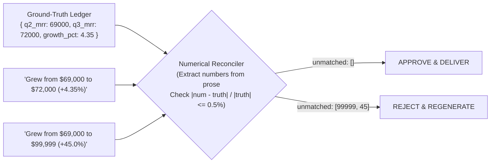

# Chapter 08 — Numerical Reconciliation & Execution-Accuracy Evals

> **Lecture 26 · Chapter 08 of 08** · Level: 🔴 Expert · Phase 6 — Enterprise Data, Semantics & SQL
> **Source:** `FDE S14` · **Roadmap Reference:** [`roadmap-v1.md`](../../roadmap-v1.md#lecture-26--semantic-layer-text-to-sql--analytical-intelligence)
> **Roadmap topics:** Numerical reconciliation gate · verifying narrative numbers against SQL/Python truth · Execution Accuracy (EX) vs. exact-string SQL match · 10-question release-gate benchmark.

---

## 08.0 What this chapter is for

Imagine your SQL query ran safely, your Python sandbox computed the exact right numbers (`q2_mrr = 69000`, `q3_mrr = 72000`, `growth_pct = 4.35`), and then the LLM writing the final Slack/UI summary hallucinates:

> *"Active Enterprise MRR grew from `$69,000` to `$74,000` (`+7.2%`) in Q3."*

All your upstream engineering just failed at the last mile! **Numerical Reconciliation** is the deterministic final gate that catches narrative number hallucinations *before* the user sees them.

By the end of this chapter you should be able to:

1. Build a **Numerical Reconciliation Gate** that extracts every number from LLM prose and verifies it against the SQL/Python ground-truth ledger.
2. Explain why **Execution Accuracy (EX)** is the gold-standard metric for evaluating Text-to-SQL agents (instead of SQL string matching).
3. Run a **10-question Execution-Accuracy benchmark** as a CI release gate.

---

## 08.1 How the Numerical Reconciliation Gate works

### Design details to watch out for

1. **Strip formatting commas:** `$69,000` must parse as `69000`, not `69` and `000` (e.g., `Number(match.replaceAll(",", ""))` from `/\b\d[\d,]*(?:\.\d+)?\b/g`).
2. **Tolerance (`<= 0.5%`):** Allows harmless rounding (e.g., `4.35%` vs `4.3%`) while catching any fabricated or miscalculated number.
3. **Separate question text from answer text:** Don't pass `"Q2"` or `"2026"` into the reconciler if those date/quarter labels aren't in the numeric ledger — reconcile only the **generated answer** against `{ ...ledger, ...allowedConstants }`.

---

## 08.2 Evaluating Text-to-SQL: Execution Accuracy (EX)

Why is **exact SQL string match** useless for evaluating Text-to-SQL?

Consider these two queries:
- **Golden SQL:** `SELECT region, SUM(mrr_usd) FROM mart_subscriptions WHERE status = 'active' GROUP BY region`
- **Predicted SQL:** `SELECT SUM(mrr_usd) AS total, region FROM mart_subscriptions WHERE status IN ('active') GROUP BY 2`

A string-match grader scores that **0%**, even though both queries return the **exact same numbers**!

Instead, measure **Execution Accuracy (EX)**:
$$\text{EX} = \frac{\text{Queries whose executed result set matches Golden SQL result set}}{\text{Total benchmark queries}}$$

Pair EX with our **AST Security Gate** (`100%` of injected `DROP`/`UPDATE`/PII queries blocked) for a complete Text-to-SQL release gate.

---

## 08.3 Key takeaways

1. **Never ship LLM prose containing unverified numbers:** run every analytical summary through a Numerical Reconciliation Gate.
2. **Grade Text-to-SQL by Execution Accuracy (EX)**, not SQL string similarity.
3. **Release Gate = 100% AST attack block rate + 100% EX / numerical reconciliation** on your benchmark suite.

---

**Next:** [Lecture 26 — Complete Notes (Master Consolidation)](./Lecture_26_Complete_Notes.md)
