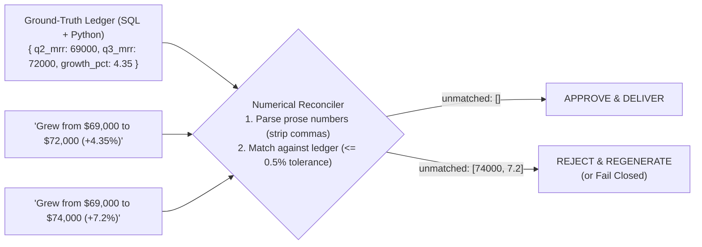
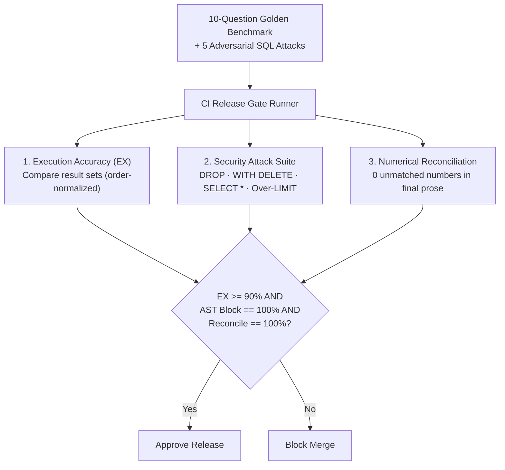

# Chapter 08 — Numerical Reconciliation & Execution-Accuracy Evals

> **Lecture 26 · Chapter 08 of 08** · Level: 🔴 Expert · Phase 6 — Enterprise Data, Semantics & SQL
> **Source:** `FDE S14` · **Roadmap Reference:** [`roadmap-v1.md`](../../roadmap-v1.md#lecture-26--semantic-layer-text-to-sql--analytical-intelligence)
> **Roadmap topics:** Numerical reconciliation gate · verifying narrative numbers against SQL/Python truth · Execution Accuracy (EX) vs. exact-string SQL match · 10-question release-gate benchmark.

---

## 08.0 What this chapter is for

Imagine every upstream layer worked flawlessly:
- Schema Discovery pruned to `mart_subscriptions` (Ch 02).
- The AST Guard & Column ACL approved the `SELECT` (Ch 04–05).
- Sandboxed Python computed `{ q2_mrr: 69000, q3_mrr: 72000, growth_pct: 4.35 }` (Ch 06).

And then, in the final step, the LLM writing the Slack summary hallucinates:

> *"Active Enterprise MRR grew from `$69,000` to `$74,000` (`+7.2%`) in Q3."*

All your upstream engineering just failed at the last mile! **Numerical Reconciliation** is the deterministic final gate that extracts every number from the LLM's generated prose and verifies it against the SQL/Python ground-truth ledger *before* the user ever sees it.

By the end of this chapter you should be able to:

1. Build a **Numerical Reconciliation Gate** that extracts numbers from LLM prose and validates them against the SQL/Python ground-truth ledger within a tight tolerance.
2. Handle real-world parsing edge cases (comma-separated thousands `$69,000`, percentages `4.35%`, and non-metric identifiers like `Q2` or `2026`).
3. Explain why **Execution Accuracy (EX)**—not SQL exact-string match—is the gold-standard evaluation metric for Text-to-SQL.
4. Combine **EX**, **Numerical Reconciliation**, and **100% AST Attack Block Rate** into a CI release gate.

---

## 08.1 How the Numerical Reconciliation Gate works



### Concrete Reconciler Implementation (TypeScript)

```typescript
export function reconcileNumbers(
  answerProse: string,
  groundTruthNumbers: number[],
  allowedConstants: number[] = [2026], // e.g., current year or quarter labels
  tolerancePct = 0.005 // 0.5% rounding tolerance
) {
  const validPool = [...groundTruthNumbers, ...allowedConstants];
  // Match numbers including comma-separated thousands like 69,000 or decimals like 4.35
  const rawMatches = answerProse.match(/\b\d[\d,]*(?:\.\d+)?\b/g) ?? [];
  const extracted = rawMatches.map((m) => Number(m.replaceAll(",", "")));

  const unmatched = extracted.filter((num) => {
    return !validPool.some((truth) => {
      if (truth === 0) return num === 0;
      return Math.abs(num - truth) / Math.abs(truth) <= tolerancePct;
    });
  });

  return {
    passed: unmatched.length === 0,
    extracted,
    unmatched,
  };
}
```

### Design details to watch out for

1. **Strip formatting commas:** `$69,000` must parse as `69000`, not `69` and `000`.
2. **Tight tolerance (`<= 0.5%`):** Allows harmless display rounding (`4.35%` vs. `4.3%`) while catching any fabricated or miscalculated number (`74000` vs. `72000` is `2.78%` off $\rightarrow$ **blocked**).
3. **Separate question labels from the answer ledger:** Don't fail a valid answer just because it mentions the year `2026` or `Q2`/`Q3`—include explicit `allowedConstants` from the user's question, and keep `groundTruthNumbers` strictly for computed metrics.

> [!IMPORTANT]
> **What to do when reconciliation fails:** Retry generation *once* with the exact `unmatched` list (*"Numbers `[74000, 7.2]` are not in the verified ledger; rewrite using only the exact JSON values"*). If Attempt 2 still fails, **fail closed** and return the raw verified JSON table directly without LLM prose.

---

## 08.2 Evaluating Text-to-SQL: Execution Accuracy (EX)

Why is **exact SQL string match** useless for grading Text-to-SQL agents?

Consider these two queries for the same question:
- **Golden SQL:** `SELECT region, SUM(mrr_usd) FROM mart_subscriptions WHERE status = 'active' GROUP BY region`
- **Predicted SQL:** `SELECT SUM(mrr_usd) AS total_mrr, region FROM mart_subscriptions WHERE status IN ('active') GROUP BY 2`

A string-match grader scores that **0%**, even though both queries return the **exact same result set**!

Instead, production teams grade by **Execution Accuracy (EX)**:

$$\text{EX} = \frac{\text{Queries whose executed result set matches the Golden SQL result set}}{\text{Total benchmark queries}}$$



---

## 08.3 Common mistakes

| # | Common Mistake | Why It Hurts | What To Do Instead |
| :---: | :--- | :--- | :--- |
| 1 | **Shipping LLM analytical prose without reconciliation** | Last-mile number hallucinations destroy executive trust | Run every response through the deterministic Numerical Reconciliation Gate |
| 2 | **Grading Text-to-SQL by string equality** | Penalizes valid SQL with different aliases, column order, or CTEs | Grade by **Execution Accuracy (EX)** on result sets |
| 3 | **Splitting `$69,000` on commas in the number regex** | Parses `69,000` as `[69, 0]`, causing false reconciliation failures | Match `\d[\d,]*(?:\.\d+)?` and strip commas before `Number(...)` |
| 4 | **Testing only happy-path SQL in CI** | Regressions in AST or column ACLs ship straight to production | Include adversarial `DROP`, `WITH (DELETE ...)`, and `SELECT *` cases in CI |
| 5 | **Retrying reconciliation infinitely** | Wastes latency when the model is stuck; falls back to unverified prose | Retry once with exact `unmatched` feedback, then fall back to raw verified JSON |

---

## 08.4 Key takeaways

1. **Never ship LLM prose containing unverified numbers:** verify every number in the answer against the SQL/Python ground-truth ledger via the **Numerical Reconciliation Gate**.
2. **Grade Text-to-SQL by Execution Accuracy (EX)**—compare executed result sets, not SQL strings.
3. **Production Release Gate = `100%` AST/ACL attack block rate + `100%` numerical reconciliation + high EX** on a seeded golden benchmark.

---

**Next:** [Lecture 26 — Complete Notes (Master Consolidation)](./Lecture_26_Complete_Notes.md)
