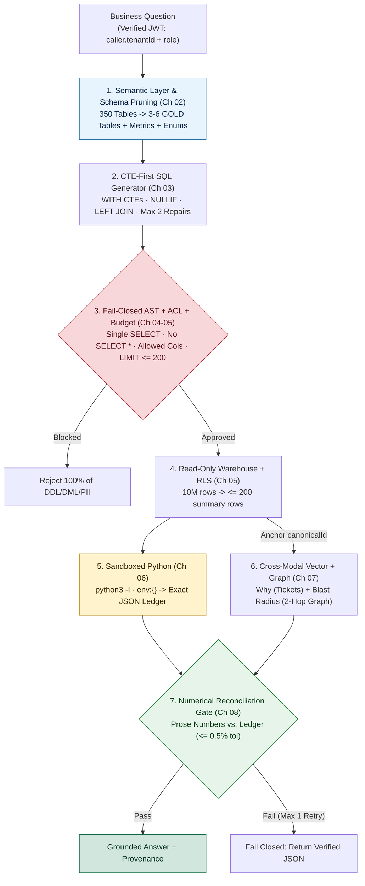

# Lecture 26 — Complete Notes
## Semantic-Layer Text-to-SQL & Analytical Python

> **Phase:** 6 · Enterprise Data, Semantics & SQL · **Level:** 🔴 Expert
> **Scope:** Master revision guide consolidating all eight chapters of Lecture 26.
> **Thesis:** Production analytical AI replaces brittle raw-DDL Text-to-SQL prompts with a **6-stage guarded pipeline**: **Semantic Layer schema pruning**, **CTE-first SQL decomposition**, **fail-closed SQL AST & column-ACL validation**, **read-only warehouse reduction**, **sandboxed Python math (`python3 -I`)**, **SQL-anchored Cross-Modal Reasoning**, and a **Numerical Reconciliation Gate** verified by **Execution Accuracy (EX)** evals.

---

## 1. Executive Summary

**The lecture in five sentences:**

1. Naive Text-to-SQL fails on **five production axes**: schema bloat (350+ DDLs), metric ambiguity (`SUM(amount)` without `status = 'active'`), unsafe DDL/DML & PII leaks, runaway scan costs, and arithmetic hallucinations.
2. **Metadata-guided schema pruning** shrinks 350 tables to 3–6 `certifiedGold` tables with a **Semantic Layer** (canonical metrics, `1:N` join paths, low-cardinality enum samples), while **CTE-first decomposition** (`WITH ...`, `NULLIF`, `LEFT JOIN` + `COALESCE`) prevents silent row drops and division crashes.
3. A **fail-closed SQL AST Validator** (`node-sql-parser`) enforces single-statement `SELECT` (blocking `WITH (DELETE ...)`, `DR/**/OP`, and stacked queries), paired with **table/column allow-lists** (blocking `SELECT *` on PII), **Postgres RLS (`tenant_id`)**, and **row/scan-byte/timeout budgets**.
4. **SQL reduces millions of rows to `<= 200` summary rows**, **Sandboxed Python** (`python3 -I`, `env: {}`, banned `os`/`subprocess`/`socket`, `2s` timeout) computes exact IEEE-754 math, and **Cross-Modal Reasoning** anchors Vector & Graph lookups to SQL `canonicalId`s.
5. A **Numerical Reconciliation Gate** verifies every number in the final prose against the SQL/Python ledger (`<= 0.5%` tolerance), while CI release gates enforce **Execution Accuracy (EX)** and **100% AST attack block rate**.

### Chapter Index

| Chapter | Topic | Core Focus | File |
| :---: | :--- | :--- | :--- |
| **01** | Why Naive Text-to-SQL Fails | 5 failure modes, regex bypasses, 6-stage guarded architecture | [01_Why_Naive_Text_to_SQL_Fails_in_Production.md](./01_Why_Naive_Text_to_SQL_Fails_in_Production.md) |
| **02** | Schema Discovery & Semantic Layers | 4 semantic primitives, 2-step pruning, enum sampling, join cardinality | [02_Metadata_Guided_Schema_Discovery_and_Semantic_Layers.md](./02_Metadata_Guided_Schema_Discovery_and_Semantic_Layers.md) |
| **03** | Query Decomposition & SQL Gen | Named `WITH` CTEs, `NULLIF` / `LEFT JOIN` / aliases, 2-retry syntax repair | [03_Query_Decomposition_and_SQL_Generation.md](./03_Query_Decomposition_and_SQL_Generation.md) |
| **04** | SQL AST Validation & Guardrails | Fail-closed `node-sql-parser`, single `SELECT`, `tableList` check, `ai_readonly` | [04_SQL_AST_Validation_and_Read_Only_Guardrails.md](./04_SQL_AST_Validation_and_Read_Only_Guardrails.md) |
| **05** | Authorization & Query Budgets | Table/column ACLs, blocking `SELECT *`, DB RLS, `LIMIT` + `maximumBytesBilled` | [05_Schema_and_Column_Authorization_and_Query_Budgets.md](./05_Schema_and_Column_Authorization_and_Query_Budgets.md) |
| **06** | Sandboxed Python Intelligence | SQL reduction vs. Python math, 4 sandbox controls (`python3 -I`, `env: {}`) | [06_Sandboxed_Python_Analytical_Intelligence.md](./06_Sandboxed_Python_Analytical_Intelligence.md) |
| **07** | Cross-Modal Reasoning | SQL (*how much*) + Vector (*why*) + Graph (*who else*) via `canonicalId` | [07_Cross_Modal_Reasoning_SQL_Vector_Graph.md](./07_Cross_Modal_Reasoning_SQL_Vector_Graph.md) |
| **08** | Reconciliation & EX Evals | Numerical Reconciliation Gate, Execution Accuracy (EX), CI release gate | [08_Numerical_Reconciliation_and_Execution_Accuracy_Evals.md](./08_Numerical_Reconciliation_and_Execution_Accuracy_Evals.md) |

---

## 2. Master Architecture Diagram

---

## 3. Chapter-by-Chapter Short Revision Notes

### 3.1 Chapter 01 — Why Naive Text-to-SQL Fails in Production

Pasting 350 `CREATE TABLE` DDLs into a prompt fails on five axes: **schema bloat** (picking `raw_stripe_events` over `mart_subscriptions`), **metric ambiguity** (2× revenue inflation from missing `status = 'active'`), **unsafe SQL/PII leaks** (`SELECT *` or `; DROP TABLE`), **runaway scan costs** (`$45` full scans), and **arithmetic hallucinations** (`4.8%` instead of `4.35%`).

- **Why Regex Fails:** `!/DROP|DELETE/i` is bypassed by `DR/**/OP`, `WITH d AS (DELETE ... RETURNING *) SELECT * FROM d`, `COPY`, and `SELECT billing_email`.
- **Engine Split:** Separate **SQL (data reduction)**, **Sandboxed Python (exact math)**, and **LLM + Reconciler (narration)**.

> 📖 **Need depth?** Read [Chapter 01 — Why Naive Text-to-SQL Fails in Production](./01_Why_Naive_Text_to_SQL_Fails_in_Production.md)

### 3.2 Chapter 02 — Metadata-Guided Schema Discovery & Semantic Layers

Raw `CREATE TABLE` DDL hides enum casing (`'EMEA'` vs. `'Europe'`), metric exclusions, join grain (`1:N` fan-out), and `GOLD` certification. A **Semantic Layer** provides four primitives: **Certified Table & Grain**, **Canonical Metric** (`active_mrr`), **Allowed Join Paths** (`many_to_one`, aggregate `1:N` tickets in a CTE first), and **Low-Cardinality Enum Samples** (never sample PII columns!).

- **Progressive Pruning:** Retrieve only the top 3–6 `certifiedGold` tables at query time and append them at the dynamic prompt tail so static dialect/AST rules stay prefix-cached.

> 📖 **Need depth?** Read [Chapter 02 — Metadata-Guided Schema Discovery & Semantic Layers](./02_Metadata_Guided_Schema_Discovery_and_Semantic_Layers.md)

### 3.3 Chapter 03 — Query Decomposition & SQL Generation

Complex executive questions fail when crammed into nested subqueries. Enforce **CTE-first generation** (`WITH q2_mrr AS (...), q3_mrr AS (...)`) with **four defensive SQL habits**:
1. `NULLIF(denom, 0)` against zero-division crashes.
2. `LEFT JOIN` + `COALESCE(..., 0)` so zero-revenue regions aren't silently dropped.
3. Qualified table aliases (`q2.region`) and explicit `LIMIT`.
4. `100.0` float scaling (avoiding Postgres/DuckDB integer division `3000 / 69000 = 0`).

- **Bounded Repair:** Cap syntax self-repair at **2 attempts** and always re-run the AST Security Guard on repaired SQL.

> 📖 **Need depth?** Read [Chapter 03 — Query Decomposition & SQL Generation](./03_Query_Decomposition_and_SQL_Generation.md)

### 3.4 Chapter 04 — SQL AST Validation & Read-Only Guardrails

Parse every candidate SQL string into an **Abstract Syntax Tree (AST)** using `node-sql-parser` (or `sqlglot`) and **fail closed** on any syntax error. Enforce `statements.length === 1`, `root.type === "select"`, and verify every `tableList` entry starts with `"select::"` (blocking data-modifying CTEs like `WITH d AS (DELETE ...)`).

- **Defense in Depth:** Pair the application AST guard with a dedicated **read-only DB principal (`ai_readonly`)** granted `SELECT` only and `statement_timeout = 5000ms` so even a 0-day parser bug cannot mutate data.

> 📖 **Need depth?** Read [Chapter 04 — SQL AST Validation & Read-Only Guardrails](./04_SQL_AST_Validation_and_Read_Only_Guardrails.md)

### 3.5 Chapter 05 — Schema & Column Authorization + Query Budgets

Even a valid `SELECT` can leak PII or trigger a `$45` warehouse scan. Inspect `parsed.tableList` and `parsed.columnList` against role allow-lists, **blocking `SELECT *` (`*` / `(.*)`)** on any mixed-sensitivity table so hidden PII columns cannot leak. Enforce multi-tenant isolation via **Postgres Row-Level Security (`SET LOCAL app.current_tenant_id`)** rather than relying on LLM `WHERE` clauses.

- **3 Query Budgets:** Cap **Rows (`LIMIT <= 200`)**, **Scan Bytes (`maximumBytesBilled <= 1 GB`)**, and **Wall-Clock Time (`statement_timeout = 5s`)**.

> 📖 **Need depth?** Read [Chapter 05 — Schema & Column Authorization + Query Budgets](./05_Schema_and_Column_Authorization_and_Query_Budgets.md)

### 3.6 Chapter 06 — Sandboxed Python Analytical Intelligence

Never ask an LLM to compute percentages, growth rates, or z-scores in prose. Reduce 10M rows to `<= 200` summary rows in SQL, then run exact IEEE-754 math in **Sandboxed Python** emitting `print(json.dumps(...))`. Enforce **four mandatory sandbox controls** (plus containers/microVMs for untrusted multi-tenant users):
1. **Static Import/Builtin Guard:** Reject `os`, `sys`, `subprocess`, `socket`, `http`, `urllib`, `open`, `eval`, `exec`, `__import__`.
2. **Isolated Mode (`python3 -I`):** Ignores `PYTHONPATH` and user `site-packages`.
3. **Empty Environment (`env: {}`):** Zero inherited API keys or DB secrets.
4. **Strict Caps:** `timeout: 2000ms` and `maxBuffer: 256KB`.

> 📖 **Need depth?** Read [Chapter 06 — Sandboxed Python Analytical Intelligence](./06_Sandboxed_Python_Analytical_Intelligence.md)

### 3.7 Chapter 07 — Cross-Modal Reasoning (SQL + Vector + Graph)

Each engine answers a different question: **SQL + Python** (*how much?*), **Vector RAG** (*why?*), and **Knowledge Graph** (*who else is connected/at risk?*). Never run broad, unanchored Vector search for churn reasons; **run SQL first** to identify the exact `canonicalId`s (`c2`, `-$18k`), then pre-filter Vector (`{ tenantId, canonicalId: "c2" }`) and 2-hop Graph queries (`(c2)-[:USES]->(d)<-[:USES]-(other)`) with `tenant_id` on every node and edge.

- **Ledger Isolation:** Never blend anecdotal numbers inside support tickets (`"lost $50k"`) into `sqlPythonTruth`.

> 📖 **Need depth?** Read [Chapter 07 — Cross-Modal Reasoning (SQL + Vector + Graph)](./07_Cross_Modal_Reasoning_SQL_Vector_Graph.md)

### 3.8 Chapter 08 — Numerical Reconciliation & Execution-Accuracy Evals

Before delivering the final response, run a deterministic **Numerical Reconciliation Gate**: parse all numbers from the LLM prose (matching `\b\d[\d,]*(?:\.\d+)?\b` so `$69,000` parses as `69000`) and verify every metric against the SQL/Python ledger within `<= 0.5%` tolerance (keeping question constants like `2026` in `allowedConstants`). Retry once on unmatched numbers, or **fail closed** to raw verified JSON.

- **CI Release Gate:** Grade Text-to-SQL by **Execution Accuracy (EX)** (comparing normalized result sets, *not* SQL string equality), paired with **100% AST/ACL attack block rate** and **100% numerical reconciliation**.

> 📖 **Need depth?** Read [Chapter 08 — Numerical Reconciliation & Execution-Accuracy Evals](./08_Numerical_Reconciliation_and_Execution_Accuracy_Evals.md)

---

## 4. Cheat Sheet & Common Traps

### 4.1 Quick Reference

| Stage | Tool / Mechanism | Hard Guarantee |
| :--- | :--- | :--- |
| **Semantic Layer** | Top 3–6 `GOLD` tables + metrics + joins + enums | Eliminates `raw_*` picks & `0`-row enum misses |
| **AST + ACL Guard** | `node-sql-parser` + `tableList`/`columnList` + `LIMIT` | 100% DDL/DML/stacked/`SELECT *` block rate |
| **DB Isolation** | `ai_readonly` + RLS + `maximumBytesBilled` + `5s` timeout | Tenant isolation + bounded scan cost |
| **Sandboxed Python** | `python3 -I`, `env: {}`, banned imports, `2s` timeout | Exact IEEE-754 math; zero RCE/secret leaks |
| **Reconciler + EX** | `\d[\d,]*(?:\.\d+)?` vs. ledger (`<= 0.5%` tol) | Zero narrative math hallucinations |

### 4.2 Common Traps

| Trap | Why It Breaks Production | Fix |
| :--- | :--- | :--- |
| **Securing SQL with `!/DROP\|DELETE/i` regexes** | Bypassed by `DR/**/OP`, `WITH (DELETE ...)`, `COPY`, `SELECT *` | Fail-closed AST parser + `tableList` check + `ai_readonly` role. |
| **Omitting `NULLIF` or using `INNER JOIN` across periods** | Crashes on `0` revenue; silently drops churned regions | Use `NULLIF(denom, 0)` + `LEFT JOIN` + `COALESCE(..., 0)`. |
| **Relying on `LIMIT 200` without scan-byte caps** | `ORDER BY` on 4B unindexed rows still costs `$45` | Pair `LIMIT` with `maximumBytesBilled` / `EXPLAIN` dry-run. |
| **Running `python3` without `env: {}` or `-I`** | Child process can read `OPENAI_API_KEY` & `DATABASE_URL` | Enforce static import bans, `python3 -I`, `env: {}`, `timeout`. |
| **Grading Text-to-SQL by exact SQL string match** | Penalizes valid CTEs/aliases; ignores math hallucinations | Grade by **Execution Accuracy (EX)** + **Numerical Reconciliation**. |

---

## 5. Self-Check Questions (Release Gate Prep)

1. Give four concrete SQL payloads that bypass a `!/DROP|DELETE/i` regex, and explain how `node-sql-parser` (checking `statements.length`, `root.type`, and `tableList`) blocks all four.
2. What four facts are missing from raw `CREATE TABLE` DDL that a **Semantic Layer** must supply, and why must PII columns be excluded from enum value sampling?
3. Why must `SELECT *` be blocked on mixed-sensitivity tables, and why is `LIMIT 200` alone insufficient to prevent `$45` warehouse scans?
4. List the **four mandatory controls** for Sandboxed Python (`python3 -I`), and explain why SQL should reduce data before Python runs.
5. How do **Cross-Modal `canonicalId` anchoring**, the **Numerical Reconciliation Gate**, and **Execution Accuracy (EX)** work together to eliminate last-mile hallucinations?
