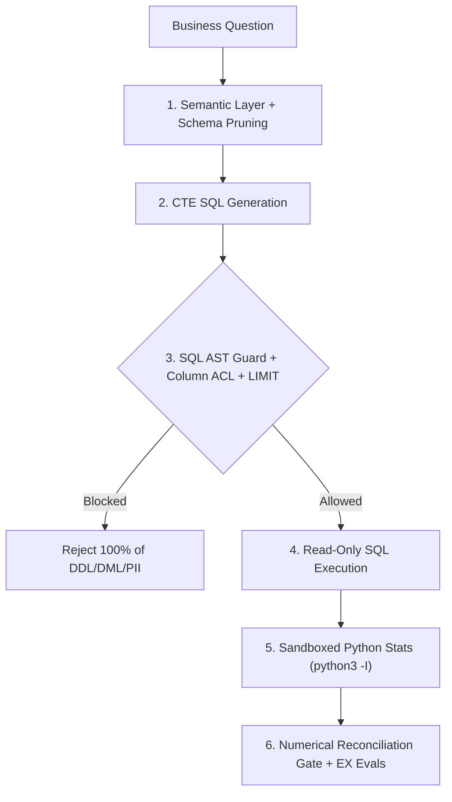

# Lecture 26 — Complete Notes
## Semantic-Layer Text-to-SQL & Analytical Python

> **Phase:** 6 · Enterprise Data, Semantics & SQL · **Level:** 🔴 Expert
> **Scope:** A single-pass consolidation of the eight chapter notes in this folder.
> **How to use this file:** Read it to *revise and navigate*. Every section links back to the chapter that explains it in full.
>
> | Chapter | File |
> | :--- | :--- |
> | 01 · Why naive Text-to-SQL fails in production | [01_Why_Naive_Text_to_SQL_Fails_in_Production.md](./01_Why_Naive_Text_to_SQL_Fails_in_Production.md) |
> | 02 · Metadata-guided schema discovery & semantic layers | [02_Metadata_Guided_Schema_Discovery_and_Semantic_Layers.md](./02_Metadata_Guided_Schema_Discovery_and_Semantic_Layers.md) |
> | 03 · Query decomposition & SQL generation | [03_Query_Decomposition_and_SQL_Generation.md](./03_Query_Decomposition_and_SQL_Generation.md) |
> | 04 · SQL AST validation & read-only guardrails | [04_SQL_AST_Validation_and_Read_Only_Guardrails.md](./04_SQL_AST_Validation_and_Read_Only_Guardrails.md) |
> | 05 · Schema & column authorization + query budgets | [05_Schema_and_Column_Authorization_and_Query_Budgets.md](./05_Schema_and_Column_Authorization_and_Query_Budgets.md) |
> | 06 · Sandboxed Python analytical intelligence | [06_Sandboxed_Python_Analytical_Intelligence.md](./06_Sandboxed_Python_Analytical_Intelligence.md) |
> | 07 · Cross-modal reasoning (SQL + Vector + Graph) | [07_Cross_Modal_Reasoning_SQL_Vector_Graph.md](./07_Cross_Modal_Reasoning_SQL_Vector_Graph.md) |
> | 08 · Numerical reconciliation & execution-accuracy evals | [08_Numerical_Reconciliation_and_Execution_Accuracy_Evals.md](./08_Numerical_Reconciliation_and_Execution_Accuracy_Evals.md) |

---

## 1. Executive summary

**The lecture in five sentences.**

1. Naive Text-to-SQL fails on **schema bloat, metric ambiguity, destructive DDL/DML, runaway scan costs, and arithmetic hallucinations**.
2. **Metadata-guided schema pruning** and a **Semantic Layer** (certified tables, canonical metrics, join paths, enum samples) + **CTE decomposition** ground SQL generation before a single token is executed.
3. A **SQL AST Validator** (`node-sql-parser`) parses generated SQL into a syntax tree — failing closed on non-`SELECT` statements, multi-statement stacking, `SELECT *` on PII tables, unauthorized columns, and missing `LIMIT` caps.
4. **Sandboxed Python** (`python3 -I`, stripped `env`, blocked `os`/`subprocess`/`socket`, strict timeout) handles exact statistical math on SQL-reduced result sets, while **Cross-Modal Reasoning** links SQL + Vector + Graph via `canonicalId`s.
5. A **Numerical Reconciliation Gate** verifies every number in the final narrative against the exact SQL/Python output ledger, and **Execution Accuracy (EX)** benchmarks prove zero numerical regression.

---

## 2. The arc of the lecture in one diagram

---

## 3. Cheat sheet

| Concept | One-line definition | Chapter |
| :--- | :--- | :--- |
| **Semantic Layer** | Certified tables, canonical metric formulas, join paths, enum values | [02](./02_Metadata_Guided_Schema_Discovery_and_Semantic_Layers.md) |
| **CTE Decomposition** | Breaking multi-step questions into named `WITH` expressions | [03](./03_Query_Decomposition_and_SQL_Generation.md) |
| **SQL AST Guard** | Grammar-based syntax tree check blocking DDL/DML & stacked queries | [04](./04_SQL_AST_Validation_and_Read_Only_Guardrails.md) |
| **Column ACL & `LIMIT`** | Role-based column allow-list, blocking `SELECT *` on PII, row/byte caps | [05](./05_Schema_and_Column_Authorization_and_Query_Budgets.md) |
| **Sandboxed Python** | Isolated `python3 -I` with banned `os`/`socket` imports and strict timeout | [06](./06_Sandboxed_Python_Analytical_Intelligence.md) |
| **Cross-Modal Reasoning** | Joining SQL (*how much*) + Vector (*why*) + Graph (*connected*) via `canonicalId` | [07](./07_Cross_Modal_Reasoning_SQL_Vector_Graph.md) |
| **Numerical Reconciliation** | Deterministic check that prose numbers match SQL/Python ground truth | [08](./08_Numerical_Reconciliation_and_Execution_Accuracy_Evals.md) |

---

## 4. Self-check questions (Release Gate Prep)

1. Why can a regex check for `DROP` or `UPDATE` always be bypassed, and how does `node-sql-parser` prevent it?
2. Why should `SELECT *` be blocked on tables containing restricted PII columns?
3. Why should statistical calculations (growth rates, z-scores) run in **sandboxed Python** rather than LLM prose or complex SQL?
4. What is the difference between **SQL string match** and **Execution Accuracy (EX)**, and how does **Numerical Reconciliation** catch narrative hallucinations?

