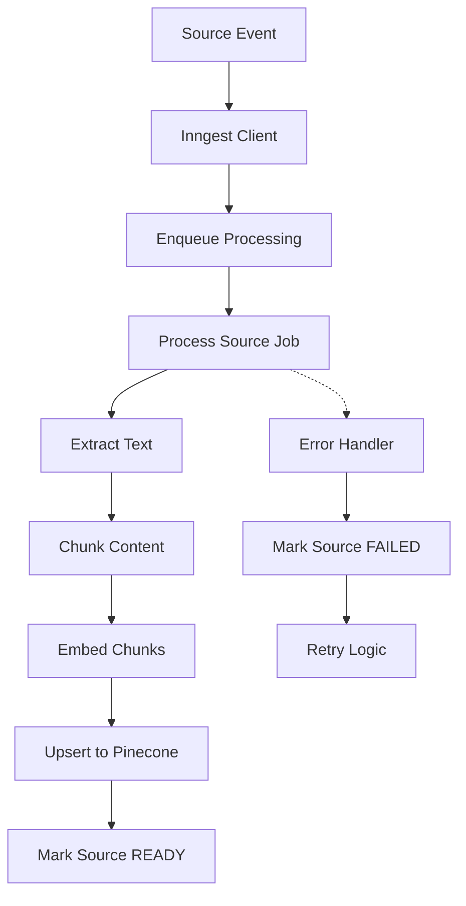
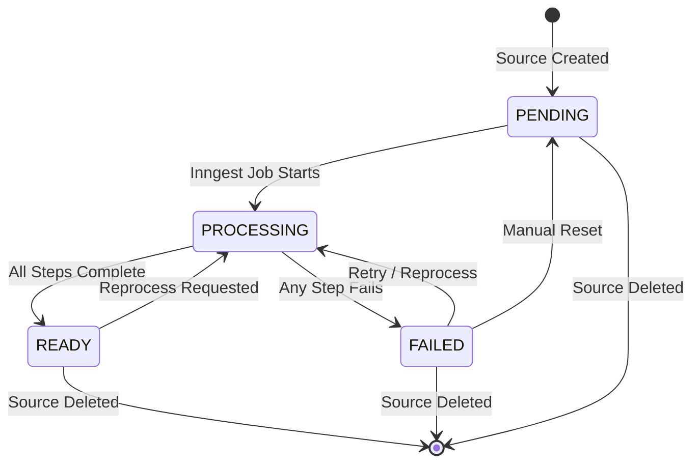
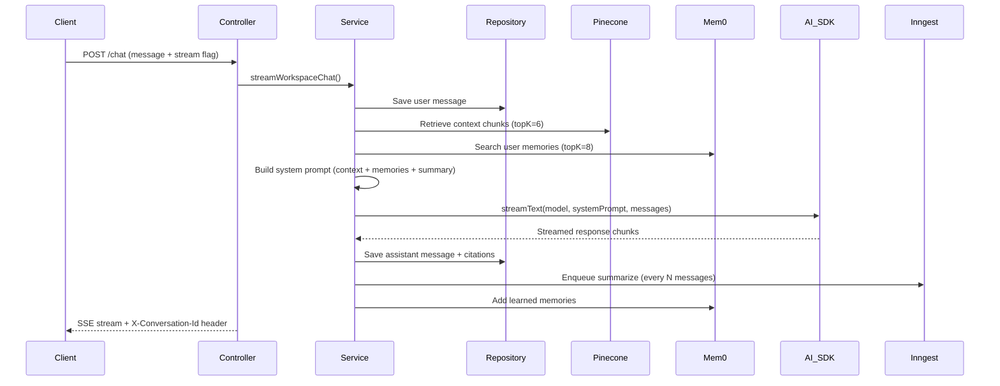
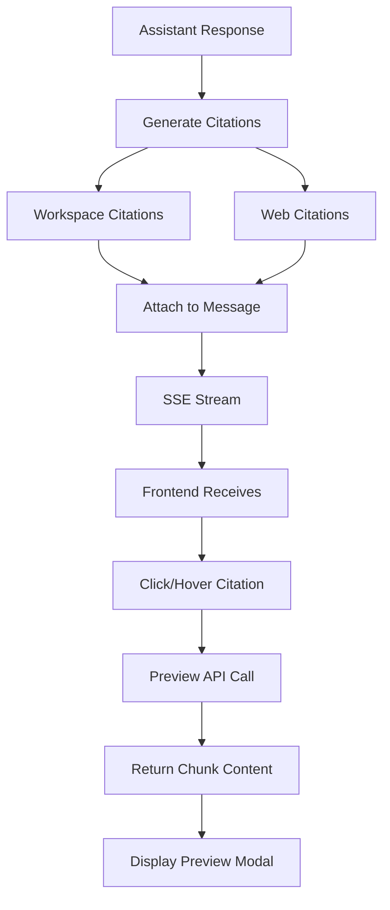
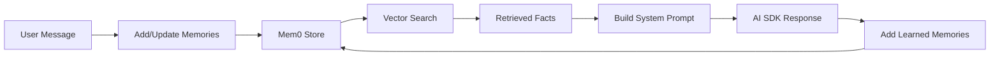
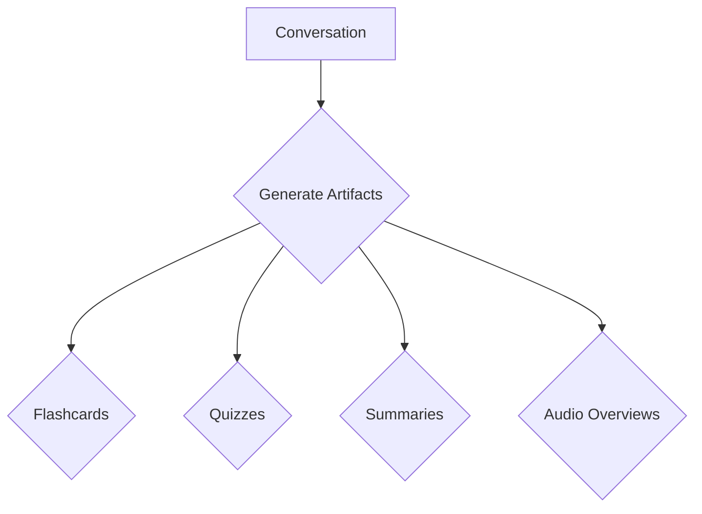
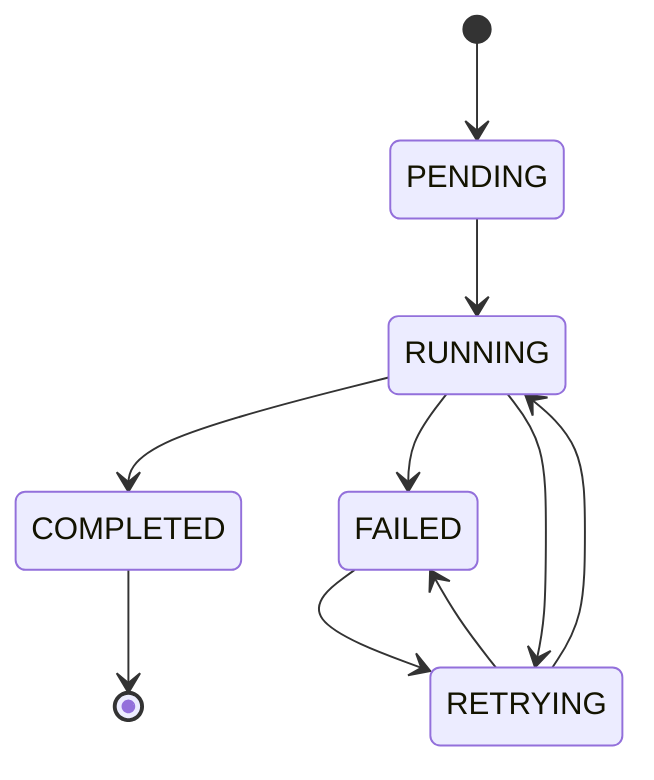
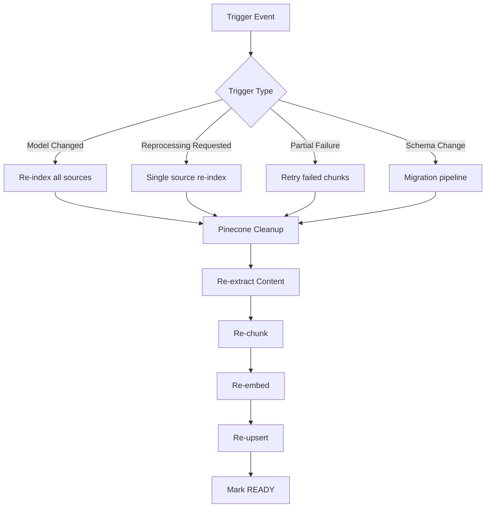

# Lecture 28 - Complete Notes: Async Indexing and RAG Chat

**Lecture:** Lecture 28 - Async Indexing and RAG Chat  
**Phase:** 8 · Production Infrastructure  
**Level:** 🔴 Expert  
**Source:** GAC D10  
**Chapters:** 8 chapters covering the complete async indexing and RAG chat system

---

## Table of Contents

| Chapter | Title | File |
|---------|-------|------|
| Chapter 1 | Async Indexing Pipeline | [notes/01_Async_Indexing_Pipeline.md](./notes/01_Async_Indexing_Pipeline.md) |
| Chapter 2 | Source Processing & State Machine | [notes/02_Source_Processing_State_Machine.md](./notes/02_Source_Processing_State_Machine.md) |
| Chapter 3 | Streaming RAG Chat | [notes/03_Streaming_RAG_Chat.md](./notes/03_Streaming_RAG_Chat.md) |
| Chapter 4 | Interactive Citations | [notes/04_Interactive_Citations.md](./notes/04_Interactive_Citations.md) |
| Chapter 5 | User Memory & Web Search | [notes/05_User_Memory_Web_Search.md](./notes/05_User_Memory_Web_Search.md) |
| Chapter 6 | Learning Artifacts | [notes/06_Learning_Artifacts.md](./notes/06_Learning_Artifacts.md) |
| Chapter 7 | Job Status, Partial Failure & UX | [notes/07_Job_Status_Partial_Failure_UX.md](./notes/07_Job_Status_Partial_Failure_UX.md) |
| Chapter 8 | Re-indexing, Model Migration & Ingestion | [notes/08_Re_indexing_Model_Migration_Ingestion.md](./notes/08_Re_indexing_Model_Migration_Ingestion.md) |

---

## Chapter 1: Async Indexing Pipeline

### Goal & Overview

The async indexing pipeline is the foundation for turning raw knowledge sources into searchable vector embeddings. It runs as background jobs using **Inngest** to handle long-running processing without blocking API responses.

### Key Components

- **Inngest** for durable, event-driven background jobs
- **Sliding-window chunking** to split text into manageable chunks
- **OpenAI embeddings** to convert text chunks to vectors
- **Pinecone** vector database for storage and similarity search
- **State machine** to track processing status (PENDING → PROCESSING → READY/FAILED)

### Architecture Diagram



### Core Code: Inngest Client & Process Function

```ts
// server/src/inngest/client.ts
export const inngest = new Inngest({ id: "chaibook" });

export type SourceCreatedEvent = {
    name: "source/created";
    data: {
        sourceId: string;
        workspaceId: string;
    };
};
```

```ts
export const processSource = inngest.createFunction(
    {
        id: "process-source";
        retries: 3;
        triggers: [{ event: "source/created" }];
    },
    async ({ event, step }) => {
        const { sourceId } = event.data;

        await step.run("mark-processing", () => markSourceProcessing(sourceId));

        try {
            const extracted = await step.run("extract-content", () =>
                extractSourceContent(sourceId),
            );

            await step.run("chunk-content", () =>
                chunkSourceContent(
                    sourceId,
                    extracted.text,
                    extracted.pages,
                ),
            );

            const result = await step.run("embed-and-index", async () => {
                const source = await findSourceById(sourceId);
                if (!source) {
                    throw new Error("Source not found");
                }

                const chunks = await findChunksBySourceId(sourceId);
                await embedAndIndexSource(source, chunks);

                return { chunkCount: chunks.length };
            });

            return { sourceId, status: "READY", ...result };
        } catch (error) {
            await step.run("mark-failed", async () => {
                const source = await findSourceById(sourceId);
                if (source) {
                    await markSourceFailed(sourceId, error, source.metadata);
                }
            });
            throw error;
        }
    },
);
```

### Sliding-Window Chunking

The chunking logic uses a sliding window with overlap to preserve context:

- **Chunk size:** 1000 characters
- **Overlap:** 100 characters
- **Strategy:** Slide across word boundaries, saving overlapping text at chunk boundaries

### Pinecone Integration

Vectors are stored in Pinecone with namespace isolation per workspace:

```ts
export async function upsertSourceVectors(
    workspaceId: string,
    records: PineconeRecord<VectorMetadata>[],
) {
    if (records.length === 0) return;

    const index = await getPineconeIndex();
    const namespace = index.namespace(workspaceId);

    const batchSize = 100;
    for (let i = 0; i < records.length; i += batchSize) {
        await namespace.upsert({
            records: records.slice(i, i + batchSize),
        });
    }
}
```

### Common Mistakes

1. Fixed chunk sizes may break semantic boundaries — use adaptive chunking
2. Hitting OpenAI rate limits during bulk processing — implement batching with delays

### Key Takeaways

- Event-driven design with Inngest for durable background jobs
- Sliding-window chunking maintains context with overlap for better retrieval
- Batch processing of embeddings and vector upserts for efficiency
- Comprehensive error handling with retry mechanisms

---

## Chapter 2: Source Processing & State Machine

### Goal & Overview

Covers the complete source processing pipeline from creation through indexing, including the state machine, re-processing capabilities, and cleanup operations.

### State Machine Diagram



### State Definitions

| State | Description | Trigger |
|-------|-------------|---------|
| PENDING | Source saved, awaiting processing | Source creation |
| PROCESSING | Inngest job actively processing | `processSource` job begins |
| READY | Successfully indexed in Pinecone | All pipeline steps complete |
| FAILED | Error during any pipeline step | Extraction, chunking, or embedding fails |

### Core Code: State Transitions

```ts
export function markSourceProcessing(sourceId: string) {
    return updateSourceRecord(sourceId, { status: "PROCESSING" });
}

export async function markSourceFailed(
    sourceId: string,
    error: unknown,
    existingMetadata: SourceRecord["metadata"],
) {
    const message =
        error instanceof Error ? error.message : "Source processing failed";

    const metadata = existingMetadata as SourceMetadata ?? {};

    return updateSourceRecord(sourceId, {
        status: "FAILED",
        metadata: {
            ...metadata,
            processingError: message,
        },
    });
}
```

### Content Extraction

Different source types require different extraction strategies:

| Channel | Content Source | Extraction Method |
|---------|---------------|-------------------|
| Text/Markdown | Direct input | Already in `source.content` |
| Website | URL | Firecrawl API scrape |
| YouTube | Video ID | YouTube transcript API |
| PDF Upload | Cloudinary | PDF text extraction |
| Web Search | Tavily results | Already extracted text |

### Re-processing Pipeline

Enables updating sources when models change or initial processing fails:

1. Remove vectors from Pinecone
2. Delete chunks from Postgres
3. Reset status to PENDING
4. Enqueue new processing job

### Source Deletion & Cleanup

Deleting a source cascades to all related data — both database records and Pinecone vectors must be cleaned:

```ts
export async function deleteSource(
    workspaceId: string,
    userId: string,
    sourceId: string,
) {
    await getWorkspaceByIdForUser(workspaceId, userId);
    const source = await findSourceByIdAndWorkspaceId(sourceId, workspaceId);
    if (!source) throw new NotFoundError("Source not found");

    await removeSourceFromIndex(workspaceId, sourceId);
    await deleteSourceRecord(sourceId);
    return { message: "Source deleted" };
}
```

### Common Mistakes

1. Only deleting database records but not Pinecone vectors
2. Allowing invalid state transitions
3. Partial PDF extraction missing pages

### Key Takeaways

- State machine is critical for tracking processing status
- Atomic cleanup removes both database records and Pinecone vectors
- Re-processing support enables model updates and recovery
- Content extraction abstraction: different sources, unified output format

---

## Chapter 3: Streaming RAG Chat

### Goal & Overview

Streaming RAG chat enables real-time, context-aware conversations over indexed workspace sources using Server-Sent Events (SSE) with AI SDK streaming.

### Pipeline Diagram



### Data Model

```prisma
model Conversation {
    id             String      @id @default(cuid())
    workspaceId    String
    title          String?
    summary        String?
    summaryMessageCount Int    @default(0)
    summarizedAt   DateTime?
    createdAt      DateTime    @default(now())
    updatedAt      DateTime    @updatedAt
    workspace      Workspace   @relation(fields: [workspaceId], references: [id], onDelete: Cascade)
    messages       Message[]
    @@index([workspaceId])
    @@map("conversation")
}

model Message {
    id       String   @id @default(cuid())
    conversationId String
    role     String   // USER | ASSISTANT
    content  String
    citations Json?    // Array of ChatCitation objects
    createdAt DateTime @default(now())
    conversation Conversation @relation(fields: [conversationId], references: [id], onDelete: Cascade)
    @@index([conversationId])
    @@map("message")
}
```

### Core Chat Flow

1. Verify workspace ownership
2. Resolve model selection
3. Extract latest user message
4. Resolve or create conversation
5. Save user message
6. Parallel: RAG retrieval + memory search
7. Build citations from retrieved chunks
8. Build system prompt with context
9. Stream response via AI SDK
10. Save assistant message with citations

### RAG Retrieval Configuration

| Setting | Value | Description |
|---------|-------|-------------|
| RAG_TOP_K | 6 | Maximum chunks retrieved per query |
| RAG_MIN_SCORE | 0.35 | Minimum cosine similarity threshold |
| EMBEDDING_DIMENSIONS | 1536 | Vector dimension for text-embedding-3-small |
| RECENT_MESSAGE_WINDOW | 12 | Recent messages sent to model |
| CONVERSATION_SUMMARY_INTERVAL | 8 | Summarize every N messages |

### System Prompt Construction

The system prompt combines context chunks, user memories, conversation summary, and web search hints into a single prompt sent to the model:

```
You are Chaibook, an assistant that helps users learn from their workspace sources.

[Web Search Section - optional]

Known facts about this user:
- Memory 1
- Memory 2

Earlier conversation summary:
<summary>

Retrieved context:
[1] Document Title (PDF)
Chunk text...

[2] Source Title (WEBSITE)
Chunk text...

Use ONLY the retrieved context below when making factual claims.
If context is insufficient, say so clearly.
Cite sources inline using [1], [2], etc.
```

### Citations

Citations are tracked per message and stored in the Message record:

```ts
type ChatCitation = {
    sourceId?: string;
    sourceTitle: string;
    sourceType: string;
    chunkId?: string;
    chunkIndex?: number;
    page?: number;
    excerpt: string;
    score?: number;
    url?: string;
};
```

### Common Mistakes

1. Sending entire conversation history to model (token bloat) — use rolling summary
2. Model references citations that don't exist — validate citations
3. Not handling stream abortion — check `isAborted` in onFinish

### Key Takeaways

- Parallel retrieval of RAG chunks and Mem0 memories for speed
- Rolling summary reduces context window size while preserving history
- Every message stores its citations for frontend display
- SSE streaming provides real-time token streaming
- Periodic summarization keeps context manageable

---

## Chapter 4: Interactive Citations

### Goal & Overview

Interactive citations allow users to hover/click on citation markers in chat responses to preview the exact source chunk, enabling verification and deeper exploration of retrieved content.

### Citation Architecture



### Citation Data Structures

**Workspace Citation (RAG):**
- sourceId, sourceTitle, sourceType, chunkId, chunkIndex, page, excerpt, score

**Web Citation (Tavily):**
- url, title, content, sourceType ("WEB"), citationId (W1, W2, etc.)

### Source Chunk Preview API

Frontend fetches full chunk content via:

```
GET /api/workspaces/:workspaceId/sources/:sourceId/chunks/:chunkId
```

Returns full chunk content for citation preview display.

### Frontend Integration

```tsx
function CitationBadge({ citation, index }) {
    const handleClick = async () => {
        if (citation.sourceType === "WEB") {
            window.open(citation.url, "_blank");
            return;
        }
        const response = await fetch(
            `/api/workspaces/${workspaceId}/sources/${citation.sourceId}/chunks/${citation.chunkId}`
        );
        const data = await response.json();
        setPreview(data.chunk);
    };

    return (
        <span className="citation-badge" onClick={handleClick}>
            [{index + 1}]
        </span>
    );
}
```

### Common Mistakes

1. Citations not saved with messages — always attach in onFinish
2. Citation index mismatch — validate references against retrieved sources
3. Preview API accessible without workspace membership — verify ownership

### Key Takeaways

- Two citation types: Workspace (RAG) with chunk IDs, Web (Tavily) with URLs
- Preview API fetches full chunk content for hover/click previews
- Authorization: verify workspace access before returning chunk content
- Validation: check citation references match retrieved sources

---

## Chapter 5: User Memory & Web Search

### Goal & Overview

User memory enables persistent, cross-session learning about each user, while web search integration provides up-to-date information beyond the workspace.

### Mem0 Memory Architecture



### Mem0 Integration

```ts
// Add memories from messages
export async function addMemoriesFromMessages(
    userId: string,
    messages: { role: string; content: string }[],
    options?: { source?: string; conversationId?: string }
) {
    const client = getMem0Client();
    const response = await client.add({
        user_id: userId,
        messages,
        ...options,
    });
    return response;
}

// Search relevant memories
export async function searchUserMemories(
    userId: string,
    query: string,
    topK = 8
) {
    const client = getMem0Client();
    const response = await client.search({
        user_id: userId,
        query,
        top_k: topK,
    });
    return response.matches.map((m: any) => ({
        memory: m.memory,
        score: m.score,
    }));
}
```

### Memory Search Configuration

| Parameter | Default | Description |
|-----------|---------|-------------|
| TOP_K | 8 | Max memories retrieved |
| RELEVANCE_THRESHOLD | 0.3 | Minimum similarity score |
| RECENCY_WEIGHT | 0.3 | Bias toward recent memories |

### Web Search Integration

Tavily provides live web search integration. When enabled, the system:

1. Extracts search terms from user queries
2. Calls Tavily API for results
3. Generates W1, W2, etc. citations for web sources
4. Includes web search hint in system prompt

### Memory-Enhanced System Prompt

```
Known facts about this user (use when relevant):
- User prefers concise, code-focused explanations
- User is learning Python for data analysis

Use these facts to personalize explanations.
```

### Common Mistakes

1. Memory leak without boundaries — implement retention policies
2. Over-populating system prompt — limit to TOP_K with relevance filtering
3. Memory privacy violations — always scope by user_id

### Key Takeaways

- Mem0 provides persistent memory across sessions
- Search with similarity retrieves relevant memories
- Web search via Tavily provides up-to-date info beyond workspace
- Memories and web search hints added to system prompt
- Retention policies prevent context bloat
- Privacy scoping by user_id

---

## Chapter 6: Learning Artifacts

### Goal & Overview

Learning artifacts turn chat conversations into structured knowledge resources that learners can use for study, review, and quick reference.

### Artifact Types

| Type | Purpose | Content |
|------|---------|---------|
| Flashcards | Quick recall practice | Q&A pairs with front/back |
| Quizzes | Knowledge testing | Multiple-choice questions |
| Summaries | Concise reference | Text summary with key points |
| Audio Overviews | Learning on the go | Text-to-speech audio |

### Artifact Generation Pipeline



### Core Artifact Structures

```ts
interface FlashcardArtifact extends ArtifactBase {
    type: "FLASHCARD";
    front: string;
    back: string;
    tags?: string[];
    difficulty: "EASY" | "MEDIUM" | "HARD";
}

interface QuizArtifact extends ArtifactBase {
    type: "QUIZ";
    questions: QuizQuestion[];
}

interface SummaryArtifact extends ArtifactBase {
    type: "SUMMARY";
    title: string;
    content: string;
    keyPoints: string[];
}

interface AudioOverviewArtifact extends ArtifactBase {
    type: "AUDIO_OVERVIEW";
    text: string;
    audioUrl: string;
    duration: number;
}
```

### Artifact Database Model

```prisma
model Artifact {
    id           String   @id @default(cuid())
    conversationId String
    userId        String
    workspaceId   String
    type          String
    title         String?
    content       String?
    metadata      Json?
    source        String
    generatedAt   DateTime  @default(now())
    lastReviewed  DateTime?
    reviewCount   Int       @default(0)
    @@index([conversationId])
    @@index([workspaceId])
    @@index([userId])
    @@map("artifact")
}
```

### Generation Triggers

| Trigger | Condition | Frequency |
|---------|-----------|-----------|
| Manual | User requests artifacts | On demand |
| Conversation End | End of every Nth conversation | Periodic |
| Periodic | Time-based generation | Every 24 hours |

### Common Mistakes

1. Hallucinated artifacts — validate Q&A pairs
2. Duplicate artifacts — check for existing artifacts before generating
3. Audio generation failures — implement fallback and retry logic

### Key Takeaways

- Multiple artifact types serve different learning needs
- Intelligent triggers based on conversation complexity
- Structured JSON storage allows frontend rendering
- Fallback mechanisms handle API errors gracefully
- Validation ensures artifact accuracy

---

## Chapter 7: Job Status, Partial Failure & UX

### Goal & Overview

Covers job status tracking, partial failure handling, and user experience features for visibility into the processing pipeline.

### Job Status Architecture



### Job Status Types

| Job Type | Description | Example |
|----------|-------------|---------|
| SourceJob | Indexing a document | PDF → chunks → vectors |
| ConversationJob | Generating artifacts | Chat → flashcards + quizzes |
| CleanupJob | Removing orphaned data | Delete sources with no vectors |
| SummarizeJob | Conversation summarization | Rolling summaries |

### Real-Time Job Status Updates

SSE endpoint provides live job status:

```
GET /jobs/:jobId/status
```

Returns streaming JobProgress events with status, progress percentage, message, and metadata.

### Partial Failure Handling

When a job step fails:

1. Isolate the failed step
2. Continue with successful parts where possible
3. Mark job as FAILED or RETRYING
4. Notify user with error details and recovery options

```ts
export async function handleStepFailure(
    jobId: string,
    stepId: string,
    error: Error,
    jobType: string,
) {
    const isRecoverable = isErrorRecoverable(error, stepId, jobType);
    // Mark status as RETRYING if recoverable, FAILED otherwise
    // Schedule retry with exponential backoff if recoverable
}
```

### Job Dashboard

Workspace-level view showing all jobs with statistics:

| Stat | Description |
|------|-------------|
| totalJobs | Total job count |
| pendingJobs | Jobs awaiting processing |
| runningJobs | Jobs currently processing |
| completedJobs | Successfully completed jobs |
| failedJobs | Jobs that failed |
| successRate | Percentage of successful jobs |

### Common Mistakes

1. Missing job cleanup — old jobs accumulate
2. Poor error messages — provide actionable guidance
3. Missing progress updates — users have no visibility

### Key Takeaways

- Real-time status tracking via SSE
- Partial failure recovery isolates successful work
- Comprehensive error handling with recovery options
- Job dashboard for workspace-level monitoring
- Progress indicators for visual feedback

---

## Chapter 8: Re-indexing, Model Migration & Ingestion

### Goal & Overview

Covers re-indexing sources after model changes, migrating between embedding models, cost control and quotas, and ingestion pipeline management.

### Re-indexing Pipeline



### Model Migration Types

| Migration Type | Description | Impact |
|---------------|-------------|--------|
| Embedding Model Change | text-embedding-3-small → text-embedding-3-large | Dimensions change 1536 → 3072 |
| Chunking Strategy Change | Sliding window → semantic chunking | Chunks re-segmented |
| Embedding Dimensions Change | Different dimensionality | Pinecone index recreation |
| Vector DB Provider Change | Pinecone → different provider | Full re-indexing |

### Migration Job

```ts
export const migrationJob = inngest.createFunction(
    {
        id: "migrate-source",
        retries: 3,
        triggers: [{ event: "source/migrate" }],
    },
    async ({ event, step }) => {
        const { sourceId, workspaceId, oldNamespace, newNamespace } = event.data;

        await step.run("delete-old-vectors", async () => {
            const oldIndex = await getPineconeIndex();
            await oldIndex.namespace(oldNamespace).deleteOne(sourceId);
        });

        await step.run("reprocess-source", async () => {
            const source = await findSourceById(sourceId);
            const chunks = await findChunksBySourceId(sourceId);
            await embedAndIndexSource(source, chunks, newNamespace);
            return { chunksProcessed: chunks.length };
        });

        await step.run("mark-migrated", async () => {
            await updateSourceRecord(sourceId, {
                metadata: {
                    ...source.metadata,
                    migrationComplete: true,
                    migratedAt: new Date().toISOString(),
                },
            });
        });

        return { sourceId, status: "MIGRATED" };
    },
);
```

### Cost Control & Quotas

```ts
export const DEFAULT_QUOTAS = {
    maxSources: 50,
    maxChunksPerSource: 1000,
    maxConversationsPerMonth: 100,
    maxMessagesPerConversation: 500,
    maxChatMessagesPerDay: 200,
    maxArtifactsPerConversation: 10,
    maxEmbeddingTokensPerDay: 1000000,
    maxChatTokensPerDay: 500000,
    maxWebSearchesPerDay: 100,
};
```

### Token Cost Estimation

```ts
export const TOKEN_COSTS = {
    "text-embedding-3-small": { input: 0.00002, output: 0.00002 },
    "gpt-4": { input: 0.03, output: 0.06 },
    "gpt-4o": { input: 0.005, output: 0.015 },
    "gpt-3.5-turbo": { input: 0.0015, output: 0.002 },
};

export function estimateEmbeddingCost(tokenCount: number, model: string): number {
    const cost = TOKEN_COSTS[model] ?? TOKEN_COSTS["text-embedding-3-small"];
    return (tokenCount / 1000) * cost.input;
}
```

### Namespace Isolation

Pinecone namespaces ensure data separation between workspaces:

```ts
export function getWorkspaceNamespace(workspaceId: string) {
    const index = await getPineconeIndex();
    return index.namespace(workspaceId);
}

export async function deleteWorkspaceVectors(workspaceId: string) {
    const namespace = await getWorkspaceNamespace(workspaceId);
    await namespace.deleteAll();
}
```

### Common Mistakes

1. Missing migration state tracking — track migration progress per source
2. Quota race conditions — use atomic quota increments
3. Model dimension mismatch — validate vector dimensions before upsert
4. Orphaned namespaces — clean up old namespaces after migration

### Key Takeaways

- Re-indexing: clean up old vectors before re-processing sources
- Model migration: handle dimension changes by creating new Pinecone namespaces
- Cost control: track token usage and enforce quotas per workspace
- Namespace isolation: scope all Pinecone operations by workspace ID
- Migration tracking: log migration status per source for visibility
- Cross-workspace security: always scope queries by workspace ID

---

## Cross-Cutting Themes

### Architecture Overview

The complete system follows this flow:

```
Source Creation → Inngest Queue → Extraction → Chunking → Embeddings → Pinecone → RAG Chat → Streaming Response → Citations → Artifacts → Job Status → Migration
```

### Key Technologies

| Technology | Purpose |
|------------|---------|
| Inngest | Durable background job processing |
| Pinecone | Vector database with namespace isolation |
| OpenAI | Embedding generation and chat completions |
| Mem0 | Persistent user memory across sessions |
| Tavily | Live web search |
| SSE | Real-time streaming to frontend |

### Security Principles

- All operations scoped by workspaceId
- User authentication verified before workspace access
- Cross-workspace data leakage prevented via scoping
- API rate limiting per workspace and user

---

## Summary

Lecture 28 covers a complete async indexing and RAG chat system with 8 chapters:

1. **Async Indexing Pipeline** — Inngest background jobs, sliding-window chunking, embeddings, Pinecone storage
2. **Source Processing & State Machine** — PENDING/PROCESSING/READY/FAILED states, extraction, cleanup
3. **Streaming RAG Chat** — SSE streaming, RAG retrieval, system prompt construction, citations
4. **Interactive Citations** — Citation attachment, preview API, frontend integration
5. **User Memory & Web Search** — Mem0 persistent memory, Tavily web search
6. **Learning Artifacts** — Flashcards, quizzes, summaries, audio overviews
7. **Job Status, Partial Failure & UX** — SSE job tracking, failure recovery, dashboard
8. **Re-indexing, Model Migration & Ingestion** — Model migration, cost control, namespace isolation

Each chapter includes mermaid diagrams, js/ts pseudo code, common mistakes, and key takeaways.

---

*Generated from source notes in `gen-ai-cohort/week05/` with additional details on error handling, best practices, and cross-cutting concerns.*