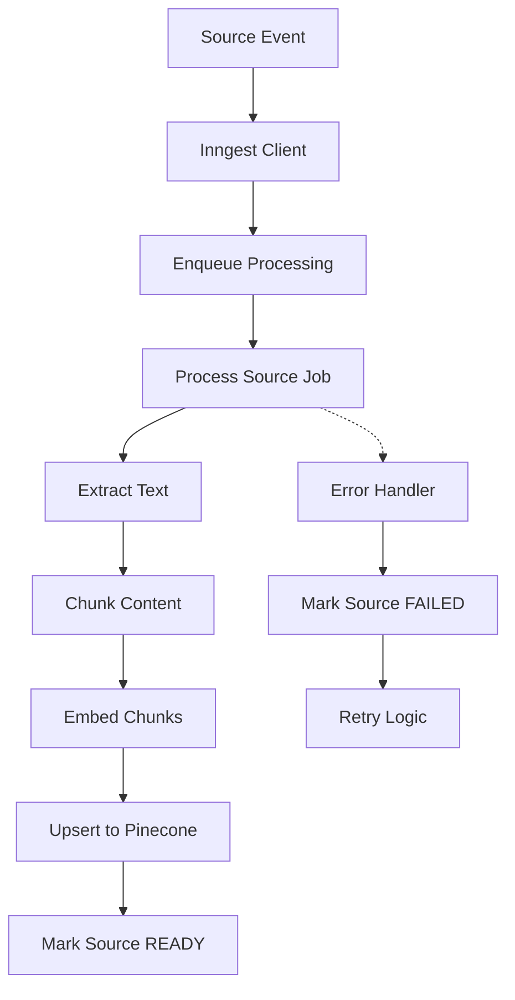
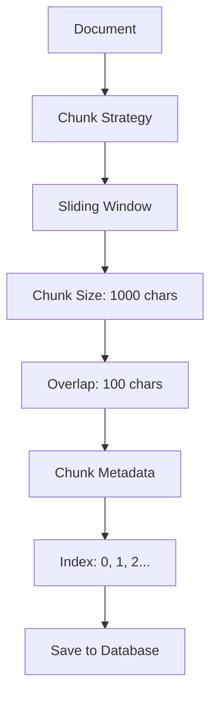
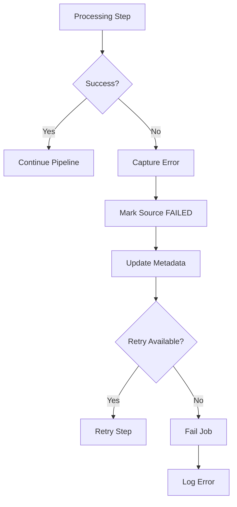
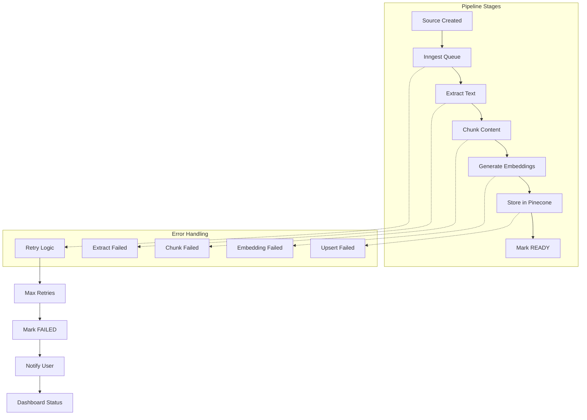

# Chapter 1: Async Indexing Pipeline

## Goal & Overview

The async indexing pipeline is the foundation for turning raw knowledge sources into searchable vector embeddings. It runs as background jobs using **Inngest** to handle long-running processing without blocking API responses.

**Key Components:**
- **Inngest** for durable, event-driven background jobs
- **Sliding-window chunking** to split text into manageable chunks
- **OpenAI embeddings** to convert text chunks to vectors
- **Pinecone** vector database for storage and similarity search
- **State machine** to track processing status (PENDING → PROCESSING → READY/FAILED)

## 1.1 Inngest Background Architecture

Inngest provides **durable execution** for long AI work, handling failures, retries, and state management automatically.



### 1.1.1 Event-Driven Architecture

**Inngest** processes events asynchronously:

```ts
// server/src/inngest/client.ts
export const inngest = new Inngest({ id: "chaibook" });

export type SourceCreatedEvent = {
    name: "source/created";
    data: {
        sourceId: string;
        workspaceId: string;
    };
};
```

**Key Features:**
- **Event-driven**: Trigger processing when sources are created
- **Durable execution**: Automatic retries, state persistence, checkpointing
- **Step functions**: Break jobs into atomic steps with automatic retries
- **Fan-out/fan-in**: Process multiple sources in parallel, wait for completion

### 1.1.2 Job Structure

Each indexing job consists of:

```ts
export const processSource = inngest.createFunction(
    {
        id: "process-source";
        retries: 3;
        triggers: [{ event: "source/created" }];
    },
    async ({ event, step }) => {
        const { sourceId } = event.data;

        // Atomic steps with automatic retries
        await step.run("mark-processing", () => markSourceProcessing(sourceId));

        try {
            const extracted = await step.run("extract-content", () =>
                extractSourceContent(sourceId),
            );

            await step.run("chunk-content", () =>
                chunkSourceContent(
                    sourceId,
                    extracted.text,
                    extracted.pages,
                ),
            );

            const result = await step.run("embed-and-index", async () => {
                const source = await findSourceById(sourceId);
                if (!source) {
                    throw new Error("Source not found");
                }

                const chunks = await findChunksBySourceId(sourceId);
                await embedAndIndexSource(source, chunks);

                return { chunkCount: chunks.length };
            });

            return { sourceId, status: "READY", ...result };
        } catch (error) {
            await step.run("mark-failed", async () => {
                const source = await findSourceById(sourceId);
                if (source) {
                    await markSourceFailed(sourceId, error, source.metadata);
                }
            });
            throw error;
        }
    },
);
```

## 1.2 Sliding-Window Chunking

Text chunking breaks documents into overlapping chunks for better context preservation and retrieval.



### 1.2.1 Chunking Logic

```ts
// server/src/lib/chunking.ts
const CHUNK_SIZE = 1000;
const CHUNK_OVERLAP = 100;

interface Chunk {
    index: number;
    content: string;
    metadata?: {
        page?: number;
        startIndex?: number;
        endIndex?: number;
    };
}

export function chunkText(text: string, page?: number): Chunk[] {
    const chunks: Chunk[] = [];
    const words = text.split(/\s+/);
    let currentChunk = "";
    let chunkIndex = 0;
    let charCount = 0;
    let wordStartIndex = 0;

    for (let i = 0; i < words.length; i++) {
        const word = words[i];
        const wordWithSpace = i === 0 ? word : ` ${word}`;

        if (charCount + wordWithSpace.length > CHUNK_SIZE && charCount > 0) {
            // Save current chunk
            chunks.push({
                index: chunkIndex,
                content: currentChunk.trim(),
                metadata: page ? { page, startIndex: wordStartIndex, endIndex: i } : undefined,
            });

            // Start new chunk with overlap
            const overlapWords = Math.ceil(CHUNK_OVERLAP / averageWordLength);
            const startIndex = Math.max(0, i - overlapWords);

            currentChunk = words.slice(startIndex, i).join(" ");
            charCount = currentChunk.length;
            wordStartIndex = startIndex;
            chunkIndex++;
        }

        currentChunk += wordWithSpace;
        charCount += wordWithSpace.length;
    }

    // Add final chunk
    if (currentChunk.trim().length > 0) {
        chunks.push({
            index: chunkIndex,
            content: currentChunk.trim(),
            metadata: page ? { page, startIndex: wordStartIndex, endIndex: words.length - 1 } : undefined,
        });
    }

    return chunks;
}
```

### 1.2.2 Chunk Metadata

Each chunk stores metadata for precise citation and debugging:

```ts
// SourceChunk Prisma model (prisma/schema.prisma)
model SourceChunk {
    id         String   @id @default(cuid())
    sourceId   String
    index      Int
    content    String
    tokenCount Int?
    metadata   Json?      // { page?: number; startIndex?: number; endIndex?: number }
    createdAt  DateTime  @default(now())
    source     Source    @relation(fields: [sourceId], references: [id], onDelete: Cascade)

    @@unique([sourceId, index])
    @@index([sourceId])
}
```

## 1.3 Embedding & Vector Storage

Embeddings convert text chunks to vector representations for similarity search.


### 1.3.1 Embedding Pipeline

```ts
// server/src/services/source-processing.service.ts
export async function embedAndIndexSource(
    source: SourceRecord,
    chunks: SourceChunkRecord[],
) {
    const batchSize = 50;
    const records: PineconeRecord<VectorMetadata>[] = [];

    for (let i = 0; i < chunks.length; i += batchSize) {
        const batch = chunks.slice(i, i + batchSize);
        const embeddings = await embedTexts(batch.map((chunk) => chunk.content));

        for (let j = 0; j < batch.length; j += 1) {
            const chunk = batch[j]!;
            const embedding = embeddings[j]!;

            records.push({
                id: chunk.id,
                values: embedding,
                metadata: {
                    workspaceId: source.workspaceId,
                    sourceId: source.id,
                    chunkId: chunk.id,
                    chunkIndex: chunk.index,
                    sourceTitle: source.title,
                    sourceType: source.type,
                    text: chunk.content.slice(0, 35000), // Limit for metadata size
                    ...(typeof chunk.metadata?.page === "number"
                        ? { page: chunk.metadata.page }
                        : {}),
                },
            });
        }
    }

    await upsertSourceVectors(source.workspaceId, records);

    // Mark source as READY with metadata
    const metadata =
        source.metadata &&
        typeof source.metadata === "object" &&
        !Array.isArray(source.metadata)
            ? (source.metadata as SourceMetadata)
            : {};

    return updateSourceRecord(source.id, {
        status: "READY",
        metadata: {
            ...metadata,
            chunkCount: chunks.length,
            indexedAt: new Date().toISOString(),
            processingError: undefined,
        },
    });
}
```

### 1.3.2 Pinecone Integration

Pinecone provides the vector database with namespace isolation and metadata filtering.

```ts
// server/src/lib/pinecone.ts
export type VectorMetadata = {
    workspaceId: string;
    sourceId: string;
    chunkId: string;
    chunkIndex: number;
    sourceTitle: string;
    sourceType: string;
    text: string;
    page?: number;
};

export async function upsertSourceVectors(
    workspaceId: string,
    records: PineconeRecord<VectorMetadata>[],
) {
    if (records.length === 0) {
        return;
    }

    const index = await getPineconeIndex();
    const namespace = index.namespace(workspaceId);

    const batchSize = 100;
    for (let i = 0; i < records.length; i += batchSize) {
        await namespace.upsert({
            records: records.slice(i, i + batchSize),
        });
    }
}
```

## 1.4 Error Handling & Retries

The pipeline implements comprehensive error handling with automatic retries and failure tracking.



### 1.4.1 Failure Recovery

```ts
export async function markSourceFailed(
    sourceId: string,
    error: unknown,
    existingMetadata: SourceRecord["metadata"],
) {
    const message =
        error instanceof Error ? error.message : "Source processing failed";

    const metadata =
        existingMetadata &&
        typeof existingMetadata === "object" &&
        !Array.isArray(existingMetadata)
            ? (existingMetadata as SourceMetadata)
            : {};

    return updateSourceRecord(sourceId, {
        status: "FAILED",
        metadata: {
            ...metadata,
            processingError: message,
        },
    });
}
```

## 1.5 Common Mistakes

### 1.5.1 Chunk Size Configuration

**Problem:** Fixed chunk sizes may break semantic boundaries.

**Solution:** Use adaptive chunking based on content structure:

```ts
function intelligentChunking(text: string): Chunk[] {
    // Split by paragraphs first
    const paragraphs = text.split('\n\n');
    const chunks: Chunk[] = [];
    let currentChunk = "";
    let chunkIndex = 0;

    for (const paragraph of paragraphs) {
        if (currentChunk.length + paragraph.length > MAX_CHUNK_SIZE) {
            if (currentChunk.length > 0) {
                chunks.push({ index: chunkIndex++, content: currentChunk });
            }
            currentChunk = paragraph;
        } else {
            currentChunk += (currentChunk ? '\n\n' : '') + paragraph;
        }
    }

    if (currentChunk.length > 0) {
        chunks.push({ index: chunkIndex, content: currentChunk });
    }

    return chunks;
}
```

### 1.5.2 Embedding Rate Limits

**Problem:** Hitting OpenAI rate limits during bulk processing.

**Solution:** Implement exponential backoff and chunked requests:

```ts
export async function embedTextsSafe(texts: string[]): Promise<number[][]> {
    const results: number[][] = [];
    const batchSize = 50;

    for (let i = 0; i < texts.length; i += batchSize) {
        const batch = texts.slice(i, i + batchSize);

        try {
            const embeddings = await embedTexts(batch);
            results.push(...embeddings);

            // Adaptive delay based on batch size
            if (batch.length === batchSize) {
                await new Promise(resolve => setTimeout(resolve, 100));
            }
        } catch (error) {
            console.error(`Embedding batch ${i} failed:`, error);
            // Retry logic with backoff
            await new Promise(resolve => setTimeout(resolve, 1000 * (Math.pow(2, 1))));
            // Retry once more
            const retryEmbeddings = await embedTexts(batch);
            results.push(...retryEmbeddings);
        }
    }

    return results;
}
```

## 1.6 Key Takeaways

- **Event-driven design**: Use Inngest for durable background jobs with automatic retries
- **Sliding-window chunking**: Maintain context with overlap for better retrieval
- **Batch processing**: Process embeddings and vector upserts in batches for efficiency
- **Comprehensive error handling**: Track failures and provide retry mechanisms
- **Metadata importance**: Store rich metadata for precise citations and debugging

## 1.7 Mermaid Diagram Reference



---

*This chapter is based on the source notes from `gen-ai-cohort/week05/implementations guide/chapter-07-indexing-pipeline.md` with additional details on error handling and best practices.*

**Next Chapter:** [Chapter 2 - Source Processing & State Machine](../02-source-processing-state-machine)