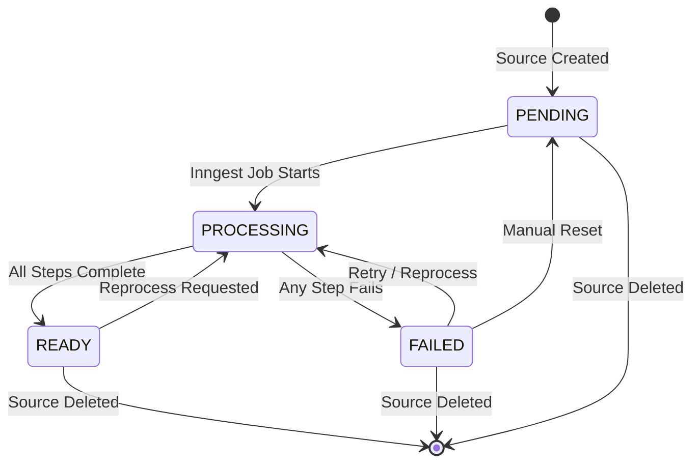
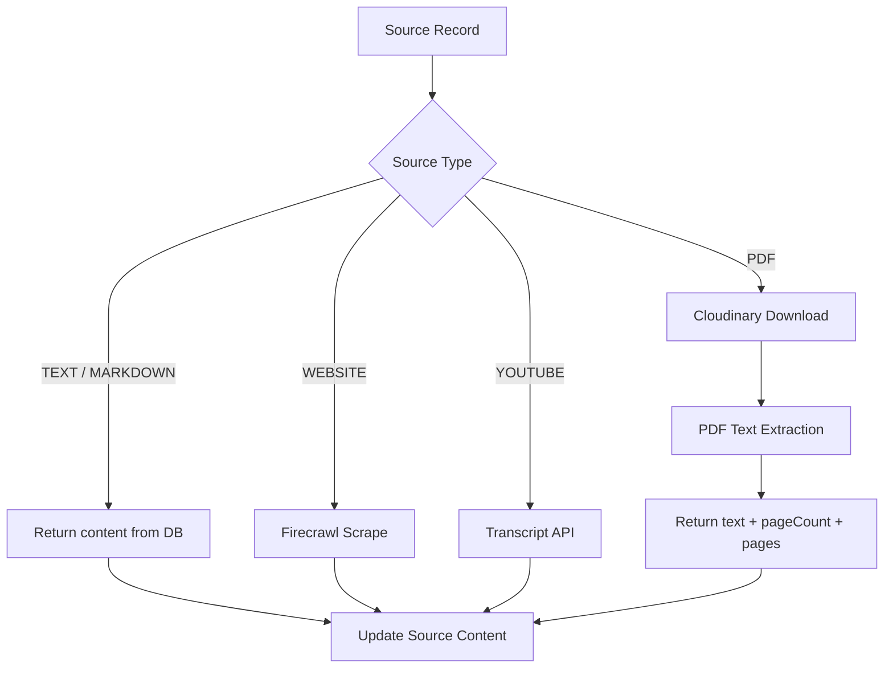
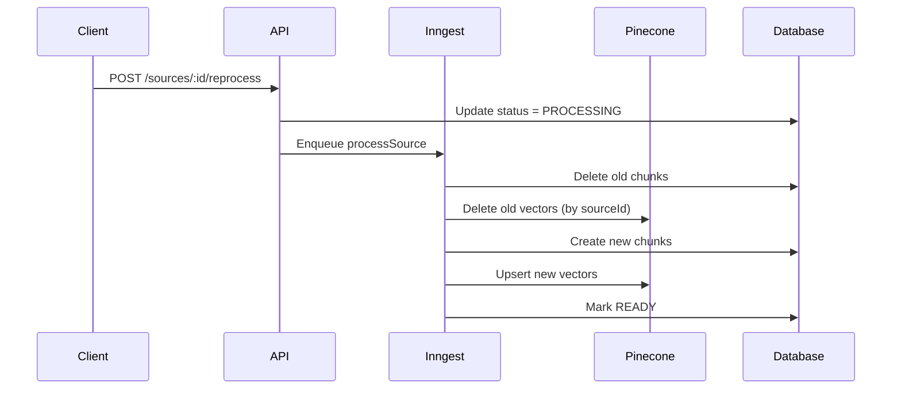

# Chapter 2: Source Processing & State Machine

## Goal & Overview

This chapter covers the complete source processing pipeline from creation through indexing, including the state machine (PENDING → PROCESSING → READY/FAILED), re-processing capabilities, and cleanup operations.

**Key Components:**
- **Source lifecycle state machine**
- **Content extraction** (PDF, website, YouTube, text)
- **Re-processing** with Pinecone cleanup
- **Source deletion** with cascade removal

## 2.1 Source State Machine

The source processing follows a well-defined state machine:



### 2.1.1 State Definitions

| State | Description | Trigger |
|-------|-------------|---------|
| **PENDING** | Source saved, awaiting processing | Source creation (all import types) |
| **PROCESSING** | Inngest job actively processing | `processSource` job begins |
| **READY** | Successfully indexed in Pinecone | All pipeline steps complete |
| **FAILED** | Error during any pipeline step | Extraction, chunking, or embedding fails |

### 2.1.2 State Transitions in Code

```ts
// server/src/services/source-processing.service.ts
export function markSourceProcessing(sourceId: string) {
    return updateSourceRecord(sourceId, { status: "PROCESSING" });
}

export async function markSourceFailed(
    sourceId: string,
    error: unknown,
    existingMetadata: SourceRecord["metadata"],
) {
    const message =
        error instanceof Error ? error.message : "Source processing failed";

    const metadata = existingMetadata as SourceMetadata ?? {};

    return updateSourceRecord(sourceId, {
        status: "FAILED",
        metadata: {
            ...metadata,
            processingError: message,
        },
    });
}

// On successful completion
return updateSourceRecord(source.id, {
    status: "READY",
    metadata: {
        ...metadata,
        chunkCount: chunks.length,
        indexedAt: new Date().toISOString(),
        processingError: undefined,
    },
});
```

## 2.2 Content Extraction

Different source types require different extraction strategies.



### 2.2.1 Extraction Logic

```ts
// server/src/services/source-processing.service.ts
async function extractSourceText(source: SourceRecord) {
    // Path 1: Text already in DB (TEXT, MARKDOWN, URL, YOUTUBE)
    const text = source.content?.trim();
    if (text) {
        return {
            text,
            pageCount: undefined,
            pages: undefined,
        };
    }

    // Path 2: PDF extraction from Cloudinary
    if (source.type === "PDF") {
        const metadata = source.metadata as SourceMetadata;
        if (!metadata.fileUrl) {
            throw new Error("PDF source is missing fileUrl metadata");
        }

        const extracted = await extractPdfFromCloudinary({
            fileUrl: metadata.fileUrl,
            publicId: metadata.publicId,
            resourceType: metadata.resourceType ?? "image",
        });

        return {
            text: extracted.text,
            pageCount: extracted.pageCount,
            pages: extracted.pages,
        };
    }

    throw new Error(`Source ${source.id} has no extractable content`);
}
```

### 2.2.2 Import Channels

Each import channel creates a source with `status: "PENDING"`:

| Channel | Content Source | Extraction Method |
|---------|---------------|-------------------|
| **Text/Markdown** | Direct input | Already in `source.content` |
| **Website** | URL | Firecrawl API scrape |
| **YouTube** | Video ID | YouTube transcript API |
| **PDF Upload** | Cloudinary | PDF text extraction |
| **Web Search** | Tavily results | Already extracted text |

## 2.3 Re-processing Pipeline

Re-processing enables updating sources when models change or initial processing fails.



### 2.3.1 Reprocess Implementation

```ts
// server/src/services/source-processing.service.ts
export async function removeSourceFromIndex(
    workspaceId: string,
    sourceId: string,
) {
    // 1. Remove vectors from Pinecone
    await deleteSourceVectors(workspaceId, sourceId);

    // 2. Delete chunks from Postgres
    await deleteChunksBySourceId(sourceId);
}

// server/src/services/source.service.ts
export async function reprocessSource(
    workspaceId: string,
    userId: string,
    sourceId: string,
) {
    await getWorkspaceByIdForUser(workspaceId, userId);

    const source = await findSourceByIdAndWorkspaceId(sourceId, workspaceId);
    if (!source) {
        throw new NotFoundError("Source not found");
    }

    // Clean up existing index
    await removeSourceFromIndex(workspaceId, sourceId);

    // Reset status and enqueue
    await updateSourceRecord(sourceId, { status: "PENDING" });
    await enqueueSourceProcessing({ sourceId, workspaceId });

    return { message: "Reprocessing started" };
}
```

## 2.4 Source Deletion & Cleanup

Deleting a source cascades to all related data.

```ts
// server/src/services/source.service.ts
export async function deleteSource(
    workspaceId: string,
    userId: string,
    sourceId: string,
) {
    await getWorkspaceByIdForUser(workspaceId, userId);

    const source = await findSourceByIdAndWorkspaceId(sourceId, workspaceId);
    if (!source) {
        throw new NotFoundError("Source not found");
    }

    // 1. Remove from vector index
    await removeSourceFromIndex(workspaceId, sourceId);

    // 2. Delete source record (cascades to chunks)
    await deleteSourceRecord(sourceId);

    return { message: "Source deleted" };
}

// Workspace deletion clears entire Pinecone namespace
export async function deleteWorkspace(workspaceId: string) {
    // 1. Delete all workspace vectors from Pinecone
    await deleteWorkspaceVectors(workspaceId);

    // 2. Delete workspace (cascades to sources, chunks, conversations, artifacts)
    await deleteWorkspaceRecord(workspaceId);
}
```

## 2.5 Chunk Inspection API

For debugging and verification, provide chunk inspection endpoints:

```ts
// server/src/services/source-processing.service.ts
export async function listChunksForSource(sourceId: string) {
    const chunks = await findChunksBySourceId(sourceId);
    return { chunks, count: chunks.length };
}

// GET /api/workspaces/:workspaceId/sources/:sourceId/chunks
// Returns: { chunks: [...], count: 5 }
```

### 2.5.1 Chunk Data Structure

```json
{
  "chunks": [
    {
      "id": "chunk_id_1",
      "sourceId": "source_id",
      "index": 0,
      "content": "First chunk of text...",
      "tokenCount": 250,
      "metadata": { "page": 1, "startIndex": 0, "endIndex": 500 },
      "createdAt": "2024-01-15T10:30:00Z"
    }
  ],
  "count": 1
}
```

## 2.6 Common Mistakes

### 2.6.1 Incomplete Cleanup

**Problem:** Only deleting database records but not Pinecone vectors.

**Solution:** Always clean both systems atomically:

```ts
async function fullCleanup(workspaceId: string, sourceId: string) {
    // Use transaction for database operations
    await prisma.$transaction(async (tx) => {
        // Delete chunks first (foreign key constraint)
        await tx.sourceChunk.deleteMany({ where: { sourceId } });

        // Delete source record
        await tx.source.delete({ where: { id: sourceId } });
    });

    // Then clean Pinecone (external system)
    await deleteSourceVectors(workspaceId, sourceId);
}
```

### 2.6.2 State Machine Violations

**Problem:** Allowing invalid state transitions.

**Solution:** Validate state transitions:

```ts
function validateStateTransition(
    current: SourceStatus,
    next: SourceStatus
): boolean {
    const validTransitions: Record<SourceStatus, SourceStatus[]> = {
        PENDING: ["PROCESSING", "FAILED"],
        PROCESSING: ["READY", "FAILED"],
        READY: ["PROCESSING"],
        FAILED: ["PROCESSING", "PENDING"],
    };

    return validTransitions[current]?.includes(next) ?? false;
}
```

### 2.6.3 Partial PDF Extraction

**Problem:** PDF text extraction missing pages or producing garbled text.

**Solution:** Add extraction validation:

```ts
async function validateExtraction(source: SourceRecord, extracted: ExtractedContent): Promise<void> {
    const minChars = 100;
    const minPages = 1;

    if (source.type === "PDF") {
        if (!extracted.pages || extracted.pages.length < minPages) {
            throw new Error("PDF extraction produced insufficient pages");
        }

        if (!extracted.text || extracted.text.length < minChars) {
            throw new Error("PDF extraction produced insufficient text");
        }
    }
}
```

## 2.7 Key Takeaways

- **State machine is critical**: Track processing status for UX and debugging
- **Atomic cleanup**: Remove both database records and Pinecone vectors together
- **Re-processing support**: Enable model updates and recovery from failures
- **Content extraction abstraction**: Different sources, unified output format
- **Chunk inspection**: Essential for debugging retrieval quality

---

*Based on source notes from `gen-ai-cohort/week05/implementations guide/chapter-07-indexing-pipeline.md` (sections 7C-7E) and `notes.md` chapters 7E-7F.*

**Next Chapter:** [Chapter 3 - Streaming RAG Chat](../03_Streaming_RAG_Chat)