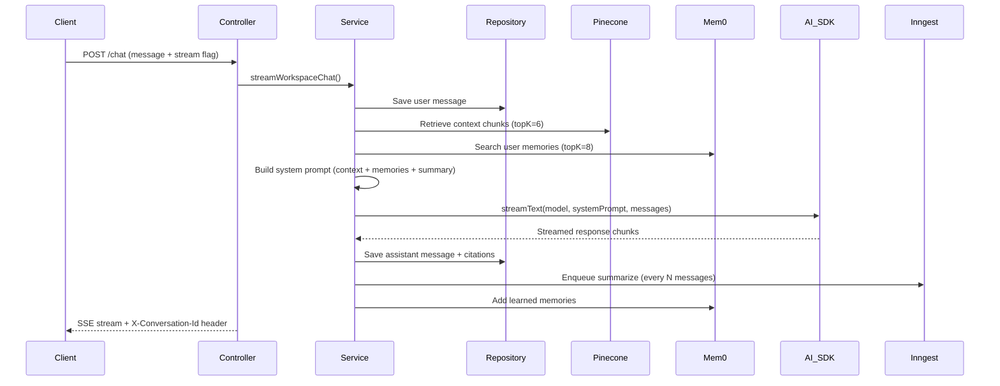
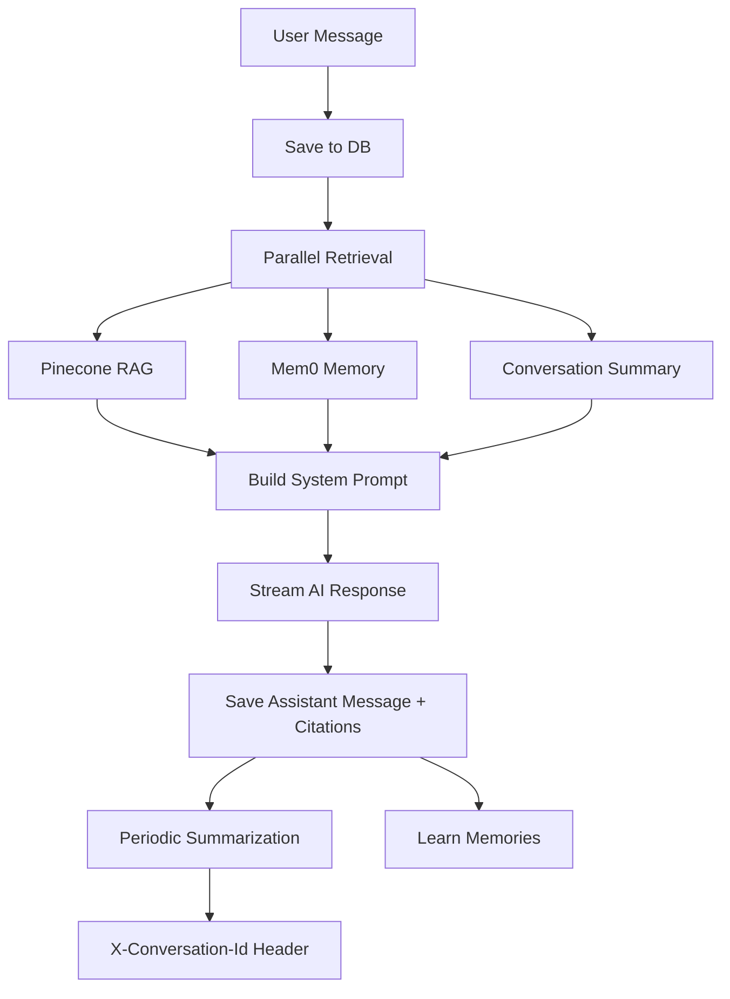
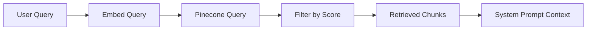

# Chapter 3: Streaming RAG Chat

## Goal & Overview

Streaming RAG chat enables real-time, context-aware conversations over indexed workspace sources using Server-Sent Events (SSE) with AI SDK streaming.

**Key Components:**
- **Conversations & Messages** for chat history
- **RAG retrieval** with Pinecone vector search
- **System prompt construction** with retrieved context
- **Streaming responses** via AI SDK (streamText)
- **Citation tracking** with per-message citations

## 3.1 RAG Chat Pipeline Architecture



## 3.2 Data Model

### 3.2.1 Prisma Schema

```prisma
model Conversation {
    id             String      @id @default(cuid())
    workspaceId    String
    title          String?
    summary        String?
    summaryMessageCount Int    @default(0)
    summarizedAt   DateTime?
    createdAt      DateTime    @default(now())
    updatedAt      DateTime    @updatedAt
    workspace      Workspace   @relation(fields: [workspaceId], references: [id], onDelete: Cascade)
    messages       Message[]

    @@index([workspaceId])
    @@map("conversation")
}

model Message {
    id       String   @id @default(cuid())
    conversationId String
    role     String   // USER | ASSISTANT
    content  String
    citations Json?    // Array of ChatCitation objects
    createdAt DateTime @default(now())
    conversation Conversation @relation(fields: [conversationId], references: [id], onDelete: Cascade)

    @@index([conversationId])
    @@map("message")
}
```

### 3.2.2 Chat Body Schema

```ts
// server/src/validators/chat.validator.ts
export const chatBodySchema = z.object({
    conversationId: z.string().trim().min(1).optional(),
    messages: z.array(z.record(z.string(), z.unknown())).min(1),
    model: z.enum(CHAT_MODELS).optional(),
    webSearch: z.boolean().optional(),
});
```

## 3.3 Core Chat Flow

### 3.3.1 Step-by-Step Pipeline

```ts
// server/src/services/chat.service.ts
export async function streamWorkspaceChat(
    res: Response,
    workspaceId: string,
    userId: string,
    input: ChatInput,
) {
    // 1. Verify workspace ownership
    const workspace = await getWorkspaceByIdForUser(workspaceId, userId);

    // 2. Resolve model selection
    const chatModel = input.model ?? workspace.defaultModel ?? CHAT_MODEL;

    // 3. Extract latest user message
    const userText = getLastUserMessageText(input.messages);
    if (!userText) {
        throw new ValidationError("A user message is required");
    }

    // 4. Resolve or create conversation
    const conversation = await resolveConversation(
        workspaceId,
        input.conversationId,
        userText,
    );

    // 5. Save user message
    await createMessageRecord({
        conversationId: conversation.id,
        role: "USER",
        content: userText,
    });

    // 6. Parallel: RAG retrieval + memory search
    const [retrievedChunks, userMemories] = await Promise.all([
        retrieveWorkspaceContext(workspaceId, userText),
        searchUserMemories(userId, userText),
    ]);

    // 7. Build citations
    const citations = retrievedChunks.map((chunk) => ({
        sourceId: chunk.sourceId,
        sourceTitle: chunk.sourceTitle,
        sourceType: chunk.sourceType,
        chunkId: chunk.chunkId,
        chunkIndex: chunk.chunkIndex,
        page: chunk.page,
        excerpt: chunk.text.slice(0, 280),
        score: chunk.score,
    }));

    // 8. Build system prompt
    const systemPrompt = buildChatSystemPrompt({
        chunks: retrievedChunks,
        conversationSummary: conversation.summary,
        userMemories: userMemories.map((memory) => memory.memory),
        webSearchEnabled: input.webSearch && !!process.env.TAVILY_API_KEY,
    });

    // 9. Prepare context messages (with rolling summary)
    const contextMessages =
        conversation.summary &&
        input.messages.length > RECENT_MESSAGE_WINDOW
            ? input.messages.slice(-RECENT_MESSAGE_WINDOW)
            : input.messages;

    // 10. Stream response via AI SDK
    const stream = createUIMessageStream({
        originalMessages: input.messages,
        execute: async ({ writer }) => {
            const tools = webSearchEnabled ? { web_search: webSearchTool } : undefined;

            const result = streamText({
                model: openai(chatModel),
                system: systemPrompt,
                messages: await convertToModelMessages(contextMessages),
                tools,
                stopWhen: webSearchEnabled ? isStepCount(3) : undefined,
            });

            writer.merge(toUIMessageStream({ stream: result.stream }));
        },
        onFinish: async ({ responseMessage, isAborted }) => {
            if (isAborted) return;

            const assistantText = getTextFromUIMessage(responseMessage).trim();
            if (!assistantText) return;

            // Save assistant message with citations
            const webCitations = ...;
            const allCitations = [...citations, ...webCitations];

            await createMessageRecord({
                conversationId: conversation.id,
                role: "ASSISTANT",
                content: assistantText,
                citations: allCitations,
            });

            await touchConversation(conversation.id);

            // Auto-title
            if (!conversation.title) {
                await updateConversationRecord(conversation.id, {
                    title: buildConversationTitle(userText),
                });
            }

            // Periodic summarization
            const messageCount = await countMessagesByConversationId(conversation.id);
            if (messageCount % CONVERSATION_SUMMARY_INTERVAL === 0) {
                await enqueueConversationSummarize({
                    conversationId: conversation.id,
                    userId,
                });
            }

            // Learn memories
            void addMemoriesFromMessages(
                userId,
                [
                    { role: "user", content: userText },
                    { role: "assistant", content: assistantText },
                ],
                { source: "learned", conversationId: conversation.id },
            ).catch((error) => console.error("Mem0 add failed:", error));
        },
    });

    await pipeUIMessageStreamToResponse({
        response: res,
        stream,
        headers: { "X-Conversation-Id": conversation.id },
    });
}
```

### 3.3.2 Mermaid Flowchart



## 3.4 RAG Retrieval

### 3.4.1 Context Retrieval



### 3.4.2 Retrieval Configuration

| Setting | Value | Description |
|---------|-------|-------------|
| `RAG_TOP_K` | 6 | Maximum chunks retrieved per query |
| `RAG_MIN_SCORE` | 0.35 | Minimum cosine similarity threshold |
| `EMBEDDING_DIMENSIONS` | 1536 | Vector dimension for text-embedding-3-small |
| `RECENT_MESSAGE_WINDOW` | 12 | Recent messages sent to model |
| `CONVERSATION_SUMMARY_INTERVAL` | 8 | Summarize every N messages |

### 3.4.3 Retrieval Logic

```ts
// server/src/lib/rag/retrieve.ts
export async function retrieveWorkspaceContext(
    workspaceId: string,
    query: string,
): Promise<RetrievedChunk[]> {
    const [embedding] = await embedTexts([query]);
    const matches = await queryWorkspaceVectors(workspaceId, embedding, RAG_TOP_K);

    const chunks: RetrievedChunk[] = [];

    for (const match of matches) {
        const score = match.score ?? 0;
        if (score < RAG_MIN_SCORE) continue;

        const metadata = match.metadata as Record<string, unknown> | undefined;
        if (!metadata) continue;

        // Validate required metadata fields
        const valid =
            typeof metadata.sourceId === "string" &&
            typeof metadata.sourceTitle === "string" &&
            typeof metadata.sourceType === "string" &&
            typeof metadata.chunkId === "string" &&
            typeof metadata.text === "string";

        if (!valid) continue;

        chunks.push({
            sourceId: metadata.sourceId,
            sourceTitle: metadata.sourceTitle,
            sourceType: metadata.sourceType,
            chunkId: metadata.chunkId,
            chunkIndex: Number(metadata.chunkIndex ?? 0),
            page: typeof metadata.page === "number" ? metadata.page : undefined,
            text: metadata.text,
            score,
        });
    }

    return chunks;
}
```

## 3.5 System Prompt Construction

The system prompt combines context, memories, summary, and web search hints.

### 3.5.1 System Prompt Structure

```
You are Chaibook, an assistant that helps users learn from their workspace sources.

[Web Search Section - optional]
Known facts about this user:
- Memory 1
- Memory 2

Earlier conversation summary:
<summary>

Retrieved context:
[1] Document Title (PDF)
Chunk text...

[2] Source Title (WEBSITE)
Chunk text...

Use ONLY the retrieved context below when making factual claims.
If context is insufficient, say so clearly.
Cite sources inline using [1], [2], etc.
```

### 3.5.2 Prompt Builder Logic

```ts
export function buildChatSystemPrompt(input: {
    chunks: RetrievedChunk[];
    conversationSummary?: string | null;
    userMemories?: string[];
    webSearchEnabled?: boolean;
}): string {
    const sections: string[] = [
        "You are Chaibook, an assistant that helps users learn from their workspace sources.",
    ];

    // Web search section
    if (input.webSearchEnabled) {
        sections.push(
            "You have access to a web_search tool for up-to-date information outside the workspace.",
            "Use it when the user asks about recent events or topics not covered by their sources.",
            "Cite web results inline using [W1], [W2], etc.",
        );
    }

    // User memories
    if (input.userMemories?.length) {
        const memoryBlock = input.userMemories
            .map((memory) => `- ${memory}`)
            .join("\n");
        sections.push("Known facts about this user (use when relevant):", memoryBlock);
    }

    // Conversation summary
    const summary = input.conversationSummary?.trim();
    if (summary) {
        sections.push("Earlier conversation summary:", summary);
    }

    // No chunks case
    if (input.chunks.length === 0) {
        sections.push(
            "This workspace has no indexed source content yet, or nothing relevant was retrieved.",
            "Do not invent citations.",
        );
        return sections.join("\n");
    }

    // Build context from chunks
    const context = input.chunks
        .map((chunk, index) => {
            const label = `[${index + 1}] ${chunk.sourceTitle} (${chunk.sourceType})${
                chunk.page ? `, page ${chunk.page}` : ""
            }`;
            return `${label}\n${chunk.text}`;
        })
        .join("\n\n");

    sections.push(
        "Use ONLY the retrieved context below when making factual claims about their materials.",
        "If the context is insufficient, say so clearly.",
        "Cite sources inline using [1], [2], etc. matching the numbered context blocks.",
        "Keep answers concise, accurate, and educational.",
        "",
        "Retrieved context:",
        context,
    );

    return sections.join("\n");
}
```

## 3.6 Citations

Citations are tracked per message and enable interactive source previews.

```ts
// server/src/services/chat.service.ts
const citations = retrievedChunks.map((chunk) => ({
    sourceId: chunk.sourceId,
    sourceTitle: chunk.sourceTitle,
    sourceType: chunk.sourceType,
    chunkId: chunk.chunkId,
    chunkIndex: chunk.chunkIndex,
    page: chunk.page,
    excerpt: chunk.text.slice(0, 280),
    score: chunk.score,
}));
```

### 3.6.1 Citation Data Structure

```ts
type ChatCitation = {
    sourceId?: string;
    sourceTitle: string;
    sourceType: string;
    chunkId?: string;
    chunkIndex?: number;
    page?: number;
    excerpt: string;
    score?: number;
    url?: string; // WEB sources only
};
```

## 3.7 Common Mistakes

### 3.7.1 Missing Context Window

**Problem:** Sending entire conversation history to model, causing token bloat and cost issues.

**Solution:** Use rolling summary with recent message window:

```ts
const contextMessages =
    conversation.summary &&
    input.messages.length > RECENT_MESSAGE_WINDOW
        ? input.messages.slice(-RECENT_MESSAGE_WINDOW)
        : input.messages;
```

### 3.7.2 Unchecked Citation References

**Problem:** Model references citations that don't exist in retrieved context.

**Solution:** Validate citations at response time:

```ts
function validateCitations(text: string, citations: ChatCitation[]): string {
    const citationPattern = /\[(\d+)\]/g;
    return text.replace(citationPattern, (match, index) => {
        const citationIndex = parseInt(index, 10);
        if (citationIndex >= 1 && citationIndex <= citations.length) {
            return match; // Valid citation
        }
        return ""; // Remove invalid reference
    });
}
```

### 3.7.3 Streaming Abortion Handling

**Problem:** Not handling stream abortion gracefully.

**Solution:** Check `isAborted` in `onFinish`:

```ts
onFinish: async ({ responseMessage, isAborted }) => {
    if (isAborted) {
        return; // Don't save incomplete responses
    }
    // Save complete response
};
```

## 3.8 Key Takeaways

- **Parallel retrieval**: RAG chunks and Mem0 memories are fetched in parallel for speed
- **Rolling summary**: Reduce context window size while preserving conversation history
- **Citation tracking**: Every message stores its citations for frontend display
- **Streaming with SSE**: AI SDK `streamText` provides real-time token streaming
- **Automatic summarization**: Periodic summarization keeps context manageable

---

*Based on source notes from `gen-ai-cohort/week05/implementations guide/chapter-08-rag-chat.md` and `notes.md` chapter 8.*

**Next Chapter:** [Chapter 4 - Interactive Citations](../04_Interactive_Citations)