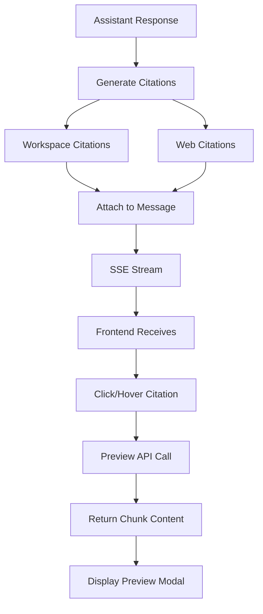
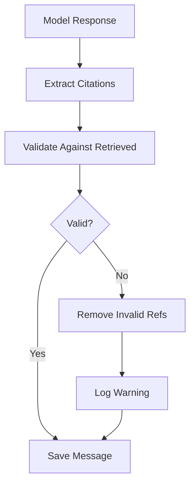

# Chapter 4: Interactive Citations

## Goal & Overview

Interactive citations allow users to hover/click on citation markers in chat responses to preview the exact source chunk, enabling verification and deeper exploration of retrieved content.

**Key Components:**
- **Citation attachment** to assistant messages
- **Source-chunk preview API** for frontend display
- **Citation types**: workspace (RAG) and web (Tavily) sources
- **Frontend integration** with hover/click previews

## 4.1 Citation Architecture



## 4.2 Citation Data Structures

### 4.2.1 Workspace Citation (RAG)

```ts
// From retrieved chunks in chat.service.ts
type ChatCitation = {
    sourceId: string;        // Source record ID
    sourceTitle: string;     // Source title for display
    sourceType: SourceType;  // PDF, WEBSITE, YOUTUBE, TEXT, MARKDOWN
    chunkId: string;         // Chunk record ID
    chunkIndex: number;      // Position in source
    page?: number;           // Page number (PDF)
    excerpt: string;         // Preview text (280 chars)
    score: number;           // Cosine similarity score
};
```

### 4.2.2 Web Citation (Tavily)

```ts
// From web search tool results
type WebCitation = {
    url: string;             // Source URL
    title: string;           // Page title
    content: string;         // Snippet content
    sourceType: "WEB";       // Always WEB
    citationId: string;      // W1, W2, etc.
};
```

### 4.2.3 Message Storage

```prisma
model Message {
    id       String   @id @default(cuid())
    conversationId String
    role     String   // USER | ASSISTANT
    content  String
    citations Json?    // Array of ChatCitation | WebCitation
    createdAt DateTime @default(now())
    conversation Conversation @relation(fields: [conversationId], references: [id], onDelete: Cascade)
}
```

## 4.3 Citation Generation

### 4.3.1 Workspace Citations

Generated during RAG retrieval:

```ts
// server/src/services/chat.service.ts
const citations = retrievedChunks.map((chunk) => ({
    sourceId: chunk.sourceId,
    sourceTitle: chunk.sourceTitle,
    sourceType: chunk.sourceType,
    chunkId: chunk.chunkId,
    chunkIndex: chunk.chunkIndex,
    page: chunk.page,
    excerpt: chunk.text.slice(0, 280),
    score: chunk.score,
}));
```

### 4.3.2 Web Search Citations

Generated when web search is enabled:

```ts
// server/src/services/chat.service.ts
const webSearchResults = responseMessage.parts
    .filter((part) => part.type === "tool-web_search")
    .flatMap((part) => part.content);

const webCitations = webSearchResults.map((result: WebSearchResult, index: number) => ({
    url: result.url,
    title: result.title,
    content: result.content,
    sourceType: "WEB" as const,
    citationId: `W${index + 1}`,
}));

const allCitations = [...citations, ...webCitations];
```

### 4.3.3 Citation Format in Streaming

Citations are attached to the final assistant message:

```json
{
  "id": "msg_abc123",
  "role": "assistant",
  "content": "Based on the PDF, the concept is defined as... [1]",
  "citations": [
    {
      "sourceId": "src_xyz",
      "sourceTitle": "Introduction to AI",
      "sourceType": "PDF",
      "chunkId": "chunk_001",
      "chunkIndex": 0,
      "page": 1,
      "excerpt": "The concept is defined as a method for...",
      "score": 0.89
    }
  ]
}
```

## 4.4 Source Chunk Preview API

Frontend fetches full chunk content for previews.

### 4.4.1 API Endpoint

```ts
// GET /api/workspaces/:workspaceId/sources/:sourceId/chunks/:chunkId
// Returns full chunk content for citation preview
```

### 4.4.2 Preview Controller

```ts
// server/src/controllers/source.controller.ts
export async function getSourceChunkById(
    workspaceId: string,
    userId: string,
    sourceId: string,
    chunkId: string,
) {
    await getWorkspaceByIdForUser(workspaceId, userId);

    const chunk = await findChunkById(chunkId);
    if (!chunk || chunk.sourceId !== sourceId) {
        throw new NotFoundError("Chunk not found");
    }

    // Verify source belongs to workspace
    const source = await findSourceById(sourceId);
    if (!source || source.workspaceId !== workspaceId) {
        throw new NotFoundError("Source not found in workspace");
    }

    return {
        chunk: {
            id: chunk.id,
            sourceId: chunk.sourceId,
            index: chunk.index,
            content: chunk.content,
            tokenCount: chunk.tokenCount,
            metadata: chunk.metadata,
            createdAt: chunk.createdAt,
        },
    };
}
```

### 4.4.3 Chunk Data Response

```json
{
  "chunk": {
    "id": "chunk_001",
    "sourceId": "src_xyz",
    "index": 0,
    "content": "Full chunk text content here...",
    "tokenCount": 245,
    "metadata": { "page": 1, "startIndex": 0, "endIndex": 1200 },
    "createdAt": "2024-01-15T10:30:00Z"
  }
}
```

## 4.5 Frontend Integration

### 4.5.1 Citation Component

```tsx
// components/chat/CitationBadge.tsx
interface CitationBadgeProps {
    citation: ChatCitation | WebCitation;
    index: number;
}

export function CitationBadge({ citation, index }: CitationBadgeProps) {
    const [preview, setPreview] = useState<ChunkPreview | null>(null);
    const [isLoading, setIsLoading] = useState(false);

    const handleClick = async () => {
        if (citation.sourceType === "WEB") {
            window.open(citation.url, "_blank");
            return;
        }

        setIsLoading(true);
        try {
            const response = await fetch(
                `/api/workspaces/${workspaceId}/sources/${citation.sourceId}/chunks/${citation.chunkId}`
            );
            const data = await response.json();
            setPreview(data.chunk);
        } catch (error) {
            console.error("Failed to load preview:", error);
        } finally {
            setIsLoading(false);
        }
    };

    return (
        <span
            className="citation-badge"
            onClick={handleClick}
            onMouseEnter={handleClick} // Hover preview
        >
            [{index + 1}]
            {preview && (
                <CitationPreview
                    content={preview.content}
                    title={citation.sourceTitle}
                    page={citation.page}
                    score={citation.score}
                />
            )}
        </span>
    );
}
```

### 4.5.2 Preview Modal

```tsx
// components/chat/CitationPreview.tsx
interface CitationPreviewProps {
    content: string;
    title: string;
    page?: number;
    score?: number;
}

export function CitationPreview({ content, title, page, score }: CitationPreviewProps) {
    return (
        <div className="citation-preview">
            <div className="preview-header">
                <strong>{title}</strong>
                {page && <span>Page {page}</span>}
                {score && <span className="score">Score: {(score * 100).toFixed(0)}%</span>}
            </div>
            <div className="preview-content">
                {content}
            </div>
        </div>
    );
}
```

## 4.6 Citation Validation

Ensure citation references match retrieved sources.



### 4.6.1 Validation Logic

```ts
// server/src/services/chat.service.ts
function validateAndCleanCitations(
    responseText: string,
    citations: ChatCitation[],
): string {
    // Find all [N] references in response
    const referencePattern = /\[(\d+)\]/g;
    const referencedIndices = new Set<number>();

    let match;
    while ((match = referencePattern.exec(responseText)) !== null) {
        referencedIndices.add(parseInt(match[1], 10));
    }

    // Check each reference exists
    const validIndices = Array.from(referencedIndices).filter(
        (idx) => idx >= 1 && idx <= citations.length
    );

    if (validIndices.length !== referencedIndices.size) {
        console.warn(
            "Citation mismatch:",
            Array.from(referencedIndices).filter(
                (idx) => !validIndices.includes(idx)
            )
        );
    }

    // Optionally strip invalid references
    return responseText.replace(referencePattern, (match, index) => {
        const idx = parseInt(index, 10);
        return validIndices.includes(idx) ? match : "";
    });
}
```

## 4.7 Common Mistakes

### 4.7.1 Missing Citation Attachments

**Problem:** Citations not saved with messages, breaking history.

**Solution:** Always attach citations in `onFinish`:

```ts
onFinish: async ({ responseMessage, isAborted }) => {
    if (isAborted) return;

    const assistantText = getTextFromUIMessage(responseMessage).trim();
    if (!assistantText) return;

    const allCitations = [...workspaceCitations, ...webCitations];

    await createMessageRecord({
        conversationId: conversation.id,
        role: "ASSISTANT",
        content: assistantText,
        citations: allCitations,  // Always include citations
    });
}
```

### 4.7.2 Citation Index Mismatch

**Problem:** Model references citation [5] but only 3 chunks retrieved.

**Solution:** Validate and clean references before saving:

```ts
function cleanCitationReferences(text: string, maxCitation: number): string {
    return text.replace(/\[(\d+)\]/g, (match, num) => {
        const idx = parseInt(num, 10);
        return idx >= 1 && idx <= maxCitation ? match : "";
    });
}
```

### 4.7.3 Preview API Authorization

**Problem:** Preview API accessible without workspace membership.

**Solution:** Verify workspace ownership:

```ts
export async function getSourceChunkById(
    workspaceId: string,
    userId: string,
    sourceId: string,
    chunkId: string,
) {
    // First verify user has access to workspace
    await getWorkspaceByIdForUser(workspaceId, userId);

    // Then verify chunk belongs to source in workspace
    const chunk = await findChunkById(chunkId);
    if (!chunk || chunk.sourceId !== sourceId) {
        throw new NotFoundError("Chunk not found");
    }

    const source = await findSourceById(sourceId);
    if (!source || source.workspaceId !== workspaceId) {
        throw new NotFoundError("Source not found in workspace");
    }

    return { chunk };
}
```

## 4.8 Key Takeaways

- **Two citation types**: Workspace (RAG) with chunk IDs, Web (Tavily) with URLs
- **Preview API**: Fetch full chunk content for hover/click previews
- **Authorization**: Verify workspace access before returning chunk content
- **Validation**: Check citation references match retrieved sources
- **Frontend UX**: Hover for quick preview, click for full modal

---

*Based on source notes from `gen-ai-cohort/week05/implementations guide/chapter-08-rag-chat.md` (citations section) and `notes.md` chapter 8.*

**Next Chapter:** [Chapter 5 - User Memory & Web Search](../05_User_Memory_Web_Search)