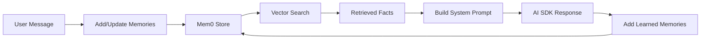
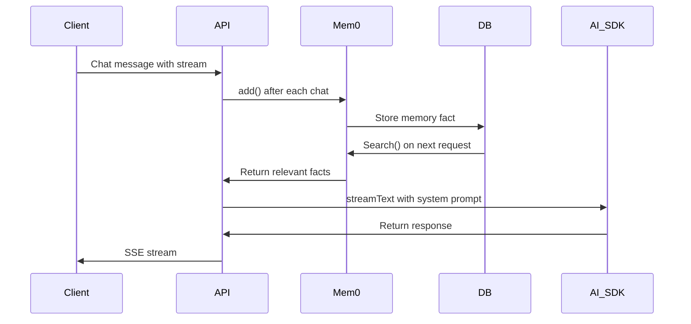

# Chapter 5: User Memory & Web Search

## Goal & Overview

User memory enables persistent, cross-session learning about each user, while web search integration provides up-to-date information beyond the workspace. Mem0 handles memory storage and retrieval, and Tavily handles live web search.

**Key Components:**
- **Mem0** for persistent user memory across chats
- **Tavily** for live web search integration
- **Memory search** with similarity ranking and recency bias
- **Web search** tool usage in RAG chat pipeline

## 5.1 Mem0 Memory Architecture



### 5.1.1 Mem0 Integration

```ts
// server/src/lib/mem0.ts
let mem0Client: any = null;

export function getMem0Client() {
    if (!mem0Client) {
        mem0Client = new Mem0Client({
            apiKey: process.env.MEM0_API_KEY,
            version: "v1.8.2",
        });
    }
    return mem0Client;
}

// Add memories from messages
export async function addMemoriesFromMessages(
    userId: string,
    messages: { role: string; content: string }[],
    options?: { source?: string; conversationId?: string }
) {
    const client = getMem0Client();
    const response = await client.add({
        user_id: userId,
        messages,
        ...options,
    });
    return response;
}

// Search relevant memories
export async function searchUserMemories(
    userId: string,
    query: string,
    topK = 8
) {
    const client = getMem0Client();
    const response = await client.search({
        user_id: userId,
        query,
        top_k: topK,
    });
    return response.matches.map((m: any) => ({
        memory: m.memory,
        score: m.score,
    }));
}
```

### 5.1.2 Memory Data Structure

```
User Memory Record:
- user_id: string
- memory: string (factual statement about user)
- created_at: datetime
- updated_at: datetime
- metadata?: { source: "learned" | "user_input"; conversationId?: string; tags?: string[] }
```

### 5.1.3 Memory Search Configuration

| Parameter | Default | Description |
|-----------|---------|-------------|
| `TOP_K` | 8 | Max memories retrieved |
| `RELEVANCE_THRESHOLD` | 0.3 | Minimum similarity score |
| `RECENCY_WEIGHT` | 0.3 | Bias toward recent memories |
| `TAGS` | [] | Optional filter tags |

## 5.2 Web Search Integration

### 5.2.1 Tavily Integration

```ts
// server/src/tools/web-search.ts
import { getTavilyClient } from "@/lib/tavily";

const tavily = getTavilyClient();

export async function webSearch(query: string, maxResults = 5) {
    const response = await tavily.search({
        query,
        maxResults,
        includeDomains: [],
        excludeDomains: [],
    });

    return response.results.map((result: any) => ({
        url: result.url,
        title: result.title,
        content: result.content || result.snippet || "",
        score: result.score || 1.0,
    }));
}

// Keyword extraction from user query
export function extractSearchTerms(message: string): string[] {
    // Remove common stop words and extract meaningful terms
    const stopWords = new Set([
        "the", "a", "an", "and", "or", "but", "is", "are", "was", "were",
        "to", "of", "in", "for", "on", "with", "at", "by", "from"
    ]);

    const words = message
        .toLowerCase()
        .split(/\s+/)
        .filter((w) => !stopWords.has(w) && w.length > 2);

    return words.slice(0, 8);
}
```

### 5.2.2 Web Search in Chat Pipeline

```tsx
// server/src/services/chat.service.ts
// In onFinish after generating assistant response:

const webCitations = responseMessage.parts
    .filter((part) => part.type === "tool-web_search")
    .flatMap((part) => part.content);

// Add web search hint to system prompt
const systemPrompt = buildChatSystemPrompt({
    chunks: retrievedChunks,
    conversationSummary: conversation.summary,
    userMemories: userMemories.map((m) => m.memory),
    webSearchEnabled: true,
});

// Execute with web search tools
const result = streamText({
    model: openai(chatModel),
    system: systemPrompt,
    messages: contextMessages,
    tools: { web_search: webSearchTool },
    stopWhen: isStepCount(3),
});

// webCitations from result above
```

### 5.2.3 Web Search Result Citation Format

```ts
type WebCitation = {
    url: string;
    title: string;
    content: string;
    sourceType: "WEB";
    citationId: string; // W1, W2, etc.
};
```

### 5.2.4 Web Search System Prompt Addition

```
You have access to a web_search tool for up-to-date information outside the workspace.

Use it when the user asks about recent events or topics not covered by their sources.

When using web search:
- Cite results inline using [W1], [W2], etc.
- Include source title and brief excerpt
- Distinguish from workspace citations [1], [2], etc.
- Only use for facts not covered by workspace context
```

## 5.3 Memory-Enhanced System Prompt

The system prompt incorporates user memories to personalize responses.

### 5.3.1 Prompt Section Structure

```
Known facts about this user (use when relevant):
- User prefers concise, code-focused explanations
- User is learning Python for data analysis
- User has a background in JavaScript development

Use these facts to personalize explanations, use the user's preferred
technologies as analogies, and reference their stated goals.
```

### 5.3.2 Memory Filtering Logic

```ts
function shouldUseMemory(memory: string, userQuery: string): boolean {
    const queryLower = userQuery.toLowerCase();
    const memoryLower = memory.toLowerCase();

    // Simple keyword overlap check
    const queryWords = queryLower.split(/\s+/).filter((w) => w.length > 3);
    const memoryWords = memoryLower.split(/\s+/).filter((w) => w.length > 3);

    const overlappingWords = queryWords.filter((w) => memoryWords.includes(w));

    // Use memory if at least 2 overlapping words
    return overlappingWords.length >= 2;
}
```

## 5.4 Memory Persistence & Sync

### 5.4.1 Message-to-Memory Pipeline



### 5.4.2 Memory Retention Policies

```ts
// server/src/lib/mem0.ts
const RETENTION_POLICIES = {
    // Keep user preferences indefinitely
    PREFERENCES: "indefinite",

    // Keep project-specific learnings for 90 days
    PROJECT_LEARNINGS: "90d",

    // Short-term conversation context (handled by conversation summary)
    CONTEXT: "conversation-only",
};

// Purge old memories
export async function purgeOldMemories(userId: string, maxAgeDays = 90) {
    const client = getMem0Client();
    await client.purge({
        user_id: userId,
        older_than: `${maxAgeDays}d`,
    });
}
```

## 5.5 Common Mistakes

### 5.5.1 Memory Leak Without Boundaries

**Problem:** Memories accumulate indefinitely, causing context bloat.

**Solution:** Implement retention policies and periodic pruning:

```ts
export async function cleanupMemories(userId: string) {
    await purgeOldMemories(userId, 90); // Keep 90 days
    console.log(`Memories cleaned for user ${userId}`);
}
```

### 5.5.2 Over-Populating System Prompt

**Problem:** Too many memories flood the system prompt, pushing out recent context.

**Solution:** Limit to TOP_K and check relevance:

```ts
const relevantMemories = await searchUserMemories(userId, query, 8);
// Only include memories with score > 0.3
const qualifiedMemories = relevantMemories
    .filter((m) => m.score > 0.3)
    .map((m) => m.memory);
```

### 5.5.3 Memory Privacy Violations

**Problem:** User facts leak across different users/workspaces.

**Solution:** Always scope memories by user_id and verify workspace ownership:

```ts
export async function searchUserMemories(
    userId: string,
    query: string,
    topK = 8
) {
    const client = getMem0Client();
    const response = await client.search({
        user_id: userId, // CRITICAL: scope by user
        query,
        top_k: topK,
    });
    return response.matches;
}
```

### 5.5.4 Missing Memory Source Tracking

**Problem:** Cannot distinguish between user-provided and learned facts.

**Solution:** Tag memories with source:

```ts
// When adding memories
await client.add({
    user_id: userId,
    messages: [
        { role: "user", content: "I prefer React over Vue" }
    ],
    metadata: {
        source: "user_input",  // or "learned"
        tags: ["preference", "framework"]
    }
});
```

## 5.6 Key Takeaways

- **Mem0 provides persistent memory**: Stores facts about users across sessions
- **Search with similarity**: Retrieve relevant memories using vector search
- **Web search via Tavily**: Provides up-to-date info beyond workspace
- **Prompt integration**: Memories and web search hints added to system prompt
- **Retention policies**: Periodic cleanup prevents context bloat
- **Privacy scoping**: Always scope by user_id

---

*Based on source notes from `gen-ai-cohort/week05/notes.md` and `gen-ai-cohort/week05/implementations guide/chapter-09-memory-search.md`.*

**Next Chapter:** [Chapter 6 - Learning Artifacts](../06_Learning_Artifacts)