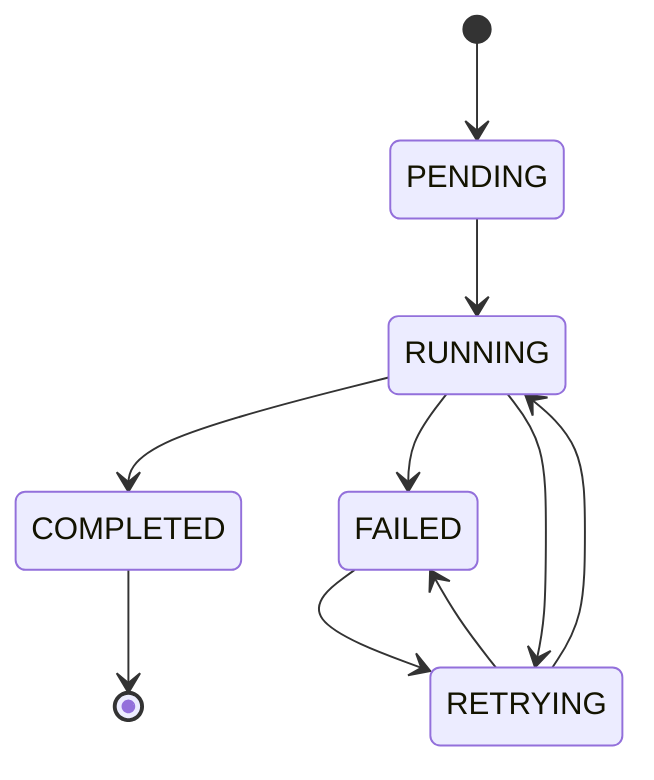
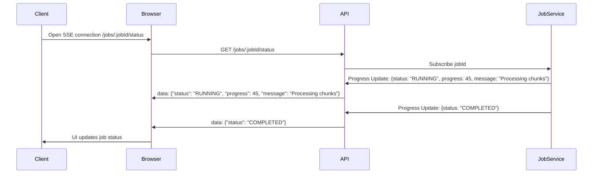
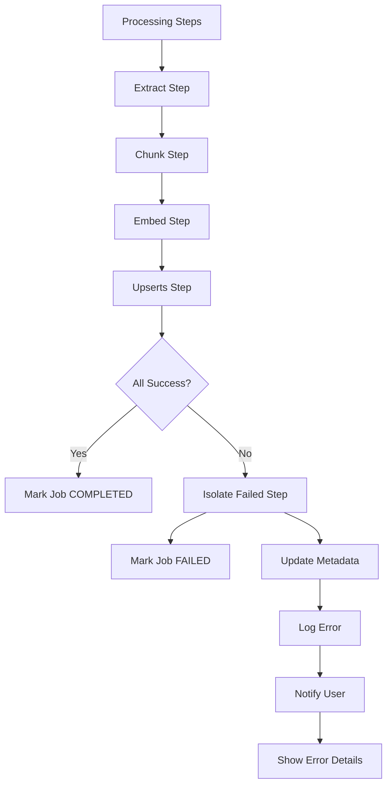
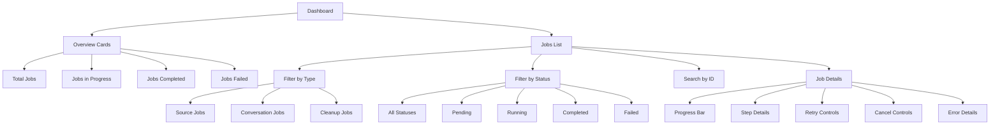

# Chapter 7: Job Status, Partial Failure & UX

## Goal & Overview

This chapter covers job status tracking, partial failure handling, and user experience features that provide visibility into the processing pipeline, including job monitoring, error recovery, and progress indicators.

**Key Components:**
- **Job status tracking** with real-time updates via SSE
- **Partial failure recovery** with isolation of successful/failed chunks
- **Job dashboard** for workspace-level monitoring
- **Progress indicators** and user feedback
- **Error reporting** with actionable guidance

## 7.1 Job Status Architecture

### 7.1.1 Job Status Types

The system tracks different types of jobs:

| Job Type | Description | Example |
|----------|-------------|---------|
| **SourceJob** | Indexing a document | PDF → chunks → vectors |
| **ConversationJob** | Generating artifacts | Chat → flashcards + quizzes |
| **CleanupJob** | Removing orphaned data | Delete sources with no vectors |
| **SummarizeJob** | Conversation summarization | Rolling summaries |

### 7.1.2 Job Status States



### 7.1.3 Job Tracking Database

```prisma
model Job {
    id          String    @id @default(cuid())
    type        String    // SourceJob, ConversationJob, etc.
    status      String    // PENDING, RUNNING, COMPLETED, FAILED, RETRYING
    createdAt   DateTime  @default(now())
    updatedAt   DateTime  @updatedAt
    startedAt   DateTime?
    completedAt DateTime?
    payload     Json?      // Job-specific data
    metadata    Json?      // Progress, error info
    retries     Int       @default(0)

    @@index([status, createdAt])
    @@index([type])
    @@map("job")
}
```

### 7.1.4 Job Progress Tracking

```ts
// server/src/lib/job-tracking.ts
export interface JobProgress {
    jobId: string;
    type: string;
    status: JobStatus;
    progress?: number; // 0-100
    message?: string;
    metadata?: JobMetadata;
    error?: JobError;
    createdAt: Date;
    updatedAt: Date;
    startedAt?: Date;
    completedAt?: Date;
    retries: number;
}

export interface JobError {
    code: string;          // error_code
    message: string;       // Human-readable
    details?: string;      // Stack trace or context
    recoverable: boolean;  // Can be retried?
    helpUrl?: string;      // Documentation link
}

export type JobMetadata = {
    totalSteps?: number;
    completedSteps?: number;
    currentStep?: string;
    estimatedTimeRemaining?: number;
    [key: string]: any;
};
```

## 7.2 Real-Time Job Status Updates

### 7.2.1 SSE Job Status Endpoint

```ts
// server/src/routes/job.routes.ts
router.get(
    "/:jobId/status",
    sse({ idleTimeout: 5 * 60 * 1000 }), // 5 minute idle timeout
    authenticate,
    async (req: Request, res: Response) => {
        const jobId = req.params.jobId;
        const workspaceId = req.user?.currentWorkspaceId;

        // Verify job belongs to workspace
        const job = await findJobByIdAndWorkspaceId(jobId, workspaceId);
        if (!job) {
            throw new NotFoundError("Job not found");
        }

        // Subscribe to job status updates
        const { readable, writable } = new ReadableWritablePair();

        const stream = jobStatusStream.subscribe(jobId);
        stream.on("data", (progress: JobProgress) => {
            const message = JSON.stringify(progress);
            writable.write(`data: ${message}\n\n`);
        });

        stream.on("complete", () => {
            writable.close();
        });

        stream.on("error", (error: Error) => {
            const errorProgress: JobProgress = {
                jobId,
                type: job.type,
                status: "FAILED",
                message: error.message,
                error: {
                    code: "STREAM_ERROR",
                    message: error.message,
                    recoverable: false,
                },
                createdAt: job.createdAt,
                updatedAt: new Date(),
                retries: job.retries,
            };
            writable.write(`data: ${JSON.stringify(errorProgress)}\n\n`);
            writable.close();
        });

        res.stream(readable);
    }
);
```

### 7.2.2 Job Status Streaming



### 7.2.3 Progress Update Example

```json
{
  "jobId": "job_abc123",
  "type": "SourceJob",
  "status": "RUNNING",
  "progress": 45,
  "message": "Processing chunks and generating embeddings",
  "metadata": {
    "totalSteps": 5,
    "completedSteps": 2,
    "currentStep": "embeddings",
    "estimatedTimeRemaining": 120
  },
  "createdAt": "2024-01-15T10:30:00Z",
  "updatedAt": "2024-01-15T10:45:00Z",
  "retries": 0
}
```

## 7.3 Partial Failure Handling

### 7.3.1 Isolate Failures

When a job step fails, the system isolates the failure and continues with successful parts:



### 7.3.2 Error Recovery Logic

```ts
// server/src/services/job-tracking.service.ts
export async function handleStepFailure(
    jobId: string,
    stepId: string,
    error: Error,
    jobType: string,
) {
    const job = await findJobById(jobId);
    if (!job) throw new NotFoundError("Job not found");

    const metadata = (job.metadata as JobMetadata) || {};

    // Determine if failure is recoverable
    const isRecoverable = isErrorRecoverable(error, stepId, jobType);

    // Update job status based on error
    const updateData: Partial<JobRecord> = {
        status: isRecoverable ? "RETRYING" : "FAILED",
        metadata: {
            ...metadata,
            currentStep: stepId,
            lastError: error.message,
            recoverable: isRecoverable,
            failedSteps: [...(metadata.failedSteps || []), stepId],
        },
        retries: isRecoverable ? job.retries + 1 : job.retries,
    };

    if (isRecoverable) {
        // Schedule retry with exponential backoff
        const backoffMs = Math.pow(2, job.retries) * 1000;
        await scheduleJobRetry(jobId, backoffMs);

        updateData.updatedAt = new Date();
    }

    await updateJobRecord(jobId, updateData);

    // For source jobs, isolate successful work
    if (jobType === "SourceJob" && !isRecoverable) {
        await isolateSourceJobProgress(jobId, error);
    }

    return updateData;
}
```

### 7.3.3 Isolate Source Job Progress

```ts
export async function isolateSourceJobProgress(
    jobId: string,
    error: Error,
): Promise<void> {
    const job = await findJobById(jobId);
    if (!job || job.type !== "SourceJob") return;

    const sourceId = job.payload?.sourceId;
    const workspaceId = job.payload?.workspaceId;

    if (!sourceId || !workspaceId) return;

    // 1. Mark source as READY if chunks were processed
    const source = await findSourceById(sourceId);
    if (source?.status === "READY") {
        // Source has successful chunks, mark as usable
        await updateSourceRecord(sourceId, {
            metadata: {
                ...source.metadata,
                partialFailure: true,
                errorAtStep: job.metadata?.currentStep,
                message: `Processing completed with errors: ${error.message}`,
            },
        });

        // Send notification to workspace
        await notifyWorkspace(
            workspaceId,
            "source/partial-success",
            {
                sourceId,
                message: `Source indexed with partial errors`,
                error: error.message,
                retryUrl: `/sources/${sourceId}/reprocess`,
            }
        );
    } else {
        // Complete failure - mark as error
        await updateSourceRecord(sourceId, {
            status: "FAILED",
            metadata: {
                ...source.metadata,
                processingError: error.message,
                errorAtStep: job.metadata?.currentStep,
            },
        });
    }
}
```

## 7.4 Job Dashboard

### 7.4.1 Workspace Job Dashboard

The workspace view shows all jobs for the current workspace:



### 7.4.2 Dashboard API

```ts
// server/src/controllers/dashboard.controller.ts
export async function getWorkspaceDashboard(
    workspaceId: string,
    userId: string,
    filters?: {
        type?: string;
        status?: string;
        fromDate?: Date;
        toDate?: Date;
    }
) {
    await getWorkspaceByIdForUser(workspaceId, userId);

    // Get job statistics
    const stats = await getJobStats(workspaceId, filters);

    // Get recent jobs
    const jobs = await findJobsByWorkspaceId(
        workspaceId,
        {
            orderBy: { createdAt: "desc" },
            limit: 20,
            where: {
                type: filters?.type,
                status: filters?.status,
                createdAt: {
                    gte: filters?.fromDate,
                    lte: filters?.toDate,
                },
            },
        }
    );

    // Get failed jobs for error report
    const failedJobs = await findJobsByWorkspaceId(
        workspaceId,
        {
            where: {
                status: "FAILED",
                createdAt: { gte: subDays(new Date(), 7) },
            },
            orderBy: { createdAt: "desc" },
            limit: 10,
        }
    );

    return {
        stats,
        jobs,
        failedJobs,
        filters,
    };
}
```

### 7.4.3 Dashboard Statistics

```json
{
  "stats": {
    "totalJobs": 156,
    "pendingJobs": 3,
    "runningJobs": 1,
    "completedJobs": 142,
    "failedJobs": 10,
    "sourceJobs": 134,
    "conversationJobs": 18,
    "cleanupJobs": 4,
    "jobsToday": 12,
    "successRate": 0.91,
    "averageProcessingTime": 2.5
  },
  "jobs": [
    {
      "id": "job_abc123",
      "type": "SourceJob",
      "status": "RUNNING",
      "progress": 45,
      "message": "Processing chunks and generating embeddings",
      "createdAt": "2024-01-15T10:30:00Z",
      "updatedAt": "2024-01-15T10:45:00Z",
      "retries": 0,
      "metadata": {
        "currentStep": "embeddings",
        "totalSteps": 5,
        "completedSteps": 2
      }
    }
  ],
  "failedJobs": [
    {
      "id": "job_def456",
      "type": "ConversationJob",
      "status": "FAILED",
      "error": {
        "code": "INVALID_INPUT",
        "message": "Source document contains too many pages",
        "recoverable": false,
        "helpUrl": "/help/artifacts"
      },
      "createdAt": "2024-01-14T15:20:00Z",
      "completedAt": "2024-01-14T15:25:00Z"
    }
  ]
}
```

## 7.5 Progress Indicators

### 7.5.1 Progress Component

Frontend component for real-time progress visualization:

```tsx
// components/jobs/JobProgress.tsx
interface JobProgressProps {
    jobId: string;
}

export function JobProgress({ jobId }: JobProgressProps) {
    const [progress, setProgress] = useState<JobProgress | null>(null);

    useEffect(() => {
        const eventSource = new EventSource(`/api/jobs/${jobId}/status`);

        eventSource.onmessage = (event) => {
            const data = JSON.parse(event.data);
            setProgress(data);
        };

        eventSource.onerror = () => {
            eventSource.close();
        };

        return () => eventSource.close();
    }, [jobId]);

    if (!progress) return <div>Loading job status...</div>;

    return (
        <div className="job-progress">
            <div className="progress-header">
                <h3>Job Status: {progress.type}</h3>
                <span className={`status ${progress.status}`}>{progress.status}</span>
            </div>
            {(progress.status === "RUNNING" || progress.status === "RETRYING") && (
                <div className="progress-bar">
                    <div
                        className="progress-fill"
                        style={{ width: `${progress.progress || 0}%` }}
                    />
                    <span className="progress-text">
                        {progress.progress}% - {progress.message}
                    </span>
                </div>
            )}
            {progress.error && (
                <div className="error-section">
                    <h4>Error</h4>
                    <p>{progress.error.message}</p>
                    {progress.error.recoverable && (
                        <button onClick={() => retryJob(jobId)}>
                            Retry Job
                        </button>
                    )}
                    {progress.error.helpUrl && (
                        <a href={progress.error.helpUrl} target="_blank">
                            View Documentation
                        </a>
                    )}
                </div>
            )}
        </div>
    );
}
```

### 7.5.2 Progress Bar Implementation

```tsx
.job-progress {
    border: 1px solid var(--border-color);
    border-radius: 8px;
    padding: 16px;
    background: var(--background);
}

.progress-header {
    display: flex;
    justify-content: space-between;
    align-items: center;
    margin-bottom: 12px;
}

.progress-bar {
    height: 24px;
    background: var(--gray-200);
    border-radius: 12px;
    overflow: hidden;
    position: relative;
    margin: 12px 0;
}

.progress-fill {
    height: 100%;
    background: var(--blue-500);
    transition: width 0.3s ease;
}

.progress-text {
    position: absolute;
    top: 50%;
    left: 50%;
    transform: translate(-50%, -50%);
    color: white;
    font-weight: 500;
}

.status {
    padding: 4px 8px;
    border-radius: 4px;
    font-size: 12px;
    font-weight: 500;
}

.status.pending { background: var(--gray-200); color: var(--gray-700); }
.status.running { background: var(--blue-100); color: var(--blue-700); }
.status.completed { background: var(--green-100); color: var(--green-700); }
.status.failed { background: var(--red-100); color: var(--red-700); }
.status.retrying { background: var(--yellow-100); color: var(--yellow-700); }
```

## 7.6 Error Reporting & Recovery

### 7.6.1 Error Details Component

```tsx
// components/jobs/ErrorDetails.tsx
interface ErrorDetailsProps {
    error: JobError;
    jobId: string;
    stepId?: string;
}

export function ErrorDetails({ error, jobId, stepId }: ErrorDetailsProps) {
    const [isExpanded, setIsExpanded] = useState(false);

    const getErrorCodeDisplay = (code: string) => {
        const codes: Record<string, string> = {
            "INVALID_INPUT": "Invalid source document",
            "EXTRACTION_FAILED": "Failed to extract content",
            "CHUNKING_FAILED": "Failed to split document into chunks",
            "EMBEDDING_FAILED": "Failed to generate embeddings",
            "UPLOAD_FAILED": "Failed to upload to storage",
        };

        return codes[code] || code;
    };

    return (
        <div className="error-details">
            <div className="error-header" onClick={() => setIsExpanded(!isExpanded)}>
                <span className="error-icon">⚠️</span>
                <span className="error-code">{getErrorCodeDisplay(error.code)}</span>
                <span className="error-message">{error.message}</span>
                <span className="expand-icon">{isExpanded ? "▼" : "►"}</span>
            </div>

            {isExpanded && (
                <div className="error-content">
                    {stepId && <p>Step: <code>{stepId}</code></p>}

                    {error.details && (
                        <div className="error-stack">
                            <h5>Technical Details</h5>
                            <pre>{error.details}</pre>
                        </div>
                    )}

                    <div className="error-actions">
                        {error.recoverable && (
                            <button onClick={() => retryJob(jobId)}>
                                Retry Job
                            </button>
                        )}

                        {error.helpUrl && (
                            <a href={error.helpUrl} target="_blank">
                                View Help Documentation
                            </a>
                        )}

                        <button onClick={() => contactSupport(jobId, error)}>
                            Contact Support
                        </button>
                    </div>
                </div>
            )}
        </div>
    );
}
```

### 7.6.2 Retry Logic

```ts
// server/src/services/job-retry.service.ts
export async function retryFailedJob(jobId: string, userId: string) {
    const job = await findJobById(jobId);
    if (!job) throw new NotFoundError("Job not found");

    if (!["FAILED", "RETRYING"].includes(job.status)) {
        throw new ValidationError("Job can only be retried if it failed");
    }

    // Verify user has access to workspace
    const workspaceId = job.payload?.workspaceId;
    if (workspaceId) {
        await getWorkspaceByIdForUser(workspaceId, userId);
    }

    // Schedule retry with exponential backoff
    const backoffMs = Math.pow(2, job.retries || 0) * 1000;
    await scheduleJobRetry(jobId, backoffMs);

    return { message: "Job retry scheduled", jobId };
}
```

## 7.7 Common Mistakes

### 7.7.1 Missing Job Cleanup

**Problem:** Failed jobs accumulate and consume resources.

**Solution:** Implement job cleanup:

```ts
export async function cleanupCompletedJobs() {
    const thirtyDaysAgo = subDays(new Date(), 30);

    // Delete completed jobs older than 30 days
    await deleteJobs({
        status: "COMPLETED",
        completedAt: { lte: thirtyDaysAgo },
    });

    // Archive failed jobs for troubleshooting
    await archiveJobs({
        status: "FAILED",
        retries: { gte: 3 }, // Only archive jobs with retries
        completedAt: { lte: thirtyDaysAgo },
    });
}
```

### 7.7.2 Poor Error Messages

**Problem:** Error messages are technical but not user-friendly.

**Solution:** Provide actionable error messages:

```ts
const errorMessages: Record<string, string> = {
    "PDF_TOO_LARGE": "Document exceeds 50MB. Please upload a smaller PDF.",
    "CHUNKING_FAILED": "Document contains unsupported formatting. Try uploading as plain text.",
    "EMBEDDING_FAILED": "Temporary service issue. Please retry in a few minutes.",
};
```

### 7.7.3 Missing Progress Updates

**Problem:** Users have no visibility into job progress.

**Solution:** Provide regular progress updates:

```ts
export async function updateJobProgress(
    jobId: string,
    step: string,
    message: string,
) {
    const job = await findJobById(jobId);
    if (!job) return;

    const metadata = (job.metadata as JobMetadata) || {};

    // Update progress with step-specific messages
    await updateJobRecord(jobId, {
        metadata: {
            ...metadata,
            currentStep: step,
            lastProgressUpdate: new Date(),
        },
        updatedAt: new Date(),
    });

    // Broadcast progress to connected clients
    await broadcastJobProgress(jobId, {
        status: "RUNNING",
        progress: metadata.progress || 0,
        message,
        metadata,
    });
}
```

## 7.8 Key Takeaways

- **Real-time status tracking**: SSE provides live job status updates for immediate feedback
- **Partial failure recovery**: Isolate successful work when jobs fail partway through
- **Comprehensive error handling**: Provide actionable error messages and recovery options
- **Job dashboard**: Workspace-level monitoring with statistics and job details
- **Progress indicators**: Visual feedback helps users understand job progress
- **Cleanup policies**: Remove old jobs to prevent resource accumulation

---

*Based on source notes from `gen-ai-cohort/week05/notes.md` and `raw-class.md`.*

**Next Chapter:** [Chapter 8 - Re-indexing, Model Migration & Ingestion](../08_Re_indexing_Model_Migration_Ingestion)