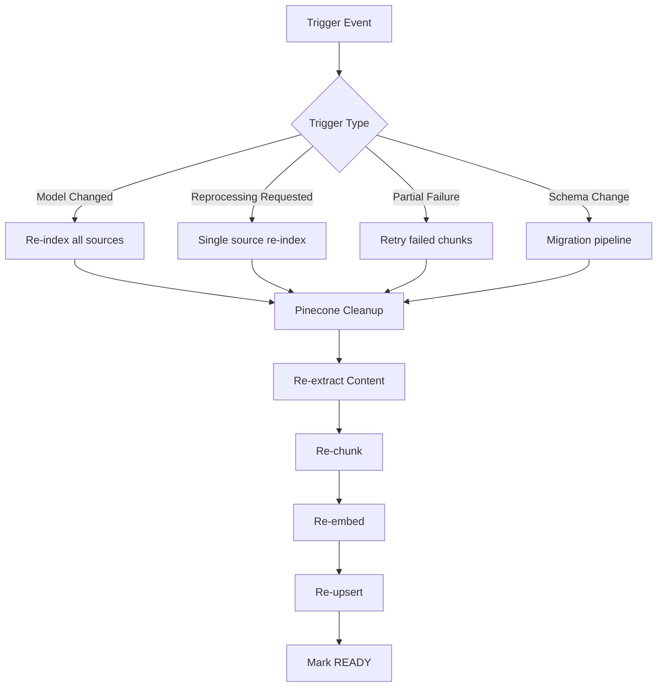
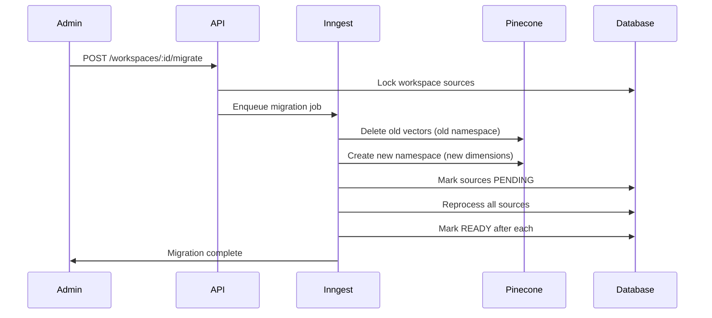
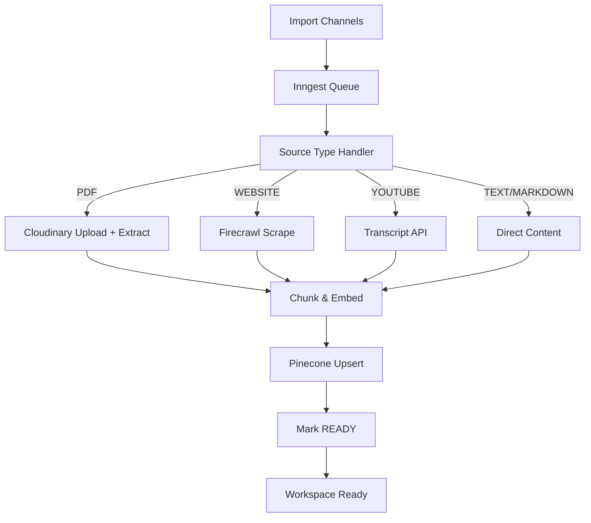
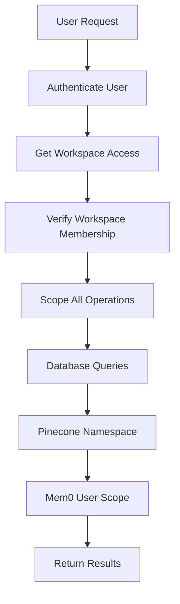

# Chapter 8: Re-indexing, Model Migration & Ingestion

## Goal & Overview

This chapter covers re-indexing sources when models change or errors occur, migrating between embedding models with schema updates, cost control and quotas, and managing ingestion pipelines across workspaces.

**Key Components:**
- **Re-indexing** sources after model changes or failures
- **Model migration** between embedding models with vector dimension changes
- **Cost control and quotas** for usage management
- **Cross-workspace ingestion** management
- **Namespace isolation** for data separation

## 8.1 Re-indexing Pipeline

### 8.1.1 Re-index Triggers



### 8.1.2 Single Source Re-processing

```ts
// server/src/services/source.service.ts
export async function reprocessSource(
    workspaceId: string,
    userId: string,
    sourceId: string,
) {
    await getWorkspaceByIdForUser(workspaceId, userId);

    const source = await findSourceByIdAndWorkspaceId(sourceId, workspaceId);
    if (!source) {
        throw new NotFoundError("Source not found");
    }

    // 1. Remove from vector index
    await removeSourceFromIndex(workspaceId, sourceId);

    // 2. Reset status to PENDING
    await updateSourceRecord(sourceId, {
        status: "PENDING",
        metadata: {
            ...source.metadata,
            processingError: undefined,
            reprocessingAt: new Date().toISOString(),
        },
    });

    // 3. Enqueue new processing job
    await enqueueSourceProcessing({ sourceId, workspaceId });

    return { message: "Reprocessing started", sourceId };
}
```

### 8.1.3 Bulk Re-processing

```ts
export async function bulkReprocessSources(
    workspaceId: string,
    userId: string,
    sourceIds: string[],
) {
    await getWorkspaceByIdForUser(workspaceId, userId);

    // Verify all sources belong to workspace
    const sources = await findSourcesByIds(sourceIds);
    const invalidIds = sourceIds.filter(
        (id) => !sources.some((s) => s.id === id && s.workspaceId === workspaceId)
    );

    if (invalidIds.length > 0) {
        throw new ValidationError(`Sources not found in workspace: ${invalidIds.join(", ")}`);
    }

    // Clean up all sources first
    await Promise.all(
        sources.map((source) =>
            removeSourceFromIndex(workspaceId, source.id)
        )
    );

    // Reset all statuses
    await Promise.all(
        sources.map((source) =>
            updateSourceRecord(source.id, {
                status: "PENDING",
                metadata: {
                    ...source.metadata,
                    processingError: undefined,
                },
            })
        )
    );

    // Enqueue all processing jobs
    await Promise.all(
        sources.map((source) =>
            enqueueSourceProcessing({ sourceId: source.id, workspaceId })
        )
    );

    return { message: `Started reprocessing ${sources.length} sources` };
}
```

## 8.2 Model Migration

### 8.2.1 Migration Triggers



### 8.2.2 Migration Types

| Migration Type | Description | Impact |
|---------------|-------------|--------|
| **Embedding Model Change** | text-embedding-3-small → text-embedding-3-large | Dimensions change 1536 → 3072 |
| **Chunking Strategy Change** | Sliding window → semantic chunking | Chunks re-segmented |
| **Embedding Dimensions Change** | Different dimensionality | Pinecone index recreation |
| **Vector DB Provider Change** | Pinecone → different provider | Full re-indexing |

### 8.2.3 Migration Implementation

```ts
// server/src/services/migration.service.ts
export async function migrateWorkspaceEmbeddingModel(
    workspaceId: string,
    userId: string,
    fromModel: string,
    toModel: string,
) {
    await getWorkspaceByIdForUser(workspaceId, userId);

    // 1. Get old embedding config
    const oldConfig = getEmbeddingConfig(fromModel);
    const newConfig = getEmbeddingConfig(toModel);

    if (oldConfig.dimensions === newConfig.dimensions) {
        // Same dimensions - no Pinecone changes needed
        await updateWorkspaceEmbeddingModel(workspaceId, toModel);
        await reprocessAllSources(workspaceId);
        return { message: "Same dimensions - re-indexing only" };
    }

    // 2. Different dimensions - need namespace migration
    const oldNamespace = await getNamespaceForModel(fromModel);
    const newNamespace = await getNamespaceForModel(toModel);

    // 3. Create new Pinecone namespace with correct dimensions
    await createPineconeNamespace(newConfig.dimensions, newNamespace);

    // 4. Mark all sources for re-processing
    await updateAllSourcesStatus(workspaceId, "PENDING");

    // 5. Enqueue migration jobs for each source
    const sources = await findSourcesByWorkspaceId(workspaceId);
    await Promise.all(
        sources.map((source) =>
            enqueueMigrationJob({
                sourceId: source.id,
                workspaceId,
                fromModel,
                toModel,
                oldNamespace,
                newNamespace,
            })
        )
    );

    return {
        message: "Migration started",
        sourceCount: sources.length,
        newModel: toModel,
        newDimensions: newConfig.dimensions,
    };
}
```

### 8.2.4 Migration Job

```ts
export const migrationJob = inngest.createFunction(
    {
        id: "migrate-source",
        retries: 3,
        triggers: [{ event: "source/migrate" }],
    },
    async ({ event, step }) => {
        const { sourceId, workspaceId, oldNamespace, newNamespace } = event.data;

        // Delete old vectors from old namespace
        await step.run("delete-old-vectors", async () => {
            const oldIndex = await getPineconeIndex();
            await oldIndex.namespace(oldNamespace).deleteOne(sourceId);
        });

        // Re-process source with new embedding model
        await step.run("reprocess-source", async () => {
            const source = await findSourceById(sourceId);
            if (!source) throw new Error("Source not found");

            const chunks = await findChunksBySourceId(sourceId);
            await embedAndIndexSource(source, chunks, newNamespace);

            return { chunksProcessed: chunks.length };
        });

        // Mark migration complete
        await step.run("mark-migrated", async () => {
            await updateSourceRecord(sourceId, {
                metadata: {
                    ...source.metadata,
                    migrationComplete: true,
                    migratedAt: new Date().toISOString(),
                    fromModel: event.data.fromModel,
                    toModel: event.data.toModel,
                },
            });
        });

        return { sourceId, status: "MIGRATED" };
    },
);
```

## 8.3 Cost Control & Quotas

### 8.3.1 Quota Configuration

```ts
// server/src/lib/quotas.ts
export const DEFAULT_QUOTAS = {
    // Per workspace per month
    maxSources: 50,
    maxChunksPerSource: 1000,
    maxConversationsPerMonth: 100,
    maxMessagesPerConversation: 500,
    maxChatMessagesPerDay: 200,
    maxArtifactsPerConversation: 10,

    // Embedding API usage
    maxEmbeddingTokensPerDay: 1000000,
    maxChatTokensPerDay: 500000,

    // Web search
    maxWebSearchesPerDay: 100,
};

export interface WorkspaceQuota {
    sources: { used: number; limit: number };
    chunks: { used: number; limit: number };
    conversations: { used: number; limit: number };
    messages: { used: number; limit: number };
    chatMessagesToday: { used: number; limit: number };
    embeddingTokens: { used: number; limit: number };
    chatTokensToday: { used: number; limit: number };
    webSearchesToday: { used: number; limit: number };
}
```

### 8.3.2 Quota Checking Middleware

```ts
// server/src/middleware/quota.middleware.ts
export async function checkWorkspaceQuota(
    workspaceId: string,
    action: QuotaAction,
) {
    const quota = await getWorkspaceQuota(workspaceId);

    switch (action.type) {
        case "CREATE_SOURCE":
            if (quota.sources.used >= quota.sources.limit) {
                throw new QuotaExceededError(
                    `Source limit reached (${quota.sources.limit}/month). Upgrade plan.`
                );
            }
            break;

        case "SEND_MESSAGE":
            if (quota.chatMessagesToday.used >= quota.chatMessagesToday.limit) {
                throw new QuotaExceededError(
                    `Daily message limit reached (${quota.chatMessagesToday.limit}/day). Try again tomorrow.`
                );
            }
            break;

        case "WEB_SEARCH":
            if (quota.webSearchesToday.used >= quota.webSearchesToday.limit) {
                throw new QuotaExceededError(
                    `Daily web search limit reached (${quota.webSearchesToday.limit}/day).`
                );
            }
            break;

        case "EMBEDDING_TOKENS":
            if (quota.embeddingTokens.used >= quota.embeddingTokens.limit) {
                throw new QuotaExceededError(
                    `Embedding token budget exceeded (${quota.embeddingTokens.limit}/day).`
                );
            }
            break;
    }

    return quota;
}
```

### 8.3.3 Cost Tracking

```ts
// server/src/lib/cost-tracking.ts
export const TOKEN_COSTS = {
    "text-embedding-3-small": { input: 0.00002, output: 0.00002 }, // per 1K tokens
    "gpt-4": { input: 0.03, output: 0.06 },
    "gpt-4o": { input: 0.005, output: 0.015 },
    "gpt-3.5-turbo": { input: 0.0015, output: 0.002 },
};

export function estimateEmbeddingCost(
    tokenCount: number,
    model: string,
): number {
    const cost = TOKEN_COSTS[model] ?? TOKEN_COSTS["text-embedding-3-small"];
    return (tokenCount / 1000) * cost.input;
}

export function estimateChatCost(
    inputTokens: number,
    outputTokens: number,
    model: string,
): number {
    const cost = TOKEN_COSTS[model] ?? TOKEN_COSTS["gpt-4o"];
    return (inputTokens / 1000) * cost.input + (outputTokens / 1000) * cost.output;
}

export interface CostBreakdown {
    embeddingCost: number;
    chatCost: number;
    totalCost: number;
    tokenUsage: {
        embeddingTokens: number;
        chatTokens: number;
    };
}
```

## 8.4 Ingestion Management

### 8.4.1 Ingestion Pipeline



### 8.4.2 Import Channel Configuration

| Channel | Source Type | Max Size | Processing Time |
|---------|------------|----------|-----------------|
| Text/Markdown | TEXT | 1MB | < 1s |
| Website URL | WEBSITE | - | 5-30s |
| YouTube Video | YOUTUBE | - | 10-60s |
| PDF Upload | PDF | 50MB | 30-120s |
| Web Search | WEB | - | 2-10s |

### 8.4.3 Rate Limiting & Throttling

```ts
// server/src/lib/rate-limiting.ts
export const RATE_LIMITS = {
    sourceCreationPerMinute: 10,
    chatMessagesPerMinute: 30,
    webSearchesPerMinute: 10,
    artifactsPerMinute: 5,
    reprocessingPerHour: 5,
};

export async function checkRateLimit(
    workspaceId: string,
    action: string,
    userId: string,
): Promise<void> {
    const key = `ratelimit:${workspaceId}:${userId}:${action}`;
    const current = await redis.get(key) || "0";
    const count = parseInt(current, 10);

    if (count >= RATE_LIMITS[action as keyof typeof RATE_LIMITS]) {
        throw new RateLimitError(`Rate limit exceeded for ${action}`);
    }

    await redis.incr(key);
    await redis.expire(key, 60); // Reset after 1 minute
}
```

### 8.4.4 Namespace Isolation

Pinecone namespaces ensure data separation between workspaces:

```ts
// server/src/lib/pinecone.ts
export async function getPineconeIndex() {
    return pinecone.Index(INDEX_NAME);
}

export function getWorkspaceNamespace(workspaceId: string) {
    const index = await getPineconeIndex();
    return index.namespace(workspaceId);
}

export async function deleteWorkspaceVectors(workspaceId: string) {
    const namespace = await getWorkspaceNamespace(workspaceId);
    await namespace.deleteAll();
}
```

## 8.5 Cross-Workspace Operations

### 8.5.1 Workspace Scoping



### 8.5.2 Cross-Workspace Query Guard

```ts
// server/src/services/source.service.ts
export async function findSourceByIdAndWorkspaceId(
    sourceId: string,
    workspaceId: string,
): Promise<SourceRecord | null> {
    // Always scope queries by workspaceId to prevent cross-workspace leaks
    return await findSourceById(sourceId, workspaceId);
}

// Prisma query example
// await prisma.source.findUnique({
//   where: { id: sourceId },
//   include: { chunks: true },
//   // Workspace scoping is applied in the service layer
// });
```

### 8.5.3 Workspace Deletion Cascade

```ts
export async function deleteWorkspace(workspaceId: string) {
    // 1. Delete all Pinecone vectors for workspace namespace
    await deleteWorkspaceVectors(workspaceId);

    // 2. Delete all workspace data (cascades to sources, chunks, conversations, artifacts)
    await prisma.$transaction([
        prisma.artifact.deleteMany({ where: { workspaceId } }),
        prisma.message.deleteMany({
            where: { conversation: { workspaceId } },
        }),
        prisma.conversation.deleteMany({ where: { workspaceId } }),
        prisma.sourceChunk.deleteMany({
            where: { source: { workspaceId } },
        }),
        prisma.source.deleteMany({ where: { workspaceId } }),
        prisma.workspace.delete({ where: { id: workspaceId } }),
    ]);

    return { message: "Workspace deleted" };
}
```

## 8.6 Common Mistakes

### 8.6.1 Missing Migration State Tracking

**Problem:** Migration runs without tracking which sources were migrated.

**Solution:** Track migration progress:

```ts
export async function trackMigrationProgress(
    workspaceId: string,
    sourceId: string,
    status: MigrationStatus,
) {
    await prisma.migrationLog.upsert({
        where: { workspaceId_sourceId: { workspaceId, sourceId } },
        update: {
            status,
            updatedAt: new Date(),
            ...(status === "COMPLETED" && { completedAt: new Date() }),
        },
        create: {
            workspaceId,
            sourceId,
            status,
            startedAt: new Date(),
        },
    });
}
```

### 8.6.2 Quota Race Conditions

**Problem:** Multiple requests bypass quota checks simultaneously.

**Solution:** Atomic quota increments:

```ts
export async function atomicQuotaIncrement(
    workspaceId: string,
    quotaType: string,
    increment: number = 1,
) {
    const result = await prisma.$transaction(async (tx) => {
        const quota = await tx.workspaceQuota.update({
            where: { workspaceId_type: { workspaceId, type: quotaType } },
            data: { used: { increment } },
        });

        if (quota.used > quota.limit) {
            throw new QuotaExceededError(`Quota exceeded for ${quotaType}`);
        }

        return quota;
    });

    return result;
}
```

### 8.6.3 Model Dimension Mismatch

**Problem:** Upserting vectors with wrong dimensions to Pinecone.

**Solution:** Validate dimensions before upsert:

```ts
export async function validateVectorDimensions(
    records: PineconeRecord[],
    expectedDimensions: number,
): Promise<void> {
    const invalid = records.filter((r) => r.values.length !== expectedDimensions);
    if (invalid.length > 0) {
        throw new Error(
            `Invalid vector dimensions: expected ${expectedDimensions}, ` +
            `got ${invalid.map((r) => r.values.length).join(", ")}`
        );
    }
}
```

### 8.6.4 Orphaned Namespaces

**Problem:** Old Pinecone namespaces remain after migration.

**Solution:** Clean up old namespaces:

```ts
export async function cleanupOldNamespaces(
    workspaceId: string,
    activeNamespaces: string[],
) {
    const allNamespaces = await listNamespaces(workspaceId);
    const obsolete = allNamespaces.filter((ns) => !activeNamespaces.includes(ns));

    await Promise.all(
        obsolete.map((ns) => deleteNamespace(workspaceId, ns))
    );
}
```

## 8.7 Key Takeaways

- **Re-indexing**: Clean up old vectors before re-processing sources to avoid duplicates
- **Model migration**: Handle dimension changes by creating new Pinecone namespaces
- **Cost control**: Track token usage and enforce quotas per workspace
- **Namespace isolation**: Scope all Pinecone operations by workspace ID
- **Migration tracking**: Log migration status per source for visibility
- **Cross-workspace security**: Always scope queries by workspace ID

---

*Based on source notes from `gen-ai-cohort/week05/notes.md`, `raw-class.md`, and implementation guide chapters.*

**Next:** [Complete Notes Summary](Lecture_28_Complete_Notes.md)