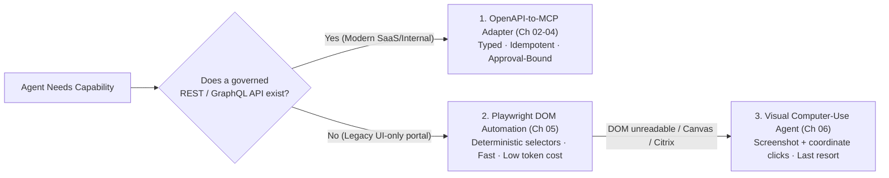

# Chapter 01 — Evaluating Enterprise APIs for Agent Readiness

> **Lecture 30 · Chapter 01 of 07** · Level: 🟠 Advanced · Phase 7 — Connectors, Code Mode & Proactive Workflows
> **Source:** `FDE S15` · **Roadmap Reference:** [`roadmap-v1.md`](../../roadmap-v1.md#lecture-30--enterprise-apis-openapi-to-mcp-idempotency--computer-use-fallback)
> **Roadmap topics:** Why raw REST/GraphQL APIs make poor agent tools · payload bloat · pagination traps · side-effect classification · the API-to-Browser fallback spectrum.

---

## 01.0 What this chapter is for

Most enterprises already have hundreds of REST and GraphQL endpoints built over the last decade for **human web frontends and backend microservices**. When teams wire an AI agent directly to those raw endpoints, the agent immediately struggles:

- A single `GET /orders/123` returns **14 KB of nested JSON** (200 internal billing flags), burning 3,500 tokens on every call.
- A `POST /refunds` endpoint has **no idempotency key**, so when the agent retries after a 5-second timeout, the customer gets refunded **twice**.
- A legacy ERP vendor-portal has **no API at all** — only a 1990s web form.

By the end of this chapter you should be able to:

1. Audit any legacy REST or GraphQL API against the **five Agent-Readiness criteria**.
2. Classify endpoints into **Read-Only**, **Idempotent Mutation**, **Approval-Bound Mutation**, or **Quarantined**.
3. Decide when to wrap an API as an **MCP Tool** vs. when to fall back to **Browser / Computer-Use Automation**.

---

## 01.1 The running case study: Order Refunds & Legacy ERP

Throughout Lecture 30, we will follow one realistic enterprise workflow:

> **"A support agent needs to look up an order in our modern REST API, issue a \$45 refund if eligible, and log the credit memo in a legacy 2008 ERP web portal that has no API."**

Look at why naive REST wrapping fails on this exact workflow:

| Raw API Problem | What Happens to the Agent | How an Agent-Ready Wrapper Fixes It |
| :--- | :--- | :--- |
| **1. Noisy 14 KB Payloads** | Context window fills up after 3 calls; LLM misses the `eligibleForRefund` boolean buried on line 180 | Project only the **6 fields** the agent actually needs (`orderId`, `status`, `amountUsd`, `eligible`) |
| **2. Unbounded Pagination** | `GET /orders` returns 500 items or an opaque `cursor` token the LLM drops | Cap `limit <= 20` and expose a clean `nextCursor` parameter |
| **3. Ambiguous Error Messages** | `422 Unprocessable Entity` with `{"code": "E_4091"}` | Translate error codes into actionable hints (`"Refund exceeds 30-day policy window"`) |
| **4. Unsafe Side Effects** | `DELETE /orders/123` exposed alongside `GET /orders/123` | **Filter out** destructive endpoints; require HITL approval for high-value mutations |
| **5. Missing Idempotency** | Network timeout $\rightarrow$ agent retries `POST /refunds` $\rightarrow$ **double refund!** | Inject mandatory `idempotencyKey` at the MCP adapter boundary (Chapter 03) |

---

## 01.2 The Integration Spectrum: API First, Browser Fallback

> [!IMPORTANT]
> **Golden rule of enterprise integration:** Always prefer **Typed API (MCP) $\rightarrow$ Deterministic Browser (Playwright) $\rightarrow$ Visual Computer-Use**, in that exact order. Never use a slow, fragile vision-based computer-use loop when a REST API or stable DOM selector exists.

---

## 01.3 Key takeaways

1. **Human/microservice APIs are not agent-ready out of the box:** trim noisy payloads, cap pagination, and translate cryptic error codes.
2. **Never expose raw `DELETE` or unguarded `POST` endpoints** to an autonomous loop without idempotency and approval policies.
3. **Use the 3-tier fallback ladder:** API (MCP) first, Playwright DOM automation second, Visual Computer-Use last.

---

**Next:** [Chapter 02 — Automated OpenAPI-to-MCP Adaptation](./02_Automated_OpenAPI_to_MCP_Adaptation.md)

