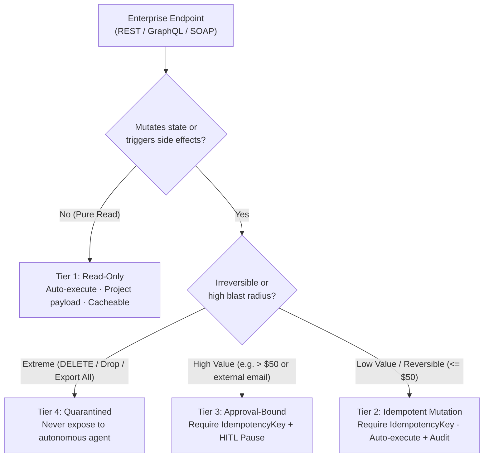
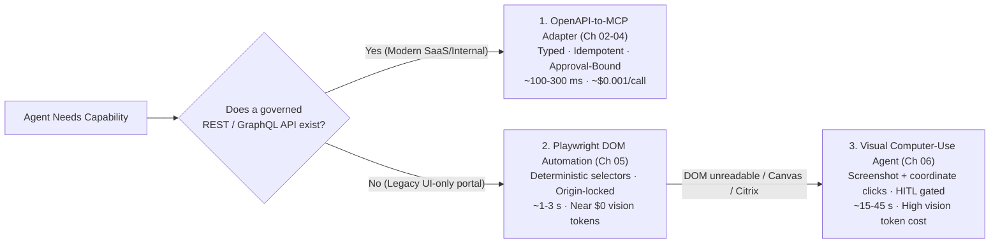

# Chapter 01 — Evaluating Enterprise APIs for Agent Readiness

> **Lecture 30 · Chapter 01 of 07** · Level: 🟠 Advanced · Phase 7 — Connectors, Code Mode & Proactive Workflows
> **Source:** `FDE S15` · **Roadmap Reference:** [`roadmap-v1.md`](../../roadmap-v1.md#lecture-30--enterprise-apis-openapi-to-mcp-idempotency--computer-use-fallback)
> **Roadmap topics:** Why raw REST/GraphQL APIs make poor agent tools · payload bloat · pagination traps · side-effect classification · the API-to-Browser fallback spectrum.

---

## 01.0 What this chapter is for

Most enterprises already have hundreds of REST and GraphQL endpoints built over the last decade for **human web frontends and backend microservices**. When teams wire an AI agent directly to those raw endpoints, the agent immediately struggles:

- A single `GET /orders/123` returns **14 KB of nested JSON** (200 internal billing flags, tax ledger arrays, and legacy ERP metadata), burning 3,500 tokens on every call.
- A `POST /refunds` endpoint has **no idempotency key**, so when the agent retries after a 5-second timeout, the customer gets refunded **twice**.
- A legacy ERP vendor-portal has **no API at all** — only a 1990s web form behind an internal VPN.

This chapter gives you a systematic **Agent-Readiness Audit** before you write a single line of MCP adapter code.

By the end of this chapter you should be able to:

1. Audit any legacy REST or GraphQL API against the **five Agent-Readiness criteria**.
2. Classify endpoints into **Read-Only**, **Idempotent Mutation**, **Approval-Bound Mutation**, or **Quarantined**.
3. Design **response projections** and **actionable error translations** that cut token usage by 80–95%.
4. Decide when to wrap an API as an **MCP Tool** vs. when to fall back to **Playwright DOM Automation** or **Visual Computer-Use**.
5. Explain why an agent's retry loop turns minor API ambiguities into **financial or data-integrity incidents**.

---

## 01.1 The running case study: Order Refunds & Legacy ERP

Throughout Lecture 30, we will follow one realistic enterprise workflow:

> **"A support agent needs to look up an order in our modern REST API, issue a \$45 refund if eligible, and log the credit memo in a legacy 2008 ERP web portal that has no API."**

Even for a seemingly simple 3-step workflow, raw enterprise APIs fail agents in five predictable ways:

| Raw API Problem | What Happens to the Agent | How an Agent-Ready Wrapper Fixes It |
| :--- | :--- | :--- |
| **1. Noisy 14 KB Payloads** | Context window fills up after 3 calls; LLM misses the `eligibleForRefund` boolean buried on line 180 | Project only the **6 fields** the agent actually needs (`orderId`, `status`, `amountUsd`, `eligible`) |
| **2. Unbounded Pagination** | `GET /orders` returns 500 items or an opaque `cursor` token the LLM drops or hallucinates | Cap `limit <= 20` and expose a clean `nextCursor` parameter with explicit `hasMore` boolean |
| **3. Ambiguous Error Messages** | `422 Unprocessable Entity` with `{"code": "E_4091"}` | Translate error codes into actionable hints (`"Refund exceeds 30-day policy window"`) |
| **4. Unsafe Side Effects** | `DELETE /orders/123` exposed alongside `GET /orders/123` | **Filter out** destructive endpoints; require HITL approval for high-value mutations |
| **5. Missing Idempotency** | Network timeout $\rightarrow$ agent retries `POST /refunds` $\rightarrow$ **double refund!** | Inject mandatory `idempotencyKey` at the MCP adapter boundary (Chapter 03) |

### Concrete example: Raw REST response vs. Agent-Ready projection

Look at what `GET /api/v2/orders/ORD-9042` actually returns in a typical SaaS/ERP backend:

```json
// ❌ Raw REST response (14 KB / ~3,500 tokens — 95% noise)
{
  "id": "ORD-9042",
  "tenant_uuid": "tnt_001928374",
  "legacy_sap_doc_num": "0004918273",
  "audit_trail": [ /* 45 historical status transitions */ ],
  "line_items": [ /* 18 nested SKU objects with warehouse bin IDs */ ],
  "tax_breakdown": { /* 12 jurisdiction objects */ },
  "billing_flags": { "eligible_for_refund": true, "refund_window_days_left": 12 },
  "totals": { "gross_cents": 4500, "currency": "USD" }
}
```

And here is what the **Agent-Ready MCP wrapper** returns instead:

```json
// ✅ Projected MCP Tool response (~90 tokens — 97% smaller, zero ambiguity)
{
  "orderId": "ORD-9042",
  "status": "DELIVERED",
  "amountUsd": 45.00,
  "currency": "USD",
  "eligibleForRefund": true,
  "refundWindowDaysLeft": 12
}
```

> [!TIP]
> **Rule of thumb for FDEs:** If a human engineer needs `jq` to find the boolean they care about in a REST payload, an LLM will burn thousands of tokens and still misread it. Always project responses at the MCP adapter layer.

---

## 01.2 The Four-Tier Endpoint Classification

Before compiling any OpenAPI spec or hand-writing an MCP server, classify every endpoint into one of four safety tiers:



| Tier | Examples | Required Adapter Controls |
| :--- | :--- | :--- |
| **Tier 1: Read-Only** | `GET /orders/{id}`, `GET /customers/search` | Payload projection, `limit <= 20` pagination cap, read-only OAuth scope |
| **Tier 2: Idempotent Mutation** | `POST /refunds` ($\le \$50$), `PATCH /tickets/{id}` | Mandatory `idempotencyKey`, payload-hash check (`409` on mismatch), rate limit |
| **Tier 3: Approval-Bound** | `POST /refunds` ($> \$50$), `POST /campaigns/send` | Mandatory `idempotencyKey` + **HITL `PENDING_APPROVAL` gate** before upstream call |
| **Tier 4: Quarantined** | `DELETE /orders/{id}`, `POST /admin/users/export` | **Omitted completely** from MCP `tools/list` |

---

## 01.3 The Integration Spectrum: API First, Browser Fallback

When an enterprise workflow spans both modern microservices and legacy portals, teams often jump straight to flashy vision-based Computer-Use agents. That is an architectural mistake.



> [!IMPORTANT]
> **Golden rule of enterprise integration:** Always prefer **Typed API (MCP) $\rightarrow$ Deterministic Browser (Playwright) $\rightarrow$ Visual Computer-Use**, in that exact order. Never use a slow, fragile vision-based computer-use loop when a REST API or stable DOM selector exists.

### Where teams misjudge the fallback ladder

| Trap | What It Looks Like | Why It Breaks |
| :--- | :--- | :--- |
| **"Just give the agent Playwright for everything"** | Using a headless browser to click through Stripe Dashboard instead of calling Stripe's API | 20× slower, breaks on every CSS redesign, and loses API idempotency guarantees |
| **"If there's no OpenAPI spec, we can't automate it"** | Abandoning the legacy 2008 ERP credit-memo step | Wrapping a 10-line Playwright script inside a typed MCP tool gives you 90% of API safety |
| **"Use Computer-Use because it's 'general'"** | Running a VLM screenshot loop on a standard HTML form | Burns vision tokens on every click and exposes the model to screen-text prompt injection |

---

## 01.4 Common mistakes

| # | Common Mistake | Why It Hurts | What To Do Instead |
| :--- | :--- | :--- | :--- |
| **1** | **Exposing raw 14 KB REST responses to the LLM** | Fills context window in 3–4 turns and causes the model to miss key eligibility booleans | Project every response down to the 5–10 fields required for reasoning |
| **2** | **Leaving `DELETE` or admin routes in `tools/list`** | One hallucinated or prompt-injected tool call permanently destroys production records | Quarantine destructive endpoints at compile/registration time |
| **3** | **Returning raw HTTP `422` / `E_4091` error codes** | Agent cannot self-correct and enters a blind retry loop | Map error codes to plain-English recovery hints inside the MCP adapter |
| **4** | **Allowing unbounded `GET /items` pagination** | Agent requests `limit=1000`, blowing up memory and token budgets | Hard-cap `limit <= 20` inside the adapter and return `nextCursor` + `hasMore` |
| **5** | **Skipping straight to Computer-Use for HTML forms** | 10×–30× higher latency and token cost, plus indirect prompt-injection risk | Use Playwright DOM automation (Chapter 05) whenever stable ARIA/label selectors exist |

---

## 01.5 Key takeaways

1. **Human/microservice APIs are not agent-ready out of the box:** trim noisy payloads, cap pagination, and translate cryptic error codes into actionable hints.
2. **Classify every endpoint into 4 tiers** (Read-Only, Idempotent Mutation, Approval-Bound, Quarantined) before exposing it.
3. **Never expose raw `DELETE` or unguarded `POST` endpoints** to an autonomous loop without idempotency and approval policies.
4. **Use the 3-tier fallback ladder:** API (MCP) first, Playwright DOM automation second, Visual Computer-Use last.

---

**Next:** [Chapter 02 — Automated OpenAPI-to-MCP Adaptation](./02_Automated_OpenAPI_to_MCP_Adaptation.md)
