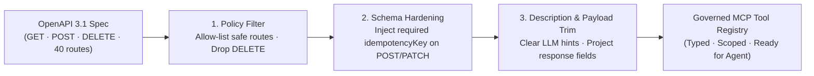

# Chapter 02 — Automated OpenAPI-to-MCP Adaptation

> **Lecture 30 · Chapter 02 of 07** · Level: 🟠 Advanced · Phase 7 — Connectors, Code Mode & Proactive Workflows
> **Source:** `FDE S15` · **Roadmap Reference:** [`roadmap-v1.md`](../../roadmap-v1.md#lecture-30--enterprise-apis-openapi-to-mcp-idempotency--computer-use-fallback)
> **External Reference:** [OpenAPI Specification 3.1](https://spec.openapis.org/oas/v3.1.0)
> **Roadmap topics:** Parsing OpenAPI 3.1 specs · path allow-listing · rewriting descriptions for LLM clarity · auto-injecting `idempotencyKey` on mutations · response projection.

---

## 02.0 What this chapter is for

Writing bespoke MCP servers by hand for 50 internal microservices does not scale. Almost every modern backend already publishes an **OpenAPI 3.1 (Swagger) JSON/YAML spec**.

An **OpenAPI-to-MCP Adapter** compiles an OpenAPI specification into governed MCP tool definitions automatically — **but a naive 1:1 converter is dangerous** (it exposes `DELETE` routes, omits idempotency, and dumps 400 tools into context). A **production** adapter filters, enriches, and hardens every endpoint during compilation.

By the end of this chapter you should be able to:

1. Map OpenAPI 3.1 primitives (`paths`, `operationId`, `parameters`, `requestBody`) to MCP Tool schemas (`name`, `description`, `inputSchema`).
2. Apply **4 compilation rules** that make generated MCP tools safe and token-efficient.
3. Explain why **200+ endpoint APIs** eventually hit the Tool Schema Scaling Wall (previewing Lecture 31's Code Mode).

---

## 02.1 The 4-Step OpenAPI-to-MCP Compiler



### Concrete transformation example

Suppose the raw OpenAPI spec has:
- `GET /orders/{orderId}` $\rightarrow$ Compiled to `get_order` (`permission: "READ_ONLY"`, `requiresIdempotency: false`)
- `POST /refunds` $\rightarrow$ Compiled to `create_refund` (`permission: "APPROVAL_REQUIRED"` if `> $50`, `requiresIdempotency: true` — compiler automatically adds `idempotencyKey: string` to `inputSchema.required`!)
- `DELETE /orders/{orderId}` $\rightarrow$ **Blocked / Omitted** by compiler policy (`allowMethods: ["GET", "POST", "PATCH"]`).

```json
// Compiled MCP Tool Output for POST /refunds
{
  "name": "create_refund",
  "description": "Issue a customer refund after verifying eligibility with get_order. MUTATING ACTION: Requires unique idempotencyKey.",
  "inputSchema": {
    "type": "object",
    "required": ["orderId", "amountUsd", "idempotencyKey"],
    "properties": {
      "orderId": { "type": "string" },
      "amountUsd": { "type": "number", "exclusiveMinimum": 0 },
      "idempotencyKey": { "type": "string", "description": "Unique retry key" }
    }
  }
}
```

---

## 02.2 Writing LLM-friendly tool descriptions

OpenAPI summaries are often terse (`"Post refund"`). The compiler should enrich `description` with:
1. **When to use it:** *"Issue a customer refund after verifying order eligibility with `get_order`."*
2. **Side-effect warning:** *"MUTATING ACTION: Requires a unique `idempotencyKey`."*
3. **Parameter constraints:** *"amountUsd must be > 0 and <= order total."*

---

## 02.3 Key takeaways

1. **Never do a blind 1:1 OpenAPI-to-MCP dump:** filter out dangerous methods (`DELETE`) and internal admin routes at compile time.
2. **Auto-inject `idempotencyKey` into `inputSchema.required`** for every `POST`, `PUT`, and `PATCH` tool.
3. **Project responses down to essential fields** so 14 KB REST payloads don't bloat the agent's context window.

---

**Next:** [Chapter 03 — Idempotency Keys & Safe Retries on Mutations](./03_Idempotency_Keys_and_Safe_Retries_on_Mutations.md)

