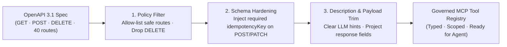
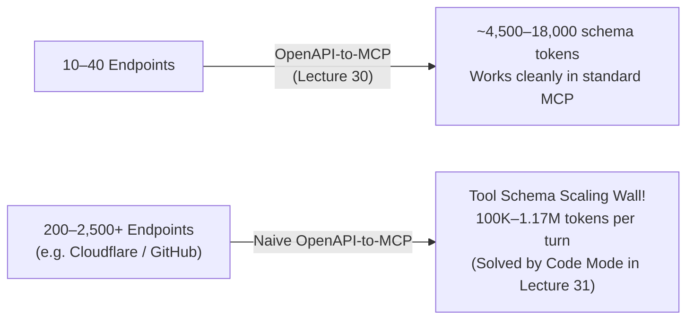

# Chapter 02 — Automated OpenAPI-to-MCP Adaptation

> **Lecture 30 · Chapter 02 of 07** · Level: 🟠 Advanced · Phase 7 — Connectors, Code Mode & Proactive Workflows
> **Source:** `FDE S15` · **Roadmap Reference:** [`roadmap-v1.md`](../../roadmap-v1.md#lecture-30--enterprise-apis-openapi-to-mcp-idempotency--computer-use-fallback)
> **External Reference:** [OpenAPI Specification 3.1](https://spec.openapis.org/oas/v3.1.0)
> **Roadmap topics:** Parsing OpenAPI 3.1 specs · path allow-listing · rewriting descriptions for LLM clarity · auto-injecting `idempotencyKey` on mutations · response projection.

---

## 02.0 What this chapter is for

Writing bespoke MCP servers by hand for 50 internal microservices does not scale. Almost every modern backend already publishes an **OpenAPI 3.1 (Swagger) JSON/YAML spec** describing its paths, parameters, request bodies, and response schemas.

An **OpenAPI-to-MCP Adapter** compiles an OpenAPI specification into governed MCP tool definitions automatically — **but a naive 1:1 converter is dangerous**. A blind 1:1 dump exposes `DELETE` routes, omits idempotency keys, keeps terse 2-word summaries, and dumps 400 tools into the LLM's context window. A **production** compiler filters, enriches, and hardens every endpoint during compilation.

By the end of this chapter you should be able to:

1. Map OpenAPI 3.1 primitives (`paths`, `operationId`, `parameters`, `requestBody`) to MCP Tool schemas (`name`, `description`, `inputSchema`).
2. Apply **4 compilation rules** that make generated MCP tools safe, governed, and token-efficient.
3. Rewrite terse OpenAPI summaries into **LLM-ready tool descriptions** with preconditions and side-effect warnings.
4. Explain why **200+ endpoint APIs** eventually hit the Tool Schema Scaling Wall (previewing Lecture 31's Code Mode).

---

## 02.1 The 4-Step OpenAPI-to-MCP Compiler

Rather than treating OpenAPI as a passive config file, treat it as **source code** that goes through a 4-stage compiler pipeline before reaching an agent:



### Mapping OpenAPI 3.1 primitives to MCP

| OpenAPI 3.1 Field | MCP Tool Field | Compiler Transformation |
| :--- | :--- | :--- |
| `operationId` (e.g. `postRefunds`) | `name` | Normalize to `snake_case` (`create_refund`) for consistent model tool-calling |
| `summary` + `description` | `description` | Enrich with **when to use**, **preconditions**, and **MUTATING ACTION** warning |
| `parameters` + `requestBody` | `inputSchema` | Merge path/query/body into one flat JSON Schema; inject `idempotencyKey` if mutating |
| `responses["200"].content` | Runtime Response Filter | Strip internal fields via a per-tool `responseProjection` allow-list |

---

## 02.2 Concrete transformation example

Suppose our raw OpenAPI 3.1 spec defines three endpoints for the Order Refunds service:
1. `GET /orders/{orderId}` $\rightarrow$ Compiled to `get_order` (`permission: "READ_ONLY"`, `requiresIdempotency: false`)
2. `POST /refunds` $\rightarrow$ Compiled to `create_refund` (`permission: "APPROVAL_REQUIRED"` if `> $50`, `requiresIdempotency: true`)
3. `DELETE /orders/{orderId}` $\rightarrow$ **Blocked / Omitted** by compiler policy (`allowMethods: ["GET", "POST", "PATCH"]`).

Look at the compiled MCP tool definition generated for `POST /refunds`:

```json
// Compiled MCP Tool Output for POST /refunds
{
  "name": "create_refund",
  "description": "Issue a customer refund after verifying eligibility with get_order. MUTATING ACTION: Requires unique idempotencyKey. Refunds > $50 pause for human approval.",
  "inputSchema": {
    "type": "object",
    "required": ["orderId", "amountUsd", "idempotencyKey"],
    "properties": {
      "orderId": {
        "type": "string",
        "description": "Target order ID, e.g. ORD-9042"
      },
      "amountUsd": {
        "type": "number",
        "exclusiveMinimum": 0,
        "description": "Refund amount in USD; must be <= order total"
      },
      "idempotencyKey": {
        "type": "string",
        "description": "Unique retry key (e.g. workflowRunId:stepId) to prevent duplicate refunds"
      }
    }
  }
}
```

### Compiler implementation sketch (TypeScript)

```typescript
const ALLOWED_METHODS = new Set(["get", "post", "patch"]);

function compileOperation(path: string, method: string, op: OpenApiOperation) {
  if (!ALLOWED_METHODS.has(method.toLowerCase())) {
    return null; // Rule 1: Quarantine DELETE / PUT / internal admin routes
  }

  const isMutation = method.toLowerCase() !== "get";
  const schema = mergeParamsAndBody(op.parameters, op.requestBody);

  if (isMutation) {
    // Rule 2: Auto-inject mandatory idempotencyKey on all mutations
    schema.properties.idempotencyKey = {
      type: "string",
      description: "Unique retry key to guarantee exactly-once execution",
    };
    schema.required = Array.from(new Set([...(schema.required ?? []), "idempotencyKey"]));
  }

  return {
    name: toSnakeCase(op.operationId),
    description: enrichDescription(op.summary, isMutation), // Rule 3
    inputSchema: schema,
    isMutation,
  };
}
```

---

## 02.3 Writing LLM-friendly tool descriptions & handling `$ref`

OpenAPI summaries are written for human developers reading Swagger UI, not for LLMs choosing between 25 tools.

| Terse OpenAPI Summary | LLM-Friendly Compiled Description | Why It Works Better |
| :--- | :--- | :--- |
| `"Get order"` | `"Fetch order status, amountUsd, and refund eligibility by orderId. Call this BEFORE create_refund."` | Tells the planner the exact **prerequisite** step |
| `"Post refund"` | `"Issue a customer refund. MUTATING ACTION: Requires idempotencyKey. Amounts > $50 require HITL approval."` | Surfaces side-effect risk and approval thresholds upfront |
| `"List orders"` | `"Search orders by customerId. Capped at 20 items per page; pass nextCursor to paginate."` | Prevents the model from requesting `limit: 500` |

> [!IMPORTANT]
> **Always dereference `$ref` pointers at compile time.** Many OpenAPI specs use `"$ref": "#/components/schemas/RefundRequest"`. Most LLM tool-calling APIs reject or misread unresolved JSON Schema `$ref` pointers. Flatten them during compilation!

### Where automated OpenAPI-to-MCP compilation breaks



> [!WARNING]
> **The 50-Tool Ceiling:** OpenAPI-to-MCP compilation is ideal for focused domain connectors (5–40 endpoints). Once a spec exceeds ~50–100 endpoints, dumping every compiled tool into `tools/list` causes attention dilution and context overflow. In **Lecture 31**, we solve that with **Cloudflare Code Mode (`openApiMcpServer`)**.

---

## 02.4 Common mistakes

| # | Common Mistake | Why It Hurts | What To Do Instead |
| :--- | :--- | :--- | :--- |
| **1** | **Blind 1:1 OpenAPI-to-MCP conversion** | Exposes `DELETE`, `/internal/*`, and `/admin/*` endpoints to the agent | Maintain an explicit method + path allow-list in the compiler |
| **2** | **Leaving `$ref` unresolved in `inputSchema`** | OpenAI / Anthropic / Gemini tool validators reject `$ref` or hallucinate arguments | Dereference and inline all `$ref` schemas at build/compile time |
| **3** | **Optional `idempotencyKey` on `POST`/`PATCH`** | LLMs skip optional fields under token pressure, causing duplicate writes on retry | Add `idempotencyKey` to `inputSchema.required` automatically |
| **4** | **Forwarding full upstream JSON responses** | 14 KB payloads flood context and hide key booleans | Attach a `responseProjection` allow-list to every compiled tool |
| **5** | **Compiling 500+ endpoints into `tools/list`** | Burns 200K+ tokens per turn and degrades tool selection accuracy | Split into scoped connectors or use Code Mode (`openApiMcpServer`) |

---

## 02.5 Key takeaways

1. **Never do a blind 1:1 OpenAPI-to-MCP dump:** filter out dangerous methods (`DELETE`) and internal admin routes at compile time.
2. **Dereference `$ref` schemas and enrich descriptions** with preconditions, mutating warnings, and parameter constraints.
3. **Auto-inject `idempotencyKey` into `inputSchema.required`** for every `POST`, `PUT`, and `PATCH` tool.
4. **Project responses down to essential fields** so 14 KB REST payloads don't bloat the agent's context window.

---

**Next:** [Chapter 03 — Idempotency Keys & Safe Retries on Mutations](./03_Idempotency_Keys_and_Safe_Retries_on_Mutations.md)
