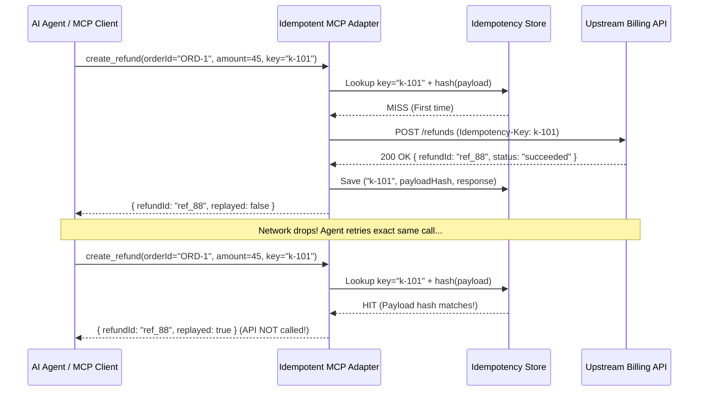

# Chapter 03 — Idempotency Keys & Safe Retries on Mutations

> **Lecture 30 · Chapter 03 of 07** · Level: 🟠 Advanced · Phase 7 — Connectors, Code Mode & Proactive Workflows
> **Source:** `FDE S15` · **Roadmap Reference:** [`roadmap-v1.md`](../../roadmap-v1.md#lecture-30--enterprise-apis-openapi-to-mcp-idempotency--computer-use-fallback)
> **Roadmap topics:** The "double-refund" network failure · `Idempotency-Key` semantics · payload-hash mismatch detection (`409 Conflict`) · TTLs and atomic locking.

---

## 03.0 What this chapter is for

In distributed systems, **networks fail after the server commits**. Look at what happens when an agent calls `create_refund` for `$45`:

1. Agent sends `POST /refunds` (`$45`).
2. Billing server charges/refunds `$45` and writes to the database.
3. **Network drops** before the `200 OK` reaches the agent!
4. The agent sees `ETIMEDOUT` and **retries `POST /refunds`** (`$45`).
5. Without an **Idempotency Key**, the customer just received **\$90**!

By the end of this chapter you should be able to:

1. Implement an **Idempotency Store** that guarantees **exactly-once side effects** across retries.
2. Detect **key reuse with a different payload** (`409 Conflict` / `IdempotencyMismatchError`) so a buggy agent cannot accidentally reuse an old key for a new refund amount.
3. Choose between **client-generated keys** vs. **harness-derived deterministic keys**.

---

## 03.1 How Idempotency Keys work under the hood

### The 3 mandatory rules of an Idempotency Store

| Rule | What It Checks | Response |
| :--- | :--- | :--- |
| **1. Key Required on Mutations** | `POST`, `PATCH`, `PUT` without `idempotencyKey` | Reject immediately (`400 Bad Request`) |
| **2. Replay with Matching Payload** | `key` exists AND `sha256(args) === stored.payloadHash` | Return stored response (`replayed: true`); **0 upstream calls** |
| **3. Replay with Different Payload** | `key` exists BUT `sha256(args) !== stored.payloadHash` | Reject with **`409 Conflict`** — never silently return the old result for new arguments! |

### Harness-Derived vs. LLM-Generated Keys
Never rely solely on the LLM to invent a random UUID—if the LLM re-plans, it might generate a *new* UUID for the same refund! Derive deterministic keys in the harness:
`idempotencyKey = sha256(workflowRunId + ":" + stepId + ":" + toolName)` — guaranteeing every retry of the same step produces the exact same key.

---

## 03.2 Key takeaways

1. **Every mutating MCP tool must require an `idempotencyKey`** so retries never duplicate charges, tickets, or emails.
2. **Store `sha256(payload)` alongside the key** and fail with `409 Conflict` if an agent reuses a key with different arguments.
3. **If the upstream legacy API does not support `Idempotency-Key` headers**, enforce idempotency inside your **MCP Adapter layer** backed by Redis/Postgres.

---

**Next:** [Chapter 04 — Approval-Bound Actions & Connector Governance](./04_Approval_Bound_Actions_and_Connector_Governance.md)

