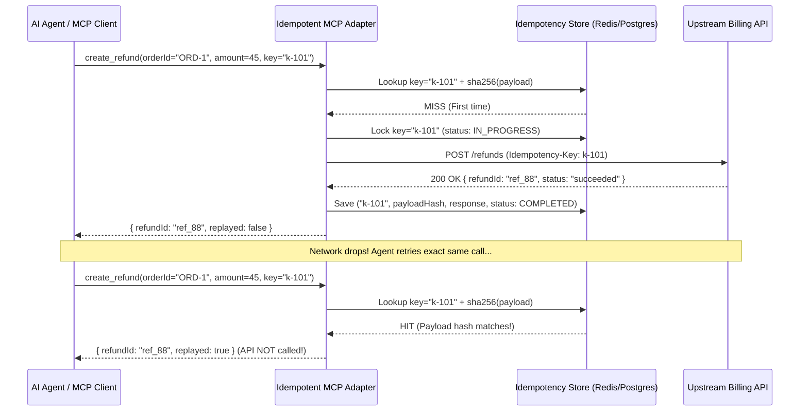
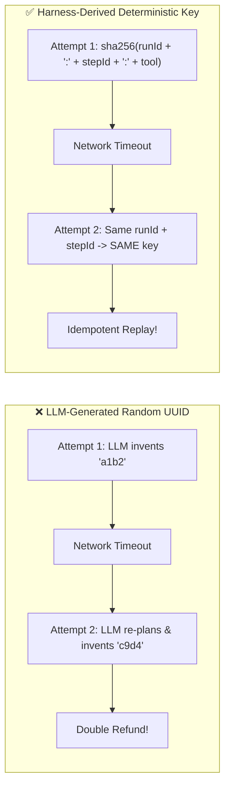

# Chapter 03 — Idempotency Keys & Safe Retries on Mutations

> **Lecture 30 · Chapter 03 of 07** · Level: 🟠 Advanced · Phase 7 — Connectors, Code Mode & Proactive Workflows
> **Source:** `FDE S15` · **Roadmap Reference:** [`roadmap-v1.md`](../../roadmap-v1.md#lecture-30--enterprise-apis-openapi-to-mcp-idempotency--computer-use-fallback)
> **Roadmap topics:** The "double-refund" network failure · `Idempotency-Key` semantics · payload-hash mismatch detection (`409 Conflict`) · TTLs and atomic locking.

---

## 03.0 What this chapter is for

In distributed systems, **networks fail after the server commits**. Look at what happens when an agent calls `create_refund` for `$45`:

1. Agent sends `POST /refunds` (`$45`).
2. Billing server refunds `$45` and commits the row to its database.
3. **Network drops** (or a 5-second gateway timeout fires) before the `200 OK` reaches the agent!
4. The agent sees `ETIMEDOUT` and **retries `POST /refunds`** (`$45`).
5. Without an **Idempotency Key**, the customer just received **\$90**!

In traditional web apps, a human notices a spinner and hesitates before clicking twice. In an agentic loop, **automatic retries are built into every SDK and orchestrator** — turning every transient network blip into a duplicate charge, duplicate Jira ticket, or duplicate email.

By the end of this chapter you should be able to:

1. Implement an **Idempotency Store** inside an MCP adapter that guarantees **exactly-once side effects** across retries.
2. Detect **key reuse with a different payload** (`409 Conflict` / `IdempotencyMismatchError`) so a buggy agent cannot accidentally reuse an old key for a new refund amount.
3. Handle **concurrent in-flight retries** using atomic locking (`IN_PROGRESS` state).
4. Choose between **LLM-generated keys** vs. **harness-derived deterministic keys**.

---

## 03.1 How Idempotency Keys work under the hood



### The 4 mandatory states of an Idempotency Store

| Rule / State | What It Checks | Adapter Response |
| :--- | :--- | :--- |
| **1. Missing Key** | `POST`, `PATCH`, `PUT` without `idempotencyKey` | Reject immediately (`400 Bad Request`) |
| **2. In-Flight Lock (`IN_PROGRESS`)** | Same `key` arrives while first request is still running | Reject with `409 Retry-Later` (prevents race-condition double execution) |
| **3. Replay with Matching Payload** | `key` exists (`COMPLETED`) AND `sha256(args) === stored.payloadHash` | Return stored response (`replayed: true`); **0 upstream calls** |
| **4. Replay with Different Payload** | `key` exists BUT `sha256(args) !== stored.payloadHash` | Reject with **`409 Conflict`** — never silently return the old result for new arguments! |

> [!IMPORTANT]
> **Why `sha256(payload)` is non-negotiable:** Suppose an agent calls `create_refund(orderId="ORD-1", amount=45, key="k-101")`, and on the next step tries `create_refund(orderId="ORD-1", amount=90, key="k-101")` using the same key. Without a payload-hash check, the store would silently return the `$45` receipt and fool the agent into thinking `$90` was refunded!

---

## 03.2 Implementing an Idempotent MCP Adapter (TypeScript)

Note that we hash a **canonicalized JSON** payload (sorted keys) excluding `idempotencyKey` itself, and we store records with a bounded TTL (typically **24 hours** to **7 days** depending on business SLA):

```typescript
import { createHash } from "node:crypto";

function hashPayload(args: Record<string, unknown>): string {
  const { idempotencyKey: _, ...rest } = args;
  const canonical = JSON.stringify(rest, Object.keys(rest).sort());
  return createHash("sha256").update(canonical).digest("hex");
}

async function executeIdempotentMutation(
  store: IdempotencyStore,
  key: string,
  args: Record<string, unknown>,
  upstreamCall: () => Promise<unknown>
) {
  if (!key) throw new Error("400 Bad Request: idempotencyKey is required");
  const payloadHash = hashPayload(args);

  const existing = await store.get(key);
  if (existing) {
    if (existing.payloadHash !== payloadHash) {
      throw new Error("409 Conflict: IdempotencyMismatchError — key reused with different payload");
    }
    if (existing.status === "IN_PROGRESS") {
      throw new Error("409 Conflict: Request with this idempotencyKey is still in flight");
    }
    return { ...existing.response, replayed: true };
  }

  await store.setInProgress(key, payloadHash, { ttlSeconds: 86400 });
  try {
    const response = await upstreamCall();
    await store.setCompleted(key, payloadHash, response, { ttlSeconds: 86400 });
    return { ...response, replayed: false };
  } catch (err) {
    await store.delete(key); // Release lock on transient failure so legitimate retry can proceed
    throw err;
  }
}
```

---

## 03.3 Harness-Derived vs. LLM-Generated Keys

Where should `idempotencyKey` come from? Never rely solely on the LLM to invent a random UUID!



| Strategy | How Key Is Produced | Verdict |
| :--- | :--- | :--- |
| **LLM-Generated Random String** | Model invents `"refund-123"` or a random UUID | ⚠️ Dangerous on re-plan: model often invents a *new* key on retry |
| **Harness-Derived Deterministic Key** | `sha256(workflowRunId + ":" + stepId + ":" + toolName)` | ✅ **Best practice:** every retry of the same step produces the exact same key |
| **Semantic Business Key** | `"refund:" + orderId + ":" + reasonCode` | ✅ Great when business rules allow at most one refund per order |

> [!TIP]
> **What if the upstream legacy API has NO `Idempotency-Key` header?** That is the exact reason to enforce idempotency inside your **MCP Adapter layer** backed by Redis or Postgres. Even if the legacy backend is naive, the MCP adapter prevents duplicate upstream calls.

---

## 03.4 Common mistakes

| # | Common Mistake | Why It Hurts | What To Do Instead |
| :--- | :--- | :--- | :--- |
| **1** | **Letting the LLM invent a fresh UUID per retry** | On re-plan, the LLM generates a new UUID and triggers a duplicate mutation | Derive deterministic keys in the harness from `runId + stepId + toolName` |
| **2** | **Skipping the `sha256(payload)` comparison** | Reusing a key with different arguments silently returns the stale response | Always compare canonical payload hashes and throw `409 Conflict` on mismatch |
| **3** | **No `IN_PROGRESS` lock for concurrent calls** | Parallel tool calls with the same key both pass the initial `MISS` check | Acquire an atomic `SET NX` / DB lock before calling the upstream API |
| **4** | **Deleting the key only on success instead of transient error** | If the upstream times out *before* committing, a permanent lock blocks all future retries | Release `IN_PROGRESS` on explicit `5xx`/network pre-commit failures (or forward `Idempotency-Key` upstream) |
| **5** | **Keeping idempotency records with no TTL** | Redis/Postgres grows unboundedly over months | Set a sensible TTL (e.g., 24 h–7 d) aligned with workflow retry windows |

---

## 03.5 Key takeaways

1. **Every mutating MCP tool must require an `idempotencyKey`** so network retries never duplicate charges, tickets, or emails.
2. **Store `sha256(payload)` alongside the key** and fail with `409 Conflict` if an agent reuses a key with different arguments.
3. **Derive deterministic keys in the agent harness** (`runId:stepId:tool`) rather than trusting the LLM to remember a random UUID.
4. **If the upstream legacy API does not support `Idempotency-Key` headers**, enforce idempotency inside your **MCP Adapter layer** backed by Redis/Postgres.

---

**Next:** [Chapter 04 — Approval-Bound Actions & Connector Governance](./04_Approval_Bound_Actions_and_Connector_Governance.md)
