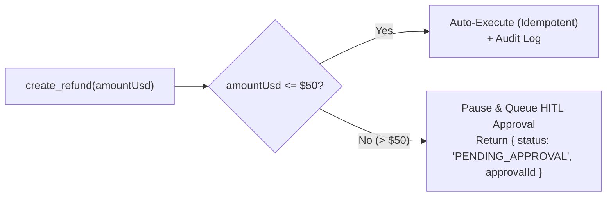

# Chapter 04 — Approval-Bound Actions & Connector Governance

> **Lecture 30 · Chapter 04 of 07** · Level: 🟠 Advanced · Phase 7 — Connectors, Code Mode & Proactive Workflows
> **Source:** `FDE S15` · **Roadmap Reference:** [`roadmap-v1.md`](../../roadmap-v1.md#lecture-30--enterprise-apis-openapi-to-mcp-idempotency--computer-use-fallback)
> **Roadmap topics:** Scoped OAuth permissions · approval-bound mutations (HITL thresholds) · per-connector rate limits & circuit breakers · audit logging.

---

## 04.0 What this chapter is for

Idempotency stops *accidental duplicate* mutations, but what if the agent intentionally proposes a **\$5,000 refund** or tries to **send 200 emails in 10 seconds**?

**Connector Governance** sits inside the MCP Adapter/Gateway and enforces **who can call what, up to what dollar/rate threshold, and when a human must approve**.

By the end of this chapter you should be able to:

1. Enforce **value-based HITL approval thresholds** (e.g., refunds $\le \$50$ auto-execute; $> \$50$ pause for human sign-off).
2. Apply **scoped credentials** (least-privilege OAuth scopes) per connector instead of a single root API key.
3. Add **rate caps and circuit breakers** so a looping agent cannot overwhelm a fragile legacy backend.

---

## 04.1 Approval-Bound Mutation Flow

### The 4 pillars of Connector Governance

1. **Scoped Permissions:** A support connector only receives `orders:read` and `refunds:create` — never `users:delete` or `billing:export_all`.
2. **Thresholded Approvals:** High-impact mutations return `PENDING_APPROVAL` with an `approvalId` instead of executing immediately.
3. **Per-Connector Rate Limits:** Cap `maxCallsPerMinute` (e.g., `20 req/min` for legacy ERPs) so an agent cannot DDoS internal services.
4. **Structured Audit Trail:** Log `{ traceId, callerId, toolName, idempotencyKey, decision, latencyMs }` for every connector call.

---

## 04.2 Key takeaways

1. **Never give a connector a god-mode admin API key:** scope credentials per connector capability.
2. **Gate high-value or irreversible mutations behind HITL thresholds** inside the adapter code.
3. **Rate-limit every legacy connector** to protect fragile internal systems from agent retry storms.

---

**Next:** [Chapter 05 — Browser Automation Fallback (Playwright)](./05_Browser_Automation_Fallback_Playwright.md)

