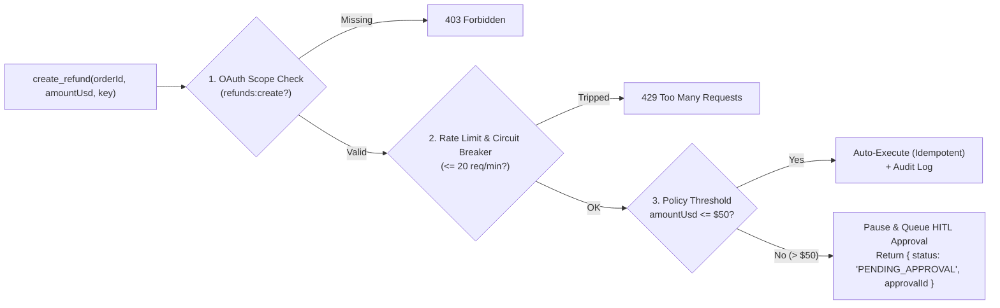
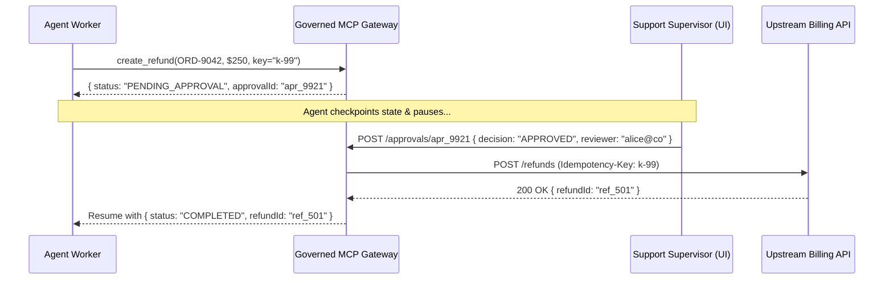

# Chapter 04 — Approval-Bound Actions & Connector Governance

> **Lecture 30 · Chapter 04 of 07** · Level: 🟠 Advanced · Phase 7 — Connectors, Code Mode & Proactive Workflows
> **Source:** `FDE S15` · **Roadmap Reference:** [`roadmap-v1.md`](../../roadmap-v1.md#lecture-30--enterprise-apis-openapi-to-mcp-idempotency--computer-use-fallback)
> **Roadmap topics:** Scoped OAuth permissions · approval-bound mutations (HITL thresholds) · per-connector rate limits & circuit breakers · audit logging.

---

## 04.0 What this chapter is for

Idempotency stops *accidental duplicate* mutations, but it does not stop **badly scoped or high-impact** mutations. What if a prompt-injected or confused agent intentionally proposes a **\$5,000 refund**, or enters a loop and tries to **send 200 customer emails in 10 seconds**?

**Connector Governance** sits inside the MCP Adapter/Gateway — **in deterministic code, never in the system prompt** — and enforces **who can call what, up to what dollar/rate threshold, and when a human must approve**.

By the end of this chapter you should be able to:

1. Enforce **value-based HITL approval thresholds** (e.g., refunds $\le \$50$ auto-execute; $> \$50$ pause for human sign-off).
2. Apply **scoped credentials** (least-privilege OAuth scopes) per connector instead of a single root API key.
3. Add **per-connector rate caps and circuit breakers** so a looping agent cannot overwhelm a fragile legacy backend.
4. Emit **structured audit logs** linking every external mutation to `traceId`, `callerId`, `idempotencyKey`, and `approvalId`.

---

## 04.1 Approval-Bound Mutation Flow

Look at how a governed `create_refund` tool evaluates every incoming request before touching the upstream billing API:



### How the HITL resume cycle works

When `amountUsd > 50`, the MCP tool **does not throw an error** — it returns a structured `PENDING_APPROVAL` payload so the orchestrator (and `AG-UI` frontend in Lecture 37) can pause cleanly and render an Approve/Reject card:

```json
{
  "status": "PENDING_APPROVAL",
  "approvalId": "apr_9921",
  "tool": "create_refund",
  "arguments": { "orderId": "ORD-9042", "amountUsd": 250.00, "idempotencyKey": "run42:step3:create_refund" },
  "reason": "Exceeds $50.00 auto-approval threshold for Support Tier 1"
}
```



> [!IMPORTANT]
> **Never enforce dollar caps only in the system prompt.** Writing *"Do not issue refunds over \$50"* in a prompt is easily bypassed by indirect prompt injection or arithmetic confusion. Always enforce thresholds in deterministic gateway code.

---

## 04.2 The 4 Pillars of Connector Governance

| Pillar | What It Enforces | Concrete Example |
| :--- | :--- | :--- |
| **1. Scoped Permissions** | Least-privilege OAuth scopes per connector | Support connector gets `orders:read` + `refunds:create`; never `users:delete` or `billing:export_all` |
| **2. Thresholded Approvals** | Dollar, count, or blast-radius HITL gates | Refunds $\le \$50$ auto-run; $> \$50$ require `apr_*` sign-off; bulk email $> 10$ recipients paused |
| **3. Rate Limits & Circuit Breakers** | Protects fragile legacy systems from agent retry storms | Cap `20 req/min` per connector; open circuit for 60 s if upstream returns 5 consecutive `5xx` errors |
| **4. Structured Audit Trail** | Immutable compliance record for every tool call | Log `{ traceId, callerId, toolName, idempotencyKey, approvalId, decision, latencyMs }` |

### Gateway Policy Configuration Example

```typescript
interface ConnectorPolicy {
  allowedScopes: string[];
  maxCallsPerMinute: number;
  circuitBreakerErrorThreshold: number;
  approvalRules: {
    tool: string;
    requireApprovalIf: (args: Record<string, unknown>) => boolean;
    reason: string;
  }[];
}

const supportRefundPolicy: ConnectorPolicy = {
  allowedScopes: ["orders:read", "refunds:create"],
  maxCallsPerMinute: 20,
  circuitBreakerErrorThreshold: 5,
  approvalRules: [
    {
      tool: "create_refund",
      requireApprovalIf: (args) => Number(args.amountUsd) > 50,
      reason: "Refund exceeds $50 auto-approval cap",
    },
  ],
};
```

> [!TIP]
> **Audit logs must record both `callerId` (the human user) and `agentId`.** When an enterprise security team asks *"Who authorized this \$250 refund?"*, your audit log must point to `alice@company.com` via `approvalId: apr_9921`, not just `"ai-agent"`.

---

## 04.3 Common mistakes

| # | Common Mistake | Why It Hurts | What To Do Instead |
| :--- | :--- | :--- | :--- |
| **1** | **Giving every connector a single root/admin API key** | Any compromised or confused agent can access unrelated tables and admin endpoints | Issue least-privilege, per-connector OAuth tokens |
| **2** | **Putting approval rules in the LLM prompt instead of code** | Prompt injection or model error bypasses the rule | Enforce `requireApprovalIf` inside the MCP Gateway before upstream execution |
| **3** | **No rate limit on legacy ERP connectors** | A looping agent can DDoS a fragile internal service in seconds | Add per-connector token-bucket rate limits + circuit breakers |
| **4** | **Treating `PENDING_APPROVAL` as an exception/crash** | Agent retries the same call in a loop instead of pausing | Return a structured `PENDING_APPROVAL` status that pauses the workflow cleanly |
| **5** | **Omitting `idempotencyKey` and `approvalId` from logs** | Impossible to reconcile duplicate charges or prove human sign-off during audits | Emit structured JSON audit events for every allow, block, and approval decision |

---

## 04.4 Key takeaways

1. **Never give a connector a god-mode admin API key:** scope credentials per connector capability.
2. **Gate high-value or irreversible mutations behind HITL thresholds** inside deterministic adapter code, not prompts.
3. **Rate-limit and circuit-break every legacy connector** to protect fragile internal systems from agent retry storms.
4. **Log `{ traceId, callerId, idempotencyKey, approvalId, decision }`** on every connector call for full enterprise auditability.

---

**Next:** [Chapter 05 — Browser Automation Fallback (Playwright)](./05_Browser_Automation_Fallback_Playwright.md)
