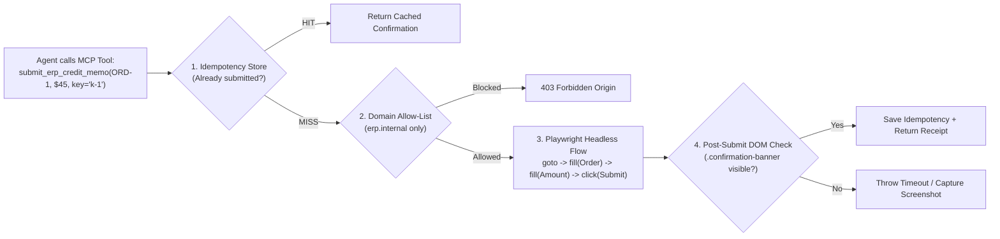

# Chapter 05 — Browser Automation Fallback (Playwright)

> **Lecture 30 · Chapter 05 of 07** · Level: 🟠 Advanced · Phase 7 — Connectors, Code Mode & Proactive Workflows
> **Source:** `FDE S15` · **Roadmap Reference:** [`roadmap-v1.md`](../../roadmap-v1.md#lecture-30--enterprise-apis-openapi-to-mcp-idempotency--computer-use-fallback)
> **External Reference:** [Playwright Browser Automation](https://playwright.dev/)
> **Roadmap topics:** UI-only legacy portals · wrapping Playwright scripts as typed MCP tools · semantic DOM/ARIA selectors · domain allow-lists · combining idempotency with browser submits.

---

## 05.0 What this chapter is for

In almost every enterprise, you eventually hit a brick wall: **a 15-year-old ERP, insurance portal, or government compliance form that has NO REST or GraphQL API**.

Instead of giving up or jumping straight to slow pixel-clicking Computer-Use models, **wrap a deterministic Playwright script as a typed MCP tool**. To the agent, it looks just like an API call (`submit_erp_credit_memo(orderId, amountUsd, idempotencyKey)`), while under the hood Playwright fills the legacy web form cleanly.

By the end of this chapter you should be able to:

1. Wrap a Playwright browser flow inside a **typed, idempotent MCP tool** with strict **URL domain allow-lists**.
2. Choose resilient **ARIA/role/label selectors** (`getByLabel("Order ID")`) over brittle CSS/XPath (`div > div:nth-child(4)`).
3. Enforce **post-submit DOM confirmation** so the tool never returns `ok: true` unless the confirmation banner actually appeared.

---

## 05.1 Playwright Fallback Architecture



### Why Playwright-behind-MCP beats raw browser agents

| Dimension | Raw Unconstrained Browser Agent | Typed Playwright MCP Fallback |
| :--- | :--- | :--- |
| **Speed** | 15–40 s (LLM inspects screenshot every click) | **1–3 s** (deterministic Playwright steps) |
| **Cost** | High (vision tokens on every step) | **Near `$0`** (no vision tokens in steady state) |
| **Safety** | Could navigate to external sites or click "Delete All" | Locked to **allow-listed origin** + **explicit form actions** |
| **Idempotency** | Can double-submit forms on retry | Protected by **`IdempotencyStore`** before launching browser |

### Resilient Playwright Pattern (Semantic Locators + Origin Guard)
```typescript
if (!ALLOWED_ORIGINS.has(new URL(targetUrl).origin)) {
  throw new Error("403 Forbidden Origin");
}
await page.goto(targetUrl);
await page.getByLabel("Order ID").fill(orderId);
await page.getByLabel("Credit Amount (USD)").fill(String(amountUsd));
await page.getByRole("button", { name: "Submit Credit Memo" }).click();
await page.getByText("Credit Memo Recorded").waitFor({ timeout: 5000 });
```

---

## 05.2 Key takeaways

1. **Wrap Playwright flows as typed MCP tools** so legacy UI-only portals inherit schema validation, idempotency, and audit logging.
2. **Enforce strict URL domain allow-lists** so prompt injection in page text cannot redirect the browser to an attacker origin.
3. **Verify post-submit DOM confirmation** before recording success.

---

**Next:** [Chapter 06 — Computer-Use Agents & Visual Grounding](./06_Computer_Use_Agents_and_Visual_Grounding.md)

