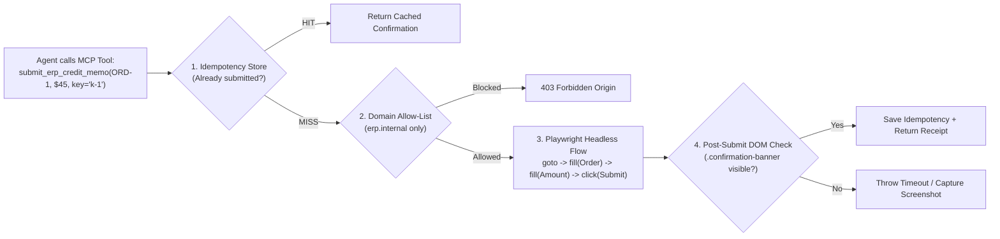

# Chapter 05 — Browser Automation Fallback (Playwright)

> **Lecture 30 · Chapter 05 of 07** · Level: 🟠 Advanced · Phase 7 — Connectors, Code Mode & Proactive Workflows
> **Source:** `FDE S15` · **Roadmap Reference:** [`roadmap-v1.md`](../../roadmap-v1.md#lecture-30--enterprise-apis-openapi-to-mcp-idempotency--computer-use-fallback)
> **External Reference:** [Playwright Browser Automation](https://playwright.dev/)
> **Roadmap topics:** UI-only legacy portals · wrapping Playwright scripts as typed MCP tools · semantic DOM/ARIA selectors · domain allow-lists · combining idempotency with browser submits.

---

## 05.0 What this chapter is for

In almost every enterprise, you eventually hit a brick wall: **a 15-year-old ERP, insurance portal, or government compliance form that has NO REST or GraphQL API**. In our running case study, the support agent issued the `$45` refund via API, and now must **log the credit memo in a legacy 2008 ERP web portal**.

Instead of giving up or jumping straight to slow, expensive pixel-clicking Computer-Use models, **wrap a deterministic Playwright script as a typed MCP tool**. To the agent, it looks just like an API call (`submit_erp_credit_memo(orderId, amountUsd, idempotencyKey)`), while under the hood Playwright fills and submits the legacy web form cleanly.

By the end of this chapter you should be able to:

1. Wrap a Playwright browser flow inside a **typed, idempotent MCP tool** with strict **URL domain allow-lists**.
2. Choose resilient **ARIA/role/label selectors** (`getByLabel("Order ID")`) over brittle CSS/XPath (`div > div:nth-child(4)`).
3. Enforce **post-submit DOM confirmation** so the tool never returns `ok: true` unless the confirmation banner actually appeared.
4. Explain why **Playwright-behind-MCP** beats letting an LLM drive a raw browser freely.

---

## 05.1 Playwright Fallback Architecture

Notice how the Playwright fallback reuses the **exact same Idempotency Store and Governance layers** from Chapters 03 and 04 before ever launching a browser context:



### Why Playwright-behind-MCP beats raw browser agents

| Dimension | Raw Unconstrained Browser Agent | Typed Playwright MCP Fallback |
| :--- | :--- | :--- |
| **Speed** | 15–40 s (LLM inspects screenshot every click) | **1–3 s** (deterministic Playwright steps) |
| **Cost** | High (vision tokens on every step) | **Near `$0`** (no vision tokens in steady state) |
| **Safety** | Could navigate to external sites or click "Delete All" | Locked to **allow-listed origin** + **explicit form actions** |
| **Idempotency** | Can double-submit forms on retry | Protected by **`IdempotencyStore`** before launching browser |

---

## 05.2 Resilient Playwright Pattern (Semantic Locators + Origin Guard)

Three rules keep Playwright MCP tools reliable in production:

1. **Origin Allow-Listing (Network + URL Guard):** Validate `new URL(targetUrl).origin` against `ALLOWED_ORIGINS` *and* intercept Playwright `page.route("**/*", ...)` so even a malicious redirect inside the legacy portal cannot leave `https://erp.internal`.
2. **Semantic ARIA/Label Locators:** Use `getByLabel`, `getByRole`, and `getByPlaceholder` — never `div > table > tr:nth-child(3)`.
3. **Explicit Post-Submit Verification:** Wait for the confirmation banner and extract the confirmation/receipt ID from the DOM before marking the idempotency record `COMPLETED`.

```typescript
const ALLOWED_ORIGINS = new Set(["https://erp.internal"]);

async function runCreditMemoFlow(orderId: string, amountUsd: number) {
  const targetUrl = "https://erp.internal/credit-memo/new";
  if (!ALLOWED_ORIGINS.has(new URL(targetUrl).origin)) {
    throw new Error("403 Forbidden Origin");
  }

  const page = await browser.newPage();
  // Enforce origin lock on all sub-requests & redirects
  await page.route("**/*", (route) => {
    const reqOrigin = new URL(route.request().url()).origin;
    return ALLOWED_ORIGINS.has(reqOrigin) ? route.continue() : route.abort();
  });

  try {
    await page.goto(targetUrl, { waitUntil: "domcontentloaded" });
    await page.getByLabel("Order ID").fill(orderId);
    await page.getByLabel("Credit Amount (USD)").fill(amountUsd.toFixed(2));
    await page.getByRole("button", { name: "Submit Credit Memo" }).click();

    // Post-submit DOM confirmation — never assume click() succeeded!
    const banner = page.getByText(/Credit Memo Recorded/i);
    await banner.waitFor({ state: "visible", timeout: 5000 });
    return { status: "RECORDED", receiptText: await banner.textContent() };
  } finally {
    await page.close(); // Always clean up browser context to prevent memory leaks
  }
}
```

> [!TIP]
> **Always capture a failure screenshot on timeout.** When `banner.waitFor()` times out (e.g., because the ERP showed a red validation error *"Duplicate Credit Memo"*), save `await page.screenshot()` to your artifact/debug store and return the visible error text to the agent so it can diagnose why the form failed.

### Where Playwright DOM automation breaks

| Trap | What Happens | What To Do Instead |
| :--- | :--- | :--- |
| **Brittle CSS/XPath selectors** | A minor table column change breaks `tr:nth-child(4) > td:nth-child(2)` | Use `getByLabel()`, `getByRole()`, or `data-testid` |
| **Canvas / Citrix / Flash / PDF viewers** | There is no semantic HTML DOM to query | Escalate to **Visual Computer-Use** (Chapter 06) |
| **Unclosed browser pages/contexts** | Worker pod memory climbs by 150 MB per call until `OOMKilled` | Always wrap `browser.newPage()` in `try { ... } finally { await page.close(); }` |

---

## 05.3 Common mistakes

| # | Common Mistake | Why It Hurts | What To Do Instead |
| :--- | :--- | :--- | :--- |
| **1** | **Giving the agent an open `navigate(anyUrl)` browser tool** | Prompt injection in page text can redirect the browser to an attacker origin or internal metadata IP | Hardcode the target URL and enforce `ALLOWED_ORIGINS` via `page.route()` |
| **2** | **Returning `ok: true` right after `button.click()`** | Form validation errors or 500s go unnoticed and are recorded as successes | `waitFor()` an explicit post-submit confirmation banner in the DOM |
| **3** | **Skipping `IdempotencyStore` for browser submits** | A timeout after clicking Submit causes Playwright to submit the form twice | Wrap the Playwright flow in `executeIdempotentMutation()` (Chapter 03) |
| **4** | **Using brittle positional CSS/XPath selectors** | Minor UI tweaks break automation silently | Use Playwright's `getByLabel` and `getByRole` locators |
| **5** | **Leaking `Page` / `BrowserContext` instances** | Rapid OOM crashes on worker pods | Close `page` and `context` in `finally` blocks |

---

## 05.4 Key takeaways

1. **Wrap Playwright flows as typed MCP tools** so legacy UI-only portals inherit schema validation, idempotency, and audit logging.
2. **Enforce strict URL domain allow-lists** (`ALLOWED_ORIGINS` + `page.route`) so prompt injection in page text cannot redirect the browser.
3. **Prefer semantic ARIA/label locators** and **always verify post-submit DOM confirmation** before recording success.

---

**Next:** [Chapter 06 — Computer-Use Agents & Visual Grounding](./06_Computer_Use_Agents_and_Visual_Grounding.md)
