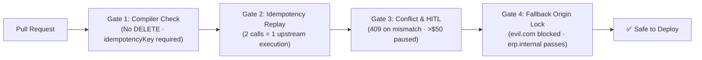

# Chapter 07 — Production Connector Testing & Contract Evals

> **Lecture 30 · Chapter 07 of 07** · Level: 🟠 Advanced · Phase 7 — Connectors, Code Mode & Proactive Workflows
> **Source:** `FDE S15` · **Roadmap Reference:** [`roadmap-v1.md`](../../roadmap-v1.md#lecture-30--enterprise-apis-openapi-to-mcp-idempotency--computer-use-fallback)
> **Roadmap topics:** Testing MCP connectors without hitting live SaaS · idempotency replay tests · `409 Conflict` payload-mismatch tests · Playwright fallback mocks · release-gate verification.

---

## 07.0 What this chapter is for

You cannot run CI/CD tests against live Stripe, Salesforce, or legacy ERP production systems on every pull request — it is slow, flaky, rate-limited, and risks real money. Instead, production connector suites test **every contract invariant** against deterministic local stubs and mock servers.

If your connector suite passes, you know with mathematical certainty (before deploying) that `DELETE` routes are absent, retries execute once, key mismatches throw `409`, high-value refunds pause for HITL, and Playwright cannot leave `erp.internal`.

By the end of this chapter you should be able to:

1. Build a **4-part Connector Release Gate** testing OpenAPI compilation, idempotency replay, payload-mismatch rejection, and Playwright fallback.
2. Simulate **network-drop-and-retry** scenarios to prove mutations execute **exactly once**.
3. Verify **approval-bound thresholds** (`> $50` $\rightarrow$ `PENDING_APPROVAL`) and **domain allow-lists** deterministically in CI.
4. Explain why **contract evals** run on every PR while live-sandbox smoke tests run only on nightly/staging schedules.

---

## 07.1 The 4-Part Connector Release Gate



| Test Case | What It Proves | Expected Outcome |
| :--- | :--- | :--- |
| **1. OpenAPI Compilation** | `DELETE` routes are omitted; `POST`/`PATCH` tools require `idempotencyKey` | `delete_order` absent; `create_refund` has `idempotencyKey` in `required` |
| **2. Idempotency Replay** | Calling `create_refund` twice with the same key & payload executes upstream **once** | `upstreamExecutions === 1`, second call returns `replayed: true` |
| **3. Key-Mismatch Conflict** | Reusing an old `idempotencyKey` with a different `amountUsd` is blocked | Throws `409 Conflict` (`IdempotencyMismatchError`) |
| **4. Approval & Fallback** | Refunds `> $50` return `PENDING_APPROVAL`; legacy ERP form uses allow-listed Playwright fallback | High-value refund paused; `evil.com` blocked; `erp.internal` succeeds once |

---

## 07.2 Concrete CI Contract Tests (TypeScript)

### Test 1 & 2: Simulating Network Drop + Retry & Payload Mismatch

```typescript
import assert from "node:assert/strict";

// Gate 2: Exact-once execution on retry
let upstreamCalls = 0;
const mockUpstream = async () => {
  upstreamCalls += 1;
  return { refundId: "ref_88", status: "succeeded" };
};

const first = await adapter.invoke("create_refund", {
  orderId: "ORD-1",
  amountUsd: 45,
  idempotencyKey: "k-1",
}, mockUpstream);

const retry = await adapter.invoke("create_refund", {
  orderId: "ORD-1",
  amountUsd: 45,
  idempotencyKey: "k-1",
}, mockUpstream);

assert.equal(upstreamCalls, 1);
assert.equal(first.replayed, false);
assert.equal(retry.replayed, true);

// Gate 3: Key reuse with different amountUsd MUST throw 409 Conflict
await assert.rejects(
  () => adapter.invoke("create_refund", {
    orderId: "ORD-1",
    amountUsd: 90, // Changed payload!
    idempotencyKey: "k-1",
  }, mockUpstream),
  /409 Conflict/
);
```

### Test 3 & 4: Approval Threshold & Origin Allow-List

```typescript
// Gate 3b: High-value refund pauses for HITL
const highValue = await adapter.invoke("create_refund", {
  orderId: "ORD-2",
  amountUsd: 250,
  idempotencyKey: "k-2",
});
assert.equal(highValue.status, "PENDING_APPROVAL");
assert.ok(highValue.approvalId);

// Gate 4: Playwright fallback rejects disallowed origins
await assert.rejects(
  () => erpTool.navigate("https://evil.com/phish"),
  /403 Forbidden Origin/
);
```

> [!TIP]
> **Mock the upstream HTTP boundary, not your adapter logic.** Keep the real OpenAPI compiler, real `hashPayload()`, real `IdempotencyStore` (using an in-memory/ephemeral Redis), and real policy evaluator active during tests so you test the actual governance code.

---

## 07.3 CI Contract Tests vs. Nightly Live-Sandbox Smoke Tests

| Suite | Frequency | Target | What It Catches |
| :--- | :--- | :--- | :--- |
| **Contract Release Gate** | Every PR (`< 5 s`) | Local mock upstreams + ephemeral store | Schema regressions, missing idempotency, broken `409` checks, policy bypasses |
| **Live-Sandbox Smoke Suite** | Nightly / Pre-release | Stripe Test Mode + Staging ERP | Upstream API schema drift, expired OAuth credentials, legacy ERP DOM changes |

---

## 07.4 Common mistakes

| # | Common Mistake | Why It Hurts | What To Do Instead |
| :--- | :--- | :--- | :--- |
| **1** | **Testing connectors against live production SaaS** | Slow, flaky, hits rate limits, and risks real financial mutations | Use deterministic mock upstreams in PR CI; reserve staging for nightly smoke tests |
| **2** | **Only testing the happy path (`first` call)** | Never catches broken idempotency replay or missing `409` mismatch checks | Explicitly assert `upstreamCalls === 1` on retry and `409` on payload mutation |
| **3** | **Mocking away the `IdempotencyStore` or policy engine** | Policy bugs slip through into production | Test the real adapter, real canonical hashing, and real policy rules |
| **4** | **Skipping negative origin tests on Playwright tools** | Redirect/SSRF bypasses go undetected | Assert that non-allow-listed URLs throw `403 Forbidden Origin` |

---

## 07.5 Key takeaways

1. **Test connectors deterministically in CI** with mock upstreams — never hit live SaaS production in unit tests.
2. **Always test both idempotency replay AND payload-mismatch (`409`)** so buggy retries are caught safely.
3. **Verify HITL thresholds and Playwright origin allow-lists** as automated release gates on every PR.

---

**Next:** [Lecture 30 — Complete Notes (Master Consolidation)](./Lecture_30_Complete_Notes.md)
