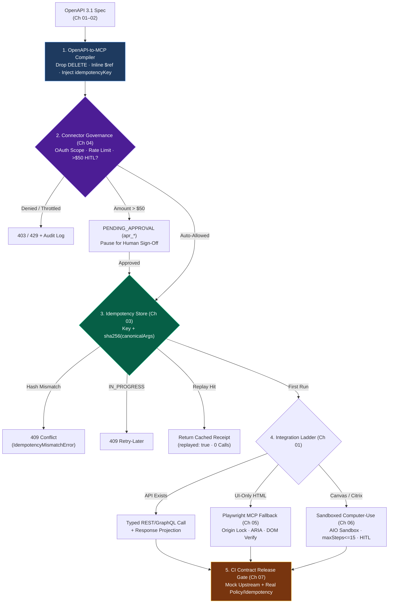

# Lecture 30 — Complete Notes
## Enterprise APIs, OpenAPI-to-MCP, Idempotency & Computer-Use Fallback

> **Phase:** 7 · Connectors, Code Mode & Proactive Workflows · **Level:** 🟠 Advanced
> **Scope:** Single-pass revision guide consolidating all seven chapter notes in this folder.
> **How to use this file:** Revise the end-to-end architecture, cheat sheet, and release-gate checks here; jump to any chapter file for full code, edge cases, and worked examples.

---

## 1. Executive Summary

**Thesis:** Raw enterprise REST/GraphQL endpoints and legacy UI portals are hostile to autonomous agents; production connectors must wrap them behind a deterministic **OpenAPI-to-MCP $\rightarrow$ Governance & Idempotency $\rightarrow$ Playwright DOM $\rightarrow$ Sandboxed Computer-Use** pipeline verified by contract evals.

**The lecture in five sentences:**

1. Raw enterprise APIs fail agents via **14 KB noisy payloads**, unbounded pagination, cryptic `422` errors, and unguarded mutations — requiring an **Agent-Readiness Audit** and the **API (MCP) $\rightarrow$ Playwright DOM $\rightarrow$ Visual Computer-Use** integration ladder.
2. An **OpenAPI-to-MCP Compiler** treats OpenAPI 3.1 specs as source code: it quarantines `DELETE`/admin routes, dereferences `$ref` schemas, enriches LLM descriptions, projects responses, and **auto-injects `idempotencyKey`** on mutations.
3. An **Idempotency Store** guarantees **exactly-once side effects** across network retries (`IN_PROGRESS` lock, `replayed: true` when `sha256(payload)` matches, and `409 Conflict` when a key is reused with different arguments).
4. **Connector Governance** enforces least-privilege OAuth scopes, per-connector rate limits/circuit breakers, structured audit logs (`traceId`, `callerId`, `idempotencyKey`, `approvalId`), and **deterministic HITL approval gates** (`> $50` $\rightarrow$ `PENDING_APPROVAL`).
5. When legacy systems lack APIs, **Playwright-behind-MCP** (origin-locked + semantic ARIA locators + post-submit DOM verification) and **sandboxed Computer-Use** (step-capped + VNC/AIO Sandbox + pre-submit HITL) bridge the gap, with all invariants proven in CI via a **4-Part Connector Release Gate**.

| Chapter | Core Topic | Link |
| :--- | :--- | :--- |
| **01** | Evaluating Enterprise APIs for Agent Readiness | [01_Evaluating_Enterprise_APIs_for_Agent_Readiness.md](./01_Evaluating_Enterprise_APIs_for_Agent_Readiness.md) |
| **02** | Automated OpenAPI-to-MCP Adaptation | [02_Automated_OpenAPI_to_MCP_Adaptation.md](./02_Automated_OpenAPI_to_MCP_Adaptation.md) |
| **03** | Idempotency Keys & Safe Retries on Mutations | [03_Idempotency_Keys_and_Safe_Retries_on_Mutations.md](./03_Idempotency_Keys_and_Safe_Retries_on_Mutations.md) |
| **04** | Approval-Bound Actions & Connector Governance | [04_Approval_Bound_Actions_and_Connector_Governance.md](./04_Approval_Bound_Actions_and_Connector_Governance.md) |
| **05** | Browser Automation Fallback (Playwright) | [05_Browser_Automation_Fallback_Playwright.md](./05_Browser_Automation_Fallback_Playwright.md) |
| **06** | Computer-Use Agents & Visual Grounding | [06_Computer_Use_Agents_and_Visual_Grounding.md](./06_Computer_Use_Agents_and_Visual_Grounding.md) |
| **07** | Production Connector Testing & Contract Evals | [07_Production_Connector_Testing_and_Contract_Evals.md](./07_Production_Connector_Testing_and_Contract_Evals.md) |

---

## 2. Master Architecture Diagram

---

## 3. Chapter-by-Chapter Short Revision Notes

### 3.1 Chapter 01 — Evaluating Enterprise APIs for Agent Readiness

Raw enterprise APIs built for web frontends fail agents in five predictable ways: 14 KB nested JSON responses (~3,500 tokens), unbounded pagination, cryptic `422` error codes, exposed `DELETE` routes, and missing idempotency on `POST` mutations. Before writing any adapter, audit every endpoint into four safety tiers and commit to the **Integration Ladder**: **Typed API (MCP) $\rightarrow$ Deterministic Playwright DOM $\rightarrow$ Visual Computer-Use**.

- **Response Projection:** Strip 14 KB payloads down to the 5–10 fields needed for reasoning (e.g., `orderId`, `status`, `amountUsd`, `eligibleForRefund`, `refundWindowDaysLeft` — ~90 tokens, 97% smaller).
- **Pagination & Errors:** Hard-cap `limit <= 20`, return `nextCursor` + `hasMore`, and translate internal codes (`E_4091`) into plain-English recovery hints.
- **4 Endpoint Tiers:** `Tier 1 Read-Only` | `Tier 2 Idempotent Mutation` ($\le \$50$) | `Tier 3 Approval-Bound` ($> \$50$) | `Tier 4 Quarantined` (`DELETE` / admin exports omitted from `tools/list`).

> 📖 **Need depth?** Read [Chapter 01 — Evaluating Enterprise APIs for Agent Readiness](./01_Evaluating_Enterprise_APIs_for_Agent_Readiness.md)

### 3.2 Chapter 02 — Automated OpenAPI-to-MCP Adaptation

Treat OpenAPI 3.1 specs as source code compiled through a 4-stage pipeline rather than a blind 1:1 dump. A blind conversion exposes destructive routes, leaves unresolved `$ref` pointers that break LLM tool validators, and dumps hundreds of terse endpoints into context.

- **4 Compilation Rules:** (1) Allow-list safe methods (`GET`, `POST`, `PATCH`) and drop `DELETE`; (2) inline/dereference all `$ref` schemas; (3) auto-inject `idempotencyKey` into `inputSchema.required` on mutations; (4) enrich descriptions with preconditions (`"Call get_order BEFORE create_refund"`) and `MUTATING ACTION` warnings.
- **The 50-Tool Ceiling:** Standard OpenAPI-to-MCP shines for focused connectors (5–40 endpoints); beyond ~50–100 endpoints, schema bloat triggers Lecture 31's **Code Mode (`openApiMcpServer`)**.

> 📖 **Need depth?** Read [Chapter 02 — Automated OpenAPI-to-MCP Adaptation](./02_Automated_OpenAPI_to_MCP_Adaptation.md)

### 3.3 Chapter 03 — Idempotency Keys & Safe Retries on Mutations

In distributed systems, networks fail *after* the upstream server commits. Because agentic orchestrators retry automatically on timeouts, any unguarded `POST /refunds` turns a transient blip into a double refund. Enforce an **Idempotency Store** (Redis/Postgres) at the MCP adapter boundary—even when the legacy upstream lacks `Idempotency-Key` support.

- **4 Mandatory Store States:** Missing key $\rightarrow$ `400 Bad Request`; concurrent `IN_PROGRESS` $\rightarrow$ `409 Retry-Later`; `COMPLETED` with matching `sha256(canonicalArgs)` $\rightarrow$ cached response (`replayed: true`, 0 upstream calls); key reuse with **different payload** $\rightarrow$ **`409 Conflict` (`IdempotencyMismatchError`)**.
- **Deterministic Key Derivation:** Never let the LLM invent random UUIDs on retry; derive `sha256(workflowRunId + ":" + stepId + ":" + toolName)` in the harness.

> 📖 **Need depth?** Read [Chapter 03 — Idempotency Keys & Safe Retries on Mutations](./03_Idempotency_Keys_and_Safe_Retries_on_Mutations.md)

### 3.4 Chapter 04 — Approval-Bound Actions & Connector Governance

Idempotency prevents accidental duplicates, not intentionally harmful or runaway mutations. **Connector Governance** lives in deterministic gateway code—never in the system prompt—and controls who can call what, at what rate, and when a human must sign off.

| Governance Pillar | Deterministic Control |
| :--- | :--- |
| **Scoped OAuth** | Per-connector least-privilege scopes (`orders:read`, `refunds:create`), never root keys |
| **Thresholded HITL** | `amountUsd > 50` returns `{ status: "PENDING_APPROVAL", approvalId }` cleanly (not an error) |
| **Rate & Circuit Limits** | Token-bucket cap (e.g., `20 req/min`) + open circuit after consecutive `5xx` errors |
| **Structured Audit Log** | Immutable record with `traceId`, `callerId`, `agentId`, `idempotencyKey`, `approvalId` |

> 📖 **Need depth?** Read [Chapter 04 — Approval-Bound Actions & Connector Governance](./04_Approval_Bound_Actions_and_Connector_Governance.md)

### 3.5 Chapter 05 — Browser Automation Fallback (Playwright)

When a legacy 2008 ERP portal has no API, wrap a deterministic **Playwright** script inside a typed, idempotent MCP tool (`submit_erp_credit_memo`). To the agent it looks like an API call, executing in 1–3 s at near-`$0` vision token cost while inheriting idempotency and audit trails.

- **3 Production Guardrails:** (1) **Origin Lock** via `ALLOWED_ORIGINS` + `page.route("**/*", ...)` aborting off-origin redirects; (2) **Semantic ARIA/Label Locators** (`getByLabel`, `getByRole`) instead of brittle CSS `nth-child`; (3) **Post-Submit DOM Verification** (`banner.waitFor()`) before marking idempotency `COMPLETED`, plus `page.close()` in `finally` to prevent OOMs.

> 📖 **Need depth?** Read [Chapter 05 — Browser Automation Fallback (Playwright)](./05_Browser_Automation_Fallback_Playwright.md)

### 3.6 Chapter 06 — Computer-Use Agents & Visual Grounding

Reserve **Visual Computer-Use** (VLM screenshot $\rightarrow$ coordinate `click(x, y)` loop) strictly for Citrix, `<canvas>`, or shifting layouts where both APIs and Playwright DOM fail. Because VLMs read raw pixels, any text rendered inside a ticket or webpage can execute **indirect screen prompt injection**.

- **Non-Negotiable Controls:** Run only in an isolated VM/container, cap `maxSteps <= 15` (and `maxDurationMs`), lock domains outside the VLM, and pause for **pre-submit HITL** with an annotated screenshot.
- **AIO Sandbox (`agent-infra/sandbox`):** Unifies **Browser (CDP/Playwright) + Shell + Filesystem (`/workspace`) + Jupyter + VS Code + VNC** in one container over MCP—enabling seamless browser-to-Python workflows and human VNC takeover for 2FA/CAPTCHAs.

> 📖 **Need depth?** Read [Chapter 06 — Computer-Use Agents & Visual Grounding](./06_Computer_Use_Agents_and_Visual_Grounding.md)

### 3.7 Chapter 07 — Production Connector Testing & Contract Evals

Never run PR CI against live production SaaS. Instead, mock only the upstream HTTP/browser boundary while running the **real** OpenAPI compiler, `hashPayload()`, `IdempotencyStore`, and policy evaluator in a `< 5 s` **4-Part Connector Release Gate** (saving live-sandbox smoke tests for nightly staging runs).

- **4 Release Gates:** (1) Compiler omits `DELETE` & requires `idempotencyKey`; (2) Retry with same key/payload executes upstream once (`replayed: true`); (3) Reusing key with altered `amountUsd` throws `409 Conflict`; (4) `> $50` returns `PENDING_APPROVAL` and Playwright blocks `https://evil.com` with `403 Forbidden Origin`.

> 📖 **Need depth?** Read [Chapter 07 — Production Connector Testing & Contract Evals](./07_Production_Connector_Testing_and_Contract_Evals.md)

---

## 4. Cheat Sheet & Common Traps

| Concept / Pattern | Key Rule / Formula | Common Trap to Avoid |
| :--- | :--- | :--- |
| **Integration Ladder** | Typed API (MCP) $\rightarrow$ Playwright DOM $\rightarrow$ Computer-Use | Jumping straight to Computer-Use for standard HTML forms |
| **OpenAPI-to-MCP** | Filter `DELETE`, inline `$ref`, inject `idempotencyKey`, project JSON | Blind 1:1 spec dump or exposing 200+ tools into `tools/list` |
| **Idempotency Key** | `sha256(runId + ":" + stepId + ":" + toolName)` | Letting the LLM invent random UUIDs (new key on re-plan!) |
| **Payload Hash Check** | Store `(key, sha256(canonicalArgs))`; reject mismatch with `409` | Returning cached `$45` receipt when agent retries with `$90` |
| **Approval Gate** | Enforce `> $50` $\rightarrow$ `PENDING_APPROVAL` in gateway code | Putting dollar caps only in the system prompt |
| **Playwright Fallback** | `ALLOWED_ORIGINS` + `page.route()` + `banner.waitFor()` | Returning `ok: true` right after `click()` or leaking `page` |
| **Computer-Use / AIO** | Isolated container, `maxSteps <= 15`, VNC for CAPTCHA/2FA | Running on a developer laptop or bypassing CAPTCHAs automatically |

---

## 5. Self-Check Questions (Release Gate Prep)

1. **Compiler Safety:** Why must an OpenAPI-to-MCP compiler never perform a blind 1:1 conversion of every route, and what happens if `$ref` pointers are left unresolved?
   - *Key check:* Blind 1:1 dumps expose `DELETE`/admin routes, omit `idempotencyKey`, and keep terse summaries; unresolved `$ref`s cause LLM tool-calling validators to reject or hallucinate arguments.
2. **Idempotency Edge Cases:** Trace what happens when an agent retries `create_refund` after a gateway timeout with (a) the exact same `idempotencyKey` and `amountUsd`, vs. (b) the same `idempotencyKey` and a different `amountUsd`.
   - *Key check:* (a) `sha256(canonicalArgs)` matches $\rightarrow$ returns cached receipt (`replayed: true`, 0 upstream calls); (b) hash mismatch $\rightarrow$ throws **`409 Conflict` (`IdempotencyMismatchError`)**.
3. **Harness vs. LLM Keys:** Why does letting the LLM generate a random UUID for `idempotencyKey` still cause double refunds during a retry/re-plan?
   - *Key check:* On re-plan, the LLM invents a *new* UUID, bypassing the store; derive deterministic keys in the harness via `sha256(runId + ":" + stepId + ":" + toolName)`.
4. **Governance Placement:** Why is `PENDING_APPROVAL` returned as a structured tool result rather than thrown as an exception, and why must dollar thresholds live in gateway code instead of the system prompt?
   - *Key check:* Throwing an exception triggers blind agent retry loops, whereas `PENDING_APPROVAL` pauses cleanly for HITL; system-prompt rules can be bypassed by prompt injection or arithmetic errors.
5. **Fallback Selection:** Why is deterministic Playwright-behind-MCP preferred over a visual Computer-Use agent whenever ARIA/label DOM selectors exist, and when does an **AIO Sandbox (`agent-infra/sandbox`)** become necessary?
   - *Key check:* Playwright runs in 1–3 s at near-`$0` vision tokens without screen-text prompt injection; AIO Sandbox is needed when workflows combine Browser downloads + Shell/Python processing + VNC HITL takeover in one `/workspace`.
6. **CI Contract Evals:** In your PR release gate, which components should be mocked and which components must remain real?
   - *Key check:* Mock only the upstream HTTP/browser boundary; keep the real OpenAPI compiler, `hashPayload()`, `IdempotencyStore`, and policy evaluator active.

---

## 6. Quick Reference: End-to-End Refund + Legacy ERP Flow

| Step | Layer | Input / Trigger | Output / Guarantee |
| :---: | :--- | :--- | :--- |
| **1** | `get_order` (Tier 1) | `orderId: "ORD-9042"` | Projected 6-field JSON (~90 tokens vs. 14 KB raw) |
| **2** | `create_refund` (Tier 2/3) | `amountUsd`, `idempotencyKey` | $\le \$50$ auto-runs; $> \$50$ returns `PENDING_APPROVAL` (`apr_*`) |
| **3** | Idempotency Store | `sha256(canonicalArgs)` | `IN_PROGRESS` lock; `replayed: true` on match; `409` on mismatch |
| **4** | `submit_erp_credit_memo` | `erp.internal` only | Origin-locked Playwright + ARIA locators + `banner.waitFor()` |
| **5** | Computer-Use / AIO | Citrix / `<canvas>` fallback | Isolated container, `maxSteps <= 15`, VNC for 2FA/HITL |
