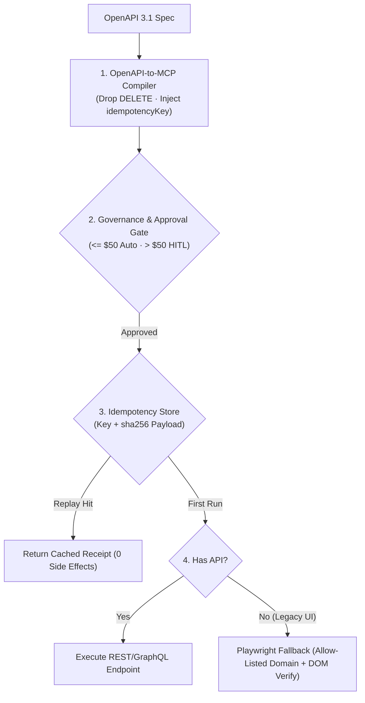

# Lecture 30 — Complete Notes
## Enterprise APIs, OpenAPI-to-MCP, Idempotency & Computer-Use Fallback

> **Phase:** 7 · Connectors, Code Mode & Proactive Workflows · **Level:** 🟠 Advanced
> **Scope:** A single-pass consolidation of the seven chapter notes in this folder.
> **How to use this file:** Read it to *revise and navigate*. Every section links back to the chapter that explains it in full.
>
> | Chapter | File |
> | :--- | :--- |
> | 01 · Evaluating enterprise APIs for agent readiness | [01_Evaluating_Enterprise_APIs_for_Agent_Readiness.md](./01_Evaluating_Enterprise_APIs_for_Agent_Readiness.md) |
> | 02 · Automated OpenAPI-to-MCP adaptation | [02_Automated_OpenAPI_to_MCP_Adaptation.md](./02_Automated_OpenAPI_to_MCP_Adaptation.md) |
> | 03 · Idempotency keys & safe retries on mutations | [03_Idempotency_Keys_and_Safe_Retries_on_Mutations.md](./03_Idempotency_Keys_and_Safe_Retries_on_Mutations.md) |
> | 04 · Approval-bound actions & connector governance | [04_Approval_Bound_Actions_and_Connector_Governance.md](./04_Approval_Bound_Actions_and_Connector_Governance.md) |
> | 05 · Browser automation fallback (Playwright) | [05_Browser_Automation_Fallback_Playwright.md](./05_Browser_Automation_Fallback_Playwright.md) |
> | 06 · Computer-Use agents & visual grounding | [06_Computer_Use_Agents_and_Visual_Grounding.md](./06_Computer_Use_Agents_and_Visual_Grounding.md) |
> | 07 · Production connector testing & contract evals | [07_Production_Connector_Testing_and_Contract_Evals.md](./07_Production_Connector_Testing_and_Contract_Evals.md) |

---

## 1. Executive summary

**The lecture in five sentences.**

1. Raw enterprise REST/GraphQL endpoints fail as agent tools due to noisy payloads, unbounded pagination, cryptic errors, and unguarded side effects — requiring the **API (MCP) $\rightarrow$ Playwright DOM $\rightarrow$ Visual Computer-Use** integration ladder.
2. An **OpenAPI-to-MCP Adapter** compiles OpenAPI 3.1 specs into typed MCP tools while **filtering out `DELETE` routes**, projecting concise responses, and **auto-injecting `idempotencyKey`** on mutations.
3. An **Idempotency Store** guarantees **exactly-once side effects** on retries (`replayed: true` when payload matches; `409 Conflict` when a key is reused with different arguments).
4. **Connector Governance** enforces scoped OAuth permissions, value-based **HITL approval thresholds** (`> $50` $\rightarrow$ `PENDING_APPROVAL`), rate limits, and structured audit logs.
5. When legacy portals lack APIs, **Playwright fallback** (locked to allow-listed domains + idempotency + post-submit DOM checks) and **sandboxed Computer-Use** bridge the gap safely.

---

## 2. The arc of the lecture in one diagram

---

## 3. Cheat sheet

| Concept | One-line definition | Chapter |
| :--- | :--- | :--- |
| **Integration Ladder** | Typed API (MCP) $\rightarrow$ Playwright DOM $\rightarrow$ Visual Computer-Use | [01](./01_Evaluating_Enterprise_APIs_for_Agent_Readiness.md) |
| **OpenAPI-to-MCP** | Compiling OpenAPI 3.1 into filtered, hardened, typed MCP tools | [02](./02_Automated_OpenAPI_to_MCP_Adaptation.md) |
| **Idempotency Store** | Caching `(key, sha256(payload)) -> response` for exactly-once retries | [03](./03_Idempotency_Keys_and_Safe_Retries_on_Mutations.md) |
| **409 Conflict** | Rejecting key reuse when the request payload differs | [03](./03_Idempotency_Keys_and_Safe_Retries_on_Mutations.md) |
| **Approval-Bound Mutation** | Pausing high-value actions (`> $50`) for HITL sign-off | [04](./04_Approval_Bound_Actions_and_Connector_Governance.md) |
| **Playwright Fallback** | Deterministic, domain-locked browser automation wrapped as an MCP tool | [05](./05_Browser_Automation_Fallback_Playwright.md) |
| **Computer-Use** | Screenshot-to-coordinate VLM loop for Canvas/Citrix, sandboxed + HITL | [06](./06_Computer_Use_Agents_and_Visual_Grounding.md) |
| **AIO Sandbox (`agent-infra/sandbox`)** | Unified Browser (CDP/VNC) + Shell + Filesystem + Jupyter over MCP | [06](./06_Computer_Use_Agents_and_Visual_Grounding.md) |

---

## 4. Self-check questions (Release Gate Prep)

1. Why should an OpenAPI-to-MCP compiler never do a blind 1:1 conversion of every route?
2. What happens when an agent retries `create_refund` after a network timeout with the same `idempotencyKey` vs. a different `amountUsd`?
3. Why is deterministic Playwright-behind-MCP preferred over a visual Computer-Use agent whenever DOM selectors exist?

