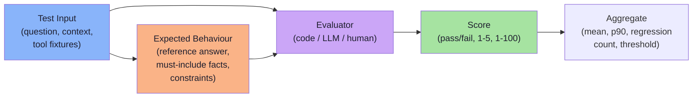
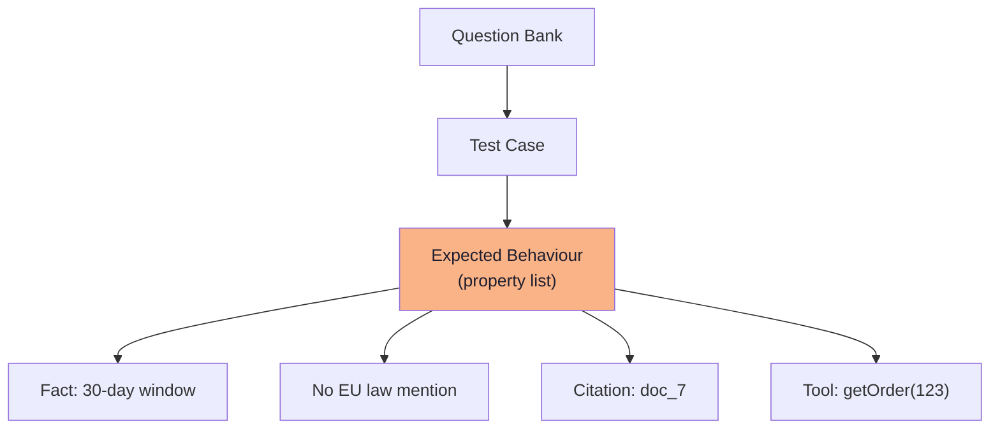
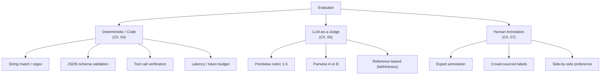
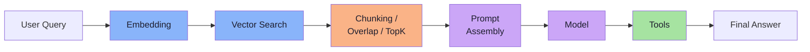
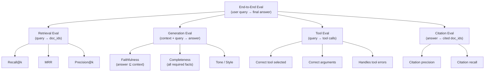
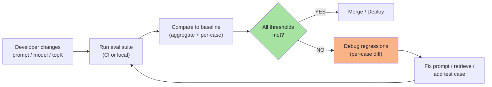

# Chapter 02: Anatomy of an Eval — Test Input, Expected Behaviour, Evaluator

> **Chapter Goal:** Chapter 01 showed *why* normal testing breaks. This chapter shows *what an eval actually is* — the four pieces that must exist before any measurement can be meaningful, and why we evaluate the **whole system** (prompt + retrieval + tools + model), not just the model in isolation.
>
> At the end you should be able to write the **eval spec** for a new feature: given a product requirement, produce the dataset, the expected behaviour, and the evaluator that will tell you whether the change improved or regressed the system.

---

## 2.1 The Four Components of Every Eval

An evaluation is not a model call. An evaluation is a **repeatable procedure** that takes a test case and returns a score. Every eval — deterministic or quality, unit or end-to-end — has exactly four parts:



| # | Component | What it is | Example |
|---|---|---|---|
| 1 | **Test Input** | The exact prompt, context, conversation history and any tool fixtures the system will receive | `"What is the refund policy?"` + retrieved chunks + `orderId=123` |
| 2 | **Expected Behaviour** | The *property* the output must satisfy — not the exact text | `"Answer must state 30-day window"`, `"Must not mention EU law"` |
| 3 | **Evaluator** | The mechanism that decides: code, an LLM judge, or a human | `contains("30 days")`, LLM rubric 1–5, annotator label |
| 4 | **Score** | The result of the evaluator — always a number or pass/fail | `1.0`, `4 / 5`, `PASS`, `0.87` |

**No component is optional.** If you have inputs but no expected behaviour, you have a smoke test, not an eval. If you have expected behaviour but no evaluator, you have a wish list.

---

## 2.2 Test Input — What the System Actually Sees

The test input must capture **everything that reaches the model at inference time**. For a RAG chatbot that means:

```typescript
interface TestInput {
  // The user's literal question
  userQuery: string;

  // Conversation history if the system is multi-turn
  history?: ChatMessage[];

  // Retrieved context — the *exact* chunks that will be injected
  // This is critical: the eval must use the same retrieval the prod system uses
  retrievedChunks: RetrievedChunk[];

  // Tool fixtures — what the tools will return when called
  toolFixtures: Record<string, ToolResult>;

  // Any system / developer prompt fragments
  systemPrompt?: string;

  // Metadata for slicing (domain, difficulty, language, etc.)
  metadata: TestCaseMetadata;
}
```

> **Key insight from FDE L17:** the test input is **not just the user question**. It is the *entire assembled prompt*. If you evaluate with a hand-crafted context but production retrieves a different one, your eval is measuring a different system.

---

## 2.3 Expected Behaviour — Properties, Not Strings

Because `Expected Output == Actual Output` is broken (Chapter 01), we express expectations as **checkable properties**.

| Type of expectation | Example |
|---|---|
| **Must-include fact** | Answer contains "30 days" |
| **Must-not-include** | Answer does not contain "EU regulation" |
| **Structural constraint** | Output is valid JSON matching `OrderSchema` |
| **Tool call expectation** | `getOrderStatus` is called with `orderId=123` |
| **Style / tone** | Answer uses professional tone, no emojis |
| **Refusal condition** | If query is off-topic, model says "I can't help with that" |
| **Citation requirement** | Every factual claim has a `[doc_id]` citation |



> **Anti-pattern:** "The answer should be helpful." — *Not checkable.*
> **Good:** "The answer states the 30-day return window, cites `doc_7`, and does not mention EU law." — *Every clause is checkable.*

---

## 2.4 Evaluator — The Mechanism That Decides

The evaluator is the function `Evaluator(testInput, systemOutput, expectedBehaviour) → Score`. There are three families:



| Family | Speed | Cost | Nuance | Use when |
|---|---|---|---|---|
| **Code** | Instant | Free | Low | Facts, structure, tool calls, latency |
| **LLM Judge** | Seconds | $/1k | Medium | Style, tone, completeness, faithfulness |
| **Human** | Hours | $$$ | High | Gold labels, calibration, edge cases |

> **Rule from FDE L17:** *start with code evaluators*. They are free, instant and perfectly reproducible. Only escalate to LLM or human when a property genuinely requires semantic judgement.

---

## 2.5 Why We Evaluate the Whole System, Not Just the Model

The board in FDE L17 draws a RAG pipeline and labels every box as a source of quality variance:



Each arrow is a place where a change can silently move quality:

| Component | What it controls | Failure mode if changed without evals |
|---|---|---|
| **Embedding model** | Semantic similarity space | Different documents retrieved |
| **Vector search (index, metric)** | Which vectors are near | Different ranking, different topK |
| **Chunking / overlap / topK** | Context window content | Evidence lost or diluted |
| **Prompt assembly** | Instruction phrasing, few-shots | Model follows different rules |
| **Model (version, temp)** | Generation distribution | Different facts, style, refusals |
| **Tools (availability, specs)** | External actions | Silent fallbacks, wrong calls |

> **FDE L17 principle:** *You do not evaluate the model. You evaluate the application.* The model is one component. If you swap the embedding model and do not re-run the eval, you have shipped an unmeasured change.

---

## 2.6 The Eval Spec — A Template You Can Copy

Every new feature should start with an **eval spec** — a short document that fixes the four components before any code is written.

```markdown
# Eval Spec: Refund Policy QA

## 1. Test Inputs
- 50 real customer questions about refunds (from support logs)
- Each case includes: userQuery, expected retrieved doc_ids, order fixtures
- Metadata: {domain: "refund", difficulty: "easy|medium|hard", language: "en"}

## 2. Expected Behaviours (per case)
- MUST_INCLUDE: "30 days", "original receipt"
- MUST_NOT_INCLUDE: "lifetime", "no questions asked"
- CITATION_REQUIRED: at least one doc_id from expected set
- TOOL_CALL: getOrderStatus(orderId) if orderId mentioned
- REFUSAL: if question is about warranty, respond with handoff phrase

## 3. Evaluators
- deterministic: fact_inclusion, citation_check, tool_call_check, json_schema
- llm_judge (1-5): tone_professional, completeness
- human: side-by-side vs previous version (calibration set of 20)

## 4. Thresholds (release gate)
- fact_inclusion >= 0.95
- citation_check >= 0.90
- llm_judge tone >= 4.0 mean, no case < 3
- zero regressions on calibration set

## 5. Baseline
- Current production version scores attached
- Re-run on every prompt/model/retrieval change
```

---

## 2.7 Common Mistakes in Eval Design

| Mistake | Why it breaks the eval | Fix |
|---|---|---|
| Test input is only the user question | Ignores retrieval, history, tools → measures a different system | Include full assembled context in the test case |
| Expected behaviour is a reference answer string | Fails on valid paraphrases | Write checkable properties (must-include, must-not, structure) |
| Evaluator is "vibes" | No baseline, no diff, no automation | Pick code / LLM / human explicitly per property |
| Evaluating only the final answer | Misses tool calls, citations, retrieval quality | Add intermediate assertions (tool called?, correct docs retrieved?) |
| One eval for the whole product | Cannot isolate which component regressed | Decompose: retrieval eval, generation eval, tool eval, end-to-end eval |
| No metadata on test cases | Cannot slice by difficulty, domain, language | Tag every case; report per slice |

---

## 2.8 Decomposing System Evals Into Component Evals

Because the whole system has many moving parts, a mature eval suite runs **multiple evals at different granularities**:



| Eval level | What it catches | Typical evaluator |
|---|---|---|
| **Retrieval** | Embedding drift, index corruption, topK too small | Code (recall@k, MRR) |
| **Generation** | Hallucination, missing facts, tone drift | LLM judge (faithfulness, completeness) |
| **Tool** | Wrong tool, bad args, unhandled errors | Code (schema match, arg values) |
| **Citation** | Fake citations, missing evidence | Code + LLM (citation precision/recall) |
| **End-to-end** | Integration bugs, cascading failures | Mix of all above |

> **Practical rule from FDE L18:** run retrieval eval *every commit* (it's fast and deterministic). Run generation eval *every PR*. Run full end-to-end *nightly* or *on release candidate*.

---

## 2.9 The "Eval Loop" — How It Fits in Development



This loop is exactly the same shape as a traditional test suite — the only difference is that the assertions are **property-based** and the result is **aggregated with thresholds** instead of a binary pass/fail.

---

## 2.10 Pseudo-Code: The Minimal Eval Runner

```typescript
// The four components, wired together
interface EvalCase {
  input: TestInput;
  expected: ExpectedBehaviour;
}

interface EvalResult {
  caseId: string;
  scores: Record<string, number | boolean>;
  output: SystemOutput;
  passed: boolean;  // all thresholds met for this case
}

interface EvalSuite {
  name: string;
  cases: EvalCase[];
  thresholds: Record<string, number>;  // metric -> minimum
  evaluators: Evaluator[];
}

async function runEval(suite: EvalSuite, system: SystemUnderTest): EvalReport {
  const results: EvalResult[] = [];

  for (const tc of suite.cases) {
    // 1. Run the system with the exact test input
    const output = await system.run(tc.input);

    // 2. Score with every evaluator
    const scores: Record<string, number | boolean> = {};
    for (const ev of suite.evaluators) {
      scores[ev.name] = await ev.score(tc.input, output, tc.expected);
    }

    // 3. Per-case pass = all thresholds met
    const passed = Object.entries(suite.thresholds).every(
      ([metric, thresh]) => (scores[metric] as number) >= thresh
    );

    results.push({ caseId: tc.input.id, scores, output, passed });
  }

  // 4. Aggregate
  const aggregates = aggregateScores(results, suite.evaluators);
  const regressions = findRegressions(results, suite.baseline);

  return { suite: suite.name, results, aggregates, regressions, timestamp: Date.now() };
}
```

---

## 2.11 Chapter Summary

| Concept | Takeaway |
|---|---|
| **Four components** | Test Input, Expected Behaviour, Evaluator, Score — all required |
| **Test input = full prompt** | Not just the user question; includes retrieval, history, tool fixtures |
| **Expected behaviour = properties** | Must-include, must-not, structure, tool calls, citations — never exact strings |
| **Three evaluator families** | Code (fast, free), LLM Judge (semantic), Human (gold standard) |
| **Evaluate the whole system** | Model is one component; embedding, retrieval, chunking, prompt, tools all affect quality |
| **Eval spec first** | Write the spec before code; it is the contract the system must satisfy |
| **Decompose** | Retrieval eval + Generation eval + Tool eval + Citation eval + End-to-end eval |
| **Eval loop** | Change → Run → Compare to baseline → Gate → Debug → Fix → Repeat |

---

## Where This Goes Next

- **[Chapter 03](./03_Evaluation_Datasets_And_Golden_Data.md)** — building the dataset that makes comparison possible: golden data, adversarial cases, slicing metadata, versioning.
- **[Chapter 04](./04_Deterministic_Evaluation.md)** — the first evaluator family: everything code can decide with zero ambiguity.
- Cross-lecture: [Lecture 12](../../Lecture%2012/notes/README.md) (retrieval levers: chunking, hybrid search, reranking), [Lecture 03](../../Lecture%2003/notes/README.md) (prompt engineering patterns that become eval properties), [Lecture 11](../../Lecture%2011/notes/README.md) (structured outputs as deterministic eval targets).

---

**Back to:** [Lecture 30 — Chapter Index](./README.md)