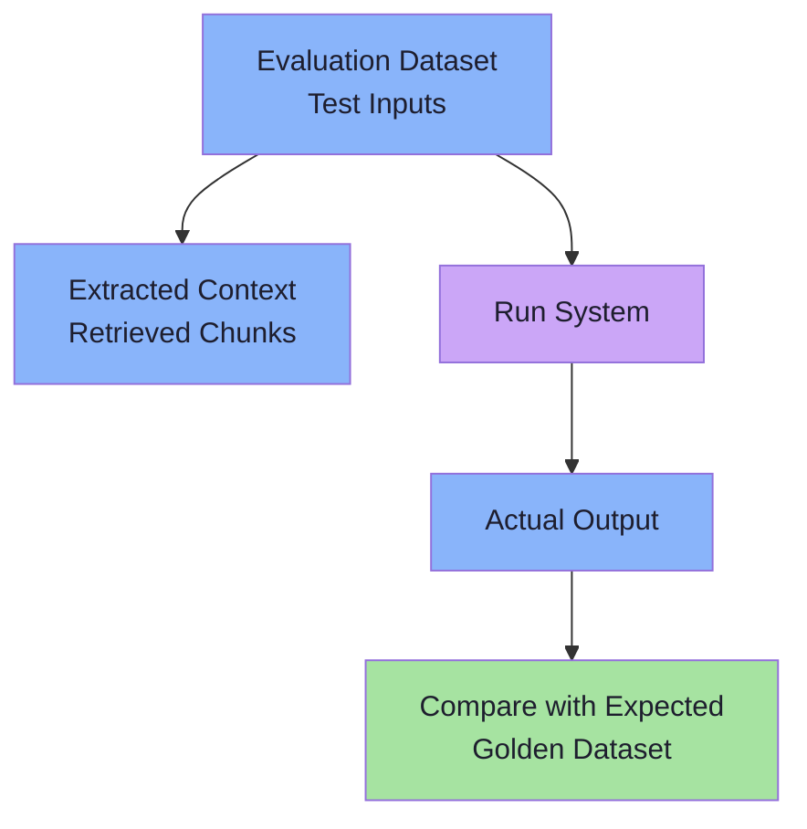
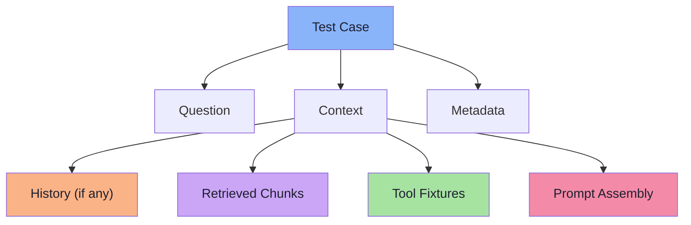
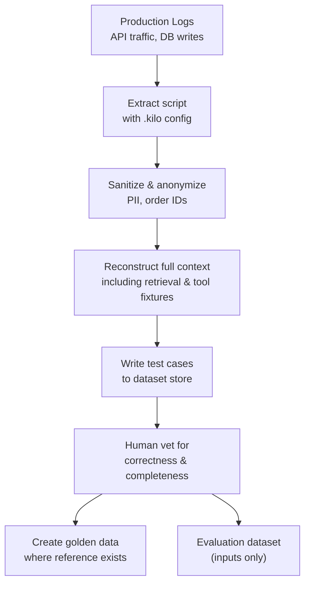
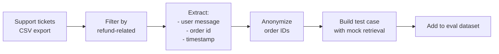

# Chapter 03: Evaluation Datasets and Golden Data — The Foundation of Comparison

> **Chapter Goal:** An eval without an evaluation dataset is a wish list. The dataset is the *stable, versioned benchmark* that lets you compare today’s system against yesterday’s, and prove that your changes actually improved (or broke) something.
>
> This chapter teaches how to build both the **evaluation dataset** (every test case) and the **golden dataset** (the high-quality reference the system should match). It shows you how to slice the dataset for reporting, and how to version it so every change becomes traceable.

---

## 3.1 What Is an Evaluation Dataset? What Is a Golden Dataset?

| Concept | When to use | Contents |
|---|---|---|
| **Evaluation dataset** | Every eval run | Test inputs only (question + context + history + fixtures) |
| **Golden dataset** | Reference for quality evals (faithfulness, factuality, style, tool) | Test inputs **+** reference answers, expected behaviours, or gold-standard outputs |

> **The difference is subtle but critical:** the evaluation dataset lets you know *did the system behave consistently?* The golden dataset lets you know *did the system answer correctly?* 



*If you only have the evaluation dataset, you can measure consistency, but not correctness.*
*If you also have the golden dataset, you can measure both.*

---

## 3.2 The Anatomy of a Test Case

A test case is a **snapshot of a production event**. It must be copy-paste reproducible: everything that the system saw at inference time, plus everything the evaluator needs to score it.

```typescript
interface TestCase {
  // Unique identifier for the dataset (not the question)
  id: string;  // e.g. "test_case_123"
  // The actual question or request from a user / support ticket / API log
  question: string;
  // The full context the system should have seen at inference
  context: TestContext;
  // Metadata for slicing: difficulty, domain, language, etc.
  metadata: {
    domain: "refund" | "billing" | "technical";  // business area
    difficulty: "easy" | "medium" | "hard";       // human-annotated or algorithmic
    language: "en" | "es" | "fr";                  // query language
    source: "support_log" | "forum" | "synthetic"; // where it came from
    priority: number; // 1 = critical, 5 = low
  };
}
```



> **FDE L17 emphasis:** The *context* is **the exact assembled prompt**. This means you must snapshot retrieval results and any tool fixtures the system would have received — not just the user question.

---

## 3.3 Sources of Test Cases

| Source | Pros | Cons | Best practices |
|---|---|---|---|
| **Production logs** | Real usage, naturally varied | Requires extraction, privacy check | Redact PII, mask order IDs, anonymize emails |
| **Support tickets** | Problem-driven, highlights edge cases | Structured, may not reflect natural phrasing | Include full conversation thread |
| **User surveys / feedback** | Direct user intent | Low scale, self-reported | Filter for high-quality queries (grade by human) |
| **Synthetic generation** | Unlimited scale, can target edge cases | May drift from reality | Ground in real usage; use models to generate then human filter |
| **Crowdsourced labeling** | Diverse annotators, large N | Inconsistent quality, bias | Calibrate; use high-quality subset as gold |

> **Framing:** Treat the dataset as **one of your source code files** — version it, test it, and store it in a place where you can run it reproducibly.

---

## 3.4 Golden Data — Reference Answers & Expected Behaviours

When you have a golden dataset, you can measure **quality** (did the model get it right?). The golden data includes:

| Golden data type | When to use | Example |
|---|---|---|
| **Reference answer** | Exact fact-checking | "Products can be returned within 30 days of delivery." |
| **Document snippet** | Citation verification | `[doc_7] Customers have up to 30 days from delivery to initiate a return.` |
| **Structured output** | Schema validation | `{"refund_period": 30, "requires_receipt": true}` |
| **Style template** | Tone / formatting | "Hi [Customer], ... thanks!" |
| **Tool call signature** | Behaviour verification | `{tool: "getOrderStatus", args: {orderId: 123}}` |

> **FDE L17 point:** *Golden dataset is a statement of ground truth.* It is not a “suggested answer”. It must be authoritative, e.g. a legal document, a known database row, or a human-verified fact.

---

## 3.5 Building the Dataset — The Workflow

### Step 1: Extract from Production

> **Tool:** Use existing log parsers to extract `{question, conversationHistory, toolsUsed, orderId, metadata}`.



### Step 2: Add Synthetic Cases

> Use code or LLMs to generate queries that cover edge cases not seen in logs: “refund policy for EU customers”, “what if no order exists?”, “refund for digital goods?”.

```typescript
// Example of a synthetically generated test case
const syntheticCase: TestCase = {
  id: "synth_refund_eu",
  question: "What is the refund policy for customers in the EU?",
  context: {
    history: [],
    retrievedChunks: [],
    toolFixtures: { getCustomerRegion: () => "EU" }
  },
  metadata: {
    domain: "refund",
    difficulty: "medium",
    language: "en",
    source: "synthetic",
    priority: 2
  }
};
```

### Step 3: Human Review / Calibration

> **FDE L17 lesson:** quality evals need human-annotated gold labels. Use a calibration set of ~5% of the dataset, label with multiple annotators, compute agreement (`kappa`), and only use high-agreement cases for model evaluation.

### Step 4: Version & Store

> **Key:** Every eval run must be on a **fixed version**. Store the dataset as JSON, CSV, or protobuf with a `version` field. For large datasets, use object storage (S3, GCS) and mount it in CI.

```text
/dataset/
  v1/
    cases_001.json
    golden_001.json
    metadata_001.json
  v2/  // created after adding new edge cases
    cases_002.json
    golden_002.json
    metadata_002.json
```

> **FDE L18 practical note:** In the actual slides, FDE L18 uses a real dataset structure from a Git repo. It does the following in the `eval dataset:

- A list of `test_cases` each with a `query`, a `ground_truth` (golden data), `metadata`, and `expected_tools`.
- The `ground_truth` includes not just the answer but also `evidence` and `source_ids`.
- The `metadata` includes `domain`, `difficulty`, `language`, and `source`. They use the dataset in CI to compute metrics like `faithfulness`, `answer_relevance`, and `tool_accuracy`.

So they have a **single structure** that stores both the test input (query + context) and the golden data (ground truth + evidence) together. That's a pragmatic compromise: you only need one dataset to produce both the evaluation dataset (inputs) and the golden dataset (expected behaviours), as long as you treat the golden fields as the reference.

### Step 5: Slicing & Reporting

> Your reporting must answer *who* and *what* questions. Use metadata to slice the dataset.

```typescript
// Example slicing
slices = {
  "domain": ["refund", "billing", "technical"],
  "difficulty": ["easy", "medium", "hard"],
  "language": ["en", "es", "fr"]
};
```

Reporting example:

```text
domain: refund
  faithfulness: 0.94 / 1.0
  answer_relevance: 0.87 / 1.0
  tool_accuracy: 0.96 / 1.0
  regressions: 2 / 500

difficulty: hard
  faithfulness: 0.71 / 1.0
  answer_relevance: 0.62 / 1.0
```

> **FDE L17 clarity:** *slice by metadata.* It is the only way to know if a change improved the easy cases but broke the hard ones.

---

## 3.6 Practical Example — Building a Dataset for a RAG Chatbot

> **Setting:** Refund policy RAG bot that pulls from PDF docs and calls `getOrderStatus` for order-specific questions.

### 3.6.1 Extraction from Real Support Tickets



### 3.6.2 Retrieval Snapshot

```typescript
// The golden dataset stores the doc_ids the retrieval should have returned
// This is the ground truth for recall@k evals
const goldenRetrieval = {
  doc_ids: ["policy.pdf:30-day", "faq.pdf:return-process"],
  order_id: "12345"
};
```

### 3.6.3 Tool Fixtures

```typescript
// Golden tool results (from real API responses)
const goldenTool = {
  getOrderStatus: {
    orderId: "12345",
    status: "shipped",
    eligibleForReturn: true,
    returnWindowDays: 30
  }
};
```

### 3.6.4 Expected Behaviour (Golden Data)

```typescript
// Reference answer: must include 30-day window, citation, no mention of EU law
const goldenAnswer = {
  text: "You can return your product within 30 days of delivery.",
  citations: ["policy.pdf:30-day"],
  restrictions: [],
  toolCalled: false
};
```

### 3.6.5 Metadata for Slicing

```typescript
const metadata = {
  domain: "refund",
  difficulty: "medium",
  language: "en",
  source: "support_log",
  priority: 1
};
```

---

## 3.7 Dataset Quality Checks

| Check | What it catches | How to run |
|---|---|---|
| **Format validation** | Missing fields, wrong types | Static type check; `ajv` schema validation |
| **Context completeness** | Missing retrieval, missing tool fixtures | Assert that `context.retrievedChunks.length > 0` |
| **Ground truth integrity** | Empty references, contradictory golden data | Human review of a sample (e.g., 5%) |
| **Consistency across versions** | Golden answer changes without version bump | Compare hashes of golden data between versions |
| **Reproduction** | Cannot regenerate the same output | Run system on test case; compare to stored golden output (if deterministic) |

---

## 3.8 Versioning the Dataset

> **FDE L18 simple rule:** treat the dataset exactly like source code — commit to git, tag releases, use semantic versioning (`v1.2.0`).

```bash
# Example dataset structure
git add dataset/
# `dataset/` contains:
#   v1.2.0/
#     test_cases.json
#     golden_data.json
#     metadata.json
#   README.md
#   schema.json
```

**Tagging:**

```bash
git tag -a v1.2.0 -m "Add 50 support‑ticket questions, golden reference answers for refund cases"
git push origin v1.2.0
```

**When to version:**

- New test cases (especially edge cases)
- Golden answer updates (e.g., policy changed)
- Metadata schema changes (new fields)
- Intentional dataset reshuffle (e.g., different retrieval strategy)

---

## 3.9 Example Dataset File Structure

```text
/FDE-and-GenAI-Mastery/Lecture 30 - Evals and Testing/dataset/
├── README.md                     # How to load, version, slice
├── v1.0.0/
│   ├── test_cases.json          # List of test inputs (questions + contexts)
│   ├── golden_data.json          # Reference answers / expected behaviours
│   └── metadata.json             # Domain, difficulty, language, source, priority
├── v1.1.0/                        # After adding synthetic edge cases
│   ├── test_cases.json
│   ├── golden_data.json
│   └── metadata.json
└── v2.0.0/                        # After policy change updates golden data
    ├── test_cases.json
    ├── golden_data.json
    └── metadata.json
```

> **Practical tip:** Keep the `dataset/` under version control and point your CI to the tag you want to evaluate against. This is the same model as code: you checkout a tag, run tests, and ship the version.

---

## 3.10 Chapter Summary

| Concept | What it gives you |
|---|---|
| **Evaluation dataset** | Fixed inputs for measuring consistency |
| **Golden dataset** | Reference truth for measuring correctness |
| **Test case** | Complete snapshot of a production event (question + full context) |
| **Metadata** | Allows slicing and targeted reporting (domain, difficulty, language) |
| **Dataset building workflow** | Extract → Enrich → Vet → Version → Slice → Report |
| **Retrieval snapshot** | Stores which document IDs the system *should* have seen |
| **Tool fixtures** | Deterministic mocks for external API calls |
| **Dataset quality** | Validation, sample review, and consistency checks |
| **Versioning** | Git tags, semantic versioning, reproducible runs |

---

## Where This Goes Next

- **[Chapter 04](./04_Deterministic_Evaluation.md)** — the first evaluator family: everything code can decide with zero ambiguity.
- **[Chapter 05](./05_AI_Quality_Metrics.md)** — the metrics we will score (relevance, correctness, faithfulness, …).
- Cross-lecture: [Lecture 12](../../Lecture%2012/notes/README.md) (chunking & retrieval levers), [Lecture 03](../../Lecture%2003/notes/README.md) (prompt design patterns that become eval properties), [Lecture 13](../../Lecture%2013/notes/README.md) (structured outputs as deterministic eval targets).

---

**Back to:** [Lecture 30 — Chapter Index](./README.md)